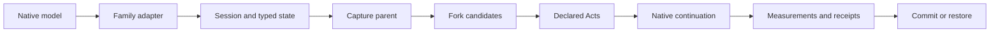

# Models as software

Saturn gives native execution a small, explicit transaction boundary:

The researcher chooses an observable and consumer. An adapter exposes supported state
addresses and continuation boundaries. A Session captures the parent, forks isolated candidates,
applies declared changes, runs the native suffix, and records decisions. The same process can
inspect inference, build experiments, and evaluate candidate training updates.

## Six primary concepts

| Concept | Responsibility |
| --- | --- |
| Adapter | Validate family state; expose addresses; execute one native transition |
| Session | Own branch state and transaction lifecycle around one resident adapter |
| Frame | Describe the current boundary and slot fingerprints |
| Act | Declare reads, writes, invalidations, parameters, and numerical intent |
| StateCut | Seal a restorable state closure to model, execution, and parent identity |
| Receipt | Preserve immutable JSON evidence about an operation |

Descriptors are frozen, but Python tensors are mutable. Public payload/read methods return
copies; sealed cuts verify content before use. Direct access to private fields is outside the API.
Adapters are trusted in-process code, and callable Acts can execute Python. Declared input
visibility is not an OS sandbox or a security boundary against hostile code.

## AR and diffusion

Qwen uses `embedding → layer 0 … layer N → normalization/readout → token commit`.
At a token boundary, K/V covers every token except the pending final token. During a layer
transition, processed layers have staged the pending token's K/V; later layers have not.
The StateCut captures that mixed layer closure and the live hidden carrier. A changed carrier
continues through the remaining native layers rather than replaying a monolithic surrogate.

DDIM uses `conditioning + latent + timestep → native UNet → native scheduler → new latent`.
The cut includes conditioning, scheduler configuration binding, timesteps, cursor, and RNG.
The deterministic eta-zero lane has no evolving multistep solver history. Other schedulers
need adapters that explicitly capture their own history; they are refused by this adapter.

For Stable Diffusion, supplied conditioning is consumed by the native conditional UNet, and
the final latent is decoded by the supplied native VAE. Prompt encoding stays in the caller's
pipeline. V1 does not implement classifier-free guidance or promise pipeline-default parity.

## Investigation, compilation, and execution

The original Mimas work compiled behavioral questions into bounded causal panels. The public
Investigation keeps that useful unit: named arms, same parent, explicit intervention and native
continuation, per-arm metrics, and retained errors. Hyperion's contribution was context-qualified
programs over measured response surfaces. The public Program deliberately supports only an
ordered pre-continuation schedule already measured by a panel, bound to its exact recipient
state and named context. General temporal lowering and learned compilation are extensions.

The historical final-boss investigations motivate ordered consumer-relative paths, rather than
one universal final layer. A weak or failed certificate does not establish mechanism absence.

DependencyGraph is the small public VM partial evaluator. Cells declare input dependencies and
implementation versions. Changed inputs propagate through the dirty closure. The exact local
cache never skips the final consumer. Feedback through a diffusion scheduler creates a new
latent input on the next step, so it invalidates dependent denoising work.

Model OS authority lives in the Session: compatibility, supported write addresses, candidate
preview through a fork, parent-bound commit, and verified restore. There is no second executor.
Thott/Future Forest ideas appear as state ancestry and retained branch/cut objects. Historical
branches are retained in memory; durable retention is explicit through LocalStore.
Explicit `capture()` retains the cut in Session.history. Internal transition bookkeeping retains
fingerprints in receipts rather than accumulating every dense state payload. Discard unneeded
branch objects and clear history when their snapshots are no longer required.

## Memory hierarchy

Experimental shared memory represents `history = actual ancestor + private tail`. It stores
the ancestor once and consumes segments under one global softmax. Storage sharing does not
reduce the number of attention rows. Context still obeys the checkpoint's position limit.

PhaseLaw demonstrates exact integer phase composition and local-frame query transport without
rewriting immutable keys. The shared Qwen example retains original post-RoPE positions and
does not use PhaseLaw. Combining these two mechanisms needs a separate numerical ABI.

Independently compiling A and B then mounting their pages generally differs from prefill(A+B).
B's hidden states depend on A. Correct rotation cannot reconstruct that causal interaction.
Selected-context memory therefore requires a separate consumer experiment and quality policy.

## What is intentionally outside v1

The public repository excludes the historical experiment fleet, advanced Hyperion atlases,
learned Registrar, Black Mamba, CUDA virtual-address aliasing, continuous batching, arbitrary
model lowering, remote stores, and production permission systems. Its extension seam is the
Adapter protocol, not a promise that every private prototype already has a public implementation.
