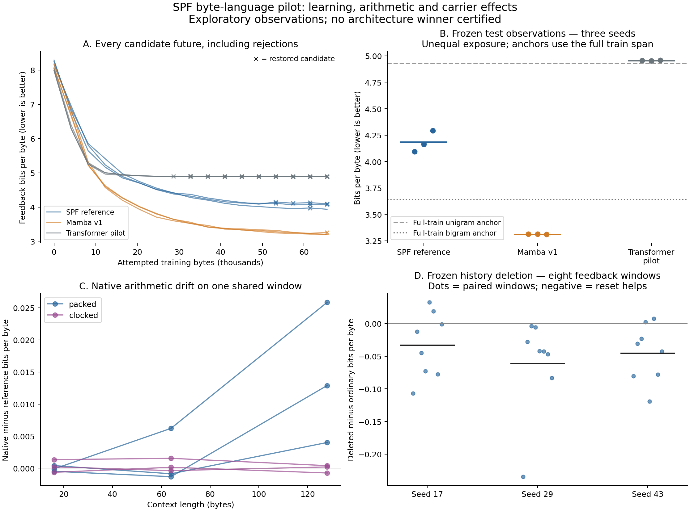

# SPF sequence-model experiments, 2026-10-13

The ordered follow-up finds a strong, bounded lead: this SPF prototype learns
raw-byte delayed recall when variable transition rotation is removed from only
its first layer. On one selected checkpoint and seed, that controlled change
plus matched training improves five-delay query loss from 2.0733 to .0395 bits
and accuracy from 41.7% to 99.2%. The unchanged branch reproduces its earlier
complete training closure exactly. This is a toy-task discovery on feedback,
with no full-language or architecture-winner claim; cold audit remains closed.

The path to that result matters. The original phase model learns immediate recall
in all three seeds, then loses much of it as the training distribution changes.
A stationary delay schedule preserves immediate recall but does not solve longer
recall. Microscopic gradients and native carrier edits motivate the single-layer
transport cut. Separately, the first pilot's poor Transformer result contains a
substantial input-conditioning effect. Original artifacts and unsuccessful
futures remain intact.

The algorithmic study completed 21 fits: three seeds (17, 29, 43), four text arms
and three memory arms. Every text arm received 256 completed updates / 65,536
supervised bytes. Every memory arm received 384 completed updates / 3,072 query
targets / 41,920–42,016 input bytes, depending on seed. Training inputs match across all arms within each
seed and study. Public Saturn inspects and retains every 16-step closure;
completed update count advances this fixed-budget control, while quality remains
an observation. Cold memory audit and the sealed text test remain closed.

| Text arm | Parameters | Mean feedback bits/byte | Range over three seeds |
| --- | ---: | ---: | ---: |
| Actual Mamba v1, width 20 | 17,900 | 3.2543 | 3.2467–3.2645 |
| Transformer, width 18, position scale .02 | 17,172 | 3.7904 | 3.7694–3.8089 |
| SPF Cartesian reference, width 24 | 17,890 | 4.0733 | 4.0500–4.1140 |
| Same Transformer, position scale 1 | 17,172 | 4.7176 | 4.5918–4.8625 |

Each score averages three fixed feedback panels of 512 targets. These panels and
their sampled windows are not independent corpus replications. The matched
Transformer variants have identical initial trainable weights and training
bytes; changing the fixed position scale from 1 to .02 improves all nine paired
seed/panel comparisons. The measured initial position/embedding RMS ratio changes
from 35.17 to .703. This isolates a conditioning contribution under this recipe;
the table does not certify an architecture winner.

The controlled memory input is `^A` followed by IID lowercase distractors and
`?`; the model predicts raw byte `A` at the query. A/B/C/D are balanced, no padding
is used, and only input bytes reach the model. The target, query mask and source
position are trainer/evidence metadata. SPF reaches 8/8 immediate queries correct
by update 48 in every seed and retains that through 128. At128, immediate-query
loss is .1191/.0485/.0537 bits; at 384 it is 2.1219/2.0366/1.8271 bits. The first
curriculum change removes delay 0 at 128, but delay 8 remains trained throughout and
also deteriorates. Thus removal of one delay cannot alone explain the result.
Final effects are heterogeneous: seed 43 retains 14/32 delay 8 queries correct.
Mamba and the scaled Transformer retain the task through the measured delay 64
feedback grid. Immediate recall has only four distinct inputs, so repeated
queries do not create additional independent examples or a broad memory claim.

Separate text futures start from the exact update 128 parent: LR .003 and .001,
64 uninterrupted steps, observations at 16/32/64, then exact parent restoration.
All four candidate siblings improve their parent at 16 on every panel; this
study does not show a short-bad/long-good rescue. Transformer LR preference
reverses between 16 and64, while its greedy continuation stays eight spaces.
The two probed arms consume128 extra physical updates each; those updates never
alter the primary256-update trajectory. Physical work and primary exposure are
recorded separately.

The first causal cut, [memory-futures-protocol.json](memory-futures-protocol.json),
restores the complete SPF update 128 parent and crosses the original delay schedule
with a stationary0/4/8/16/32 schedule, each at LR .003 and .001. Every sibling runs
256 uninterrupted updates. Fresh feedback panels, native MDB word-state
clear/donor controls, component trajectories and cross-delay gradients inspect
the original128/160/384 checkpoints and all candidate endpoints. The original
LR .003 continuation reproduces the complete original384 closure exactly,
including model, optimizer, gradients, modes, sampler, RNG and diagnostics.
Every probe and final parent restore is exact. No cold data selects a future.

| Continuation from 128 to384 | Mean feedback bits/query, delays 0–32 | Immediate-query bits | Delay8 bits | Delay32 bits |
| --- | ---: | ---: | ---: | ---: |
| Original schedule, LR .003 | 2.0238 | 2.1219 | 1.9755 | 2.0892 |
| Original schedule, LR .001 | 1.9964 | 1.6257 | 2.0448 | 2.0446 |
| Stationary schedule, LR .003 | 2.0733 | .0358 | 2.3459 | 2.5490 |
| Stationary schedule, LR .001 | 2.2973 | .0359 | 2.5562 | 3.1438 |

These are one selected seed and parent, with three feedback seeds / 24 queries
per delay. Delay0 still has only four unique inputs. All four futures initially
worsen the parent's five-delay mean at 16; three end better at 256. The stationary
LR .001 branch improves at 128, then deteriorates by256. Thus intermediate trends
and rejected futures carry useful evidence; they do not determine absence.
The four arms have equal256-update / 2,048-query budgets. Original schedules use
34,720 input bytes, stationary schedules30,944; schedule contrasts change
exposure. LR pairs share identical input/target/mask streams.

Keeping short delays preserves immediate recall, but neither tested learning
rate solves longer-delay recall. Native MDB strengthens the short-memory result:
clearing all packed prefix words increases loss by about 2 bits and reduces
accuracy from 100% to25%; transplanting model-computed alternate prefix words
changes all answers to the alternate payload. Native full/chunk replay and
no-op/repair/restore are exact on the measured panels. Long-delay state edits
have mixed effects, sometimes improving loss when state is cleared. Payload
differences survive into long-delay carriers and readers, so sensitivity and
storage alone do not establish useful retrieval.

At the original128 checkpoint, delay 32 feedback gradient norm is about 300 versus
3.2 at delay 0, with address projection dominating and negative cross-delay
gradient alignment on the measured panel. This motivates the next minimal cut
in [transport-control-protocol.json](transport-control-protocol.json): keep all
trainable weights and the same stationary LR .003 continuation, and set only the
first layer's transition frequency to zero. B/C phases, attenuation, values and
the reader remain active. Observe the zero-update shock before relearning;
compare the unchanged continuation against its earlier exact endpoint. This
is a diagnostic of variable transport rotation, with no architecture promotion.

The final transport study completed two 256-update continuations from the same
update 128 closure. Only layer 0's registered transition-frequency buffer changes
from one to zero in the modified branch. Layer1 retains rotation; B/C phases,
attenuation, value ingress, trainable parameter initialization, optimizer and
stationary training bytes match. The zero-update modified parent initially
worsens five-delay loss from 2.0842 to 2.2789 bits and immediate loss from .1191
to .8700. The intervention is therefore not a frozen-model repair. Learning
subsequently changes the behavior:

| Endpoint, additional 256 updates | Delays0–32 mean bits/query | Raw query accuracy | Delay8 bits | Delay32 bits | Untrained delay 64 bits |
| --- | ---: | ---: | ---: | ---: | ---: |
| Original first-layer rotation | 2.0733 | 41.7% | 2.3459 | 2.5490 | 2.4567 |
| First-layer rotation disabled | .0395 | 99.2% | .0052 | .1757 | .9922 |

Each trained-delay result uses 120 balanced queries (24 per delay); the single
error in the modified arm is at delay 32. Delay64 is an extrapolation observation,
excluded from the continuation objective. The largest learning change emerges
between 64 and 128 additional updates. On the smaller component panel, delay 8
gradient norm falls from 101.8 in the unchanged endpoint to .174 in the modified
endpoint, and delay 32 from 164.3 to 34.9. These endpoint gradients are consequences
as well as possible clues to optimization; they do not alone prove mediation.

Native MDB also shows learned longer-delay use after the cut. On eight measured
queries per delay 0/8/32, alternate prefix-word transplants produce alternate
answers at 100%/100%/87.5%, with zero original-label accuracy. Clearing all prefix
words increases query loss by 3.55/4.49/3.33 bits. Layer0 carries the decisive
state: its transplant reproduces the alternate-answer effect, while a layer 1-only
transplant largely preserves the original answer. Native full/chunk words and
logits, no-op, repair and restore are exact on these panels. Packed-versus-reference
query loss differs by +.0179 bits at delay 32 in the learned endpoint; this is a
numerical observation, not a universal parity claim. The control and modified
arms each consume 256 updates, 2,048 query targets and 30,944 input bytes, with
identical raw input/target/mask streams. The control's complete endpoint closure
exactly matches the earlier stationary LR .003 endpoint.

The working inference is that variable first-layer rotation contributes to this
prototype's long-delay learning difficulty. The scoped intervention changes the
learning trajectory while retaining a native SPF phase writer/reader and a
rotating second layer. It does not isolate gap rotations from source/query
rotations, or prove that all phase transport is harmful. Writer interference,
second-layer coupling, initialization and optimizer interactions remain plausible
parts of the mechanism. Replicate the frozen contrast on new initializations,
vary distractors and alphabets, then use a fresh frozen audit before broader
claims. A matched masked-span task is still needed for Hydra; Hydra was not run.

The scout and replication are `job-5030a6108d9c` and `job-868f81fb2de6`, completed
in 110.1 and168.4 scheduler seconds with zero monitored VRAM. The four-future
study is `job-356316bd313e`, completed in 136.45 seconds with zero VRAM. The final
transport cut is `job-0b29dbdc3974`, completed in 81.95 seconds with zero VRAM. All raw artifacts
are checksum verified; compact feedback evidence and plots are in
[the algorithmic results directory](results/2026-10-13-algorithmic/data-review).
See the [replicated feedback figure](results/2026-10-13-algorithmic/data-review/replicated-feedback.png),
[four-future mechanism figure](results/2026-10-13-algorithmic/future-review/future-mechanisms.png),
and [transport-control observations](results/2026-10-13-algorithmic/transport-review/transport-observations.json).
The [transport learning figure](results/2026-10-13-algorithmic/transport-review/transport-learning.png)
separates the zero-update disruption from the later trained effect.
The public runtime helper is [algorithmic_futures.py](algorithmic_futures.py),
the raw-byte organism is [memory_tasks.py](memory_tasks.py), and frozen component
analysis is [phase_diagnosis.py](phase_diagnosis.py). Source mechanics now have
55 passing focused tests. No canonical SPF/MDB/Saturn-pub library source was modified
by this experiment.

## First pilot and frozen analysis

The learned causal phase model predicts raw next bytes better than the train-only
unigram anchor in this pilot. Its recurrent history is not yet consistently
helping: clearing history before every token slightly improves the eight-window
feedback mean in all three seeds. Phase interventions have a real downstream
effect, and saved prefix state helps or hurts depending on the seed and context.
These observations motivate experiments on learning and interference; they do
not establish that phase recurrence cannot learn useful memory.

The first study completed nine fits: three initialization seeds (17, 29, 43),
three two-layer models, 256 attempted AdamW updates per arm, batch 4, context 64.
Each model used raw bytes from the pinned tiny Shakespeare corpus, with disjoint
90/5/5 training, feedback and sealed-test spans. Test results never selected
updates. Final scores use the same 64 sampled windows / 4,096 target bytes; sampled
windows can overlap. The complete corpus is 1,115,394 bytes, SHA-256
`86c4e6aa9db7c042ec79f339dcb96d42b0075e16b8fc2e86bf0ca57e2dc565ed`.

| Arm | Parameters | Accepted updates, seeds 17/29/43 | Mean test bits/byte | Seed range |
| --- | ---: | --- | ---: | --- |
| Learned SPF Cartesian reference, width 24 | 17,890 | 240 / 208 / 192 | 4.1836 | 4.0930–4.2931 |
| Actual Transformers Mamba v1, width 20 | 17,900 | 256 / 240 / 256 | 3.3119 | 3.3102–3.3129 |
| Causal Transformer pilot, width 18, two heads | 17,172 | 96 / 128 / 112 | 4.9560 | 4.9519–4.9597 |
| Train-only unigram frequency anchor | Different capacity/exposure | All 1,003,854 training bytes counted | 4.9264 | Deterministic |
| Train-only bigram frequency anchor | Different capacity/exposure | All 1,003,853 training pairs counted | 3.6398 | Deterministic |

These are untuned recipe and continuation-policy observations. They do not certify
an architecture ranking. Rewind caused accepted exposure and learning-rate histories
to diverge. The Transformer has an additional input-conditioning concern: its
initial fixed sinusoid norm is about 35 times its expected byte-embedding norm.
That scale is calculated from the implementation; its causal contribution to the
stall has not been isolated. Mamba uses the official sequential implementation:
the optimized Mamba/CUDA convolution kernels were unavailable.



The model in [models.py](models.py) learns real byte embeddings, token-local phase
addresses, static per-state decay and read/write gains, payload and output
projections, a diagonal path and a byte head. A fixed sparse integer character
bank produces the A/B/C phases. Its recurrence advances the carrier, reads it,
then injects the current payload. Backpropagation uses explicitly named
`REFERENCE_CARTESIAN` pair arithmetic. It supplies no syntax roles, entity labels,
answer bytes or oracle state to the model.

[native_bridge.py](native_bridge.py) installs the learned fixed program into the
canonical `PhaseSequenceMixer`. Float embedding/controller ingress is encoded to
words; the core computes on packed SPF32 or `SPFBlockV3` records; a counted output
adapter feeds the learned float readout and the next layer. Every later native
layer consumes the preceding native layer's output. This is a hybrid model, not
an all-native embedding or probability head. The older exact byte-mass tree is
not the learned output head in this experiment.

Both native arithmetic paths ran for all seeds at contexts 16, 64 and 128, with
zero core fallback conversions. At 128 bytes the packed path changed loss by
`+0.0040` to `+0.0258` bits/byte and agreed with reference argmax predictions on
88.3–97.7% of positions. The clocked path changed loss by `-0.00074` to `+0.00040`
and agreed on 99.2–100%. These are one-window diagnostics, not universal parity.
The logical sum of final layer-state layouts was 1,536 bytes for packed state
and 250,536 bytes for clocked records at length 128. This sum is not measured peak
residency. Clocked records currently retain history and have quadratic read work.

[runtime.py](runtime.py) uses the public Saturn-pub `TrainingTransaction`, including
parameters, buffers, optimizer, gradients, modes, RNG, sampler cursor and declared
diagnostics. Sixteen-step candidate futures are evaluated on feedback loss,
generated-history rollouts and component traces. Feedback loss selects continuation;
the other views remain diagnostics. All 144 candidate futures and their executable
closures are retained, including 36 rejected futures. This is a deliberately simple
policy: a fixed small feedback panel and permanently reduced learning rate after
rejection can trap a branch. A rejected update is evidence, not an architecture null.

MDB first tested the learned Cartesian carrier seam, then [diagnostic.py](diagnostic.py)
tested actual native uint32 packed state and phase-address words. Every measured
native no-op, repair and parent restore was exact. Native 16-byte prefix plus
16-byte suffix replay also matched the full 32-byte execution exactly in all
three measured seeds, including final word state. Model parameters remained fixed.
The first generated byte in the Cartesian seam panel uses the already computed
prefix readout; subsequent bytes consume the edited carrier.

On the fixed feedback batch, deleting all recurrent history changed mean loss by
`-0.0330`, `-0.0608`, and `-0.0456` bits/byte. Per-window signed effects remain
visible in the plot and raw rows. In the smaller native suffix panel, clearing
all saved prefix states changed loss by `+0.0344`, `-0.0834`, and `-0.0432`.
Deleting every first-layer suffix phase address increased loss by `+0.1722`,
`+0.2167`, and `+0.3650`. Half deletion improved seed 29 while worsening seeds
17 and 43. These counter-trends distinguish phase-dependent behavior from a
claim that the present memory is uniformly useful. Reset and phase deletion are
out-of-training-distribution interventions on very small panels.

The next informative experiments are:

1. Learned delayed copy, recall and revision from raw bytes, with variable delays,
   distractors and state sizes. Compare all-layer reset and writer/read/phase
   interventions; retain both target and collateral effects.
2. Common-parent longer futures and a permissive continuation-policy control,
   using feedback only. Separate optimizer progress from the current greedy policy.
3. A fixed Transformer positional-scale contrast and a small equal-budget
   learning-rate panel for every architecture. Freeze choices before opening new
   evaluation data.
4. Context-length and storage-budget curves for packed and clocked carriers,
   including cached generated-history continuation and measured peak resources.
5. A separate masked-byte/span task with matched input visibility for bidirectional
   SPF and the official Hydra implementation. Hydra has not been tested here.

The completed fleet jobs are `job-53039d9dda1d` (first mechanics probe),
`job-48b1fb3f2f3f` (paired CPU/CUDA probe), `job-751db249ef43` (three-seed pilot),
and `job-48582f694534` (frozen mechanism/anchor study). Probe geometry favored CPU
for these tiny serial models; it does not establish an architectural speed advantage.
The pilot took 111.02 scheduler seconds; the frozen study took 27.27 seconds.

Every launch seals the canonical SPF source and independent public MDB/Saturn-pub
packages with a per-file hash manifest, strict mrun preflight, finite lease and no
automatic retry. Completed files are registered incrementally in mrun's CAS/outbox.
Shared artifact publishing was unreachable; all results, checkpoints, receipts and
raw tensors were collected from Beast and verified against remote SHA-256 maps.
See `runs/*/collection-receipt.json`; these local archives are intentionally ignored
by Git. The CPU pilot's global RNG capture initialized a visible CUDA context
(238 MB monitored) although arithmetic was CPU. Subsequent CPU bootstrap hides CUDA;
the frozen study measured zero VRAM. Historical resource observations are preserved.

Mechanics status: valid on the measured causal/no-op/restore contracts. Instrument
status: all required pilot and frozen panels ran. Trend status: learning, mixed
carrier effects and a growing packed/clocked arithmetic difference observed.
Terminal status: no scientific architecture winner or absence claim requested.

Compact results are in [observations.json](results/2026-10-13/observations.json),
with [PNG](results/2026-10-13/learning-and-mechanisms.png) and
[PDF](results/2026-10-13/learning-and-mechanisms.pdf) scientific figures. Source
mechanics have 27 passing focused tests; no canonical SPF/MDB/Saturn-pub library
source was modified by this experiment.

Reproduce a sealed fleet run through the existing shared launcher (Python 3.11+
is needed by the canonical SPF/mrun imports):

```sh
common exec /Users/jakeholl/domains/spectral-phase-format-research/.venv/bin/python \
  saturn-pub/experiments/spf_language_model/launch.py \
  --stage pilot --device cpu --steps 256 --interval 16 --seeds 17 29 43 \
  --run-dir /absolute/new/run-directory
```

The pinned corpus can be reacquired with `load_tiny_shakespeare(data_dir,
download=True)` before sealing. Local mechanics tests need the public packages and
canonical SPF source explicitly inserted into `sys.path` after the common launcher,
plus Torch, Transformers, NumPy and SciPy. Analysis is artifact-only; `analyse.py`
uses Matplotlib and never opens a model or changes a training decision.
