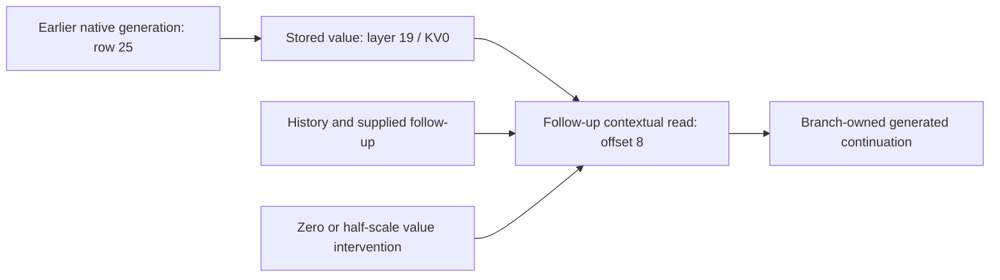

# Causal read-discovery qualification, 2026-11-06

This record accompanies [the public discovery interface](../docs/CAUSAL-CIRCUIT-DISCOVERY.md).
The new instrument nominates native memory reads, seals a local attention-write
prediction, and measures value interventions through each branch's own future.
It does not qualify arbitrary semantic CoT or economical model emulation.

## Mechanics and integration

The focused discovery, verifier, viewer, debugger, memory-probe, and CoT suites
pass **51 tests**. These include head-local edits, exact observer/reinstall
controls, later generated tokens, explicit follow-up input, atomic rollback,
finite admission bounds, and rejection of resealed evidence tampering. An
instrumented test counts 52 actual native layer-token steps against the declared
upper bound of 52. The test specimen is a tiny randomly initialized Qwen2 model;
these results establish mechanics, not trained-model semantic discovery.

A separate installed-wheel proof runs outside the repository, blocks private
runtime imports, captures a discovery report, verifies its session and export,
then resumes the exported state in a fresh session. Its native future logits
match exactly. Two receiver occurrences nominate two carriers and produce four
dose tests; each first receiver retains the original query and complete key
history. The actual local profile is CPU BF16, Torch 2.14.0, native eager Qwen2.

The frozen evidence viewer also runs with Torch, Transformers, and NumPy imports
blocked. It produces 20 typed events and retains
`semantic_cot_qualified: false`.

Final proof artifacts are in
`artifacts/mdb-circuit-discovery-20261106/installed-proof-qualified/` at the workspace
root: `qualification.json`, `report.json`, `viewer-qualification.json`,
`circuit.html`, the session/export, and `wheel-custody.json` with the exact wheels.
Earlier proofs remain separately preserved in `installed-proof/` and
`installed-proof-final/`; the final qualification includes the calibrated
cross-device verifier described below.

| Distribution | SHA-256 |
| --- | --- |
| `mdb_runtime-0.1.0-py3-none-any.whl` | `71578f33ad8aebece3d850fed1222a4659233d1e2d41dd43bf5bbbd8c1527867` |
| `saturn_pub-0.4.1-py3-none-any.whl` | `3893aca4723ad107b0a5ce97856af7d25a7f08da73fa505842a16c6717e3d6ed` |

Reproduce the installed proof with fresh wheel installation and
[`circuit_discovery_installed.py`](circuit_discovery_installed.py), first in
`capture` mode, then in `view` mode. Pass the isolated wheel target with
`--installed`, set `PYTHONPATH` to that target, and choose a new `--root` directory.

## Trained-model assay

The finite public-package assay is implemented in
[`circuit_discovery_20261106/`](circuit_discovery_20261106/). It uses one resident
frozen Qwen2.5-1.5B checkpoint on CUDA, with BF16 and native eager attention.
The two contexts are a previously studied hidden-country relation and a fresh
object-binding prompt. Each includes generated tokens, a fixed follow-up, and
a second receiver on the last follow-up token. Full compact rows, identities,
and verification counts are tracked in [RESULTS.json](circuit_discovery_20261106/RESULTS.json);
[`analyze.py`](circuit_discovery_20261106/analyze.py) reproduces that summary from
the recovered evidence.

The actual trained run is `job-760379f49115`, request
`50897c33f64bd2e212e89e8a016588c776523507b7317cf4321792ef5325b1f5`.
It used Torch 2.13.0 and the native eager BF16 profile. The checkpoint's raw
`model.safetensors` SHA-256 is
`a961db72e75d52b18e6b0c9d379e51a26973b233385e0e127fdda7d648aec796`.
The executed discovery source is byte-identical to the committed implementation:
`112fc5e72f0a558522476e83c8fb724c4b8f2c16332a68374b135f29591431d5`.
The executed MDB wheel is separately preserved with SHA-256
`cd50d0ce6a85b98254830a95d28507d955b68da0a847b40242cd4c5bc941c271`;
the later installed wheel changes verification calibration, not the native
discovery instrument or its saved evidence.

Both cases completed. Across four receivers, the pass searched all 28 layers,
nominated eight carriers, and ran 16 dose tests. All 112 layer/receiver attention
reconstructions matched their native inputs exactly. Every tested first query
and complete key history remained exact. All eight reinstall controls restored
exact logits and complete endpoint state. Parent/sibling selections were
preserved.

| Context / receiver offset | Nominated `(layer, KV head, row, source token)` | Local-write relative L2 error, across both doses |
| --- | --- | --- |
| Yen / 0 | `(26,1,0,"The")`, `(11,0,0,"The")` | 0.160%–0.309% |
| Yen / 5, after follow-up | `(26,1,0,"The")`, `(21,1,14,"country")` | 0.140%–0.324% |
| Fresh binding / 0 | `(22,0,23,"is")`, `(26,1,13,"silver")` | 0.214%–0.539% |
| Fresh binding / 8, after follow-up | `(22,0,31,"is")`, `(19,0,25,"same")` | 0.310%–0.520% |

These are prospective local attention-write errors against the native edited
return. Future logits and tokens are measured continuations, not forecasts.

The yen prompt was “The capital of the country whose currency is the yen is”,
followed by “ The country was”. The initial Tokyo-vs-Paris margin was +4.875.
The initial layer-26 value edits changed that margin by −0.125 at zero strength
and −0.0625 at half strength; the layer-11 edits left it unchanged. At the later
receiver, the layer-21 “country” edit changed the margin by +0.25 at zero and
+0.0625 at half strength. All generated consumed tokens stayed unchanged.
Three arms changed a next-token decision during fixed caller input; that
decision was superseded by the next supplied input, so it did not create a
different generated history.

The fresh prompt bound a green key to Lena and a silver coin to Omar; the
follow-up asked about Lena. No task-margin observable was configured, so no
answer-accuracy or semantic-binding claim is made. Zeroing layer 19 / KV head 0
/ row 25 at the follow-up receiver changed the next-token chain from
`1852 → 438 → 279` to `6176 → 1376 → 13`. The first two changed tokens were
then consumed by the branch's own generated steps. Half strength preserved
that chain. The other seven arms changed logits while preserving decisions.
Effects after history divergence are comparisons of different histories.

Row 25 was itself produced by the model: the prompt has 25 tokens, and the
first generated transition consumed token 1852 at row 25. The later receiver
therefore reads a model-owned earlier value, not just a supplied prompt row.
The source token's text locates the row; it does not label the value's meaning.

This is a contextual read with a dose-dependent native continuation effect.
Magnitude ranking also selected generic early-token reads and did not recover
the previously localized layer-22 / KV1 hidden-country carrier. It establishes
a useful causal discovery instrument, not a semantic circuit locator.

The assay compares effects as observations, including zero or heterogeneous
effects. Exact model/source identity, observer parity, head locality, first
query/key preservation, reinstall closure, and artifact verification are
mechanics checks. Local write error and future token-margin changes are
measurements, not scientific pass/fail gates.

## Custody and numerical calibration

The trained worker ran for 132 seconds total, with measured
peak RSS 2,395.8 MB and VRAM 3,448 MB. The two case transactions took 35.3 and
56.7 seconds. These include instrumentation and publication; no acceleration
claim follows from them.

The mrun job retains its original **failed** state: post-run collection exceeded
the original 4,096-file bound. Both completed case records and sessions remained
intact on Beast. [`recover.py`](circuit_discovery_20261106/recover.py) recovered
10,896 files / 171,104,411 bytes without another model run, verifying every file
against a manifest hashed before transport. The recovered archive is
120,385,817 bytes with SHA-256
`8edcec252c75fecb74720616fa44f29efcc4629df9fe6644136fa61791b85086`.
Current transport bounds are calibrated to this observation: 65,536 files,
512 MiB expanded, 128 MiB compressed. They are custody/resource limits.

The first offline verification rejected derived `logit_l2` summaries: CUDA and
CPU FP32 reductions over 151,936 entries differed by at most 4.307e-5 relative.
Every other check passed in the diagnostic rerun. The verifier now permits
100 ppm **only for that derived norm**, with a frozen regression example;
tensor hashes, token/margin readouts, maximum errors, and all other fields keep
their original checks. Both complete sessions pass the calibrated verifier
from a separately installed wheel. The original rejection and diagnostic rows
are retained alongside the later verification; native reports were not rewritten.

Workspace evidence lives under
`artifacts/mdb-circuit-discovery-20261106/trained-recovered-job-760379f49115/`.
It contains recovery custody, raw cases and sessions, both verification policies,
calibration diagnostics, and framework-free HTML views (106 yen events,
117 fresh-context events). Exact staged payloads and all four admission attempts
are preserved under `admission-lineage/`. Two earlier attempts failed before
model loading because of worker-cache paths; another stopped at a raw-file
versus source-map identity comparison after loading. They contain no scientific
null, and their failed statuses remain intact.

## Interpretation boundary

The local forecast assumes an unchanged first query and key history. For value
scale `s`, it predicts

\[
\widehat o'=o+(s-1)\sum_{h:g(h)=g} a_{ij,h}W_{O,h}v_{j,g}.
\]

This is a prospective test of the receiver's attention write. It does not
predict all subsequent nonlinear layers or token outcomes; native continuation
measures those. A measured effect identifies a contextual dependency under the
specified edit. It does not establish a unique minimal circuit, the semantic
meaning of a vocabulary readout, or generalization to a new prompt.

The next scientific step is to combine multiple tested reads and writes into
a candidate program, freeze that program before new contexts, and evaluate its
outputs on model-owned later states. The report preserves occurrence-scoped
query/key/value identity and signed native effects for that work.
