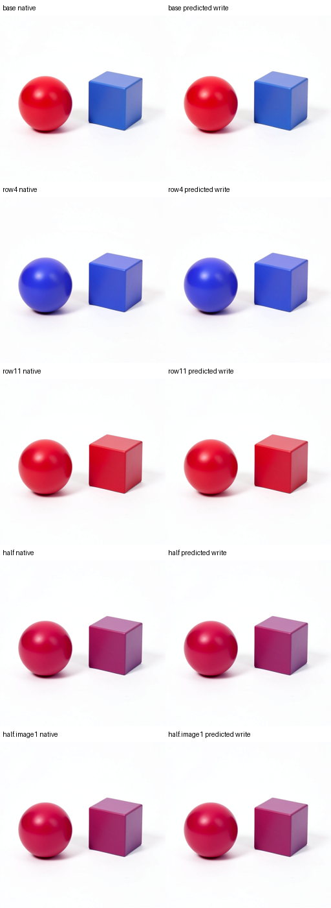

# Predicting a changed-row computation

`mdb.attention_partition` implements a stable attention response to explicitly changed key/value rows. It uses NumPy and imports no model framework. The caller supplies positioned/normalized Q/K/V and binds the model, receiving state, clock, numeric contract and source. The module calculates a mathematical reference; it does not infer semantic row labels or emulate CUDA kernel rounding.

For a fixed query, split keys into unchanged U and mutable S. Cache the unchanged softmax maximum, denominator and weighted value numerator:

\[
m_U=\max_{j\in U}s_j,\quad D_U=\sum_{j\in U}e^{s_j-m_U},\quad N_U=\sum_{j\in U}e^{s_j-m_U}v_j.
\]

For edited rows, set \(m'=\max(m_U,\max_{j\in S}s'_j)\), \(a=e^{m_U-m'}\), and calculate

\[
A'=\frac{aN_U+\sum_{j\in S}e^{s'_j-m'}v'_j}{aD_U+\sum_{j\in S}e^{s'_j-m'}}.
\]

This updates both the value contribution and the normalization of every key. Caching the unchanged partition directly avoids catastrophic cancellation when removing an old dominant key. Queries that change must be recomputed against all keys; their previous scores cannot be reused.

```python
from mdb.attention_partition import prepare_attention_partition

# Arrays use [batch, head, row, feature]. Cache preparation is real work.
cache = prepare_attention_partition(Q, K, V, mutable_rows=[4, 11])
attention, geometry = cache.evaluate(
    new_K_rows, new_V_rows,
    query_rows=new_Q_rows, query_indices=[4, 11],
)
```

Inputs are copied into immutable cache arrays. Replacement values cover exactly the declared mutable rows. Changed query values and indices must be supplied together. The reported query/key geometry includes the overlap of mutable-key evaluation and changed-query recomputation. It excludes preparation, QKV/output projections, MLPs, validation and I/O; it is not a speedup measurement.

## Prospective joint-block assay

The [response reference](../qualification/flux_response_reference.py) reuses the qualified BF16/FP64 affine, normalization, modulation and SwiGLU primitives. It prepares positioned Q/K/V separately for each receiving image state, then uses partitioned attention for changed working-text rows. Its predicted attention updates feed its own MLP inputs and outputs. It predicts complete image/text exits; it does not freeze an old MLP return after changing attention.

The finite [campaign](../qualification/flux_response_campaign.py) starts from observed step2/joint1 source cuts in Klein4B. It tests one historical baseline and four new inputs: working row4 alone, row11 alone, a half-dose two-row change, and that half-dose on a different receiving image. All five complete forecasts seal before any target block. For the new cases, predicted exits are installed and rendered through the native suffix before the corresponding native joint1 reference executes.

The first baseline native exit supplies a shared joint2 clock/unchanged-state scaffold. Predicted image/text replace both working streams completely. This clock assistance is explicit; it does not supply a target attention/MLP return. Every other live field must match across native and predicted branches. The source encoder, earlier image history and time context are observed.

The selected comparison budget is 535 native transitions, 20 Acts, 96 receipts and ten native VAE images across two loads, with zero encodes/noise. Dense mathematical attention comparisons are additional predictor validation work, and their cost is recorded separately. No complete-suffix numerical predictor or setup-inclusive speedup is implied.

The first execution (`job-3b50f8b6e026`) timed out after sealing all five forecasts and completing the historical native control. Its original status and unclosed transaction remain unchanged. A separately inventoried forensic snapshot retains all 191 original files, including the partial predicted prefix. The [prepared validator](../qualification/flux_response_validate.py) consumes those exact sealed arrays without recalculation. Its reviewed continuation is one resident load, nine remaining images, 481 native transitions, 18 Acts, 40 receipts, 436 transformer block entries and four new target entries. Native suffix operations are grouped through the next commit using public `Session.continue_(n)`, which still validates every transition and footprint. A tiny actual BF16 FLUX parity check compares every transition and complete committed payload; it does not claim measured full-size speedup. Actual attempt costs include both loads and the interrupted work; they must not be replaced by the selected comparison's logical budget.

The source forecast seal is `46d18297ebebe6ef358c3ef0482b3c18c7f2a8d9fd6e038f30e8ed1c44a79530`. All five partition calculations agree with the independent dense attention reference after BF16 rounding. The continuation succeeds as `job-326e9b1270ef`. The [frozen saved-evidence audit](../../../../artifacts/mdb-flux-response-program-20261105/audit-v3.json) verifies the seal, complete inputs/outputs, native ports, BF16 residual equations, actual typed Acts, all native transition/receipt chains and final images. It preserves the original timeout separately.

| Case | Observed native and predicted-write outcome | Image exit relative RMS | RGB MAE /255 |
|---|---|---:|---:|
| Base | Red sphere / blue cube | 0.3190% | 0.10682 |
| Row4 | Blue sphere / blue cube | 0.3226% | 0.11236 |
| Row11 | Red sphere / red cube | 0.3258% | 0.10458 |
| Half dose | Red/pink sphere / magenta cube | 0.3302% | 0.11283 |
| Half dose, changed image receiver | Red/pink sphere / magenta cube | 0.3229% | 0.17736 |



Pixels remain approximate (maximum channel error 8–12). The two new categorical forecasts match; the two half-dose positive RGB directions hold against the fixed base, without a frozen categorical name for their magenta cubes. The simple hue instrument calls those cubes red; [visual inspection](../../../../artifacts/mdb-flux-response-program-20261105/image-review-v2.json) retains the disagreement. No whole-scene automatic semantic parser or exact collateral claim follows.

Whole-state accuracy hides a harder limit. Image-exit changes relative to the control have 19.0–22.1% relative RMS error, cosine 0.976–0.982. Holding half-dose text identical and comparing the two image receivers gives 54.5% image-exit contrast error and 113.8% text-exit contrast error. The final RGB contrast error is 149.4%, cosine 0.374, although each individual RGB endpoint is close. Fine receiver-dependent effects remain unresolved.

A post-hoc linear foil has 1.398% half-dose image-exit error versus 0.330% for the full response; attention error is 3.425% versus 0.418%. It was not prospectively sealed or installed, and it mixes individual curvature with interaction. The [accepted atlas publication](../../../../artifacts/mdb-flux-response-program-20261105/public-records-v3/provenance.json) keeps one generic program, five exact-context occurrences and the receiver limitation, with five matching and ten negative applicability queries.

```sh
python -I qualification/stage_flux_response.py RUN AUDITED_CARRIER_ROOT
python -I qualification/stage_flux_response.py RUN AUDITED_CARRIER_ROOT --submit
python -I qualification/recover_flux_directory.py RUN COLLECTED_RUN
python -I qualification/analyze_flux_response.py COLLECTED_RUN AUDITED_CARRIER_ROOT AUDIT_JSON
```

Use installed public MDB/Saturn-pub packages and `common exec` for mrun credentials. The worker preserves a small native directory publication. Parameter recipes describe exact checkpoint-backed BF16 archives without retaining another parameter bank; `retrieve_weights.py` is standalone. Qualification covers these observed inputs, one seed/checkpoint/clock and the measured errors. The source encoder, earlier native history, baseline clock scaffold and native suffix/VAE remain supplied.

Future new full campaigns use the same tested commit grouping and NVMe output: 535 native transitions, 20 Acts and 45 receipts in one planned load. That whole upgraded launcher was not rerun as a duplicate assay. The executed two-attempt study has 96 selected receipts and two actual loads. The original immutable payload and its per-operation plan remain preserved.

## Cost and next cut

The successful runner takes 230.95 seconds, worker 192.86 seconds, and nine futures 52.49 worker seconds including initial consumer warm-up. Later suffix/image futures take 2.15–2.96 seconds. CPU mathematical predictions take 2.6–5.7 seconds including dense cross-checks, so this reference is not faster than the warmed GPU suffix. Three measured native VRAM peaks are 9,246–9,274 MB; future staging defaults to a reviewed 10.5 GB reservation and preserves strict admission. The executed lease retains its original 11.5 GB request.

Both runners together consume 1,012.74 seconds, including the timeout. Durable actual work is at least 539 native transitions, 22 Acts and 102 receipts, with ten complete images; interrupted work is retained separately from the selected complete matrix. Authenticated continuation collection takes 72.05 seconds for a 537.16 MB archive. No native operation was skipped in qualification. Grouping reduces capture/receipt overhead; startup, NVMe and contention also differ from prior runs, so no controlled end-to-end speedup is claimed. [Full cost ledger](../../../../artifacts/mdb-flux-response-program-20261105/cost-v1.json).

The [precision experiment](../../../../artifacts/mdb-flux-precision-cut-20261105/verification-v1.json) now traces those two historical half-dose receiver inputs through 37 native stages each. All four arithmetic variants seal before the first target entry. Two native joint1 executions reproduce the old complete inputs and outputs exactly, with four Acts and six receipts. A tiny actual BF16 FLUX test verifies observer parity and hook cleanup, including an injected failure.

## The first large error is in affine arithmetic

The first nonexact stage is LayerNorm, but its errors are small. The first large increase occurs at Q/K/V projections. These measurements use the original FP64 reference and the first receiver:

| Image stage | Full field relative RMS error | Receiver difference relative RMS error |
|---|---:|---:|
| First LayerNorm | 0.000774% | 0.1314% |
| Modulated input | 0.002062% | 0.1914% |
| Q projection | 0.2327% | 35.1570% |
| Raw attention | 0.3372% | 37.7500% |
| Block exit | 0.3302% | 54.4878% |

This is not merely an upstream input discrepancy. The [identical-row comparison](../../../../artifacts/mdb-flux-precision-cut-20261105/equal-input-rows-v1.json) finds 1,014/1,024 image rows and 505/512 text rows with bit-identical complete modulated inputs. Q/K/V errors on those rows remain approximately 0.23–0.25%. The second receiver gives the same pattern. This comparison uses saved calculations, with zero new affine evaluations.

An initial extra-rounding hypothesis is rejected. Actual FLUX uses Torch RMSNorm, whose original single-final-rounding reference differs at only 15–26 values out of millions when given native projection inputs. Adding a BF16 rounding before the learned normalization weight changes roughly a quarter of the values and worsens the image exit. The default remains unchanged. Native-operand modulation, RoPE, gated residual additions, SiLU and SwiGLU multiplication close exactly at the observed fields; LayerNorm retains a small reduction discrepancy. These are conditional operator checks, not independent whole-block forecasts.

The [CUDA matrix probe](../../../../artifacts/mdb-flux-precision-cut-20261105/gemm/collection-01/extracted/binding-minimal-result/summary.json) isolates the Q projection using eight `F.linear` calls, two known inputs and checkpoint-identical Q weights, without loading the full model:

| Arithmetic policy | Comparison on both receivers |
|---|---|
| BF16 with reduced-precision accumulation | Exactly reproduces the captured native Q |
| BF16 with full accumulation | Moves close to the FP64 reference; does not reproduce native Q |
| FP32 with TF32 disabled | Within 0.0012–0.0018% of the independent reference; does not reproduce native Q |
| GPU FP64 then declared casts | Exactly reproduces the independent NumPy reference |

Thus `allow_bf16_reduced_precision_reduction` causally distinguishes the captured native projection from the mathematical reference on these two fixed geometries. The reference's receiver-Q error is 35.1574%; replaying the reduced-precision primitive reproduces that native contrast exactly. The precise internal CUDA tile/reduction sequence is not reconstructed by this test.

Attention contributes another floor. A model-free CPU calculation from the captured native positioned Q/K and raw V has 0.1164% endpoint error. Its receiver-contrast error is 14.7210%, versus 37.7500% when Q/K/V are independently calculated too. This [saved-operand diagnostic](../../../../artifacts/mdb-flux-precision-cut-20261105/attention/collection-01/extracted/binding-minimal-result/summary.json) takes 1.75 worker seconds, with zero native forwards. Restoring QKV isolates attention arithmetic; it does not turn the result into an independent prediction.

The next cut is a numerical-contract-aware reference for the native affine and attention operators, followed by sealed own-state predictions on a fresh dose and receiver pair. Turning off reduced precision would define a different execution lane and must be qualified as such. This experiment does not improve the prior full-block prediction or fine semantic edit coverage by itself.

```sh
python -I qualification/stage_flux_precision.py RUN AUDITED_RESPONSE_STUDY
python -I qualification/stage_flux_precision.py RUN --submit
python -I qualification/recover_flux_directory.py RUN COLLECTED_RUN
python -I qualification/analyze_flux_precision.py COLLECTED_RUN AUDIT_JSON
python -I qualification/inspect_flux_precision_equal_rows.py PRECISION_STUDY ROW_REPORT
python -I qualification/flux_precision_attention.py ATTENTION_RUN COLLECTED_RUN
python -I qualification/flux_precision_attention.py ATTENTION_RUN --submit
python -I qualification/flux_precision_gemm.py GEMM_RUN PRECISION_STUDY
python -I qualification/flux_precision_gemm.py GEMM_RUN --submit
```

The first precision attempt fails at an unsupported transaction frontier label after calculation and before sealing or target execution. Its [198-file forensic snapshot](../../../../artifacts/mdb-flux-precision-cut-20261105/failed-snapshot-01/forensic-custody.json) retains the original failure; a real installed-API seal/execute preflight now catches that error before admission. The successful trace takes 143.68 runner seconds, the CPU attention assay 14.33 seconds, and the CUDA primitive assay 46.45 seconds. Including the failed 649.86-second attempt gives 854.32 runner seconds, plus queueing and collection. The CPU assay peaks at 543.8 MB RAM; the CUDA primitive assay at 1,684.4 MB RAM / 612 MB VRAM. Future fixed-geometry reservations use these measurements; executed requests remain unchanged. Startup, collection and computation all remain part of research cost.

## Continuing a preserved partial execution

Continuation is an explicit new finite experiment; it does not retry or rewrite the original lease. First recover the terminal evidence and verify its inventory. Then stage and independently review the prepared validator before admission:

```sh
python -I qualification/recover_flux_timeout.py ORIGINAL_RUN FORENSIC_SNAPSHOT
python -I qualification/stage_flux_response_validate.py NEW_RUN FORENSIC_SNAPSHOT
python -I qualification/stage_flux_response_validate.py NEW_RUN --submit
python -I qualification/recover_flux_directory.py NEW_RUN COLLECTED_CONTINUATION
python -I qualification/analyze_flux_response.py FORENSIC_SNAPSHOT AUDITED_CARRIER_ROOT AUDIT_JSON --continuation COLLECTED_CONTINUATION --view DERIVED_ANALYSIS_VIEW
```

The derived view only links verified source files and reconstructs the selected complete receipt chains. It carries provenance for every linked file and separate actual-attempt cost. Both raw collections remain authoritative. Native images still receive explicit visual inspection before the [publication helper](../qualification/publish_flux_response.py) indexes one generic response program and its five context-qualified occurrences. A successful numerical comparison does not silently convert a failed categorical prediction into a success.

## Algorithm applicability versus measured coverage

The reusable program is `flux.joint.changed-text.response.v1`. Its cache is bound to positioned Q/K/V, the receiving image, clock/modulation context and declared mutable rows. A candidate must preserve all other text rows. A new receiving image requires a new preparation; a changed query must be declared and recomputed against all keys. These are structural preconditions for calculating a candidate, rather than semantic labels.

The atlas records a different question: which exact contexts have native comparisons and observed futures? Those occurrences keep exact receiving-state identities and abstain on unknown states. Their measured errors cannot be promoted into a universal error bound merely because the mathematical program accepts another input. New candidates can still be calculated as exploratory predictions, sealed and selectively tested. Qualification accumulates around one algorithm instead of inventing a new law name for every vector.

This program implements known transformer equations and a reusable attention partition. The research contribution being tested is the connection from a causally identified contextual carrier, through an independently calculated response, to the actual image future. It does not establish a new attention law or a universal prompt-to-edit compiler.

## Causal stream crossings at the next reader

The [J2 input-corner assay](../../../../artifacts/mdb-flux-stream-cross-20261106/README.md) holds old image fixed and swaps old/new text, then makes the reciprocal image-only replacement. Both isolated stream changes worsen the immediate image-response error for both supplied edits, while the text-only switch improves immediate text response. Its native noise/latent continuation helps row11 and hurts row4. Three old/old sham controls match15 archived midpoint/complete-state readouts exactly. This establishes a bounded causal stream dependence, rather than a better general program or independent attention forecast.

For an image query and fixed image key/value partition, let `A=(N_I+N_T)/(Z_I+Z_T)`. A changed text partition obeys the real-arithmetic finite identity `A'−A=(deltaN_T−A*deltaZ_T)/(Z_I+Z_T+deltaZ_T)`. A value-only change leaves the denominator fixed. Changed text keys alter both the numerator and normalization of image values. Text queries do not enter the immediate image-query rows, though their text output can affect later computation. The image residual also contains output projection, the time gate and finite residual addition.

The next mechanism cut therefore holds image Q/K/V fixed and crosses actual positioned text K and V, including each packet condition's own half baseline. Qualify the native packets and require diagonal image-midpoint closure to the existing old/old and old-image/new-text evidence. Initially stop at that midpoint; full suffix replay is unnecessary for distinguishing changed allocation from changed content. Preserve native attention geometry/dispatch and projection/gate/residual writes. A wide-softmax reference explains the partition but does not establish CUDA numerical parity.
