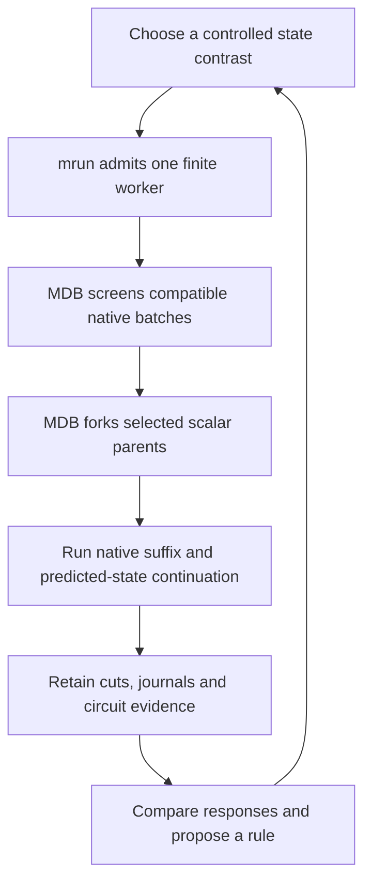

# Discovering computations with MDB and Saturn

Our goal is to build a table of computations inside a model: where they run,
what state they read and write, which routes carry their effects, and when those
effects matter to a consumer. We can give each record a useful generic name
immediately. A semantic interpretation can develop as the evidence grows.

The practical loop is **screen broadly, inspect selected branches, test the
route, record its domain, and choose the next discriminating contrast**. MDB
provides the debugger; Saturn's typed contracts and storage provide the state
and evidence machinery underneath it; mrun owns physical execution. Analysis
turns their records into the next experiment.

This workflow uses the R3 capabilities shipped in
[`562209f`](https://github.com/JHollenb/saturn-pub/commit/562209fc56d563cd345568c5ec04b10ff9656a87).
The [executed example](ROUTE-DISCOVERY-WORKFLOW.md) contains scripts, input
geometry, launch commands and durable-resume details. The
[validation](../qualification/DISCOVERY-UPGRADES-VALIDATION.md) supplies the
measured execution evidence.



## What we are trying to discover

In the R3 source, a post block performs `h = h + post(h)`. Its learned weights
define a fixed mathematical map; the incoming state changes the write it
produces. MDB lets us inspect the post output before addition, then step the
residual update separately. We can ask whether a downstream effect was formed
inside that MLP, supplied by an earlier component, transported by recurrence,
or made important by a later reader or gate.

These are different kinds of record:

| Record | The question it answers |
|---|---|
| Site or law | Which mathematical component ran, under which executable program? |
| State occurrence | What exact values reached that component in this input and branch? |
| Route | Through which addressed carriers and updates did an effect reach a reader? |
| Computation variant | What changed under a specified intervention and receiving state? |
| Symbol hypothesis | What variable appears to be represented, and how does a consumer use it? |
| Rule hypothesis | Which relationship predicts responses across several contexts? |

One MLP can participate in several computations. A recurring route can carry
different payloads, and the same payload can have different effects in different
receivers. The table should retain those distinctions rather than assign one
semantic operation to every occurrence of an MLP.

For these ISA models, the external context is the raw byte window, register
bits and flag bits. Internal activations and recurrent state evolve during the
forward call. The current driver resets internal hidden state each call and
carries predicted architectural state into the next instruction. A language
model's prompt, generated tokens and KV history need their own backend contract;
we should not substitute that mental model for the R3 input ABI.

## The tools and their responsibilities

| Tool | Use in this workflow |
|---|---|
| `common exec` | Supply the configured shared environment and credentials to control scripts. Installed public packages supply MDB worker imports. |
| mrun | Admit a finite worker, place its actual backend, enforce resource limits, count physical work and retain job telemetry. |
| MDB discovery | Name structural sites, screen native batches, pause scalar replay, inspect mathematical stages, fork, edit, restore and script actions. |
| Public Saturn contracts and LocalStore | Bind typed state, lineage and numerical contracts; preserve selected durable frontiers and alias-aware tensor storage. |
| CircuitCatalog and existing Project graphs | Retain trace-backed route candidates, sealed plans/predictions, verified public outcomes, ancestry and annotations through their supported adapters. |
| manalysis and experiment analyzers | Compare responses, inspect graphs, fit candidate relationships and diagnose instruments. Keep scientific interpretation separate from execution bookkeeping. |
| Spectral addressing | Retrieve candidate related bindings where compatible descriptors exist. A retrieval score proposes a comparison; it does not establish equivalent computations. |
| Model virtual memory and Thott | Retain and retrieve supported backend payloads and history. For this R3 lane, the qualified restart mechanism is its selected CPU frontier store. |
| Evidence tools | Verify custody and references, index supported receipts and track claims. Discovery journals currently have their own verifier; generic evidence-plane ingestion remains incomplete. |

These pieces have different integration maturity. Discovery journals do not
automatically become CircuitCatalog outcomes or Project graph transactions.
Existing ISA builders register qualified traces and public branch receipts;
new discovery variants also retain explicit sidecars and journal references.
Automatic cross-run atlas ingestion and spectral indexing of these variants
remain engineering work. Reuse the existing contracts and IDs when adding it.

## 1 Choose a contrast that can answer a question

Start with existing captures, variants and failed predictions. Pick two plausible
explanations and change one input or state condition that separates them.
For example: does `post.1` form a new contribution, or does it transform an
interaction already supplied upstream? Does a carrier recur across receiving
states while its effect changes sign?

Freeze checkpoint, program, backend, input encoding and consumer. Declare a
small context set, target readout, collateral readouts and continuation horizon.
Instruction names may help describe supplied inputs, but the debugger needs only
generic addresses and the model receives its ordinary native tensors.

**Output:** a short experiment description with competing explanations and the
smallest contrast that could distinguish them.

## 2 Admit one resident experiment

Use mrun for the real-model work. Load the frozen model once, warm reusable
setup, then run a finite panel inside that lease. Keep physical forwards,
logical rows, scalar replay primitives, branches, commands and wall allowance
separate. Candidate branches remain local to the worker.

Use strict preflight and the actual device contract; CUDA requires CUDA
admission. Prefer the intent-first planner, with explicit reservations only
for documented measured exceptions. Keep automatic retries disabled and retain
completed evidence if an optional arm fails.

**Output:** a source-bound job and an honest physical-work account.

## 3 Screen many contexts cheaply

Use `FrozenNativeBatch` for compatible full native forwards. Sweep a small
set of output doses or controlled inputs. Keep an identity condition and retain
every head, signed differences, decision margins and row ownership. Refill
physical slots with new input epochs as contexts change.

The executed `post.1` panel crossed four initial states with four output scales:
16 observations in four B4 calls. All nonidentity doses changed the same five
continuous heads, but decoded state stayed unchanged. That is a useful
numerical response pattern. A discovery filter based only on changed integer
outputs would have discarded it.

Select cases with differing consumers, response direction, dose shape,
collateral or continuation. Include near misses and stable controls. Batch
rounding can matter near a decision boundary, so selected effects receive
scalar checks. Component breakpoints use scalar replay.

**Output:** a diverse shortlist with retained batch receipts and full responses.

## 4 Inspect the mathematical transition

Create a scalar replay for a shortlisted context and stop at the relevant
generic selector, such as `module:post.1` entry or exit. The initial native
capture completes before this replay can pause.

Use `op` to inspect a primitive, `math` for a declared mathematical stage,
`law` for the MLP output, and `update` for its residual application. Use
`forward` to reach raw heads and `instruction` to commit predicted state.
Capture a common parent, fork the selected interventions, and reuse that parent
instead of recapturing its prefix for each dose.

**Output:** exact before/after state at a program-bound site, with explicit
source, write and residual boundaries.

## 5 Test the route and the future

Choose the smallest causal panel that distinguishes the live alternatives.
Often this is an unchanged branch, one coherent replacement and one intermediate
restore. Add wrong-source, wrong-time, sham or coalition controls when they
address a specific ambiguity; every experiment need not run every control.

Run the unchanged downstream model. Measure target and collateral heads, then
continue using the branch's literal predicted state. Audit selected edits with
a separate native execution. A replay matching its reference validates the
instrument; a changed native consumer supplies evidence about the computation.

To trace a route backwards, start at the consumer effect and move to the latest
writer that can create or erase it. To trace it forwards, perturb a source and
restore successive carriers. A rescue shows conditional mediation under that
contrast; it does not automatically identify a unique or minimum circuit.

Keep the temporal axes explicit. R3 scan positions are within-forward steps,
ATen events are mathematical execution steps, and committed instructions are
separate model calls. A within-scan memory route does not establish hidden-state
persistence across instructions. This is how the time-circuit question becomes
a testable sequence of state writes and readers.

**Output:** a context-qualified causal record with effects, alternatives and
its actual continuation horizon.

## 6 Add a generic record and retain its bytes

Use a stable site ID and a generic route or variant handle immediately. An alias
such as `post1_to_flags` can describe an observed association without naming an
ISA operation. Keep human labels separate from immutable execution identity.

Each variant should reference:

- Model, executable program, input digest and receiving context.
- Site, addressed source/carrier/writer/consumer, occurrence and all three clocks.
- Common-parent cut, intervention kind/sign/dose, branch, physical attempt and row.
- Full head responses, decision margins, collateral, repair and continuation.
- Native audit, control outcomes, journal/receipt references and custody hashes.
- Observation or hypothesis status, applicability, exceptions and next question.

These are a record checklist, not a new runtime schema. Keep unknown fields
unknown and link existing artifacts rather than inventing addresses. The
CircuitCatalog can seal trace-backed candidates and predictions; native
outcomes require its verified receipt/backend contract. A discovery journal
alone is not that receipt.

Save a durable frontier when a useful branch must survive worker exit. Retain
its complete store and manifests. Restore on a compatible admitted platform,
with explicit continuation budgets and factory rebinding when a new forward is
needed. Metadata and plots can be inspected without loading the model.

**Output:** a named, reopenable investigation with enough evidence to compare
it to future records. Table membership does not require semantic certification.

With the pinned MDB installation, these metadata commands inspect retained
evidence from the domains workspace:

```sh
mdb circuits list --catalog isa/outputs/post2-native-bridge-r3-mamba/mdb-catalog.json
mdb discovery inspect artifacts/mdb-discovery-upgrades-20261030/run-04-client/cli/journal --last 0
```

The installed CLI reopened two existing circuit records and verified all 12
remote journal records. This checks that those artifacts can be consumed again;
it does not merge the two evidence formats or rerun the model. For a live
session, use the attach/script and save/resume commands in the
[executed example](ROUTE-DISCOVERY-WORKFLOW.md).

## 7 Find patterns and make prospective predictions

Group variants by consumer incidence, signed dose response, receiving state,
collateral and continuation. Use spectral similarity as a retrieval lead and
graph communities as structural leads. Keep exceptions visible.

Use reachability to nominate possible consumers. Use dominators or min cuts on
an explicit computation/data projection to nominate intervention boundaries.
Lineage shortcuts and restore-selection edges do not belong in that projection.
Declare capacities before interpreting max flow. A graph cut ranks a causal
test; graph topology alone does not prove a symbol or an operation.

Fit a candidate relationship on discovery contexts, seal its forecast, and test
a new context through the native consumer. Compare predicted and actual signed
responses, not only pass/fail. Track independent contexts and uncovered
conditions rather than total replay count. Prefer the next example on which
competing rules disagree.

**Output:** a rule hypothesis with a measured domain and counterexamples, plus
the next bounded experiment. Compilation into a reusable operation comes after
this evidence, with recipient compatibility and abstention where unresolved.

## The next campaign

Qualify the same four contexts and four doses at `post.0` and `post.2`, alongside
the existing `post.1` panel. A complete three-site screen is 48 logical rows in
12 B4 calls before control reuse; qualification and scalar audits are additional
work. These additional sites were not qualified by the current upgrade assay.

Compare predicted graph consumers with observed response sets. Select one case
where two MLPs or receiving states disagree, then test one intermediate carrier
restore. Expand the receiving states or byte encoding only when that comparison
becomes legible. Keep source formation, route recurrence, payload transfer and
consumer selectivity as separate fields.

For throughput, measure setup, native execution, replay, serialization, durable
save, transport and idle time separately. Reuse resident bindings and common
parents first. The [bottleneck plan](DISCOVERY-BOTTLENECKS.md) explains why the
next engineering priorities are metadata work and finite worker-side panels.

At the end of each session, retain the raw variants, selected cuts, journals,
native audits, generic aliases, an updated route map and one discriminating
next question. The result should make the following session cheaper to start
and better informed.
