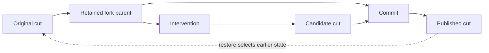

# DAGs expose useful structure—and provenance gaps

The 2026-10-27 exploration found that MDB does not need a new graph database.
`StateGraph` already supplies immutable typed nodes/edges, structural DAG
verification, lineage queries, sealed snapshots and graph exports. The useful
next representation is a DAG of **port versions at execution occurrences**,
alongside the existing native-cut DAG and cyclic component/knowledge views.

This was an offline engineering investigation over the tiny Qwen3 CLI demo,
followed by a fresh run of the same script and a JSON-only replay probe. It is
not evidence for a learned mechanism or measured semantic causality.

## What the actual data showed

| View or check | Before correction | After correction |
|---|---:|---:|
| Retained native cuts | 6 | 7 |
| Distinct native receipts | 6 | 6 |
| Existing project graph | 13 nodes / 14 edges | 14 nodes / 20 edges |
| Execution DAG verification | passed | passed |
| Missing receipt-parent cuts | 1 | 0 |
| Commit candidate represented as input | no | yes |
| Prototype port-version DAG | 49 nodes / 40 edges | 56 nodes / 55 edges |
| Prototype reported gaps | 1 missing parent | none in this trace |

All six existing cut fingerprints were unchanged. The additional retained object
is the native fork-parent cut that was previously omitted, not a new checkpoint
format. Both runs used the same random model, script, prompt and numerical
environment. Reopening after the script supplied the same additional restore
transaction in both histories.

### A valid DAG can still have incomplete provenance

The preview's `apply` receipt named a parent cut absent from the project. Public
`Session.fork` creates a new lineage identity before application, but MDB had
retained only the earlier cut and edited result. Its graph therefore showed the
intervention as an action with no input. Commit then linked only its current
parent, leaving the candidate reference in receipt metadata rather than the DAG.
Cycle checking passed despite this missing explanation.

The adapter now retains the actual preview parent. The project graph includes
candidate inputs on commit/abort. Restore targets have explicit knowledge edges;
they are selections of older state, not forward computation edges.



The dotted selection is outside the execution DAG. No native receipt or cut
identity was rewritten. Historical projects still expose missing parents; this
correction does not fabricate their absent bytes. Their retained commit
candidates can be connected when available.

### Component names create cycles; versions remove them

The component graph contains `hidden → decoder_layer.0 → hidden`. This is expected:
the name denotes a reused storage role. It is useful for architecture navigation,
but cannot be topologically sorted into one execution or trusted to distinguish
branches. The prototype instead uses `hidden@parent-cut → layer-occurrence →
hidden@result-cut`. Preserved ports and verified commit copies get separate copy
edges. The resulting graph verified as acyclic.

The prototype reuses `StateGraph` and original receipt IDs. Port nodes are
descriptive outputs with native cut/slot references; they are explicitly **not
restorable checkpoints**. It handles declared, single-transition transactions,
registered Act receipts and verified candidate copies. Unknown footprints,
unretained history and wider transactions remain reported gaps. A general product
must support receipt-local intermediate versions without inventing durable cuts.

### Declared reads are conservative, not exact influence

The zero replacement's receipt declares that it reads `hidden`. Source inspection
shows `saturn.builtin.replace@1` returns its captured replacement and ignores the
input mapping: see [`Act.replace` and `_ReplaceOperation`](../../../src/saturn_pub/core.py).
Consequently, the declared port DAG still links the old carrier, embedding and
decoder layer into the zeroed result's ancestry—even though this replacement's
value does not use the old carrier values.

This is a useful negative control for a future dataflow analyzer. Preserve the
historical declared footprint; add separately verified operator semantics that
distinguish value inputs from shape/type/control requirements. Do not relabel all
read edges as measured causal influence or silently rewrite the native receipts.

### Logical sharing and physical execution need different records

In the JSON replay probe, `step; restore parent; step` produced two native
`continue` receipts in memory, but only one distinct persisted `continue` receipt.
The full counts were three in-memory receipts and two persisted identities.
Identical computations have identical receipt fingerprints and are intentionally
deduplicated by the current project index.

That is useful logical DAG sharing. It cannot recover the number, ordering or
cost of physical executions. A separate append-only occurrence timeline should
reference immutable receipts, including repeated execution, restore, abort and
selection events. Do not add timestamps to native cut hashes to solve this.

### Whole-cut lineage has shortcut edges

The corrected project execution graph has five direct edges whose endpoints also
have a longer path. For example, `cut → next-cut` coexists with `cut → action →
next-cut`. These are legitimate native ancestry and action views, but a dominator
analysis over their union sees a route bypassing the action. Keep the original
edges, and choose an explicit computation/data projection before asking which
writer is unavoidable. Structural domination still does not prove semantic
necessity.

## Recommended next slice

1. Promote the prototype into an offline `project dag --view data` / `project slice
   --cut CUT --port PORT` API using `StateGraph`. Keep missing history visible,
   qualify nodes by model/execution/session/occurrence, and preserve original
   cut/receipt IDs as references.
2. Add audited semantics for the small registered operator set, starting with
   constant replacement versus addition. Retain declared and refined dependency
   views side by side, with versioned analysis provenance.
3. Add a project occurrence ledger for physical ordering/cost. Keep logical
   content deduplication and event multiplicity separate.
4. Build branch-specific ancestry slices, common-parent comparisons, unknown-input
   frontiers and cache-working-set planning from those views. Keep all durable
   evidence, including rejected futures; liveness can release resident payloads
   without deleting history.

The component index may remain cyclic, execution/data projections should be DAGs,
and the evidence graph may contain supports/contradicts cycles. One forced DAG
would erase distinctions needed by the debugger.

## Reproduce and inspect

```sh
python packages/mdb/examples/project-navigation/explore_dags.py PROJECT \
  --session-id demo --out ./dag-output
```

The command is framework-free and emits a summary plus a sealed port-version
graph. [Before](../examples/project-navigation/dag-evidence/before.json),
[after](../examples/project-navigation/dag-evidence/after.json),
[identity check](../examples/project-navigation/dag-evidence/identity-check.json),
and [replay probe](../examples/project-navigation/dag-evidence/replay-dedup.json)
retain the observations. The original demo remains in
[the example directory](../examples/project-navigation/README.md).

Validation: 105 targeted tests passed, including ancestry through an intervention
and commit, retained native preview parents, restore selection references,
unknown-footprint reporting and the versioned-port DAG. Wheel/sdist installation,
framework-blocked offline checks, Ruff lint and whitespace checks also passed.
