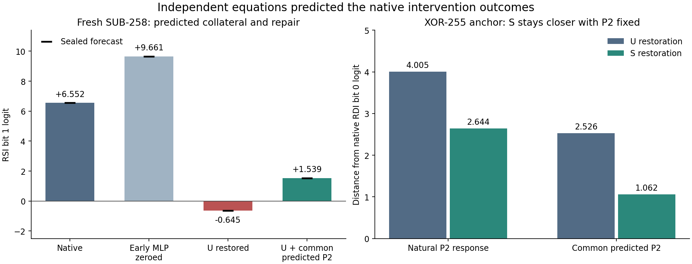

# Predicting the computation before running its suffix

We now have an independently executed mathematical account of the final mixer,
final MLP and output readers of one R3 ISA checkpoint, conditional on an observed
prefix. It predicted all 32 fresh intervention branches, including incorrect
architectural states. All 16 branches on previously observed explanation cases
also matched. No compression was required: the complete 87-array, 291,851-scalar
parameter dictionary was retained.

This establishes a bounded predictive account. It does not establish complete ISA
understanding from raw bytes, semantic names for learned operations, or prediction
of every subsequent instruction. The earlier prefix is still supplied by the
model, and the equations were written from its implementation and weights.



## What actually ran

Job `job-7a4c750a929f` ran on the Beast CPU with native Torch FP32, one thread and
one finite mrun lease. An independent NumPy FP64 interpreter used a sequential
recurrence rather than the native parallel scan. This was neither native replay
disguised as prediction nor a compressed replacement model.

| Evidence | Result |
|---|---|
| Fresh raw states | SUB RDI=257,258; XOR RDI=253,254; RSI=3 throughout |
| Earlier explanation cases | SUB RDI=254; XOR RDI=255 |
| Branches per state | 8 |
| Fresh complete register-bank, flag, length and effect decisions | 32/32 matched |
| Earlier explanation decisions | 16/16 matched |
| Sign/argmax comparisons | All 11 heads matched in every branch |
| Largest fresh register-logit residual | 0.000010718 |
| Largest fresh continuous-head residual | 0.000073229, in flags |
| Largest fresh U/M/P2/final-state residual | 0.000040494 / 0.000040494 / 0.000003875 / 0.000043030 |
| Separate MDB replay versus native-hook audit | Exact, all 48 branches, 11 heads and 6 observed arrays |
| Own-state successors | 48 observed; no sealed full-next-forward forecast claimed |

The complete register bank has 512 bit decisions. Auxiliary immediate and store
heads were compared even when their outputs were not architecturally consumed.
`dest` and `src` already execute in the prefix: their equation checks are
re-expressions. The other nine heads are genuinely downstream forecasts.

There were 108 physical root attempts: six aborted prefixes and 102 completed
forwards (six full captures, 48 independent native branch audits and 48
successors). MDB performed 20,784 replay operations and retained 96 Acts.
Worker time was 27.57 seconds; scheduler start-to-finish was 52.42 seconds. The
scheduler reported 1,034.5 MB peak process-tree RSS. No retry or model rerun was
needed.

## How we excluded future outputs

Protocol and equation source were committed as `44ad882` before execution.
The frozen protocol seal is
`647991e3e6621dfeb9a9259bbf31e24bec148687916fb8f5a8004c91c38890c9`.

1. MDB's new `record_prefix` aborts the native call **before `mixers.2`**. It
   retains the incoming state and completed decoder output. The final mixer,
   final MLP and nine downstream head modules have not run.
2. Common-parent MDB replay makes the early-MLP-zero prefix. Both prefix states,
   decoder output, initial architectural state and full weights are allowed
   forecast inputs.
3. NumPy evaluates the explicit suffix equations for all cases and arms. Fixed
   intervention payloads are staged in FP32 using the declared cast schedule.
   Every forecast and payload is
   written and globally sealed before native suffix release.
4. Only then do full native captures, MDB replay branches and separate native
   hook audits execute. Both validation paths use the **same frozen payloads**.
   Later native activations never replace analytically predicted payloads.
5. An offline analyzer verifies file/source hashes, seals, prefix exclusion,
   public Act receipts, branch ancestry, all heads, retained intermediate arrays
   and successor inputs. It makes no model calls.

The pre-release ledger contains six aborted prefixes, zero completed full
forwards, zero final-mixer/final-MLP entries and zero entries for every downstream
head module. The global forecast seal is
`fd2df328ff0f8615f0447f7933ef43d68225ab629e2dec7b8efbdca4e9bc04d1`.
This is an execution-order and custody check, not a claim that these states were
absent from model training or every earlier research activity.

## The computation we accounted for

Let `S` be the observed final-mixer input, `U` its projected update, `M=S+U`,
`P2` the final MLP write and `h=M+P2`. The independent interpreter explicitly
implements RMS normalization, input projection, causal depthwise convolution,
SiLU, selective state parameters, biased delta projection and softplus,
state recurrence, gating and output projection. The recurrent step is

```text
H[t] = exp(dt[t] * A) * H[t-1] + dt[t] * u[t] * B[t]
```

It then implements LayerNorm, linear → erf GELU → linear for P2, the residual
commit, register copy prior and every output-head equation, including the flag
attention reader. All weights and biases are used as supplied. Every numerical
residual is retained; FP64 and native FP32 are not claimed bit-identical.
Forty-three internal stages are forecast. Native audits directly compare the
future U, M, P2 and h arrays, while S and decoder z are prefix joins. The other
internal stages have not each received a separate native observation.

A register bit has an especially useful account:

```text
logit = copy_prior + bias + Wreg · M + Wreg · P2(M)
```

This separates a carrier's direct effect from the final MLP's response to that
carrier. It supports a computation record tied to a receiving state, reader and
horizon, without pretending that an MLP has one ISA mnemonic as its meaning.

## Eight controlled branches

| Arm | Exact recipe |
|---|---|
| `native` | Native prefix and suffix |
| `zero` | Early `post.0` output zeroed |
| `U_swap` | Edited prefix; U replaced with frozen FP32 predicted-native U |
| `S_swap` | Edited prefix; M replaced with FP32(native S + FP32(predicted-edited U)) |
| `both` | Edited prefix; M replaced with FP32(native S + FP32(predicted-native U)) |
| `sham` | Edited prefix; clone actual U at its SSA boundary |
| `U_swap_P2native` | U_swap, then the common frozen FP32 predicted-native P2 |
| `S_swap_P2native` | S_swap, then the same frozen predicted-native P2 |

`P2native` is a historical arm label for an **analytically predicted** native
write. These are fixed carrier substitutions, not the older exact live-U swap
recipe. Cast order is part of the intervention contract. `both` is not promised
bit-exact native closure. Sham heads and retained stages match `zero` exactly.

## What we learned

For SUB-254, restoring U in the edited recipient changes the RSI bit-1 logit
from +9.660821 to −0.644848, corrupting RSI from 3 to 1. The direct M contribution
improves by +1.945833, but the final MLP contribution changes by −12.251501.
Restoring the projected update therefore does not restore the whole computation.

Holding that branch's M fixed and replacing only P2 raises the bit logit to
+1.539280. RSI returns to 3. The native margin is still +6.551817: the missing
skip contribution also matters. This is a measured intervention separating
direct readout and downstream response, with every outcome forecast beforehand.

**Fresh SUB-258 repeats this RSI failure and repair with the same low-prefix
arrays and logits.** SUB-254 and SUB-258 share their lowest two bits; the causal
bit-axis computation repeats that local prefix. This is evidence for reuse of
the same conditional computation, not two independent local mechanisms.

**Fresh SUB-257 is the useful exception:** zeroing the early MLP already leaves
the native RDI=256 result, and all tested arms retain RSI=3. The equations
predict that too. A mnemonic-wide “SUB needs this early MLP” rule is false on
these cases. Applicability must depend on state and consumer.

For the XOR-255 RDI bit-0 reader, S restoration is closer to the native logit
than U restoration. Their distances are 2.644381 versus 4.004570. With the same
P2 write imposed on both, S remains closer: 1.062342 versus 2.525997. The direct
carrier contribution already produces the ranking; the final MLP cannot be its
sole cause. Fresh XOR-253 repeats the shared low-bit behavior. Fresh XOR-254
instead favors U: natural distances U/S=2.224220/4.254379, common-P2 distances
0.254780/1.177414. Again, one fixed route ranking is too broad.

The analyzer also retains all 96 final-MLP hidden-unit contributions per selected
reader. For the SUB RSI response, U restoration versus zero has positive terms
totalling +12.451438 and negative terms totalling −24.702937. Units 89, 39 and 24
give the largest negative terms. This is exact weighted-activation accounting
within the forecast, not evidence that those individual neurons are necessary
or that their indices are semantic symbols.

For the dynamic symbol table, this suggests recording a stable law endpoint
alongside the receiving state and consumer-specific response. The same fixed
weights can support different effective routes and opposite reader effects.
The recurrent clock here runs over bit positions inside one forward; it is
distinct from the architectural instruction clock. Successors consume the
model's decoded registers and flags, but this experiment does not establish
hidden recurrent-state persistence between instructions.

## Using MDB for the next investigation

The first-native prefix capture is now public Python API:

```python
from mdb.forward_prefix import record_prefix

# model is CPU/eval; roots are the model's ordinary positional inputs.
capture = record_prefix(
    model, roots, stop_before="mixers.2", observe=("decoder",),
    model_identity=checkpoint_sha256,
    execution={"backend": "cpu", "dtype": "float32", "threads": 1},
    input_identity=case_identity, metadata={"case_id": case_id},
    max_operations=8192,
)
incoming = capture.output["boundary"]  # args and kwargs at the stopped call
decoder_outputs = capture.output["observed"]["decoder"]
```

This completes a prefix wrapper and aborts the native stack. It is not a paused
Python stack that can later resume. Recorded wrapper paths start with `native.`.
The existing MDB recorder, fork, typed Act and replay APIs then operate on the
prefix. The campaign uses them for every edited state and intervention branch;
its source is the executable example. The qualified path is CPU/eval, occurrence
zero, immutable retained observations; other native families need qualification.

The next expansion should move the observation frontier earlier, keeping the
same sealed suffix protocol. First account for the preceding MLP and mixer from
their inputs, then forecast multiple architectural updates without observing a
new internal prefix. Use disagreements between candidate accounts to select
inputs. Generic record IDs should bind law, state conditions, source/carrier,
consumer, intervention recipe, forecast and counterexamples. Aliases can remain
structural; inferred ISA names are optional.

## What would make this significantly easier in MDB

1. **Actual module and named parameter ports.** A structural `dt_proj:output`
   currently identifies an affine operator range that excludes its bias add.
   The actual module output is a later SSA value. Depthwise convolution also
   lacks a generic structural site. Expose actual call inputs/returns separately
   from mathematical substeps, plus named weights/biases and first consumers.
   This removes manual source/trace reconciliation when extending the account.
2. **A prefix → forecast → seal → release debugger transaction.** The Python
   prefix primitive now works. Allowed-input receipts, denied downstream entry,
   frozen payload casts, global sealing and script release still require custom
   harness code. Make them one bounded script action, distinct from eager replay.
3. **Typed equation and intervention records.** Bind an equation's weight
   provenance, receiving state, FP32 cast schedule, fixed payload or live-input
   recipe and consumer horizon. Automatically join predicted and observed arrays,
   direct carrier terms, MLP response, collateral and own-state successors.
4. **Compact shared evidence and searchable comparisons.** The run generated
   352 MB expanded evidence (35 MB compressed), largely repeated cut/trace
   metadata. Share immutable program/weight/cut references and stream completed
   rows. Index applicability exceptions and forecast disagreement automatically.
   This reduces evidence overhead without compressing the model.

The existing discovery debugger already supplies generic IDs, breakpoints,
stepping, branches and bounded scripts. The largest remaining cost here is
manually joining those capabilities into a prospective computation experiment.
Requests were added or upvoted in the workspace Saturn ledger.

## Reproduction and evidence

Sources: [frozen plan](../qualification/explicit-computation-plan-20261030.json),
[equations](../qualification/explicit_suffix_equations.py),
[mrun campaign](../qualification/explicit_computation_campaign.py),
[offline analyzer](../qualification/analyze_explicit_computation.py),
[publication tool](../qualification/publish_explicit_computation.py) and
[portable result index](../qualification/explicit-computation-20261030.json).

From the domains workspace, with the qualified MDB environment selected:

```sh
# This session's installed-wheel environment; substitute your installed MDB Python.
MDB_PYTHON=/private/tmp/mdb-discovery-upgrades-installed-20261030/bin/python

# Submits a new run; use a new run directory, never overwrite the retained run.
common exec "$MDB_PYTHON" mdb/qualification/explicit_computation_campaign.py \
  --isa-root "$PWD/isa" --plan "$PWD/mdb/qualification/explicit-computation-plan-20261030.json" \
  --run-dir "$PWD/artifacts/mdb-explicit-computation-reproduction/run-01"

# After that job finishes, collect its archive using its actual job ID.
common exec "$MDB_PYTHON" mdb/qualification/explicit_computation_campaign.py \
  --collect JOB_ID --run-dir "$PWD/artifacts/mdb-explicit-computation-reproduction/run-01"
```

Local original evidence is under
`artifacts/mdb-explicit-computation-20261030/run-01/` in the domains workspace.
Its `analysis-v3.json` SHA256 is
`6c12e4d18791632fb40337ec32c5e18009955889351259a95a04bb7a490c3477`.
The archive SHA256 is
`a0826dca12515ab36a8515332ed59ac588be2d6692b14e5831e5c9b71d66115a`.
The result index binds executed source hashes, protocol, checkpoint and forecasts.
The payload wheel matched all 170 installed MDB source modules; its SHA256 is
`1b116641e05b889cdeb2b83e091f6b9ead6ae9efbd9f8a0916baaa18bd8815d5`.

The old collector refused expansion above 256 MiB before extraction. The same
archive was recovered with a bounded 512 MiB extractor, validating checksums,
unique regular files and safe paths; no model rerun occurred. Future collection
now uses an explicit bounded override. The executed worker source remains
immutable. Earlier offline-analysis failures and corrections are also retained.
The scheduler's object-store upload was unavailable and remains `failed-queued`;
the verified local archive and source-bound publication are available.

Saturn evidence `run` and `verify` both returned zero findings. Their actual
coverage is `target-streams-only`: 1,606 timeline records, no native auto-ingested
claims, and no discovered address references. The explicit analyzer's typed
receipt and tensor joins establish this campaign's detailed audit; the generic
sweep does not independently certify those numerical findings.

Validation: 33 installed-wheel prefix/recorder/discovery tests passed; independent
equation mechanics checks and Ruff passed. The collector override passed synthetic
archive and pre-API bounds checks. The graph above was rendered from saved results
and visually inspected. Sol agents implemented and checked the pieces; Astra
reviewed the interpretation and limits.
