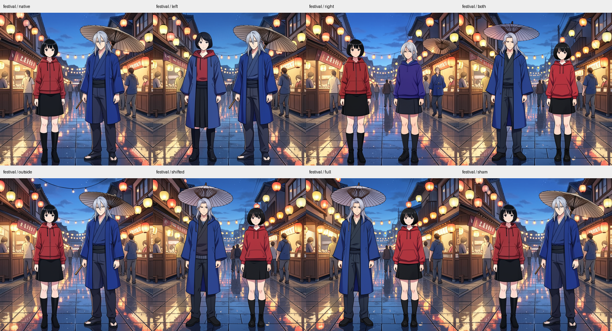
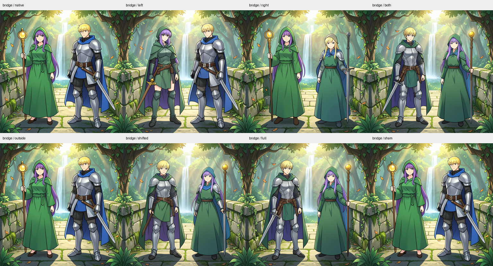

# Carried state in detailed anime scenes

This assay extends the [primitive-scene spatial experiment](FLUX-SCENE-SPATIAL.md) to original adult anime characters in detailed environments. It uses the same FLUX.2 Klein4B distilled checkpoint, CUDA BF16/B1 numerical profile,512×512 geometry, four denoising steps and step2 project frontier. Actual native denoising and VAE decode produce every image.

The first scene places a black-haired woman in a red hoodie and a silver-haired man in a blue coat on a lantern-lit festival street, using seed47. The second places a violet-haired mage in green and a blond armored knight with a blue cape on a forest bridge, using seed83. Each scene has a base A-left/B-right prompt and a reversed B-left/A-right prompt. Exact supplied prompts are retained in the plan; intended attributes are separate from observed rendering.

## Reference and local-intervention stages

The first finite lease encodes four prompts, runs four matched native prefixes through step2 and seals all predictions before final decode. Four natural references and two whole source-latent/base-conditioning futures produce six images. Within each scene, initial latent noise, schedule and native image IDs are exact. The two whole-latent cases prospectively test whether the source cast arrangement survives opposing recipient conditioning.

The second lease imports only the four size/hash-pinned typed cuts. It uses explicitly supplied rectangular body/hair/clothing windows from the known natural references, lowered through native H/W IDs. These are manual geometric windows; props extending beyond bodies are not comprehensively selected. The flat colored-component detector from the toy scenes is inapplicable as a person-identity instrument here.

Per scene, native, sham and full-latent cases replay three known outputs. Left-only, right-only, stacked both, outside and shifted edits supply five new spatial futures. All sixteen branches retain base conditioning. The frozen questions ask whether left/right edits duplicate source B/A appearance associations and whether both compose the swapped cast, retaining partial hair/outfit/prop transfer and identity drift.

The festival windows select348 left and319 right rows, with667 in their union; bridge348/420, union768 of1,024. The half-height shifted controls overlap598 and704 of those union rows, respectively. They are overlapping perturbations, not clean wrong-location nulls. The outside complements contain357 and256 rows. No equal-energy or equal-cardinality background control is claimed.

Semantic observations are informal, task-aware assistant judgments made on anonymous images before arm unblinding. Hair, clothing, props, foreground count, background and face drift remain separate observations. Numeric effects use fixed geometric regions, not semantic person masks or a calibrated facial similarity model.

## Reproduce the two stages

Use the qualified installed public environment with mrun credentials:

```sh
export MDB_WORKER_UV_CACHE_DIR=/mnt/hdd8tb/mdb/uv-cache
export MDB_WORKER_TORCH_HOME=/mnt/hdd8tb/mdb/torch
export MDB_WORKER_MODEL_ROOTS=/mnt/big/llm-models
python qualification/submit_flux_anime.py /absolute/path/references-run
python qualification/submit_flux_anime.py /absolute/path/references-run --collect REFERENCES_JOB
python qualification/analyze_flux_anime.py /absolute/path/references-run /absolute/path/references-run/analysis-v1.json
python qualification/submit_flux_anime.py /absolute/path/spatial-run --predecessor /absolute/path/references-run --annotations /absolute/path/reference-annotations.json
python qualification/submit_flux_anime.py /absolute/path/spatial-run --collect SPATIAL_JOB
python qualification/analyze_flux_anime.py /absolute/path/spatial-run /absolute/path/spatial-run/analysis-v1.json --predecessor /absolute/path/references-run
```

Supply source-image-bound annotations only after inspecting the natural references and before new spatial outcomes. Retain the pre-run audit snapshot when shared helper code changes. The second stage uses an explicit host-local historical CAS locator and hash/size verification before model load; it does not deploy a fleet artifact mount. Each sequential CUDA lease has strict preflight, one model load, no retries and a600-second execution ceiling. The reference lane bounds700 transitions; the spatial lane1,100. Neither lane trains the model.

Sources: [native worker and exact prompts](../qualification/flux_anime_campaign.py), [submitter](../qualification/submit_flux_anime.py), [auditor](../qualification/analyze_flux_anime.py), [retained runs and observations](../../../../artifacts/mdb-flux-anime-20261103/).

## Completed observations

Both leases succeeded, producing22 actual native final images:6 reference/whole-latent outputs and16 spatial outputs, of which6 repeat known controls. Both whole-latent edits retain the swapped coarse cast order. In the bridge, the left knight's source-blue cape becomes green under base C. The [paired-state diagnostic](../../../../artifacts/mdb-flux-anime-20261103/conditioning-contrast.json) verifies that edited source-L/base-C and natural source-L/source-C project states differ only in conditioning. Both prompts request a blue cape. Binding/receiving-state incompatibility is a working explanation, not an identified abstract binding operator.

The local-window results are more heterogeneous than the primitive scenes:

| Scene | Left only | Right only | Both windows |
|---|---|---|---|
| Festival | Black hair and red hoodie remain under a transferred blue coat | Silver hair remains with hoodie/skirt/boots; separate blue-coated person and umbrella appear behind | Hair/order swap succeeds, but right red hoodie retains blue outerwear |
| Forest bridge | Violet mage hair/cloak remains with transferred armor and sword | Blond hair remains with green robe, staff and residual shoulder armor | Coarse knight-left/mage-right succeeds; knight cape remains green |

None of the four single-window cases is a clean complete-character duplication under informal inspection. They do demonstrate partial appearance control and preferential geometric effects. Festival left target-window/companion-window MAE is.16070/.05021; bridge left.16030/.04990. These are window averages, including background pixels, rather than independently segmented person effects. All outside edits retain coarse base hair/role arrangement, with nonzero pixel changes.

The recurring hair response has a stronger controlled comparison. Each single-window output retains the recipient's hair cue despite changed clothing/props. In both, that side's hair changes to the source arrangement. The [paired-state audit](../../../../artifacts/mdb-flux-anime-20261103/paired-appearance-observation.json) checks four comparisons directly: the selected side's starting latent rows are bit-identical, all nonlatent state agrees, and only rows in the companion window change. Thus companion-region state affects the fixed side's eventual hair appearance in these occurrences. The window is geometric, the hair observation is informal, and the intervening locus could be in the denoiser trajectory or decoder. This does not establish a universal character identity variable.





The shifted cases confirm why overlap must be reported: they also swap the cast and are not wrong-location nulls. Festival shifted has cleaner right red clothing than both despite almost equal global source projections(.86865 versus.86869). That metric does not certify object or garment identity. Both/shifted differ by69 rows in each direction in festival and64 in bridge; a future crossed restore can distinguish adding the shifted-only rows from omitting the both-only rows.

The supplementary pre-execution forecast also remains componentwise: the untouched right knight stays blue and the stacked pair's left knight has a green cape/collar. The single-left forecast does not produce the predicted left knight: the figure retains violet mage hair with armor. Green cloth alone does not count as a successful knight prediction. All [original and supplementary prediction observations](../../../../artifacts/mdb-flux-anime-20261103/prediction-review.json) are retained.

## Mechanics and evidence

Reference job `job-996e41d31e06` used560 adapter transitions,2 Acts,4 encodes and6 decodes; worker152.36s, scheduler186.09s, peak RSS10,233.1MB/VRAM9,202MB. Spatial job `job-42ccc017f516` used896 transitions,16 Acts,0 encodes and16 decodes; worker216.12s, scheduler239.94s, peak RSS4,943.5MB/VRAM9,260MB. Queue time is separate. Audits verify562 and912 public receipts respectively, every declared row write, all6 exact historical spatial PNG controls and both exact left-edited parents for stacked Acts.

The [reference audit](../../../../artifacts/mdb-flux-anime-20261103/references-run-01/analysis-v1.json), [spatial audit](../../../../artifacts/mdb-flux-anime-20261103/spatial-run-01/analysis-v1.json), [reference external seal](../../../../artifacts/mdb-flux-anime-20261103/references-external-seal.json), [spatial external seal](../../../../artifacts/mdb-flux-anime-20261103/spatial-external-seal.json), [reference observations](../../../../artifacts/mdb-flux-anime-20261103/references-review/blind-labels.json) and [spatial observations](../../../../artifacts/mdb-flux-anime-20261103/spatial-review/blind-labels.json) preserve the evidence. Predictions preceded new final decodes; the reference seal allows224 already observed prefix transitions. The [additional forecast pin](../../../../artifacts/mdb-flux-anime-20261103/supplementary-forecast-pin.json) was recorded while queued and is separate from the unchanged worker transaction seal.

Twelve [generic occurrence records](../../../../artifacts/mdb-flux-anime-20261103/computation-records.json) cover two whole-state and ten new spatial interventions. Canonical evidence run, verify, citation query and stats return0/0/0/0; the [query](../../../../artifacts/mdb-flux-anime-20261103/evidence-v1/xref-query.json) retrieves all12 exact model/checkpoint/parent-bound occurrences. This is local empirical lookup, not automatic family discovery or equation-atlas induction. The pinned wheel's legacy CPU-FP32 transaction label and external-call counter limitation are qualified in additive [reference](../../../../artifacts/mdb-flux-anime-20261103/references-run-01/metadata-qualification.json) and [spatial](../../../../artifacts/mdb-flux-anime-20261103/spatial-run-01/metadata-qualification.json) records. Native source profiles and the dedicated ledger establish actual CUDA BF16 execution; raw artifacts are unchanged.

The useful capability is partial control over appearance-bearing carried state in detailed scenes, with composed coarse arrangement and explicit identity/attribute failures. Complete character records, calibrated facial identity, automatic person/prop masks and transferable semantic rules remain open.

The next mechanistic cut can compare a single-window state against its matched both-window state at step2 projection and the following attention/MLP ports. The fixed side starts identical. Locating its first changed native write, then restoring that write through the actual suffix, would distinguish where companion information enters from later repair or decoder effects. The festival both/shifted69-row exchange offers a separate small extent test for costume mixing.

That first cut is now [completed](FLUX-ANIME-WRITERS.md): twelve additional native futures, six exact historical/sham controls and672 verified receipt emissions. In both left-side comparisons, the first changed return is joint0 attention, followed by changed MLP inputs/returns. Restoring attention alone reproduces the single-branch local post-block state exactly; A-only and AM have identical full post-Act cuts and PNGs. The final hair still follows the both-window appearance, so one early local restoration does not reverse it. Eight writer occurrences bring the combined local citation query to20. A [finer scene inventory](../../../../artifacts/mdb-flux-anime-20261103/scene-inventory-v1/README.md) distinguishes24 manually observed part/appearance address candidates and11 visible relations from intervention-backed records.
