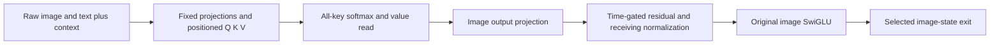

# Following raw state through attention and the image MLP

We moved the prediction boundary upstream in FLUX.2 Klein4B joint block 1. The
previous experiment supplied an observed normalized MLP input. This experiment
supplies the raw image/text state, positional context and time modulation, then
independently calculates Q/K/V, attention, the receiving MLP input, the MLP and
the selected image-state exit. Original checkpoint weights supply the fixed
parameters; no coefficients are fitted.

Three forecasts and four attention contrasts were sealed before native
execution. The selected image exits have 0.202–0.216% relative RMS error against
native CPU BF16. Their **changes** are harder: changed-minus-base image-exit
error is 5.91% of the observed change; midpoint-minus-base error is 7.86%.
These are measured numerical discrepancies, not bit-identical execution.

The main explanatory result is a complete attention-change accounting. Changing
working text changes its keys and values, and also reweights unchanged image
values through the shared softmax denominator. Routing/value interactions are
large and partly oppose the sum of the separate contributions.

## What was supplied and what was predicted

The source is the accepted [context-transfer experiment](FLUX-CONTEXT-TRANSFER.md):
step 2/joint1 entry, seed 109, 512-pixel, four-pass source runs. Base and changed
states have identical complete incoming image, position and time-modulation
state. Their working text differs. Both endpoints were previously observed on
CUDA. The new test input is their BF16-rounded text midpoint, with the same
image/context. It is an internal state, not a new natural prompt.

Native execution uses the original complete joint1 block on CPU BF16: 512 text
rows, 1024 image rows, width 3072, 24 heads of width 128. The forecaster follows
32 fixed image queries, while retaining **all 1536 keys and values**. It observes
16 text rows as additional projection witnesses. The original full native block
computes every row, including its text update.

The forecast never reads a native attention or MLP return. It does not predict
the text exit or all 1024 image exits. Consequently this is not yet a complete
predicted state suitable for the next block. The isolated component omits
latent/scheduler/conditioning fields that this block does not read; its cuts are
explicitly distinct from full-pipeline cuts.

## The mathematical path

Let \(B\) mean BF16 rounding. The state supplies image residual \(I\), working
text \(T\), positional rotations, and the modulation vectors. The image and
text streams are independently normalized and modulated:

\[
X_I=B(B(\operatorname{LN}(I)\odot B(1+s_I))+b_I),
\qquad X_T=B(B(\operatorname{LN}(T)\odot B(1+s_T))+b_T).
\]

Fixed original matrices project the streams into queries, keys and values.
Queries and keys also pass through their original weighted RMSNorm and
positional rotation. Text keys/values precede image keys/values in the combined
sequence. For each selected image query:

\[
P=\operatorname{softmax}(QK^\top/\sqrt{128}),\quad
H=B(PV),\quad A=B(\operatorname{mergeHeads}(H)W_O^\top).
\]

The image-facing attention write then enters the residual and image MLP:

\[
U=B(I+B(g_A\odot A)),\quad
x=B(B(\operatorname{LN}(U)\odot B(1+s_M))+b_M),
\]

\[
[a,v]=B(xW_{in}^\top),\quad h=B(B(\operatorname{SiLU}(a))\odot v),
\quad m=B(hW_{out}^\top),\quad I'=B(U+B(g_M\odot m)).
\]

The independent implementation uses NumPy FP64 reductions and explicit native
BF16 boundaries; RoPE preserves the native FP32 product/addition boundaries.
The formulas describe the computation, but these arithmetic choices do not
make NumPy and the native CPU kernels bit-identical.



## Prediction evidence and numerical limits

All 19 declared fields per case join actual native ports by shape, dtype and
payload hash. The independent audit also checks original checkpoint parameter
recipes, transaction sealing, typed before/after cuts, receipts and archive
custody. Complete source image-query inputs agree with the staged arrays.

| Stage | Base relative RMS | Changed relative RMS | New text midpoint relative RMS |
|---|---:|---:|---:|
| Positioned query |0.00268%|0.00268%|0.00268%|
| All positioned keys |0.00485%|0.00515%|0.00527%|
| All values |0.00358%|0.00375%|0.00363%|
| Attention head return |0.12357%|0.12077%|0.12094%|
| Image attention output |0.18767%|0.18845%|0.18751%|
| Receiving MLP input |0.22838%|0.23990%|0.22515%|
| Image MLP return |0.34884%|0.38449%|0.34641%|
| Image-state exit |0.21619%|0.20231%|0.20900%|

Here relative RMS divides error RMS by sealed prediction RMS. Endpoint
discrepancies remain in the records; image-exit maximum absolute error is 0.25.
Observed normalized image and sampled text inputs are exact. Combining the
**observed** attention and MLP writes with the residual/gates reconstructs all
98,304 selected exit values exactly in each case. That last identity is
retrospective accounting, separate from the sealed forecasts.

Error relative to a smaller effect is a different measurement:

| Predicted change | Head-return error / observed change RMS | Image-exit error / observed change RMS |
|---|---:|---:|
| Changed minus base |1.236%|5.911%|
| Midpoint minus base |1.676%|7.859%|

The attention kernels account for substantial numerical disagreement even when
given observed Q/K/V: rounded independent attention still differs from native
head returns by about 0.120–0.124% relative RMS. This comparison localizes a
numerical boundary; it is not proof of one specific kernel-internal cause.
CPU measurements do not certify CUDA parity.

## Routing, values and their interaction

The native selected image queries and **all** image keys/values are exactly
unchanged across all three text states. Only the text contribution to K/V can
change at this attention boundary. Thus the following fixed-query accounting
also applies to the actual base/changed attention operands.

Using the observed ports, define \(P_i=\operatorname{softmax}(QK_i^\top/\sqrt{128})\),
\(\Delta P=P_1-P_0\), and \(\Delta V=V_1-V_0\). Before final BF16 kernel rounding:

\[
\Delta O=
\underbrace{\Delta P_TV_{0,T}}_{\text{text routing}}+
\underbrace{\Delta P_IV_{0,I}}_{\text{image routing}}+
\underbrace{P_0\Delta V}_{\text{value change}}+
\underbrace{\Delta P\Delta V}_{\text{interaction}}.
\]

| Contribution | RMS |
|---|---:|
| Text routing |0.142183|
| Image routing with unchanged image values |0.036116|
| Value change under base routing |0.144195|
| Routing/value interaction |0.191784|
| Actual independent attention difference |0.132982|

An independently written contraction reconstructs the difference with RMS
residual \(1.66\times10^{-15}\). Without interaction, the additive sum has RMS
0.250216. The interaction has cosine −0.8513 with that sum, reducing the final
change. Component norms are not causal percentages and depend on the chosen
baseline. These are post-hoc mathematical explanations, not prospective
semantic discoveries.

Four **prospective** K/V factorial corners complement that explanation:
\(K_0V_0,K_1V_0,K_0V_1,K_1V_1\). Each uses sealed predicted Q/K/V operands and is
then tested by the unchanged native CPU SDPA kernel on those exact supplied
operands. Head errors are 0.119–0.123% relative RMS. A separately written FP64
reference rounds to exactly the sealed forecast for all four corners. The
standalone kernels use 32 queries, while the original native block uses 1536;
their execution geometries are explicitly recorded.

## Why unchanged image values move

Let \(m_i\) be the total probability assigned to text for a fixed query/head.
Because image logits are unchanged, all image probabilities scale together:

\[
P_{1,I}=\frac{1-m_1}{1-m_0}P_{0,I}.
\]

Therefore:

\[
\Delta P_IV_I=
\left(\frac{1-m_1}{1-m_0}-1\right)P_{0,I}V_I.
\]

This predicts the entire unchanged-image routing contribution with RMS residual
\(1.87\times10^{-16}\). Text does not need to alter an image value to change
how much of that value is read.

Across 768 sampled query/head pairs, average text probability moves from
0.30730 to 0.30508. Yet 484 pairs increase and 284 decrease: the decreases are
larger on average. An aggregate attention mass conceals that structure. Heads
15, 6 and 5 have the largest head-output changes in this specimen, with RMS
0.51208, 0.25680 and 0.24967. These are useful numerical addresses for the next
test, not names such as “red,” “sphere” or “relation.” All 24 head summaries are
retained, including weak responses and opposing trends.

## How MDB stores and exposes this

Seven measured occurrences are searchable in `public-records-v2/equations/`:
three under `law.flux.joint-image-state.v1`, and four supplied-operand corners
under `law.attention.softmax-value.v1`. Records bind checkpoint, component,
input identity, step/block, numerical profile, row selection, frontier,
consumer, signed residuals and evidence. Seven exact-context queries resolve;
seven changed-backend and seven changed-clock queries abstain. Applicability
conditions are supplied predicates. They have not been learned across prompts.

These commands were exercised on the actual records, from the artifact root:

```bash
python -m mdb equations find --catalog public-records-v2/equations \
  --law-id law.flux.joint-image-state.v1
python -m mdb equations find --catalog public-records-v2/equations \
  --applicable-to public-records-v2/context-midpoint.json
```

They return three occurrences and one exact-context occurrence respectively.
`mdb equations show` was also exercised. Command results and hashes are in
`public-records-v2/cli-checks.json`.

Each full native block executes through a public Saturn adapter, an MDB
`NativeCutNavigator`, typed `LocalStore` cuts and a continuation receipt. Native
hooks only observe inputs/returns; they return the original values. The native
attention dispatcher remains the original implementation. Three before/after
cut pairs and three receipts are verified.

This is **port-level observation**, not full ATen/SSA replay. The recorder's
current alias-state contract rejects a native RMSNorm in-place temporary. We
retained the original module and used explicit component boundaries rather than
alter its arithmetic to accommodate the recorder. The gap is recorded in
Saturn's request ledger.

The standard Saturn evidence-plane `run` and `verify` sweeps also ran against
the unchanged collected directory. Both report
`evidence-incomplete-empty-target`: they recognize no gate receipts, JSONL
streams or `ar://` citations in these MDB-specific records, despite scanning
54 JSON files. That is an adapter/instrument limitation, not an additional
verification or a scientific null. The custom saved-only custody/state/port
audit remains the applicable instrument. The raw sweep reports are retained,
and a format-adapter request is logged without manufacturing scientific gates.

## What this adds to the larger computation map

A fixed mathematical law and its current operands jointly determine a state
update. Attention produces state-dependent read weights; the MLP produces
state-dependent multiplicative coefficients. Time modulation gates their
writes. The symbol table names these operations and their bound occurrences,
while the typed state stores the tensors and clock that execution consumes.
A computation record describes a transition; it does not replace that state.

This run advances the observation frontier from normalized MLP input to raw
joint-block entry. It adds a measured account of how changed text affects the
image-facing computation. The architecture itself is known; the contribution
is the source-bound prediction and explanation of this specimen's transition.
Object-level labels and cross-context families remain research questions.

The next computation-first cut is to predict the **complete image and text
exit**, then feed that predicted closure into joint2 without replacing it with
an observed state. At the same time, repeat the routing/value decomposition on
fresh source contexts to test whether the same head addresses and interaction
patterns recur. Keep endpoint, effect and continuation errors separate.

The [complete-state continuation follow-up](FLUX-STATE-CLOSURE.md) now tests
that missing closure: both entire streams are predicted through joint1 and
joint2, and native joint2 separately consumes the sealed predicted joint1 state.
It reports accumulated endpoint/effect errors and their propagation accounting.

## Reproduction, custody and resources

Code: `qualification/flux_attention_state_law.py` stages/submits the experiment;
`flux_attention_state_campaign.py` runs the original component;
`analyze_flux_attention_state_law.py` audits saved outputs;
`publish_flux_attention_state_law.py` creates the records and diagnostics.

Artifact root: `artifacts/mdb-flux-attention-state-law-20261105/` in the domains
workspace. Use `run-01/`, the accepted `collection-02/`, `audit-v1.json`, frozen
`audit-sources-v2/`, and `public-records-v2/`. `public-records-v1/` is retained;
v2 adds an explicit interaction/cancellation summary without new model work.

Job `job-f01aa3abe6db` loaded one original block and executed three complete
native blocks plus four standalone attention kernels. Its census contains 36
native linear calls, three image MLP calls and three text MLP calls. There were
zero full-pipeline forwards, images, encoder calls or noise draws. The worker
took 81.37 seconds; runner elapsed time was 364.74 seconds; peak RSS was
2552.3MB, with zero VRAM use. mrun chose the automatic 4GB CPU reservation.

The archive is 179,124,660 bytes, expanding to 256,133,334 bytes across 75 files.
No persistent weight bank is included: 16 named parameter recipes, original
checkpoint/file/tensor hashes and `retrieve_weights.py` recover the parameters
if needed. The 138,221,454-byte forecast bundle exceeded the collector's 128MiB
member bound. `collection-01/` retains that failure; a separately recorded
160MiB transport override collected the unchanged original directory, without
rerunning the model. All checksums and native publication bindings still hold.
The initial audit source and the transport-repair audit source are both kept.

Forty-four focused arithmetic, native tiny-component and custody tests passed
in the installed public-wheel environment. Numerical outcomes are observations;
the audit certifies mechanics and custody, not universal semantic understanding.
