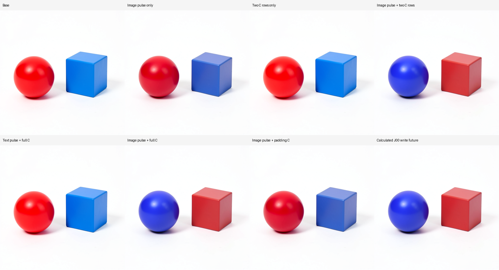
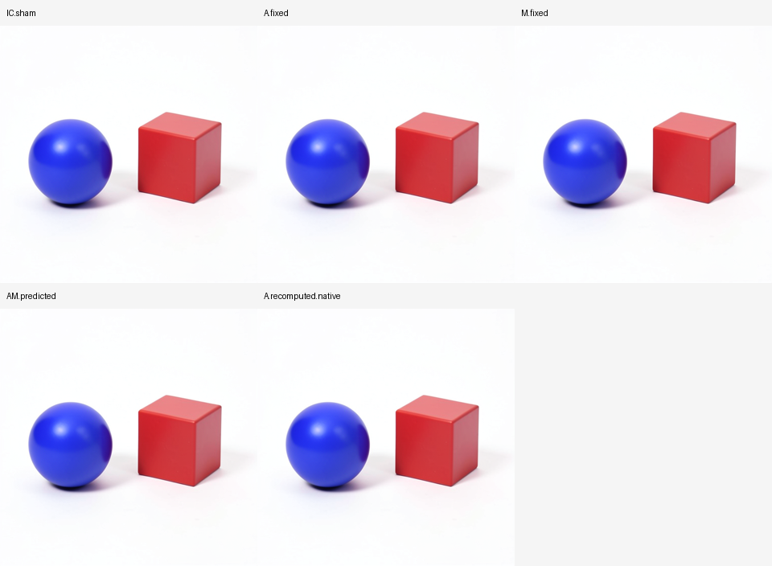
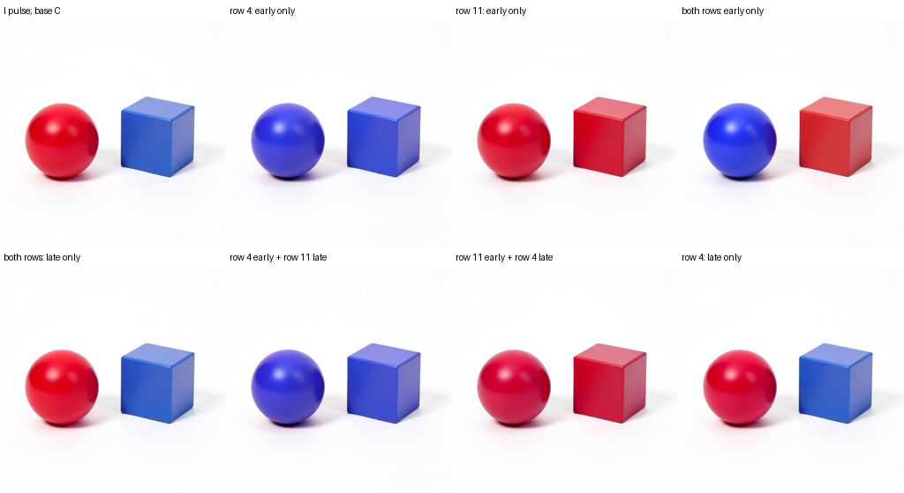
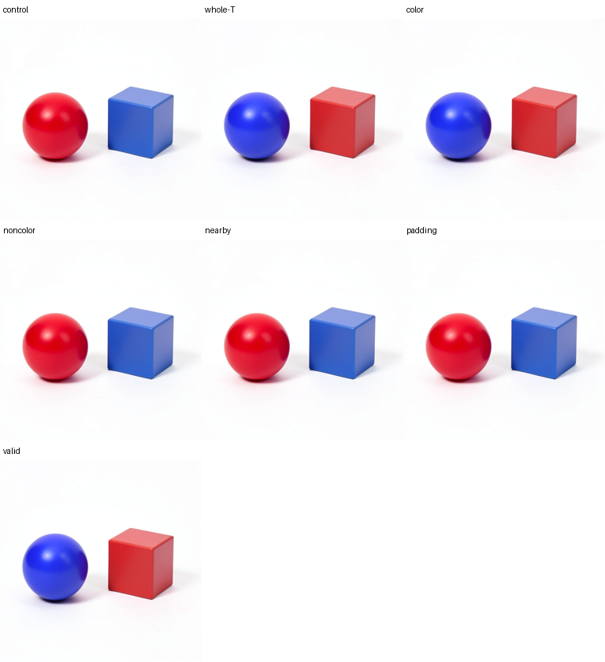

# A smaller conditional binding program and its first writers

An earlier image-only pulse plus two later conditioning rows is sufficient to swap a red sphere/blue cube into a blue sphere/red cube on the tested parent. A separate current-text transplant is unnecessary. This narrows the [previous whole-state recipe](FLUX-SIX-AREAS.md) while preserving its dependence on receiving latent state and clock.

Three completed campaigns use FLUX.2 Klein4B distilled, CUDA BF16, batch one, seed 109, 512×512 and four denoising steps. All branches start from the same saved step1/joint4 parent. Current image/text pulses occur there; conditioning changes first occur at project2 and persist through project3. No new encoder or noise draw is used. These are source-assisted contextual edits, rather than an independent raw-prompt image predictor.

## Which earlier stream prepares the receiver

The first panel seals two new categorical predictions and complete numerical forecasts before its first denoiser entry. Sham, I-only and I/T+C are historical controls.

| Current pulse | Future C | Native result | Mean RGB distance to natural binding donor |
|---|---|---|---:|
| Sham | Base | Red sphere left of blue cube | 31.1074 |
| I | Base | Red sphere left of blue/periwinkle cube | 25.8046 |
| I | Donor, all rows | Blue sphere left of red cube | 6.5032 |
| T | Donor, all rows | Red sphere left of blue cube | 30.9671 |
| I/T | Donor, all rows | Blue sphere left of red cube | 6.6097 |

Both new categorical predictions match. The earlier image pulse can prepare the receiver without a separate text pulse. It still transplants a complete working image field; spatial or feature minimality is untested. Shading, saturation and geometry differ from the natural donor. Distances are RGB levels on the 0–255 scale, not semantic percentages.

## Two contextual token rows are sufficient

The second panel fixes that image pulse and varies only future conditioning. Its full-C image exactly reproduces the first panel's I+C PNG.

| Donor C rows | Count | Native binding |
|---|---:|---|
| None | 0 | Red sphere / blue-periwinkle cube |
| All | 512 | Blue sphere / red cube |
| Valid tokens | 37 | Blue sphere / red cube |
| Padding | 475 | Red sphere / blue-periwinkle cube |
| Changed color tokens | **2: rows 4 and 11** | **Blue sphere / red cube** |

All four recorded row-panel categorical predictions match, including the repeated full-C control. These are dependent same-seed cases, not four independent generalization trials. The two-row image has donor MAE 6.2419, versus 6.5032 for full C. Its slightly smaller pixel distance does not establish better fine-detail preservation.

The explicit intervention is

\[
C^*_r=\begin{cases}C_{d,r},&r\in\{4,11\},\\C_{b,r},&\text{otherwise}.\end{cases}
\]

The row addresses are specific to the recorded tokenization. Each row contains the contextual concatenation of native Qwen layers 9, 18 and 27, not a pure color vector. The recursive follow-up below tests individual rows and read times on this receiver; different tokenizations and new seeds remain open.

An independently checked two-by-two joins earlier same-parent base/I/C.color controls with the new I+C.color future. After installing this same two-row C program at project2, complete payloads differ only in latent. Its Z3 effect RMS is 0.006447 on the unprimed receiver and 0.068088 on the image-primed receiver, a 10.56× finite response ratio. The Z4 ratio is 10.97× and RGB response ratio 43.70×. The interaction is zero before C is read and appears at the next latent commit, before the VAE. These ratios describe vector responses, not semantic shares.

## Follow the two rows into attention and the MLP

At project2, I2 is identical between I-only and I+C.color. Exactly two projected text rows change: 4 and 11, with 6,129 of their 6,144 values differing. After joint0, all 1,024 image rows and all 512 text rows differ. Actual native image attention, MLP input and MLP return each change at all 1,024 image positions.

The computation is

\[
I_2=B(Z_2W_I^T+b_I),\qquad T_2=B(C^*W_T^T+b_T),
\]

\[
U=B(R+B(g_AA)),\qquad M=\operatorname{FF}(\operatorname{mod}(\operatorname{LN}(U))),
\]

\[
R'=B(U+B(g_MM)).
\]

Here B denotes the declared BF16 rounding boundary. Fixed image and clock imply fixed initial image Q/K/V by the qualified joint-block source; changed text K/V can change image attention. The saved native ports directly observe the resulting attention and receiving-MLP changes. QKV itself was not archived at this new clock, so no specific head is claimed responsible here.

This is a first writer trace, rather than proof that joint0 is the unique final binding bottleneck.

## Predict the next projection and first joint block

The previous campaign already observed the Z2 produced by each I/T pulse. Before the new continuations, a separate request-frozen mathematical program consumes those prefixes, edited C, IDs, schedule and checkpoint-matched parameter banks. Its own predicted project/context feeds its joint0 forecast.

Across the stream and subset panels it freezes **100 complete fields / 98,795,520 scalars**. Every actual pre-C latent matches the declared prior prefix exactly. Native joint-image relative RMS errors are 0.4861–0.4935%; project-image errors are 0.00116–0.00290%. All IC/TC/ITC projected text fields under full donor C are exactly equal natively, while their different receiving latents produce different image states and futures.

These are conditional next-state forecasts. Their target exclusion counters are zero at seal. The old encoder and Z2 prefixes are observations; the later complete denoiser/VAE image computation is native. This campaign compares these forecast fields with native values, without installing them as an independent RGB bridge.

The two forecast preparations take 18.585 and 19.076 seconds locally, with zero model calls and no parameter exports. The second retrieves the same 23 parameter archives by verified SHA from shared storage when their original archive paths are absent. These are exact existing parameter bytes, not new fitted weights or observed new target activations. The separate checkpoint-backed cleanup later externalizes that cache too. The artifact overview retains an exact 23-file retrieval manifest and standalone command, matched to the completed independent checkpoint reconstruction proof; it does not retain another weight copy.

## Calculated writes and native recomputation reach the same future

The third panel starts from the successful I+C program. Saved native joint0 ports from I-only and I+C provide A0/M0 and A1/M1. The incoming image R and time gates are exactly equal at this point.

Before any new suffix runs, NumPy BF16 equations calculate three complete image exits:

\[
R'_{A}=B(B(R+B(g_AA_0))+B(g_MM_1)),
\]

\[
R'_{M}=B(B(R+B(g_AA_1))+B(g_MM_0)),\qquad
R'_{AM}=B(B(R+B(g_AA_0))+B(g_MM_0)).
\]

These are predicted write vectors conditional on saved native operands. They do not independently predict the earlier attention/MLP returns. Every vector matches its new direct native candidate exactly. A fourth candidate restores A0 and lets the native MLP recompute. Restored attention gives the MLP the same receiving state as I-only, so its image exit matches R'AM exactly.

Typed image-only Acts install each exit after the unchanged native joint block. The text exit stays native I+C. The **AM mathematical branch and native A-recomputed branch have identical complete post-Act payloads, identical final payloads and identical PNGs**. Four direct candidate blocks are counted separately from native adapter transitions.

All four corrected futures retain blue-sphere/red-cube binding, matching the frozen categorical continuation hypothesis. Replacing the first joint block's image difference is insufficient to erase this edit while donor text and future C remain available. This permits later replenishment; it does not identify the full sustaining circuit.

The finer signed hypothesis misses. It predicted decreasing pixel projection toward the natural donor, with M restoration stronger than A. All four projections increase slightly: 0.819877 for I+C becomes 0.820250 for A, 0.820425 for M, and 0.820052 for AM/native recomputation. The predicted A/M ordering reverses too. Correction MAE against the I+C image is only 0.115–0.132 RGB levels, with maximum channel changes 5–6. These small deterministic reversals are retained; local write geometry is insufficient to forecast the sign of this final pixel response.

## Evidence and debugger workflow

### Recursive follow-up: the early read is sufficient

The [bounded edit search](../../../../artifacts/mdb-flux-binding-search-20261105/README.md) tests four atoms: donor row 4 or 11 read at project2 or project3, holding the earlier image pulse fixed. Twelve native branches cover the empty set, all four singletons, all six pairs and the full four-atom program. The four triples remain untested. This is sufficient to establish minimum cardinality within the declared lattice, without assuming monotonicity.

| C read | Native coarse result |
|---|---|
| Row 4 at project2 only | Blue sphere / blue cube |
| Row 11 at project2 only | Red sphere / red cube |
| Both rows at project2 only; base C restored at project3 | **Blue sphere / red cube** |
| Either row, or both rows, at project3 only | Red sphere / blue cube |
| Row 4 early + row 11 late | Blue sphere / blue cube |
| Row 11 early + row 4 late | Red sphere / red cube |

The two early-read atoms form the only successful tested pair. No singleton or empty set produces the complete swap. This is a bounded minimum for the coarse two-object color edit on one fixed receiver; the earlier image pulse, row features, doses, other clocks, head/channel structure and fine image details are not minimized.

The original second-round row-without-clock hypothesis matches 2/6 new cases. A separate clock-conditioned refinement, sealed while the target job was queued, matches 6/6. Its applicability stays tied to this parent, source state, tokenization and execution. Both hypothesis sets and all four original misses remain in the [comparison](../../../../artifacts/mdb-flux-binding-search-20261105/clock-rule-analysis-v1.json). The replacement admission changes reservation only; its scientific config and runtime functions match the original target request exactly, with separate provenance.

The numerical prediction is narrower than the semantic rule. Previously saved projected I/T operands and the row-local projection law predict twelve complete project2 entries, **28,311,552 scalar comparisons**, all exactly matching new native entries. There are four unique arrays: the shared unchanged image field and three text variants; repetitions are not independent predictions. They use old observed projected rows, rather than new matrix evaluations from weights. Attention, subsequent blocks and final RGB remain native.

The [saved-only factorial](../../../../artifacts/mdb-flux-binding-search-20261105/row-clock-factorial-v3.json) explains why this does not imply additive internal operators. Row-specific attention effects have cosine −0.8103. Attention interaction RMS is 0.01165, or 43.29% of joint-effect RMS; MLP-return interaction RMS is 0.00501, or 70.81% of its smaller joint effect. These are vector ratios, not semantic shares. The rounded residual additions contribute another measured interaction term. Final RGB interaction is 15.08% of joint-effect RMS. A late read is unnecessary for the coarse swap but changes 37.42% of pixels, with MAE 0.3372/255 and maximum channel difference 7. Z3 remains exactly equal until that late read.

Two scientific panels produce twelve native images, 948 receipt-derived native transitions, 36 Acts and 984 receipts, with two model loads and zero new encodes/noise draws. The first runner succeeds. The second completes all six branches and closes its durable native observation, then fails an inapplicable historical-control assertion. Its failed status remains unchanged. A separate [index recovery](../../../../artifacts/mdb-flux-binding-search-20261105/round2-index-recovery-v1/recovery.json) restores row/count metadata from that observation and uniquely traverses native CAS receipts; the [auditor](../../../../artifacts/mdb-flux-binding-search-20261105/round2-audit-v1.json) rechecks edits, full projected fields, native BF16 equations and images. The final independent block-hook census was lost; its transition census is receipt-derived. No model rerun is used to recover evidence.

The harness now recognizes only explicit historical controls and persists each branch's metadata immediately. `mdb edit-search` supplies durable freezes, outcomes, proposals and minimum-cardinality status. The [resumable round controller](../qualification/run_flux_binding_search_round.py) stages, submits, waits, collects and audits; its historical recovery path was actually exercised. See [EDIT-SEARCH.md](EDIT-SEARCH.md). Direct SSH directory recovery is exercised; subsequent carrier job job-ec8810b4b5d4 qualifies successful native metadata-only publication after the guard fix. Native fleet CAS integration and complete-prefix branch sharing are further execution improvements, not measured speedups here.

The workspace root is `artifacts/mdb-flux-binding-minimal-20261105/`. Native runs are `streams-02`/job-672b215ac177, `subsets-01`/job-e6d5dce80896 and `writers-01`/job-27e36469824f. Their saved-only audits are `streams-analysis-v1.json`, `subsets-analysis-v1.json` and `writers-analysis-v1.json`. Two-row closure and propagation are in `color-row-interaction-v1.json` and `first-writer-spread-v1.json`.

The public atlas contains 20 numerical equation occurrences, 20 exact-context hits and 40 unknown-receiver/changed-clock abstentions. Fifteen causal occurrences and 35 numerical rows are searchable through 15 qualified addresses; evidence run/verify/query returns 0/0/0. Generic IDs such as `cmp.flux.binding-minimal.subsets.IC.color` retain applicability, source assistance, signed effects and counterexamples. Automatic family induction and held-out semantic portability remain open.

Use [the finite receiver worker](../qualification/flux_binding_minimal.py), [conditional forecaster](../qualification/predict_flux_binding_minimal.py), [receiver auditor](../qualification/analyze_flux_binding_minimal.py), [writer-vector preparation](../qualification/predict_flux_binding_writers.py), [writer worker](../qualification/flux_binding_writers.py) and [writer auditor](../qualification/analyze_flux_binding_writers.py). Stage and seal first, submit one mrun lease, collect custody, audit saved evidence, publish context-qualified records, then compact closed evidence with `mdb storage`.

The three successes produce 15 native PNGs, 1,185 native transitions, 33 Acts and 1,218 receipts, plus 4 explicit candidate blocks. There are 3 model loads, 0 new encodes and 0 noise draws. Runner times are 198.94, 174.66 and 169.32 seconds; the largest observed peak is 7,702.4 MB RSS and 9,270 MB VRAM. These are execution counts and measured costs, not an end-to-end speedup result.

The first submission stops before model load because it seals laptop cache paths for Beast. Its exact log and failure are retained. The repaired launcher reuses the recorded remote environment and checks conflicting overrides; four focused harness tests pass. Two saved-only publication refusals expose missing provenance/applicability fields and are retained separately; the corrected index is `public-records-v3`.

Closed numerical evidence is admitted to shared storage after collection. This campaign's compaction checks 2,664 files / 1,493 objects and removes another 882,937,876 bytes of duplicate payloads while preserving paths and hashes. Archive/log custody remains intact.

## Joint carrier restoration closes the baseline future

The [carrier assay](../../../../artifacts/mdb-flux-carrier-restoration-20261105/README.md) removes the later replenishment route: donor C rows 4/11 are read only at project2, with base C restored at project3. At step2/joint0 exit, matched I-only baseline states supply image/text restoration operands. These are source-assisted interventions, not independently predicted tensors.

| Working-stream restoration | Native result |
|---|---|
| None | Blue sphere / red cube |
| Baseline image only | Blue sphere / red cube |
| Baseline text only | Red sphere / blue cube, with small remaining pixel differences |
| Baseline image and text | Exact baseline final payload and PNG |

The frozen hypothesis that either single stream could sustain the swap misses on text restoration. Four of five categorical predictions match, including two historical controls; the joint exact-future prediction matches. This supports a text-carried sustaining program at this tested boundary. It does not establish necessity in other contexts or identify a universal color address.

The sampled image stream is exactly baseline at the next joint-block entry after image restoration. After that block it differs again: RMS 0.09166 across eight fixed image rows. Final RGB differs from the successful uncorrected edit by MAE 0.1131/255, maximum 8. Text restoration instead returns the original colors, with MAE 0.1159/255, maximum 12 against the matched baseline. Sampling does not establish a full-field numerical reconstruction claim.

Joint restoration leaves only conditioning different at the restored cut. At project3 after its base-C reset, every payload field matches the baseline. Final payload and PNG match exactly despite different lineage fingerprints. The state-dependence prediction is therefore validated through the native future, rather than merely through a local equation. The baseline here already includes the fixed earlier donor-image pulse; it is not the natural unprimed image.

The [saved-only dependency plan](../../../../artifacts/mdb-flux-carrier-restoration-20261105/reuse-plan-v1.json) identifies 26 native reuse candidates before C reset and 28 after it. The constant reset is separately audited; its declared read footprint is not weakened. All 54 transitions were executed for qualification. This is a real-receipt planning occurrence, not an executed skipping policy or measured speedup.

Job `job-ec8810b4b5d4` succeeds with 5 images, 395 native transitions, 19 Acts, 414 receipts, 355 independent block entries, 1 load and 0 encodes/noise draws. The native small directory publication and direct collector now complete successfully: 289,964,994 archive bytes transfer and validate in 35.68 seconds, with zero model reruns. The [audit](../../../../artifacts/mdb-flux-carrier-restoration-20261105/audit-v1.json), [visual review](../../../../artifacts/mdb-flux-carrier-restoration-20261105/image-review-v1.json) and [sampled trajectories](../../../../artifacts/mdb-flux-carrier-restoration-20261105/observations-v1.json) retain the prediction miss and complete-state comparisons.

## Two working text rows retain the sustaining program

The adaptive [row panel](../../../../artifacts/mdb-flux-carrier-restoration-20261105/rows/audit-v1.json) restores the complete image to baseline after joint0. It also restores text to baseline outside an explicitly retained subset of the native edited text. Conditioning is reset to base before the final projection.

| Edited working text retained | Native coarse outcome |
|---|---|
| All 512 rows | Blue sphere / red cube |
| Original color positions 4/11 only | **Blue sphere / red cube** |
| Their 510-row complement | Red sphere / blue cube |
| Nearby positions 5/12 only | Red sphere / blue cube |
| 475 padding rows only | Red sphere / blue cube |
| All 37 valid rows | Blue sphere / red cube |

All seven frozen categorical predictions match, including the repeated baseline and whole-text controls. The two-row result has MAE 0.2726/255 against the whole-text future, so sufficient coarse binding does not mean identical fine pixels. This is a sufficient pair on one fixed receiver; individual-row necessity, channel/dose minimality, new seeds/prompts and precise relationships remain untested at this later boundary. Each retained row has 3,072 features; its contents are native contextual state after joint0, not a pure color vector.

Job `job-85125cf2ae94` succeeds with 7 images, 553 native transitions, 32 Acts, 585 receipts and 497 independent block entries. Its runner takes 393.18 seconds; directory collection and verification take 50.55 seconds for a 405.52 MB archive. Warm startup and a different panel prevent treating the runner difference as a speedup benchmark.

Together the two panels retain 12 images, 948 native transitions, 51 Acts, 999 receipts and 852 instrumented block entries, with 2 loads and 0 new encodes/noise. The [public computation atlas](../../../../artifacts/mdb-flux-carrier-restoration-20261105/public-records-v1/provenance.json) indexes 12 conditional J00 equation/continuation occurrences, with 12 exact-context query hits and 24 changed-clock/unknown-parent abstentions. Equations are reconstructed afterward from native ports; prospective categorical predictions remain separately sealed. Repeated J00 computations do not create new laws. Shared storage reclaims 1.013 GB of duplicate numerical payloads across both compactions while preserving paths and hashes.

## The next discriminating cut

The [artifact overview](../../../../artifacts/mdb-flux-binding-minimal-20261105/README.md) links the frozen forecasts, three native audits, visual observations, exact-state closure, searchable records and storage receipts.

Split the two retained working rows individually, then identify the first attention/MLP writes that turn their state into the renewed image difference. Later-clock text restorations can determine when the image state becomes independently sufficient. The earlier whole-image pulse and fine signed pixel effects remain unresolved.
