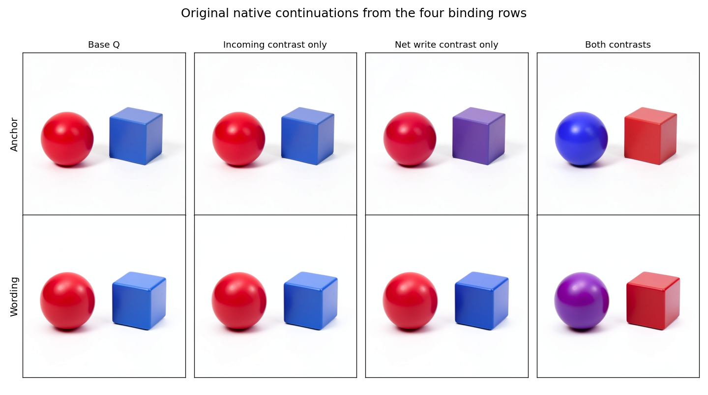

# Incoming state and new binding writes

Neither the incoming text contrast nor the finite joint0 net-write contrast alone reproduces the combined assignment in the two tested contexts. Together they reproduce the blue sphere/red cube in the anchor and the prior partial purple sphere/red cube in the paraphrase. All eight complete numerical forecasts match native execution exactly, including the decoded images. This is evidence of joint dependence under the tested decomposition and receiver; unequal factor norms and downstream threshold effects remain possible explanations.



## The question

The [lifecycle campaign](FLUX-LIFECYCLE.md) found that four originally edited rows carry the visible assignment at the joint0 exit. Joint0 also writes differences into the other 508 rows, but those complementary differences alone do not transfer the assignment under the tested receiver. On the useful four rows, the outgoing contrast still mixes inherited input with a newly computed update.

This cut uses the anchor and reversed-wording contexts. Their sealed supports are `[4,11,12,13]` and `[9,17,18,19]`. Historical source observations and the earlier image prime remain supplied inputs. It tests a conditional internal mechanism in the original FLUX.2 Klein4B distilled checkpoint, CUDA BF16, batch 1, 512×512, four steps and guidance 1.

Both contexts inherit seed 109. They are two historical prompt contexts, rather than independent new seeds or fresh prompt-to-image trials.

## The assignment needs the combined endpoint

| Context | Incoming only vs Q RGB RMS | Net write only vs Q | Both vs Q |
| --- | ---: | ---: | ---: |
| Anchor | 2.494 | 11.309 | 50.664 |
| Reversed wording | 1.132 | 3.627 | 41.345 |

RMS is computed over complete original RGB PNG arrays on the 0–255 scale. The anchor incoming-only image remains a red sphere and blue cube. Write-only leaves the sphere red and moves the cube toward purple. Both produces the blue sphere and red cube. In the wording context, both isolated arms retain red sphere/blue cube by eye, while their combination gives the existing purple sphere/red cube result. The partial write-only effect and partial wording result are retained explicitly.

Root and Astra inspected the original images independently. These are posthoc, unblinded visual observations, not calibrated semantic scores. Neither isolated arm is computationally inert: their immediate consumer states and final pixels change.

The larger immediate response also does not guarantee the final assignment. At joint1's image attention residual, write-only RMS is 0.03548 versus 0.03943 for both in anchor, and 0.03760 versus 0.04209 in wording. At the measured MLP return, the corresponding values are 0.02935 versus 0.03288 and 0.03000 versus 0.03301. Write-only reaches these consumer responses without reproducing the combined image assignment.

The source contrasts have unequal widened norms. Anchor has incoming L2 103.454, write L2 190.086 and combined L2 227.178; wording has 101.236, 184.293 and 222.144. Their cosines are 0.1214 and 0.1376. The current result does not exclude a sufficient larger dose on one axis. It identifies a useful pairing at the tested doses, rather than a universal two-input logic gate or proof that the two contrasts carry separable semantic variables.

## The finite decomposition

Let `Pin`, `Qin`, `Pout` and `Qout` be the observed BF16 joint0 text operands, widened to FP64 before subtraction. Define:

```text
WP = Pout - Pin
WQ = Qout - Qin
DR = Pin - Qin
DW = WP - WQ
DR + DW = Pout - Qout
```

`WP` and `WQ` are finite whole-block output-minus-input updates. They include attention, MLP and residual-add effects. `DW` does not isolate an attention or MLP return.

At the next joint1 entry, hold Q's image and every nontext slot fixed. Clone `Qout` and replace only the sealed support S:

| Arm | Ideal value on S | Actual operand on S |
| --- | --- | --- |
| Q | `Qin + WQ` | Original `Qout` |
| R only | `Pin + WQ` | `B(Qout + DR)` |
| W only | `Qin + WP` | `B(Qout + DW)` |
| Both | `Pin + WP` | `B(Qout + (DR + DW))` |

Here B is the actual Torch 2.13 CPU `FP64.to(torch.bfloat16)` conversion, with no explicitly inserted FP32 tensor. This specifies the executed operator; it does not assume an abstract correctly rounded FP64-to-BF16 implementation. Outside S, original Q bits are copied exactly, including signed zero. The combined endpoint must reproduce the previously tested `support_P` operand bit for bit.

The reader independently forms the FP64 differences with NumPy and repeats only the declared CPU conversion. Full ideal endpoints, landed operands, cast errors and the entry remainder `Both - R - W + Q` are retained.

## Continuation and prediction

Each of the eight futures advances 54 times through 49 transformer blocks. Base conditioning is installed before step3 projection in both lanes. Every branch uses its own evolving state and final latent for the original full VAE decode.

MDB performs typed text SETs, common-parent forks, the later conditioning SET and two complete parent rewinds. The functional lane uses the original parameters and shared Torch primitive equations while entering zero original learned modules. All eight complete predicted continuations and decoded images are globally sealed before the new native targets are released.

The physical census is 432 functional and 432 native advances, 392 native transformer blocks, 16 Acts per lane, 48 first-consumer ports per lane and eight VAE decodes per lane. Four conditions replay known endpoints; four are new modified conditions. No new text encoding, noise draw, source prefix or source joint0 execution is part of this run.

## Reading interactions

For every measured field F, retain the signed tensor:

```text
JF = F(Both) - F(R) - F(W) + F(Q).
```

Unlike the prior support/complement splice, R and W overlap on S. Text normalization can therefore interact on those rows. Outside S, text operands and first text-normalization values stay common. First image normalization and the image MLP gate also stay common because the receiving image state and context are fixed.

A nonzero entry remainder is finite endpoint arithmetic. A later normalization interaction can include both that remainder's propagation and nonlinear normalization; this experiment does not uniquely partition those causes. Full interactions remain numerical observations, not semantic contribution percentages.

The actual entry remainder has L2 2.182 and 2.204, confined to S. Its maximum absolute component is 2 in both contexts. The outside-support entry and text-normalization interactions are exactly zero. First image normalization and the image MLP gate are identical across all arms.

| Context | Text-normalization interaction RMS on S | Attention residual interaction RMS | MLP return interaction RMS | RGB interaction RMS |
| --- | ---: | ---: | ---: | ---: |
| Anchor | 0.004726 | 0.012963 | 0.010861 | 42.289 |
| Wording | 0.007320 | 0.013141 | 0.010669 | 39.899 |

These columns have different units and tensor domains. Their magnitudes are not additive contributions or a measured amplification ratio. All eighteen complete interaction arrays, including their finite entry remainders, are predicted exactly.

## What the audit establishes

Native job `job-7fd0c6eae7f6` succeeded in 231.99 scheduler seconds, with 11,128.4 MB peak RSS and 8,248 MB peak VRAM. The worker measured 202.87 seconds. The global seal was written at worker second 134.453 with zero native target advances or blocks; native release followed at 135.669. The separate saved-only audit `job-8fb4ffbfb355` succeeded in 57.74 scheduler seconds with zero CUDA work and no model forward.

| Comparison | Coverage | Observed discrepancy |
| --- | ---: | ---: |
| Complete decoded and RGB image pairs | 8 | 0 |
| First-consumer ports | 48 | 0 |
| Boundary value hashes and layouts | 6,048 | 0 mismatches |
| Complete retained tensor fields | 784 over 510,263,872 positions | 0 |
| Complete signed interaction fields | 18 | 0 |
| Known endpoint final payloads and PNG bytes | 4 | Exact |

Fields and positions overlap and do not represent independent samples. The saved reader also reconstructs the source arithmetic, actual CPU cast landings, exact outside-support bits, Act operands, full fork/advance/rewind lineage and latent-to-decoder joins. It retrieves only the two required original VAE statistics for its independent decoder-argument comparison, without a model forward or parameter-bank export.

The raw publication retains 844 files and 2,285,084,035 bytes remotely. The compact audit retains all 21 published members, 3,609,381 bytes, including all sixteen unchanged forecast/native PNGs and 311 parameter retrieval recipes. The original parameters are inherited inputs; they are not learned or fitted in this experiment. Forecasts share the original numerical primitive kernels, so this is bounded executable parity and causal state analysis, rather than an independent-kernel or arbitrary-prompt result.

## What the symbol table gains

The record now connects a source decomposition to a receiver and continuation: the four-row address, incoming contrast, finite net-write contrast, actual endpoint arithmetic, immediate consumers, final consequence and retained partial outcomes. A row address or write vector by itself would omit the joint dependence observed here.

Together with the lifecycle result, this gives a useful sequence: a paired state on four text rows is consumed, its consequence survives the next step boundary through latent, common text is rebuilt, and later image-dependent computation writes text differences again. The time-circuit description tracks the current carrier and next consumer; the symbol table stores the applicability and evidence for that relationship. This experiment does not identify a universal object dictionary or turn a finite net-write difference into an isolated MLP law.

The next causal cut can start from the already retained post-joint1 states: cross Q versus combined image and text states, hold the remaining closure common, and continue every corner. This asks whether the first consumer has already written a sufficient distinction into image state, or whether continued altered text is required. It needs no new source-prefix run.

Alongside that cut, test each isolated direction at the combined endpoint's norm and retain the actual BF16 landings. A small two-axis dose surface can separate dose from direction before naming a special cooperation mechanism. A later source-writer cut should split the finite joint0 update into attention and MLP updates with actual pre-add ports. The present result supplies both the positive combined endpoint and informative isolated counterexamples for those tests.

## Records and MDB integration

Two records, `flux-binding-residual-write-anchor` and `flux-binding-residual-write-wording`, extend the existing `diffusion.contextual-object-binding` family. Each binds the source inputs, support, cast rule, receiver, continuation, measured outcomes and counterexamples. The [new-record validation](../../../../artifacts/mdb-binding-residual-write-20261106/new-records-validation-v1.json) has zero errors or warnings. The append preserves every older catalog byte. The full 188-record catalog retains its eight pre-existing C-runtime source-hash drifts; this append creates none.

The generic Saturn evidence `run` and `verify` commands recognize no streams or receipts in the compact MDB audit, returning `evidence-incomplete-empty-target`. That is an [instrument coverage gap](../../../../artifacts/mdb-binding-residual-write-20261106/evidence-plane-observation-v1.json), not a scientific null or another numerical check. The dedicated source-bound reader remains the authority here.

Execution already uses public MDB forks, typed Acts, rewinds and a sealed prediction transaction. Repeated campaign scaffolding remains the main integration burden: source-derived finite factors and interactions need a declarative transaction interface, internal attention/MLP operands need typed pre-add ports, and the evidence plane needs an adapter for actual MDB audit records. The existing requests in [Saturn's request log](../../../../saturn/request.jsonl) retain those needs without weakening source identity or adding semantic discovery gates.

## Reproduce the workflow

Use the installed qualification environment and original pinned runtime wheels. Stage once from the completed lifecycle run, review the exact request, then submit one finite mrun CUDA lease:

```sh
python -I -B qualification/stage_flux_binding_residual_write.py RUN \
  --parent-run LIFECYCLE_RUN
python -I -B qualification/stage_flux_binding_residual_write.py RUN --submit
```

After completion, the audit stager binds the actual executed command, terminal job, published inventory and exact producer bytes:

```sh
python -I -B qualification/stage_flux_binding_residual_write_audit.py AUDIT --source RUN
python -I -B qualification/stage_flux_binding_residual_write_audit.py AUDIT --submit
python -I -B qualification/collect_astra_generalization.py AUDIT
```

Retrieve the compact inventory members through the collector's hash-checked `--retrieve` option. The compact audit keeps the original forecast/native PNGs and 311 parameter retrieval recipes, without duplicating raw states or pretrained parameter banks. The summarizer and renderer use only these saved results:

```sh
python -I -B qualification/summarize_flux_binding_residual_write.py AUDIT/compact OBSERVATIONS.json
python -I -B qualification/render_flux_binding_residual_write.py AUDIT/compact FIGURES
```

## Source and evidence

- [Producer](../qualification/flux_binding_residual_write.py), [source decomposition](../qualification/flux_binding_residual_sources.py), [native stager](../qualification/stage_flux_binding_residual_write.py).
- [Independent saved-only reader](../qualification/audit_flux_binding_residual_write.py), [audit stager](../qualification/stage_flux_binding_residual_write_audit.py), [summarizer](../qualification/summarize_flux_binding_residual_write.py), [renderer](../qualification/render_flux_binding_residual_write.py).
- [Requests and qualifications](../../../../artifacts/mdb-binding-residual-write-20261106), [Astra's pre-outcome method review](../../../../artifacts/mdb-binding-residual-write-20261106/advisor-method-notes-v1.md), [normalization addendum](../../../../artifacts/mdb-binding-residual-write-20261106/advisor-normalization-note-v1.md).
- [Independent audit and all original PNGs](../../../../artifacts/mdb-binding-residual-write-20261106/audit-01/compact), [numeric observations](../../../../artifacts/mdb-binding-residual-write-20261106/observation-summary-v1.json), [root's visual observations](../../../../artifacts/mdb-binding-residual-write-20261106/visual-observations-v1.json).
- [Astra's complete result review](../../../../artifacts/mdb-binding-residual-write-20261106/advisor-result-review-v1.md), [independent visual notes](../../../../artifacts/mdb-binding-residual-write-20261106/advisor-visual-observations-v1.md), [two computation records](../../../../artifacts/mdb-binding-residual-write-20261106/computation-records-v1.jsonl), [append receipt](../../../../artifacts/mdb-binding-residual-write-20261106/catalog-append-receipt-v1.json).
