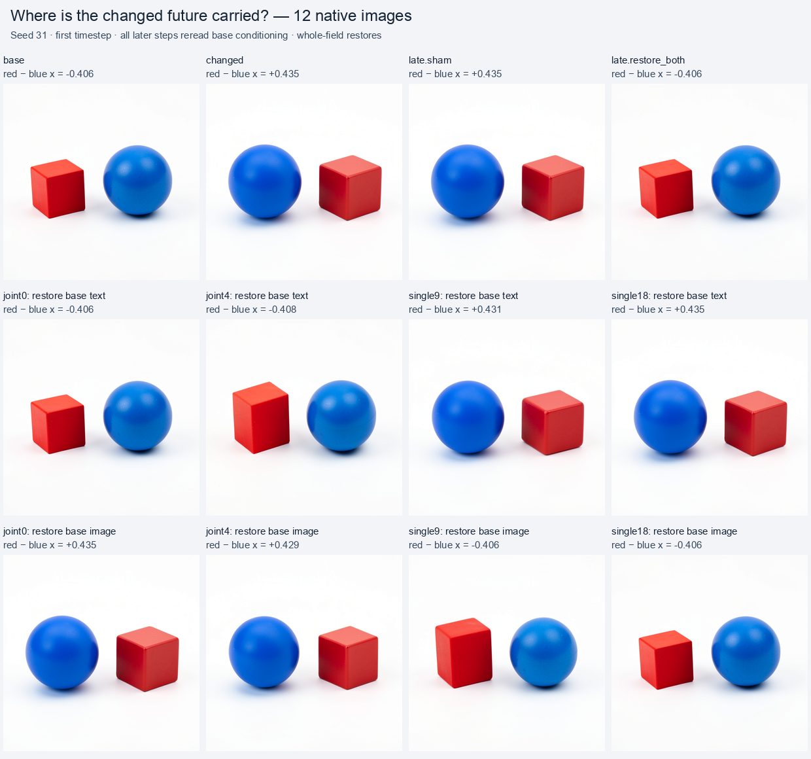
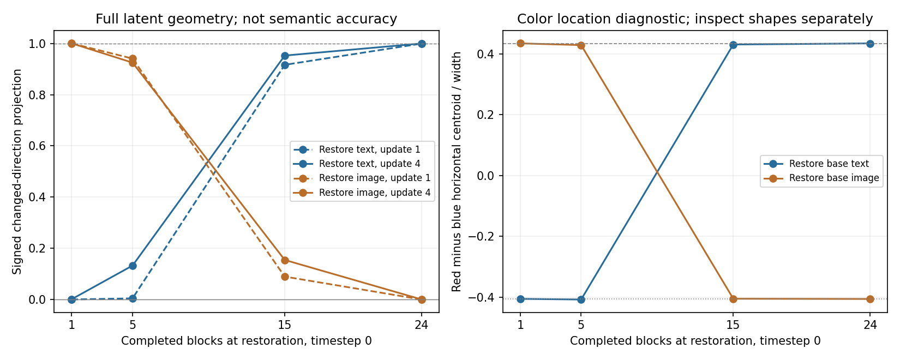
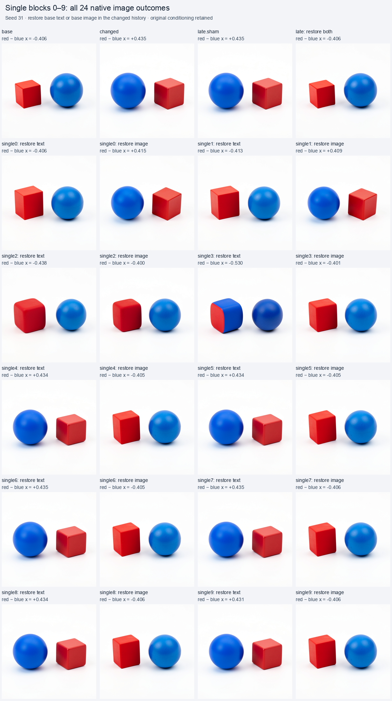
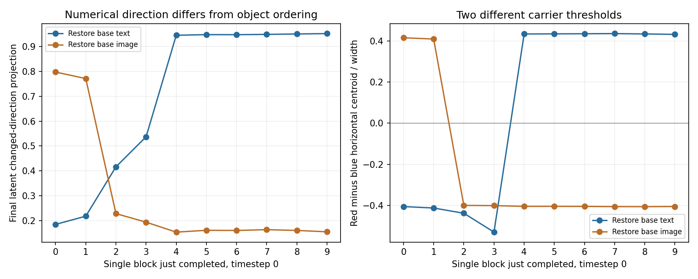

# Finding where a changed future is carried

The twelve-image assay finds a crossover inside timestep zero. After joint block 4, final object ordering follows working text in the tested restoration hybrids. After single block 9, it follows image state instead. This narrows the [whole-timestep carrier result](FLUX-CONCEPT-ROUTES.md) to single blocks 0–9 as the window between the two observed regimes. It does not isolate the first write or a unique semantic operator.

It uses public Saturn cuts and Acts through installed MDB, then continues every branch through the native denoiser, scheduler and VAE. The scientific question is whether working text still needs to write the changed scene, or whether image state can already carry it forward.

The specimen remains distilled FLUX.2 Klein 4B, CUDA BF16, batch one, 512 × 512, four steps and seed 31. The base requests a red cube to the left of a blue sphere; the contrast requests it to the right. Both have the same white-background studio suffix. This is a known contrast from the previous panel, not a fresh generalization test.

## What the completed run shows

Job `job-96ce66d7a371` completes 12 images, 13 Acts and 1,194 native adapter transitions. The [independent audit](../../../../artifacts/mdb-flux-block-handoff-20261031/run-01/analysis-v1.json) verifies 1,383 artifact files, 21 cuts, 34 pages and 27 tensor blobs. Both controls reproduce all four full scheduler arrays and PNG bytes exactly. Both reference futures also [match the previous run exactly](../../../../artifacts/mdb-flux-block-handoff-20261031/run-01/predecessor-joins-v1.json) on their shared retained arrays and PNGs, establishing that the reused cuts resume the known cases faithfully.

| Restore boundary | Completed blocks | Final latent changed-direction projection: restore base text | Final projection: restore base image |
|---|---:|---:|---:|
| After joint 0 | 1 | 0.00150 | 1.00030 |
| After joint 4 | 5 | 0.13282 | 0.92499 |
| After single 9 | 15 | 0.95264 | 0.15468 |
| After single 18 | 24 | 0.99986 | 0.00040 |

Zero denotes the base numerical direction and one the changed reference. Values can overshoot; they are not percentages of a concept. Intermediate hybrids retain numerical and shape/pose/scale differences. For example, after joint 4, restoring base text yields a final projection of 0.13282 but still restores the original visible ordering.



Assistant inspection sees the base red cube left and blue sphere right. After either joint boundary, restoring base text recovers that ordering; retaining changed text while restoring base image produces blue sphere left and red cube right. After either tested single boundary, the complementary image carrier determines that ordering instead. The [visual record](../../../../artifacts/mdb-flux-block-handoff-20261031/visual-review.json) describes all twelve images and collateral separately from the centroid diagnostic. It is informal inspection, without calibrated classifier or independent human labels.

The early and late predeclared hypotheses receive support in these observations. The four measured points show the expected crossover, while leaving intermediate depths unmeasured. In particular, the first-step image state already differs after joint block 0; the result localizes a change in its ability to sustain the ordering under the tested restoration, not the first appearance of relation information.



Two source-qualified candidate records log this distinction: `flux.route.H01`, **working-text-guided continuation**, at the two early boundaries, and `flux.route.H02`, **image-state-guided continuation**, at the two late boundaries. Their [applicability records](../../../../artifacts/mdb-flux-block-handoff-20261031/route-records-v1.json) include exact cuts, checkpoint, execution contract, contrast, consumers, signed effects, continuation and limitations. They are rules extracted from this panel; independent new-context validation remains pending. They are standalone native causal records, separate from equation-forecast observations.

This gives the time-dependent circuit account a more precise meaning: the same scene contrast has different causal carriers at different depths of one timestep. Working text can still establish the future early; later image state can sustain it through the remaining native computation and three original-prompt rereads. Restoring image state can also restore the original ordering, so this is not an irreversible commitment claim. The [historical relation work](FLUX-CONCEPT-ROUTES.md#the-exact-handoff-explains-the-carrier-lifetime) already motivates early text influence; this assay adds the matched carrier crossover under its own text-only execution contract.

The [dense follow-up](#the-dense-sweep-finds-an-intermediate-compatibility-window) now samples every single0–9 exit and resolves a more complicated intermediate regime. The next component cut separates incoming residual, attention and MLP operands at single block 4. A later fresh-seed/paraphrase panel should test the resulting applicability rule. Naming a unique MLP, object coordinate or universal `left-of` primitive would require those further measurements.

The [portable result](../qualification/flux-block-handoff-20261031.json) includes the audit, visual observations, replay joins and candidate records. A separate [offline evidence sweep](../../../../artifacts/mdb-flux-block-handoff-20261031/evidence/checksums.json) validates twelve derived numerical rows with run/verify return codes zero, adding no model execution or semantic certification. Worker execution took 261.93 seconds before archival; scheduler elapsed time was 305.18 seconds. This is execution metadata, not a controlled speed comparison.

## The dense sweep finds an intermediate compatibility window

The denser panel, job `job-482a07f53e27`, renders 24 images at every exit from single blocks 0–9: twenty complementary restores, two references and two controls. Eighteen restoration rows are previously untested; two single9 rows and the references are exact replays of known cases. The independent [audit](../../../../artifacts/mdb-flux-handoff-dense-20261031/run-01/analysis-v2.json) verifies all 2,424 transitions and 25 Acts. Both controls and all repeated known trajectories/PNGs are exact.

| Just completed | Base text restored, changed image retained | Base image restored, changed text retained |
|---|---|---|
| Single 0–1 | Base ordering | Changed ordering |
| Single 2 | Base ordering with rounded shape | Base ordering with rounded shape |
| Single 3 | Mixed red/blue cube-like object left, blue sphere right | Base ordering |
| Single 4–9 | Changed ordering | Base ordering |

These descriptions come from assistant inspection of all 24 images and the original-resolution mixed image. The intermediate hybrids do not support a simple instantaneous handoff. Neither preserves the clean changed scene at single2–3. A working inference is a window of cooperation or compatibility between text and image state, followed by image state that can sustain the changed ordering. Hybrid incompatibility remains an alternative to a semantic conjunction mechanism.



The uncalibrated midpoint guess was sealed before execution: text-guided ordering through single4, then image-guided ordering from single5. The [inspection-based comparison](../../../../artifacts/mdb-flux-handoff-dense-20261031/prediction-evaluation.json) retains 15 supported predictions, four contradicted predictions and one mixed/uncertain image among the twenty restores. This includes two previously known single9 cases; it is not a held-out accuracy estimate or an equation forecast. The four errors and ambiguous color binding refine the structural hypothesis rather than disappearing into a success count.

Numerical direction and semantics also separate. At single3, restoring base text gives final latent changed-direction projection `0.53732`, yet the image contains a blue rounded cube with a red face left and a blue sphere right. A projection threshold of one half would mislabel that outcome. At single4, the same restore yields projection `0.94593` and a clean flipped ordering. Restoring base image at single4 yields `0.15339` and the original ordering.



The [portable dense record](../qualification/flux-handoff-dense-20261031.json) preserves the predictions, counterexamples, visual observations and repeated-case joins. `H01` and `H02` remain qualified by their measured boundaries; interpolating a single switching depth between them was too simple. Single4 is selected for the [completed native parallel-merge factorial](FLUX-PARALLEL-MERGE.md) because it is the first measured exit where image state supports the clean changed ordering under base-text restoration. That experiment finds a residual/attention coalition while retaining the failed attention-only ordering prediction.

## Matched histories and restores

The [submitter](../qualification/submit_flux_handoff.py) stages only two verified projected StateCuts from the previous run, with their required CAS pages and blobs. The request seals their provenance and hashes; the worker hydrates them through public `LocalStore.load` and `Session.from_cut`. No prompt encoder or repeated native projection runs. No target images are supplied to the worker.

Reference `base` continues the original projected state. Reference `changed` replaces only initial working `text` with the relation contrast. Stored conditioning, image state, latent, position IDs, schedule and time context remain base values. Later timesteps therefore reread the base prompt in both histories.

Each reference saves these exact before-operation breakpoints:

| Boundary ID | Blocks already completed | Next operation |
|---|---:|---|
| `after_joint0` | 1 | Joint block 1 |
| `after_joint4` | 5 | Single block 0 |
| `after_single9` | 15 | Single block 10 |
| `after_single18` | 24 | Single block 19 |

At each boundary, fork the changed history twice. One Act restores base working text while retaining changed image state. The other restores base image state while retaining changed working text. Every other payload slot must be unchanged. Thus `restore_text` tests the image carrier's ability to support the changed future under base text; `restore_image` tests the text carrier's ability to rewrite that future from base image state.

These hybrids need not lie on natural trajectories. A changed outcome can reflect a carrier, an interaction or an incompatible hybrid; the complete image and latent effects remain available. In particular, failure of a text restore to repair an image does not prove text has no causal role in other states.

Two late controls reinstall the changed carriers as a sham, and restore both base carriers. They predict changed and base futures respectively because all other state is matched. There are twelve native RGB outcomes: two references, eight single-carrier restores and two controls. The plan does not assume a monotone handoff.

The [worker](../qualification/flux_handoff_campaign.py) seals qualitative handoff hypotheses before any new native block or RGB execution. It retains every scheduler latent, PNG, breakpoint cut, post-Act cut, Act and native receipt. This is native causal continuation with predeclared hypotheses; the separate [numerical trajectory forecast](FLUX-TRAJECTORY-FORECASTS.md) has a different prediction boundary.

## Scripted navigation in MDB

`NativeCutNavigator` is a small public Python helper for an existing public Saturn Session. It caches the cursor returned by native receipts; reading `point` executes no model and makes no capture. The native Session still performs its required integrity checks and state captures. Own the Session through the navigator while using it; after direct Session mutation, explicitly capture to resynchronize.

```python
from mdb.native_navigation import NativeCutNavigator
from saturn_pub import Act, Session
from saturn_pub.store import LocalStore

store = LocalStore("typed-store")
session = Session.from_cut(adapter, store.load(base_cut_id, device="cuda"))
nav = NativeCutNavigator(session, max_steps=112, on_receipt=store.receipt)
nav.until(logical_step=0, phase="single", index=10)
cut = nav.capture()
store.save(cut)

branch = nav.fork(cut)
branch.apply(Act.replace("text", matched_base_text, name="restore-base-text"))
branch.until(logical_step=4, phase="project")
adapter.decode(branch.session, height=512, width=512).save("future.png")
```

Use a compatible adapter and cuts produced under the same numerical contract. `matched_base_text` must come from the matching base boundary, rather than the initial projected text. `until` uses an exact execution-point selector and a finite attempted-step budget. A missing breakpoint cannot run beyond that budget; native execution errors also propagate. The helper is Python navigation over a resident Session, not a new remotely attachable debugger transport or an automatic GPU primitive trace.

## Reproduce and audit

Use the installed public MDB/Saturn environment with Diffusers 0.39 and the qualified CUDA BF16 checkpoint. Set host-appropriate scheduler/cache/model-root variables as described in [the preceding panel](FLUX-CONCEPT-ROUTES.md). One admitted finite mrun lease uses strict preflight and no retries. Its measured resource exception comes from the preceding successful 24-image panel; the new job renders twelve images with no prompt encoding.

```sh
python qualification/submit_flux_handoff.py /absolute/campaign/run-N --predecessor /absolute/previous-campaign/run-05
python qualification/submit_flux_handoff.py /absolute/campaign/run-N --collect JOB_ID
python qualification/analyze_flux_handoff.py /absolute/campaign/run-N /absolute/campaign/run-N/analysis-v1.json
```

The [offline auditor](../qualification/analyze_flux_handoff.py) checks request and source bytes, the retained archive, closed transaction and seal ordering, typed CAS, restoration closure, full scheduler arrays and actual pixels. It recomputes signed numerical effects without a model. Projection onto the changed-minus-base latent direction is descriptive geometry, not semantic accuracy. Red/blue centroid separation is likewise a diagnostic; image inspection must report shapes and collateral separately.
