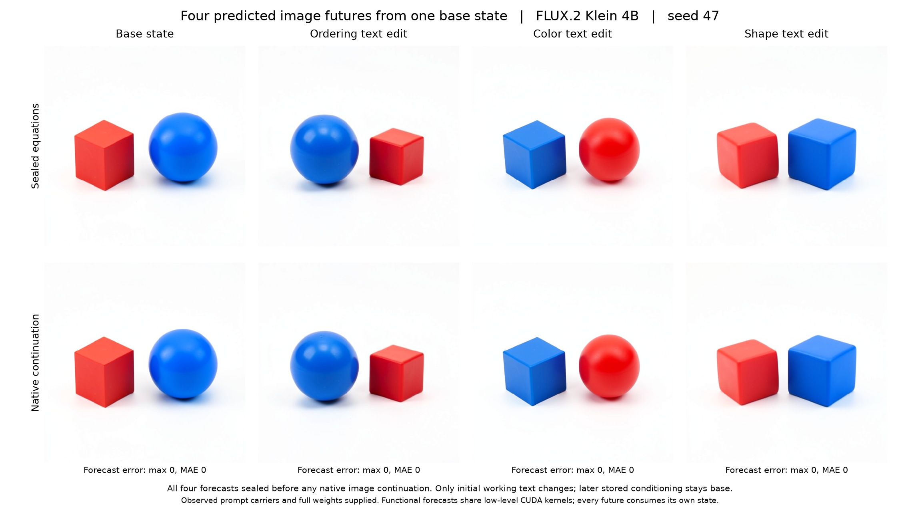

# Forecasting several image futures from one base state

This experiment combines the [complete numerical image forecast](FLUX-TRAJECTORY-FORECASTS.md) with the [stored-conditioning versus working-text distinction](FLUX-CONCEPT-ROUTES.md). It forecasts a base image and three edited futures, seals all four before any native suffix executes, then compares each with an independent native continuation of the same initial state.

The declared specimen is distilled FLUX.2 Klein 4B, CUDA BF16, batch one, 512 × 512, four diffusion steps, guidance 1 and fresh seed 47. Its initial latent is newly generated. Stored prompt carriers come from the verified earlier seed-31 panel, so the prompt encoder is observed rather than forecast. One new native projection supplies a parent before joint block zero.

| Branch | Initial working text | Stored conditioning during later steps |
|---|---|---|
| Base | Red cube left of blue sphere | Base |
| Relation | Red cube right of blue sphere | Base |
| Color | Blue cube left of red sphere | Base |
| Shape | Red sphere left of blue cube | Base |

The three replacements affect only the current working-text field. Latent, image, timestep context, position IDs, schedule and stored conditioning remain matched. These are internal-state alternatives, rather than four complete prompt changes. The resulting states are the declared inputs to the numerical forecasts.

## Completed image comparisons

Job `job-dc521d90c65d` completed the four forecasts and four native image continuations. All four forecast/native PNG pairs are byte-identical. The independent saved-array audit verifies **912 corresponding tensor hashes**, recomputes **36 full retained arrays** and all saved witnesses, and compares **3,145,728 final pixel channels** with zero error. No model or predictor executes during that audit.

| Branch | Maximum pixel forecast error | Native RGB MAE from base on 0–255 channels | Informal image observation |
|---|---:|---:|---|
| Base | 0 | 0 | Red cube left, blue sphere right |
| Relation | 0 | 28.28679 | Blue sphere left, red cube right |
| Color | 0 | 26.88402 | Blue cube left, red rounded sphere right |
| Shape | 0 | 7.56820 | Rounded red cube-like object left, blue cube right |



The relation and color edits visibly support their predeclared qualitative hypotheses. The shape result is mixed: the blue object becomes cube-like, but the red object does not become the requested sphere. Its numerical forecast is nevertheless exact. The predeclared shape hypothesis allowed mixture; this is a counterexample to a broader clean-attribute-transfer rule, not a missed numerical prediction.

These descriptions are assistant inspection, including the original-resolution shape image. They are not independent human labels or a calibrated semantic classification. Hue-region diagnostics separately give normalized red-minus-blue horizontal separations of `−0.39191`, `+0.35824`, `+0.36808` and `−0.36782` for base, relation, color and shape. They describe colored regions and do not identify cubes versus spheres. Changes in shape, scale, pose and illumination remain visible collateral.

All forecasts completed by worker second `98.2506`; the global seal occurred at `121.3629`, with zero native suffix entries, transitions or decoder calls. The first native branch began at `122.8998`. Native and functional continuations each own their intermediate states. The complete numerical result therefore includes the model's incomplete shape transfer, rather than selecting only semantically successful images.

The run took **335.23 scheduler seconds**, with measured peak RSS **12,294.8 MB** and VRAM **9,316 MB**. These are timing and resource observations, without a controlled speed comparison. [Portable result](../qualification/flux-branch-forecasts-20261102.json), [full audit](../../../../artifacts/mdb-flux-branch-forecasts-20261102/run-04/analysis-v1.json), [visual review](../../../../artifacts/mdb-flux-branch-forecasts-20261102/visual-review.json), [original-image figure manifest](../../../../artifacts/mdb-flux-branch-forecasts-20261102/figures/figures.json).

Four [standalone computation records](../../../../artifacts/mdb-flux-branch-forecasts-20261102/computation-records.json) bind the generic law/route names, exact parent cuts, numerical forecasts, rendered differences and inspected semantic outcomes. They are not automatically imported into the computation atlas. The separate [evidence sweep](../../../../artifacts/mdb-flux-branch-forecasts-20261102/evidence/checksums.json) checks four derived numerical rows with run and verification return codes zero; it adds no model execution or semantic certification.

## Prediction and comparison contract

For each initial state, the functional implementation calculates all 111 remaining transitions and VAE decoding from its own preceding predictions. It uses full frozen weights and shared low-level CUDA kernels, without native module forwards, adapter transitions, scheduler steps, VAE decode calls or native intermediate refreshes during prediction. The transaction seals all four numerical trajectories and images globally before native comparison begins.

Native comparison follows four separate own-state continuations. No predicted tensor is installed in a native suffix. Complete forecast arrays remain immutable in CPU RAM through comparison; deterministic witnesses, content hashes, full scheduler/readout arrays, raw decoded arrays and final pixels remain in durable evidence. Offline auditing recomputes the retained endpoints and witnesses; intermediate full-array error aggregates remain identified as worker observations.

The planned work is one model load, zero new prompt encodings, one prefix projection, three typed text Acts, 444 functional transitions, 444 native transitions and eight PNGs. Physical batch size remains one. This assay does not qualify diffusion batching or claim inference speedup.

Qualitative hypotheses are also fixed in the source-bound plan: relation text will reverse ordering, color text will change color assignment, and shape text may interact with later base conditioning. Those hypotheses are evaluated separately from numerical pixel prediction. Whole-field intervention does not identify an object register or minimal semantic program.

## Custody and payload selection

The first local submission attempt stopped before job creation: shipping four complete historical cuts exceeded mrun's transport limit. The corrected payload ships one complete base cut and only the authenticated text tensor ports needed from the other three source cuts. Each port retains the original cut manifest, slot page and original tensor bytes. The worker verifies their hashes, source descriptors and matching execution context. Partial carrier evidence is not represented as a complete replayable cut.

The complete source archive and failed local attempt remain separate from the admitted run. No target image from the fresh seed is staged as an input.

## Run and audit

The model run uses one finite mrun lease with CUDA admission, strict preflight and no retries. The retained run directory is `artifacts/mdb-flux-branch-forecasts-20261102/run-04` in the domains workspace. The preceding queued run was cancelled before execution to replace its overdeclared 32 GB RAM request with a 24 GB request derived from measured prior RSS and the explicit cache cap. A subsequent setup attempt failed before model loading because online package resolution timed out; the corrected launcher preserves offline resolution against the fleet's cached pinned packages. A separate CPU-only environment smoke verifies those cached dependencies with zero model loads or forwards. Collection preserves a lossless compressed original log; the audit and source snapshots remain separate from raw output.

```sh
python qualification/submit_flux_branch_forecasts.py /absolute/campaign/run-N --predecessor /absolute/concept-campaign/run-05
python qualification/submit_flux_branch_forecasts.py /absolute/campaign/run-N --collect JOB_ID
python qualification/analyze_flux_branch_forecasts.py /absolute/campaign/run-N /absolute/campaign/run-N/analysis-v1.json
python qualification/publish_flux_branch_forecasts.py /absolute/campaign/run-N /absolute/campaign/run-N/analysis-v1.json /absolute/campaign/figures
```

Use a qualified installed public MDB/Saturn environment and host-appropriate scheduler/cache settings. The model-free auditor requires NumPy and Pillow; the figure publisher additionally requires Matplotlib. Use fresh output paths; completed evidence is not overwritten.

## Object and relation understanding

The existing symbol-table work identifies structural carriers and conditional computations: stored conditioning is reread, working text participates in current writes, and image state can sustain a scene later in the timestep. The [handoff experiments](FLUX-BLOCK-HANDOFF.md) and [residual/attention factorial](FLUX-PARALLEL-MERGE.md) connect those computations to actual ordering and binding changes.

Object names in these experiments originate in the supplied contrasts and subsequent image inspection. We do not yet have an automatic reverse index from a rendered cube or sphere to its internal support, or a validated universal `left-of` operator. A numerically exact image forecast accounts for pixels without automatically assigning object semantics to its internal values.

The next semantic step is to resolve addresses and bindings under independent changes of object identity, color, position and relation, then predict the consequences of smaller interventions at new states. Automatic atlas ingestion and semantic family discovery remain separate unfinished layers.

## Code

- [Worker and immutable forecast cache](../qualification/flux_branch_forecasts.py)
- [Finite launcher and selected-port custody](../qualification/submit_flux_branch_forecasts.py)
- [Model-free auditor](../qualification/analyze_flux_branch_forecasts.py)
- [Actual-image comparison figure](../qualification/publish_flux_branch_forecasts.py)
- [Installed-package mechanics tests](../tests/test_flux_branch_forecasts.py)
