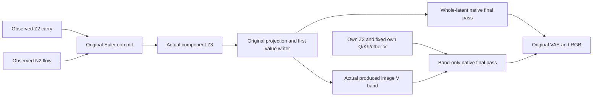

# Separating persistent carry from the current flow write

This experiment moves the [image-value route investigation](FLUX-READER-HEADS.md) one update earlier. It asks whether the selected late value response and the much larger whole-latent image response originate chiefly in the incoming latent or in the flow added at the immediately preceding scheduler commit. It does not identify the attention or MLP components that produced that flow.

The last day's [raw-prompt-to-image reconstruction](FLUX-RAW-TO-IMAGE.md) establishes broader numerical coverage than this particular assay needs. The [Qwen sign family](QWEN-SIGN-SHORTCUT.md), [support boundary](QWEN-ROW-SIGN.md), [error consumer](QWEN-ERROR-CONSUMER.md) and [source-only applicability planner](../src/mdb/computation_applicability.py) also change how we interpret a computation record: exact local execution, applicability and downstream semantic effect are separate questions. Signed interactions and consumer-specific counterexamples belong in the record.

## Exact question and specimen

Original FLUX.2 Klein4B distilled, CUDA BF16, batch1,512×512, four denoising passes. Four already encoded seed241 scenes cross green/yellow assignment and cone/cylinder left/right order. An exact prompt is:

> Studio photograph on white: a yellow cylinder stands to the right of a green cone. Show both objects separately.

Each recipient retains its own conditioning. Source histories share one initial noise draw. Paired opposite-color recipients reuse the same arithmetic hybrids under different conditioners, so the case count is not an independent-sample count.

At step2/scheduler, Z2 is the incoming persistent latent and N2 is the original third-pass noise/flow prediction. For source choices a,b in{own,opposite}, forecast:

```python
product = (sigmas[3] - sigmas[2]) * N2_b
Z3_ab = (Z2_a.to(torch.float32) + product).to(N2_b.dtype)
I3_ab = x_embedder(Z3_ab)
V3_ab = to_v((1 + scale3) * norm1(I3_ab) + shift3)
```

Keep the original full tensor geometry and every finite multiplication, addition and cast in order. In particular, widening N2 before multiplying changes the operation. Original clock modulation is an explicit known input, checked against the actual new project output. The original immutable checkpoint supplies all learned parameters; no fitted response parameters or duplicated persistent weight bank are introduced.

## Two consumer paths



All16 mathematical commit/I/V predictions and the qualitative carry-dominance hypothesis seal before any added component target or native image future. Natural00/11 arithmetic already occurred during honest source-prefix replay and is a control.01/10 are new crossed commit inputs; N2 is transplanted rather than regenerated coherently after replacing Z2.

For each of16 whole-latent worlds, separately execute the original scheduler component with declared Z2/N2 inputs. Feed its actual return into genuine `Act.replace('latent', ...)` at the normal writable project boundary. The native continuation captures actual I3 and V3 for comparison with the sealed predictions. Feeding actual returns keeps the target distinct from the forecast being checked. This uses the same original numerical primitives, so it is not implementation-independent arithmetic.

The other12 futures retain their own Z3, projected I3, Q/K and all unselected V. Replace only image-V rows512:768 (global value rows1024:1280 after512 text rows) with actual native V from the declared full-world producer. Before/after descriptors retain the entire outside-band value footprint and shape/stride. Both consumers share their natural00 RGB baseline, but have different intervention supports and11 reference contrasts. These attention edits remain campaign-local dispatcher operations; project-latent replacements are registered typed Acts.

## Signed analysis

For any consumer X, define carry C=X10−X00, flow F=X01−X00, total D=X11−X00, and interaction J=D−C−F. Preserve all four vectors and their signed energy account:

```text
||D||² = ||C||² + ||F||² + 2<C,F>
       + ||J||² + 2<C+F,J>
```

Report projections `<D,C>/||D||²` and `<D,F>/||D||²` alongside RMS and signed baseline-mask green response. Projections can exceed1 or be negative; they are not causal percentages. Zero total response abstains from projection while retaining the possibly large cancelling parts. At the commit, ideal arithmetic is affine; finite interaction comes from multiplication/cast rounding. Later projection, normalization, attention and image consumers can introduce additional interaction.

The saved-only CPU auditor independently evaluates16 NumPy elementwise commits with explicit BF16 product rounding, compares complete sealed/actual port arrays, checks historical controls and transaction chronology, publishes source-qualified equation records, and measures every native future. Numerical and qualitative misses are observations; only evidence integrity, declared footprint and mechanics can stop collection.

## Reproduce the bounded workflow

Use the installed qualified wheels outside the checkout, with absolute paths to the maintainer launchers. The native launcher stages original source hashes, parameter retrieval recipes, exact initial/final source cuts, finite budgets and a strict mrun preflight:

```sh
MDB_PY=/path/to/qualified/bin/python
MDB_QUALIFICATION=/path/to/saturn-pub/packages/mdb/qualification
export MRUN_URL=http://192.168.68.68:9025
"$MDB_PY" -I "$MDB_QUALIFICATION/stage_flux_reader_streams.py" RUN \
  --fresh FRESH_NATIVE_RUN --audit FRESH_AUDIT_STUDY --panel commit
"$MDB_PY" -I "$MDB_QUALIFICATION/stage_flux_reader_streams.py" RUN --submit
"$MDB_PY" -I "$MDB_QUALIFICATION/flux_commit_factorial_audit.py" AUDIT --study RUN
"$MDB_PY" -I "$MDB_QUALIFICATION/flux_commit_factorial_audit.py" AUDIT --submit
```

The declared CUDA assay uses one resident model,4×84 source-prefix operations and28×28 final-pass operations:1,120 navigation operations,1,000 completed blocks/attention calls,16 additional original scheduler component calls,16 project-latent Acts and28 VAE calls. It performs no encoding or new random draw. Each submission is one finite lease with automatic retries disabled. Failed attempts remain separate records.

Code: [runner](../qualification/flux_commit_factorial.py), [stager](../qualification/stage_flux_reader_streams.py), [saved-only auditor](../qualification/flux_commit_factorial_audit.py), [mechanics checks](../tests/test_flux_commit_factorial.py). Parameter manifests and standalone retrieval scripts accompany the experiment. Full arrays remain near the model on Beast; compact local custody retains reports, seals, records, native PNGs and a checksum-bound individual-file retriever.

## Results

Native job `job-d521b09f9834` completed all28 futures. Saved-only audit `job-55973976e661` independently checks the complete saved arrays and publishes16 numerical records. All48 sealed commit/I/V archive comparisons are byte-exact:24 unique archives across102,760,448 repeated scalar positions. All eight historical PNG/terminal-latent controls replay exactly; all12 band footprints, producer joins and own receiving I/text checks hold. These are dependent cases, not48 independent discoveries.

The frozen carry-dominance hypothesis is contradicted for RGB alignment in all eight recipient/consumer comparisons:

| Recipient | Whole-latent carry / flow projection | V-band carry / flow projection |
|---|---:|---:|
| c0-o0 |0.4293 /0.5541 |0.4365 /0.4559 |
| c0-o1 |0.3618 /0.4701 |0.4442 /0.4502 |
| c1-o0 |0.4068 /0.5499 |0.4006 /0.4422 |
| c1-o1 |0.4733 /0.5641 |0.4143 /0.4235 |

The current flow already has the larger signed alignment at the commit:0.5644–0.5726 versus carry0.4274–0.4356. At the selected value band it remains0.5437–0.5518 versus0.4482–0.4563. Both operands make substantial contributions. Whole-latent green magnitude favors flow in4/4; band green magnitude favors flow in2/4. Even band RGB RMS reverses the alignment rank in one recipient. The observable matters.

Whole-latent RGB response RMS is83.21–86.61 levels; selected-band response is2.95–3.92. Visually, either crossed whole-latent operand produces intermediate lime objects, while changing both produces the complete green/yellow assignment reversal. This is consistent with a jointly specified assignment, rather than one isolated part carrying its complete semantic result. It does not establish a universal binding operation or account for the earlier formation of either source.

| Whole-latent consumer | Interaction RMS / total response RMS |
|---|---:|
| Commit Z3 |1.007–1.016% |
| Selected image V |7.29–7.74% |
| First joint image exit |47.13–49.40% |
| Terminal latent |45.61–49.20% |
| RGB |28.05–36.13% |

The ideal affine commit does not acquire an unknown MLP nonlinearity. Its finite interaction is small. Original nonlinear consumers downstream produce a much larger joint response. These are dependent stage comparisons, not isolated attribution of each increase to one module.

### Independent arithmetic correction

The first completed CPU audit, `job-997ec18d16dc`, retained a genuine reference mismatch: its NumPy rule kept delta_sigma FP32. CUDA's recorded BF16 tensor/scalar profile is instead reproduced by first rounding the delta from−0.1664853096 to−0.166015625. Post-hoc diagnostic `job-e9c202b9e714` compares three rules and finds the BF16-scalar/BF16-product rule numerically exact on all16 complete products and commits. This is a known-target diagnosis. The original pretarget Torch forecasts were already exact; no forecast or target was rewritten.

The [separate correction](../../../../artifacts/mdb-flux-prior-writer-20261106/rounding-correction-v1.json) preserves the first audit and clarifies its two rounding labels: its reported product/cast terms included the unqualified product reference. The final saved-only audit uses the qualified scalar profile and separates actual scalar conversion, product rounding, FP32 addition and final cast. This qualifies the recorded CUDA profile, not arbitrary backends or independent CUDA reduction arithmetic.

### Evidence and next writer

The [cross-run index](../../../../artifacts/mdb-flux-prior-writer-20261106/index-v1/provenance.json) now contains232 records:208 earlier entries,16 new numerical entries and eight frozen consumer-prediction entries retaining all carry-order misses. Exact supplied contexts retrieve232/232, and changed horizon/clock queries abstain232/232. This tests supplied applicability and search; automatic family induction remains open.

The launcher now uses this assay's measured resource history for future admissions:6GiB RAM,10GiB VRAM,2GiB disk and180s estimate, compared with the original10GiB RAM/360s estimate. The successful observed lease used the original reservation. This reduces future reserved RAM and corrects the estimate; it is not a measured inference speedup.

The [24-hour review](../../../../artifacts/mdb-flux-prior-writer-20261106/day-review.md), [Astra review](../../../../artifacts/mdb-flux-prior-writer-20261106/advice/staged-review.md), [original audit](../../../../artifacts/mdb-flux-prior-writer-20261106/compact-collection-01/extracted/binding-minimal-result/audit.json), [scalar diagnosis](../../../../artifacts/mdb-flux-prior-writer-20261106/scalar-collection-01/extracted/binding-minimal-result/audit.json) and [qualified audit](../../../../artifacts/mdb-flux-prior-writer-20261106/compact-collection-02/extracted/binding-minimal-result/audit.json) bind the conclusions. The native output is390,013,060 bytes near compute. Each compact audit archive is about5.46MB. No original parameter bank is copied into it. The successful scheduler lease took117.63s, including setup; experiment execution was71.40s, peak RSS4,948.9MB and VRAM9,380MB.

Two preceding CUDA attempts remain failed mechanics records: missing transaction frontier kind/callback envelope, then unsupported context read after sealing and during the natural00 project. They produced no crossed targets or images. A CPU attempt also remains failed after a tuple/list descriptor comparison; canonical JSON normalization fixes that comparison. Five new installed-environment mechanics tests cover the actual staged transaction API, frozen descriptor joins, cancellation/zero totals and the finite scalar/product order; all18 focused tests pass. The standard evidence sweep and verification cover33 timeline rows only; they do not automatically validate these port/causal records.

The next informative writer cut is step2/single19: cross its incoming residual with its combined newly produced attention/MLP write while holding recipient Z2 fixed. Continue through original readout, Euler and the complete final image. This first distinguishes inherited state from the final learned write feeding N2; only then split that write into attention and MLP. Capture V3 as a downstream observable without adding another band-only image panel. This is a proposed16-future cut, not an executed result.
