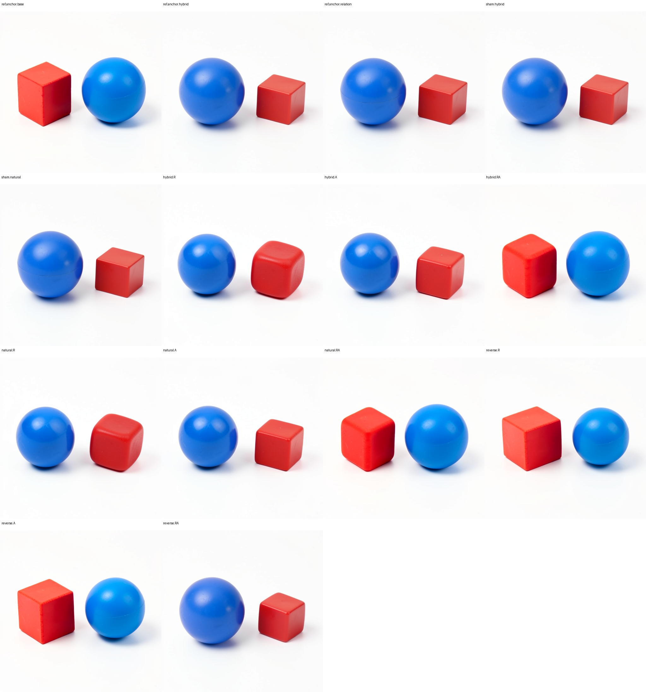
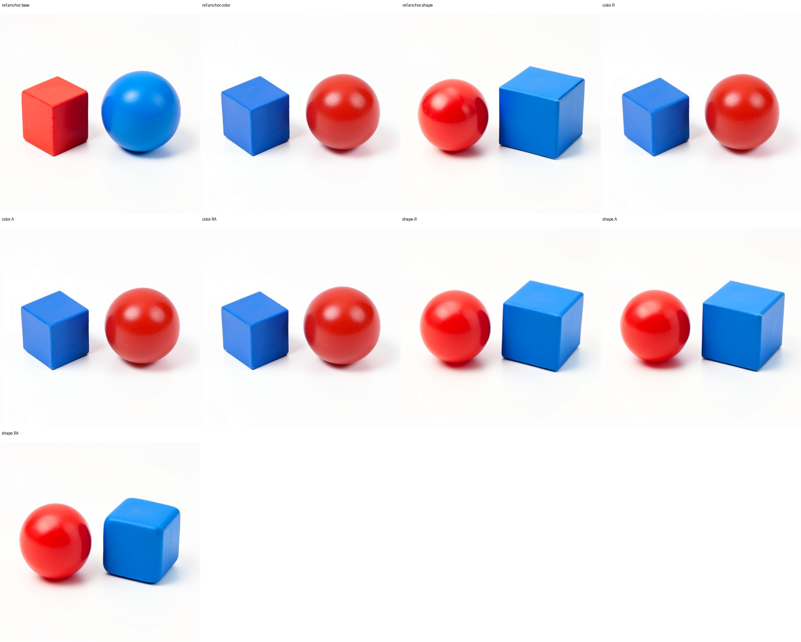
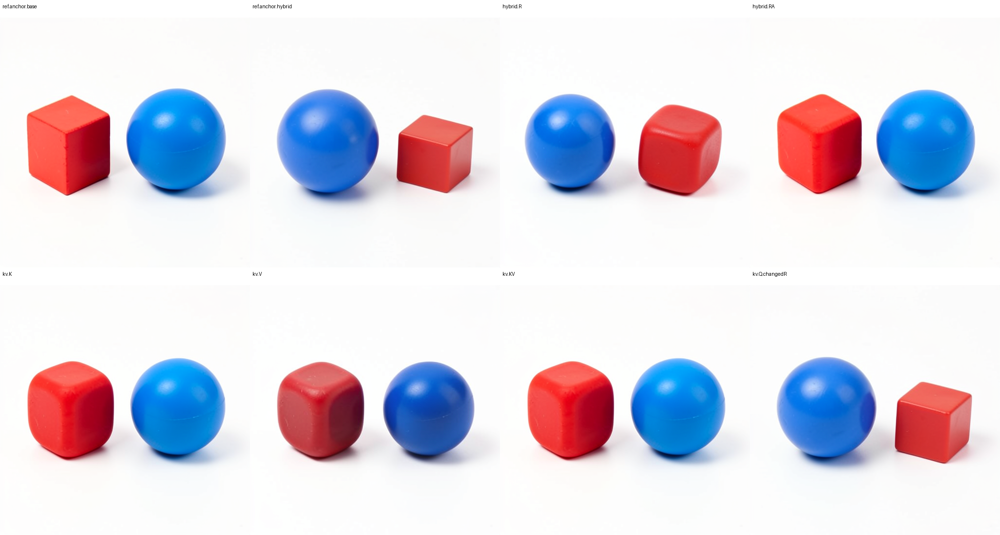
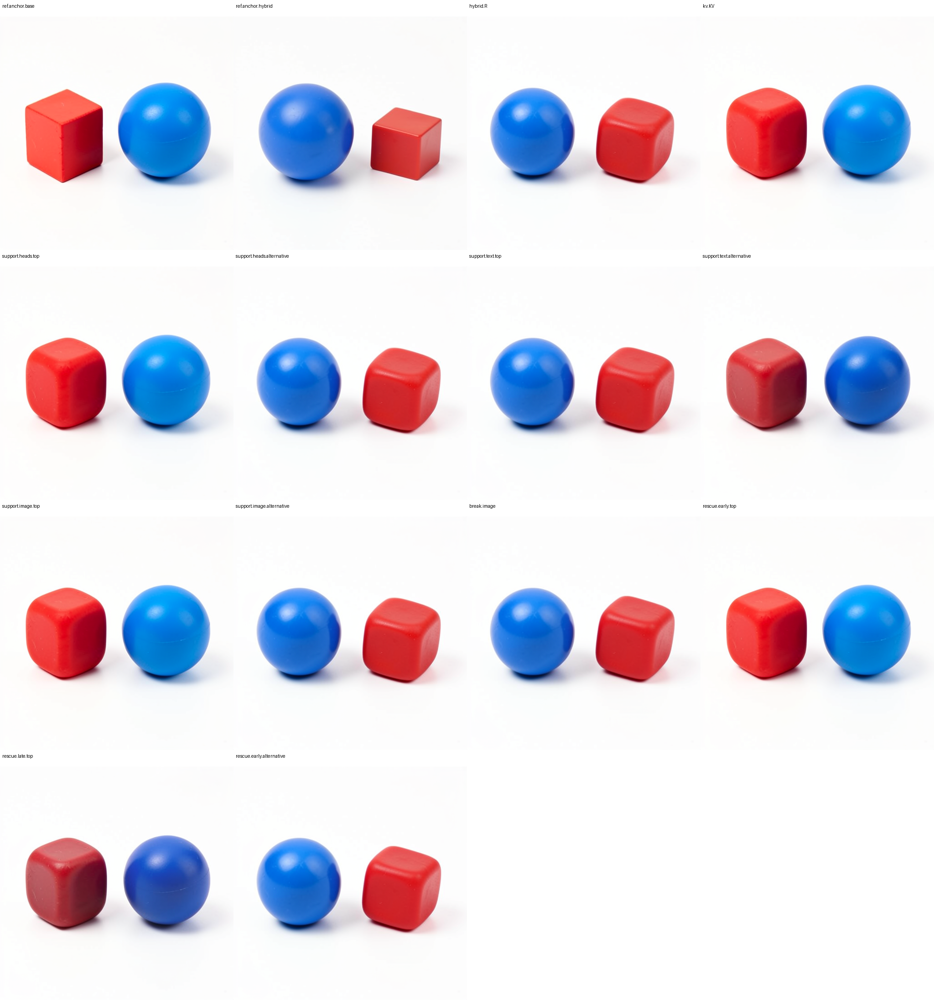
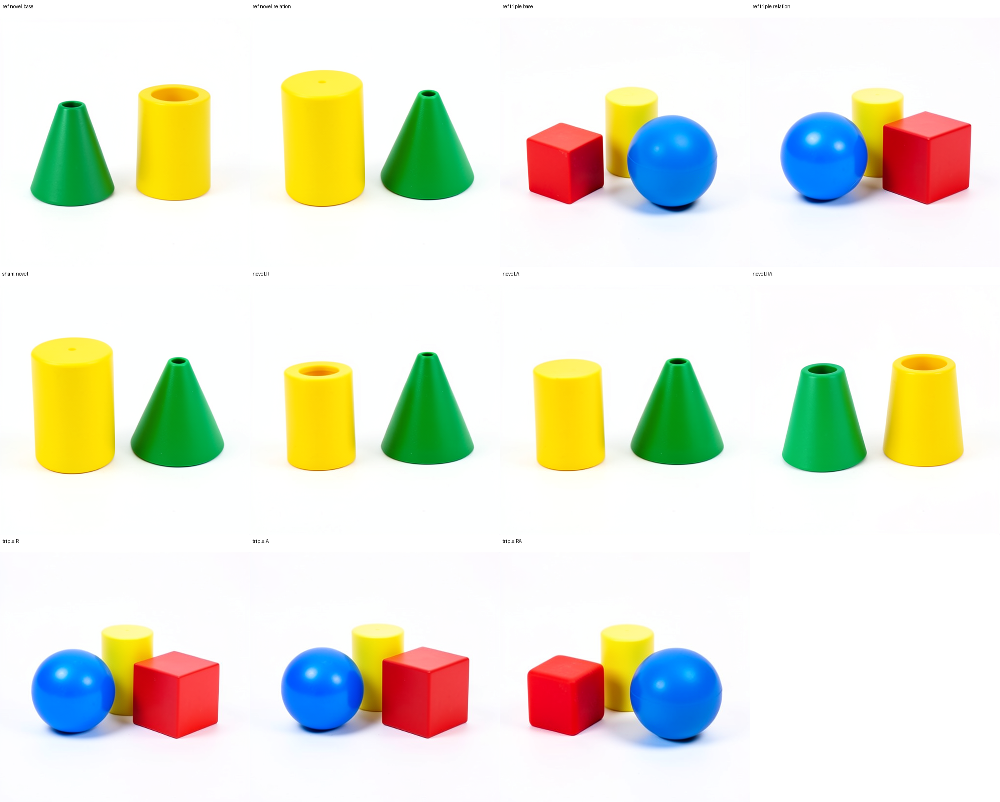
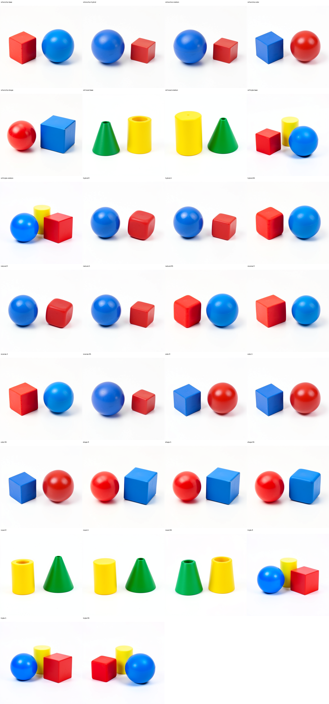

# Testing a diffusion computation family in one MDB run

This campaign tests six extensions of the [replicated single-block residual/attention record](FLUX-ROUTE-REPLICATION.md) within one resident FLUX.2 Klein 4B model process. MDB saves immutable typed cuts, rewinds to those cuts, applies declared image-state edits, and continues each branch through the native scheduler and VAE. Different prompt/seed histories have their own matched roots; sharing a model process does not make them one identical state.

All 47 futures completed in one model load. Across seven directed pairs, residual-plus-attention replacement finished closer to the source along the declared latent axis than either replacement alone. Assistant inspection found source ordering restored in all five directed relation contrasts, but source color and shape assignments were not restored. The numerical magnitudes agree with that selectivity boundary: relation pairs ended at p=0.065–0.176, while color assignment remained at p=0.889 and shape assignment at p=0.643. Several more specific predictions missed: V-only did not beat K-only, top text-energy support lost to its alternative, and the learned selectors offered no action improvement over the fixed RA baseline. These heterogeneous outcomes are retained alongside exact controls and successful selected-row rescue.

The producer `job-510de5512a8f` and separate zero-forward CPU audit `job-2357bee4b2ab` both succeeded. The [portable result index](../qualification/flux-six-panel-family-20261102.json) links every row, original PNG, receipt binding and numerical result. The frozen scientific plan has SHA `2822456cffc40f75de71430865f96a6fa29ae0d2c23c174bd23f12bce009b325`. The initial submission, `job-65ed4e0752b5`, was canceled while still queued, with no start timestamp or model execution, after independent review found its 32 GB RAM reservation materially overdeclared. The corrected submission preserved every scientific source byte and plan entry, reducing only the scheduling envelope.

## Six questions, shared evidence

| Panel | Question | Declared contrasts |
|---|---|---|
| 1 | Does text attention act through keys, values, or their combination? | K-only, V-only, K+V, and base queries under changed residual |
| 2 | Does the response depend on hybrid prompt history? | Hybrid versus ordinary full-prompt histories, plus reciprocal transfer |
| 3 | Is the response specific to relative position? | Relation, color assignment, and shape assignment, with matched R/A/RA edits |
| 4 | Does it extend beyond the original object pair? | Held-out green-cone/yellow-cylinder scenes and a third-object scene |
| 5 | Which support and timing matter? | Top versus alternative quarters of heads, text rows and image rows; row omission; early/late/alternative-row rescue |
| 6 | Can a prefix select an applicable computation record prospectively? | Paired-prefix and recipient-only nearest-development selectors, sealed before held-out futures |

There are 47 dependent native image outcomes: 36 development and 11 held-out. Eight prompt encodings produce nine source histories and seven directed source/recipient pairs. References, three copy shams, and existing mixed-state controls are shared across panels. Every declared branch runs regardless of prediction, abstention, partial semantic contrast, or an unfavorable outcome.

## What MDB executes

The specimen is the distilled FLUX.2 Klein 4B checkpoint, CUDA BF16, physical batch one, 512 × 512, four denoising steps and guidance 1. Checkpoint inventory SHA is `dd976d67036c4a0a55642f702dcb3740ba7a4f367557596572baac168330904f`. There are no training updates. Model weights remain resident throughout the campaign.

The selected boundary is logical step 0, before single block 4. Read-only hooks capture the actual module operands and returns. The native block writes

```text
R_next = R + gate * Linear(concat(A, M), W_merge, bias).
```

R/A/RA interventions replace source image-row residual and/or attention operands while keeping the recipient MLP operands, gate, post-block text and stored conditioning. The original projection shape is retained to preserve native BF16 rounding. The resulting image field is installed with a typed image `Act` at the block exit. MDB verifies that other state fields remain unchanged.

For the K/V panel, positioned and normalized native Q/K/V operands are reconstructed through the installed native attention dispatcher. Changed operands supply all unspecified ports. Only image-query outputs reach the installed image field; recomputed text-query outputs are discarded. K-only and V-only effects separate dependencies through attention weights and value vectors. They do not by themselves establish semantic address and content roles.

For fixed queries, write `P = softmax(Q Kᵀ / sqrt(d))` and `A = P V`. Let `P'` result from replacing text keys, and let `ΔV` replace only text values. Before native rounding, the three attention changes are

```text
K only:  ΔA_K  = (P' - P) V
V only:  ΔA_V  = P ΔV
K and V: ΔA_KV = (P' - P) V + P ΔV + (P' - P) ΔV.
```

This separates a local key/value interaction from the later nonlinear response of the remaining model. A visible effect of a key edit does not identify a particular noun or relation inside the key vectors. Naming a reusable semantic operation would require more contexts and controls than this source decomposition alone.

The support selector ranks contrast energy in the observed prefixes, using a stable index rule for ties. It chooses the top quarter and bottom quarter before observing any outcome. The omission branch reverts the selected attention output rows to recipient values within a full text-KV intervention. Rescue copies selected image-state rows from that clean future at a declared later boundary; it does not copy a whole final image. Late rescue inherits the actual earlier scheduler state of the broken branch.

## Prediction barriers and interpretation

The first transaction seals all development hypotheses before the first native image suffix. After development outcomes, two small empirical selectors are fitted using development prefixes and their R/A/RA outcomes. Both selectors are sealed before any of the 11 held-out reference, sham or edited suffixes execute. Native transformer and VAE entry hooks guard both prediction phases; model identity and storage/version signatures bind external frozen weights.

The paired selector uses residual, attention and MLP contrast magnitudes, residual/attention contrast cosine, and the recipient's stored-conditioning/current-text alignment. The companion uses only recipient-state features and that alignment. Both are standardized nearest-development-prefix models with an explicit distance-based abstention rule. Candidate predictions remain recorded even when a selector abstains, and all held-out arms still execute. These are small empirical applicability tests, not automatic rule discovery.

For a source final latent `z_S`, recipient `z_T`, and edited future `z`, report

```text
p(z) = dot(z - z_S, z_T - z_S) / dot(z_T - z_S, z_T - z_S).
```

Source has p=0 and recipient p=1. Negative values and values above one are valid. This signed coordinate measures motion along one latent contrast; it does not measure semantic accuracy, fraction of an image restored, or collateral orthogonal to that contrast. A zero native contrast makes this coordinate inapplicable. Native RGB inspection and recorded collateral remain separate evidence.

The local law and downstream interaction answer different questions. In real arithmetic, keeping the gate and MLP operand fixed makes residual and attention replacement affine at this merge:

```text
Δ_R  = R_source - R_recipient
Δ_A  = gate * W_attention * (A_source - A_recipient)
Δ_RA = Δ_R + Δ_A.
```

The worker evaluates the full native-shaped projection rather than this split expression, because BF16 rounding depends on the execution shape. The later consumer is a nonlinear state transition `G` that also receives the preserved text, conditioning, scheduler state and cursor. Thus an interaction measured as `p_RA - p_R - p_A + 1` after the native suffix can arise even when the local writer is affine. It names an observed downstream response; it does not turn the local merge into an independently discovered multiplicative relation operator.

Likewise, equality of working text/image ports would not establish equality of complete states. Persistent conditioning is part of the captured state and is reread by later projections. The hybrid/natural panel retains both the current working ports and that stored conditioning so an equal immediate update can still be followed by different futures. The audit reports the actual equality and divergence observations rather than assuming them.

The campaign predicts empirical effects from observed prefixes. It does not independently forecast every edited RGB pixel. Exact local equations, causal continuation, applicability predictions, and semantic image descriptions are distinct levels of coverage.

## Observed merge responses

All seven pairs satisfy the frozen numerical rank `pRA < min(pR,pA)`. The table includes the signed downstream interaction `pRA − pR − pA + 1`; this measures the later native response along one latent contrast, not a new nonlinear term in the local affine writer.

| Directed pair | Split | pR | pA | pRA | Downstream interaction |
|---|---|---:|---:|---:|---:|
| Hybrid relation | Development | 0.652486 | 0.794397 | 0.065451 | −0.381432 |
| Natural relation | Development | 0.654958 | 0.796507 | 0.071926 | −0.379539 |
| Reverse relation | Development | 0.802358 | 0.886794 | 0.075729 | −0.613423 |
| Color assignment | Development | 0.947648 | 0.975375 | 0.888505 | −0.034518 |
| Shape assignment | Development | 0.793448 | 0.830213 | 0.643243 | +0.019582 |
| Novel object pair | Held out | 0.734960 | 0.766368 | 0.167578 | −0.333751 |
| Third-object scene | Held out | 0.893935 | 0.902728 | 0.175959 | −0.620704 |

The color and shape rows are especially useful boundaries: a numerical rank win does not mean the source assignment was restored. Assistant inspection of the original-pixel panels found that all color R/A/RA rows retained the recipient blue-cube-left/red-sphere-right assignment. All shape R/A/RA rows retained the recipient red-sphere-left/blue-cube-right assignment, despite a successful separating native shape contrast. Thus color.RA and shape.RA are counterexamples to the categorical source-assignment expectation, even though both satisfy the numerical rank. This is a bounded relation-selectivity lead for further testing, rather than an established relation operator.

In the hybrid, natural, reciprocal, novel-object and third-object relation pairs, R and A individually retained recipient ordering while RA restored source ordering. Restoration had collateral: red cubes became rounded, and the novel yellow cylinder became a tapered hollow body. The requested green cone was already truncated/hollow in the native references. In the third-object scenes the yellow cylinder remained behind the foreground pair. Arity, prompt and seed change together here, so this does not isolate an arity effect. These are post-outcome assistant observations, not calibrated object recognition or human annotation.





## Attention sources and support counterexamples

| Attention edit | Receiving residual | Final p |
|---|---|---:|
| Source text K | Source R | 0.179493 |
| Source text V | Source R | 0.278202 |
| Source text K and V | Source R | 0.180621 |
| Source Q | Recipient R | 0.923228 |

The exploratory prediction `V-only < K-only` missed. K-only and joint KV produced similar final projections in this context, while V-only moved less toward the source. The Q arm retained recipient residual, so its large p cannot be used as a matched K-versus-Q importance ranking. It answers the declared question about source queries under that receiving residual. None of these outcomes independently assigns noun, relation or address semantics to a vector family.

Assistant inspection found K, V and KV all restored source ordering, while source Q under recipient R retained recipient ordering. The K/V numerical ranking therefore has no corresponding categorical ordering advantage in these images. V-only had darker palette collateral. Red-block rounding was already visible under R-only and cannot be uniquely attributed to K/V.



Prefix contrast energy was a useful support proposal for heads and receiving image rows, but not uniformly for text rows:

| Selected quarter | Top-energy p | Alternative-quarter p |
|---|---:|---:|
| Attention heads | 0.180720 | 0.652534 |
| Receiving image rows | 0.180319 | 0.652589 |
| Text rows | 0.647192 | 0.245080 |

The top text support lost to the equal-size alternative. Energy is therefore an instrument for proposing interventions, not an authority on causal utility. These spatial rows are fixed model-token positions, not identified object parts.

The visual ordering observations agree with this counterexample: top heads and image rows restored source ordering while their alternatives did not; top text rows retained recipient ordering while alternative text rows restored source ordering.

The omission branch was L2=228.591 from the clean KV final latent. Rescue uses a different projection axis: clean KV=0 and broken=1. It copies selected rows from the clean future into the broken future at a declared later clock.

| Rescue | Final clean-to-broken p | Final L2 from clean |
|---|---:|---:|
| Early top rows | 0.001012 | 5.18547 |
| Late top rows | 0.142415 | 82.2644 |
| Early alternative rows | 0.999698 | 228.578 |

Early top-row rescue nearly recovered the clean latent on this axis; late rescue was partial, and the alternative rows had little effect. The late branch retained the broken branch's already-completed first scheduler state. This is a selected-state repair observation, not independent forecasting of the clean donor state.

Both early and late top-row rescue restored the displayed ordering; early alternative-row rescue did not. Late rescue had darker palette collateral. Its larger latent distance does not make it a categorical ordering failure. Neither ordering restoration nor near-clean projection establishes complete appearance restoration.



## Equal working prefixes with different stored conditioning

The hybrid history carries source conditioning while its initial working text is replaced by the natural relation history's projected text. At the retained initial, selected-block entry and block-exit cuts, every payload field except `conditioning` has an equal descriptor. The common native residual, concatenated attention/MLP operands, full projection and gate are byte-exact. Q/K/V were retained only for the hybrid and base histories, so this comparison does not claim separate Q/K/V equality for the natural history.

Their reference first scheduler arrays are exact; the second scheduler arrays first differ among the saved observations. Each matched R, A and RA pair also has equal post-Act payload fields except conditioning, an exact first scheduler array, and a divergent second scheduler array. Thus equal local working ports and an equal immediate installed image do not specify the whole future. Stored conditioning remains part of the state consumed by later steps.

| Hybrid minus natural comparison | First differing saved scheduler | Final latent L2 | Final RGB mean absolute difference, 0–255 |
|---|---:|---:|---:|
| Native references | 2 | 61.0969 | 1.16168 |
| Matched R edits | 2 | 58.2645 | 1.80475 |
| Matched A edits | 2 | 55.6983 | 1.77286 |
| Matched RA edits | 2 | 45.9691 | 1.22044 |

The audit preserves per-step signed means and maximum differences, typed cut IDs and field-level equality diagnostics. The first differing saved scheduler is an observation boundary, not a localization of the first differing native operation.

## Held-out selectors versus the fixed baseline

The paired-prefix model predicted RA for both held-out pairs. The recipient-only model abstained for the novel objects and predicted RA for the third-object scene. Each served selection therefore matched the fixed predeclared RA action: there was zero action improvement over that baseline. The fixed baseline predicts a rank, not the idealized numerical targets R=1, A=1, RA=0.

| Held-out pair | Selector | Sealed status | Chosen action | Mean absolute error across R A RA targets | Actual minus predicted pRA |
|---|---|---|---|---:|---:|
| Novel objects | Paired prefix | Predict | RA | 0.093224 | +0.091849 |
| Novel objects | Recipient only | Abstain | None | Inapplicable | Inapplicable |
| Third object | Paired prefix | Predict | RA | 0.153429 | +0.110508 |
| Third object | Recipient only | Predict | RA | 0.153429 | +0.110508 |

The abstention and its unserved candidate values remain in the record. All 11 held-out futures ran after the selector seal, including references and sham. Five directed development pairs and two held-out pairs are too small a basis to claim a general applicability classifier; several development pairs share the same source histories.





## Evidence and status

The [independent audit](../../../../artifacts/mdb-flux-six-panel-family-20261102/audit-01/extracted/flux-family-audit-result/producer-analysis.json) verified full arrays and the typed store on the storage host. Its SHA is `44b032572513f017cfe32460279c0ca99ecbfdd85ad28cf234011677f611799d`. The producer archive SHA is `503dbbd12e8a488484863ec4a3e43a35386ab5529341bced417b7571806ea6eb`; it contains 5,518 files and 1,559,008,580 expanded bytes. The [compact verification](../../../../artifacts/mdb-flux-six-panel-family-20261102/audit-01/compact-verification.json) binds that archive and audit to their producer request. Compact custody is a source-bound remote full-array audit attestation; it does not replace possession of the full archive for an independent local re-audit.

All three copy shams reproduced every saved scheduler array and original RGB exactly. Model storage/version signatures stayed unchanged. Both prediction phases recorded zero native module entries. The producer used one model load, 48 rewinds, 4,825 native adapter steps and 39 Acts for 47 dependent futures. Scheduler elapsed time was 1,547 seconds, with peak RSS 12,783.3 MB and VRAM 9,340 MB. The separate CPU audit used 195.91 seconds and peak RSS 1,723.8 MB, with zero model calls.

The [derived result](../../../../artifacts/mdb-flux-six-panel-family-20261102/final-v1/result.json), [all-row report](../../../../artifacts/mdb-flux-six-panel-family-20261102/final-v1/result.md), and [18 generic computation observations](../../../../artifacts/mdb-flux-six-panel-family-20261102/final-v1/computation-records.json) retain the rank outcomes, source-ranking miss, support counterexample, selector errors and abstention. They are family candidates with source-qualified IDs; no automatic semantic naming, rule promotion or terminal certification follows. Their original visual-pending fields remain immutable.

Separate assistant inspection records cover [panels 1 and 5](../../../../artifacts/mdb-flux-six-panel-family-20261102/visual-panels-1-5.json), SHA `719e7b7990902a04a16c87abcbd63dc5e56db333ea15d7e41d799c747d083178`, and [panels 2, 3 and 4](../../../../artifacts/mdb-flux-six-panel-family-20261102/visual-panels-2-3-4.json), SHA `3cd71fe47c9eb1f2b4855a04b93e0aa197c886b641612d5d00c4ad6b7b74e69b`. Their union binds all 47 original PNGs. Ordering judgments are clearer than precise shape fidelity; these inspections were neither blinded nor calibrated, and have no automatic gate authority.

The [Saturn evidence sweep](../../../../artifacts/mdb-flux-six-panel-family-20261102/evidence-01/checksums.json), SHA `ebccd6e4011b64fa34db464eb4c25e9936e1289ef0a90e72c05237e56c6cd439`, ran and verified with exit 0 over 47 derived numerical stream rows and zero model calls. Its scope is target-stream mechanics, not a second scientific certification or certification of every MDB receipt.

The [independent result review](../../../../artifacts/mdb-flux-six-panel-family-20261102/independent-results-review.json), SHA `8d4a71292606ad85b5351f18b70810b5d9e37310c6c765e078ea99d96e177930`, preserves the scientific limits and the measured 18,432 MB RAM / 13,000 MB VRAM envelope. A single observed peak does not justify silently changing those qualified resource defaults.

## Reproduce the workflow

Use the declared installed public MDB qualification environment and configured mrun fleet. From the MDB package directory:

```sh
# Freeze the 47-row plan from the prior pinned checkpoint plan.
python qualification/submit_flux_family.py /absolute/campaign/plan.json \
  --make-plan /absolute/prior-replication/plan.json

# One CUDA lease, one model load, all branches in-process. No automatic retry.
python qualification/submit_flux_family.py /absolute/campaign/run-01 \
  --plan /absolute/campaign/plan.json

# After that exact job finishes, perform a separate CPU-only audit.
python qualification/remote_flux_family_audit.py /absolute/campaign/audit-01 \
  --producer /absolute/campaign/run-01
python qualification/remote_flux_family_audit.py /absolute/campaign/audit-01 \
  --collect AUDIT_JOB_ID
python qualification/remote_flux_family_audit.py /absolute/campaign/audit-01 --verify
```

The separate audit performs zero model forwards. It verifies the full producer archive, typed CAS, native ports, image Acts, scheduler arrays, PNG hashes, prediction seals, support selection and selector fitting on the storage host. The compact view returns the original 47 PNGs and audited records, with request/archive/analysis bindings. Full arrays remain in the named storage-host evidence directory. Offline auditing does not rerun external-weight projection or attention kernels.

The producer used strict preflight, a finite CUDA lease, no retries and bounded local work. Its corrected reservation was 18,432 MB RAM, 13,000 MB VRAM and four CPU threads, with an installed mrun kill ceiling of 20,275.2 MB. The observed 12,783.3 MB RSS peak was below that reservation. The worker allowed 3,000 seconds and 10,000 adapter steps, required 12 GiB free scratch, and capped retained CPU source ports at 1,536 MiB. Multipart custody independently bounded compressed/expanded bytes, members, individual files and log transport; the serialization budget was measured before submission.

The execution source is [flux_family_campaign.py](../qualification/flux_family_campaign.py), the frozen geometry and selectors are in [flux_family_plan.py](../qualification/flux_family_plan.py), and the independent auditor is [analyze_flux_family.py](../qualification/analyze_flux_family.py). Generic computation IDs should record this exact scope, applicability, signed effects, counterexamples and unresolved semantics before receiving stronger names.
