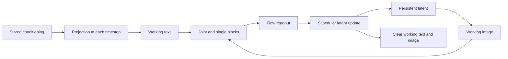
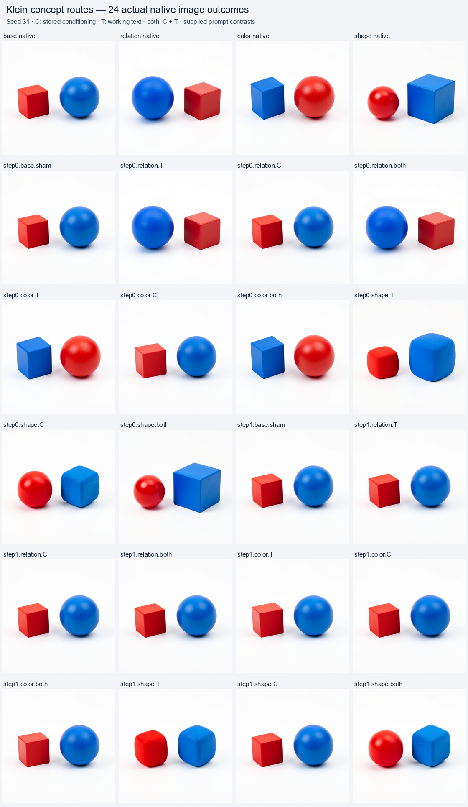
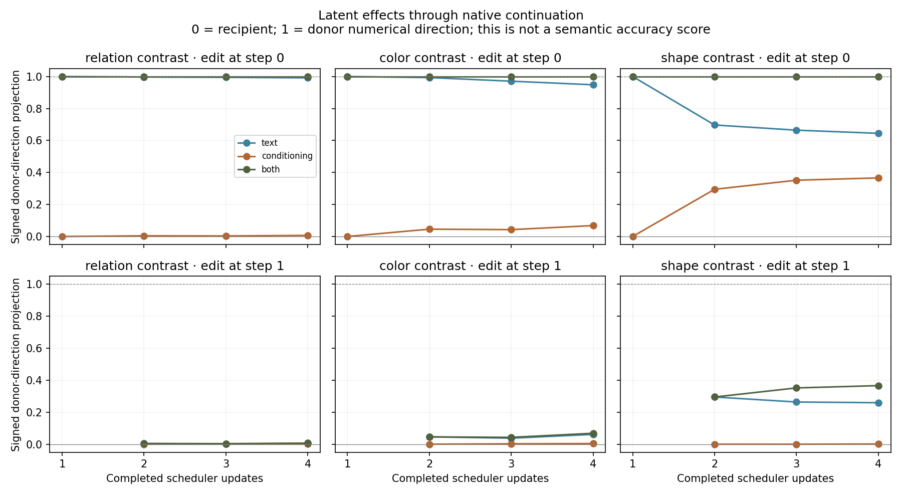

# Separating diffusion conditioning from working text

The completed 24-image panel shows a strong early effect: replacing only step zero's working text changes object ordering or color assignment, and those changes survive three later timesteps using the recipient's original stored conditioning. Replacing stored conditioning alone has much weaker effects on those properties. Shape responds more to later conditioning and produces mixed, rounded forms in several hybrid branches. This is a bounded causal starting point for naming functional windows, with object-level symbols still unresolved.

An exact numerical continuation tells us how the image was computed. This experiment starts organizing that account into functions by separating the prompt source that is reread at each timestep from the evolving text features used inside a timestep. It also observes the same first image MLP under independent changes to requested relation, color assignment and shape assignment.

The specimen is the pinned distilled FLUX.2 Klein 4B checkpoint, CUDA BF16, batch one, 512 × 512, four steps and a fresh seed, 31. The [plan](../qualification/submit_flux_concept_routes.py) fixes four prompts before submission:

| ID | Scene request before the shared background and style suffix |
|---|---|
| `base` | A red cube to the left of a blue sphere |
| `relation` | A red cube to the right of a blue sphere |
| `color` | A blue cube to the left of a red sphere |
| `shape` | A red sphere to the left of a blue cube |

These are supplied contrast labels. Swapping colors or shapes changes their assignment to both scene roles. The rendered scenes must be inspected separately; a red/blue centroid cannot identify cube versus sphere. This first panel has one seed, one wording template and whole-field interventions.

## Three structural function records

| Generic ID | Structural name | Reads and consumers |
|---|---|---|
| `flux.route.C` | Stored conditioning reread | `conditioning` is projected into working text at each timestep. |
| `flux.route.T` | Within-step working text | Joint and single blocks update/read `text` along with image features until the scheduler clears it. |
| `flux.write.J0FF` | Joint-zero time-gated image MLP write | The post-attention normalized/modulated image enters SwiGLU; its gated result is added to the image residual. |

These names describe functions visible in the [public adapter](../../../src/saturn_pub/adapters/flux2.py) and verified through typed interventions. They are not discovered `red`, `sphere` or `left of` primitives. A particular concept may use several carriers, and one mathematical writer can respond to several concepts through different incoming states.



## Same-parent carrier interventions

At steps zero and one, the worker saves the base recipient immediately before and after projection. Each of the three donors supplies a matching post-projection cut. Every edited arm uses two Acts and one projection from the same recipient parent:

| Arm | Persistent conditioning | Current working text |
|---|---|---|
| `sham` | Recipient | Recipient |
| `text` | Recipient | Donor |
| `conditioning` | Donor | Recipient |
| `both` | Donor | Donor |

Conditioning is writable at a project boundary; text is writable at a joint boundary. The [carrier helper](../qualification/flux_concept_routes.py) respects those public contracts: replace conditioning before projection, execute projection, then replace text. It verifies the entire resulting payload against the recipient projection except for the two declared fields. Image, latent, position IDs, time context, cursor and other closure fields remain recipient values.

The worker renders four native prompts and twenty same-parent branches: three donors × three edited arms × two cut times, plus two shams. All 24 images use the unchanged native suffix and VAE. The complete native prefixes through step-one projection are explicitly observed. The transaction seals route hypotheses before any RGB outcome; this assay does not mathematically forecast the edited images.

The two shams test exact recipient replay. Coherent `both` at step zero tests exact donor reproduction because initial latent, projected image, IDs and time context are common. At step one, the recipient latent already contains an earlier prompt-dependent update, so installing both text carriers does not reset the complete scene history.

## Completed observations and the counterexample

Run `run-05`, job `job-c2a467736b50`, completed all 24 native RGB outcomes, 40 Acts and 2,408 adapter transitions. The explicitly observed prefixes account for 116 transitions. The [independent audit](../../../../artifacts/mdb-flux-concept-routes-20261030/run-05/analysis-v1.json) verifies 36 typed cuts, 29 pages and 24 tensor blobs. Both shams reproduce the base's full retained latent arrays and PNG exactly. All three step-zero `both` arms reproduce their donors exactly at every retained scheduler boundary and in RGB.

The predeclared `R-T` hypothesis expected working-text effects to be less persistent because subsequent steps reread the original conditioning. The relation and color outcomes strongly contradict that simple repair account. Step-zero text-only replacement flips the relation or color assignment despite preserving the recipient conditioning. Later original conditioning changes the tensors but does not restore the original visible ordering or color assignment. The shape outcome retains a larger mixture of early and later influences.

| Contrast | Step-zero text-only final latent donor projection | Step-zero conditioning-only final latent donor projection | Text-only RGB MAE from donor on 0–255 channels | Conditioning-only RGB MAE from donor |
|---|---:|---:|---:|---:|
| Relation | 0.99151 | 0.00675 | 0.8502 | 32.2858 |
| Color assignment | 0.94822 | 0.06823 | 2.9296 | 26.5401 |
| Shape assignment | 0.64471 | 0.36605 | 7.0226 | 13.7299 |

Projection is a signed geometric measurement of the final latent, not a semantic accuracy or a percentage of concept transfer. In the relation branch, the descriptive red-minus-blue horizontal centroid changes from `−0.40631` in the base to `+0.43501` under text-only replacement; donor native is `+0.43593`. Conditioning-only remains `−0.40736`. Informal assistant inspection sees the corresponding red-cube/blue-sphere ordering reversal. The color branch similarly shows a blue cube left and red sphere right under first-step text replacement.

At step one, replacing both carriers no longer flips relation or color assignment. Its shape arm changes the red object toward a sphere and the blue object toward a rounded cube. The [visual review](../../../../artifacts/mdb-flux-concept-routes-20261030/visual-review.json) records all 24 contact-sheet observations and additional inspection of three original-resolution shape images. This is assistant inspection, without human labels or a calibrated shape classifier. Shape mixtures and collateral remain outcomes rather than being scored as clean transfers.



### The exact handoff explains the carrier lifetime

All six conditioning-only edits leave their current timestep's scheduler latent exactly equal to the recipient. They first affect a later step. This matches the native read footprint: conditioning was already projected, and the current working text was restored.

The [additional saved-array comparison](../../../../artifacts/mdb-flux-concept-routes-20261030/run-05/handoff-identities-v1.json) verifies another exact identity for all three donors: `conditioning-only at step0` equals `both at step1` in every shared retained scheduler array and PNG bytes. Delaying the changed source until the next projection produces the same future. This narrows the function of `flux.route.C` to an actual reread boundary while separating it from current working-state influence.

First-step text-only replacement initially produces the donor scheduler latent exactly, because the current transformer computation reads the transplanted text. Later original conditioning partly changes that trajectory. The final latent remains near the donor direction for relation and color, while shape shows more restoration and mixture.



The working inference is that early working text writes a scene-dependent state into the latent which later computations continue to consume. This is a temporary carrier with a persistent consequence. In this specimen, ordering and color binding resist the tested later conditioning changes more strongly than shape. The experiment localizes that distinction to a whole timestep; it does not isolate a minimal writer, establish irreversibility or exclude a later image-state intervention that could change it.

This connects with the earlier [Saturn relation-operator experiment](../../../../saturn/experiments/2026-09-16-flux2-relation-operator-rosetta/README.md) and [historical scene-program audit](../../../../obsidian/blog/2026-09-18-151427-the-relationship-survived-the-binding-has-not-been-tested.md), which reported early joint-text influence and distributed temporal/object-binding contracts on reference-conditioned Klein scenes. The present text-only panel adds explicit stored-conditioning versus working-text separation and a simple relation/color/shape comparison. It does not establish checkpoint, StateCut or semantic-operator portability between those execution contracts.

### The same MLP responds to several contrasts

The first image MLP's timestep gate is exactly equal across all four prompt conditions. Its write changes by 2.89%, 4.01% and 4.90% of the base write's L2 norm for relation, color and shape contrasts. Pairwise write-contrast cosines range from `0.104` to `0.207`. These are different incoming-state responses of the same mathematical writer, rather than a whole module with one established concept name. Low cosine does not establish disentangled semantic features.

The top 10% of spatial rows contain 24.1–30.6% of write-contrast energy. The [native-grid diagnostic](assets/flux-concept-mlp-grid-20261030.png) retains the distributed pattern, including edge effects. These maps do not trace object outlines or establish learned object masks. This assay observes those MLP writes; it causally swaps the larger text/conditioning carriers. The earlier [single-MLP donor intervention](FLUX-MLP-COMPUTATION-FORECASTS.md) did not flip relation, so the new result cannot be assigned to that first MLP alone.

### Candidate names and the next causal cut

The generic records remain `stored-conditioning-reread`, `within-step-working-text` and `joint0-time-gated-image-ff-write`. Two additional coarse candidate aliases are `early-layout-and-color-binding` for the first-step window and `later-shape-refinement` for the shape-responsive continuation. They describe this contrast family; they are working inferences rather than isolated learned functions or universal semantic instructions.

The [next cut is now measured inside step zero](FLUX-BLOCK-HANDOFF.md). Twelve native outcomes restore matched base text or image at four block boundaries. Working text determines ordering in the two early hybrids; image state determines it in the two late hybrids. This narrows the crossover to single blocks 0–9 for the known seed31 relation contrast. Only after further localization should individual attention outputs and MLP writes receive more specific functional names. More seeds, paraphrases and different scene identities are also needed before expanding applicability.

## Measurements and naming policy

The worker retains typed cuts, Acts and receipts, actual first-MLP input/output/write arrays for all prompts, scheduler latent arrays, RGB images, a closed transaction and a file manifest. The [offline auditor](../qualification/analyze_flux_concept_routes.py) checks the request, staged source, archive, transaction seal, typed CAS and undeclared-slot preservation. It independently recomputes full latent and pixel differences without loading a model.

The [portable result](../qualification/flux-concept-routes-20261030.json) retains the audit, counterexamples, handoff identities and visual inspection. The [figure manifest](../../../../artifacts/mdb-flux-concept-routes-20261030/figures.json) binds all 24 source PNGs. The separate [evidence sweep](../../../../artifacts/mdb-flux-concept-routes-20261030/evidence/checksums.json) checks 23 derived numerical rows with run/verify return codes zero; it adds no model execution or semantic certification. These causal-route records are separate from equation-forecast observations: the current computation atlas should not treat native image effects as independently forecast equations.

Target projection measures the signed fraction of the donor-minus-base numerical direction taken by a branch. It is a descriptive geometric measurement, not a semantic correctness score. Color-region centroids are likewise descriptive. Shape and relational inspection are reported separately with their evaluator limitations. Control disagreement remains visible per row; numerical effect sizes have no independent authority to discard exploratory evidence.

Specific semantic aliases remain candidates until interventions move the corresponding concept while preserving relevant alternatives across additional contexts. This first map can support structural names and contrast-sensitive write records while leaving object-level bindings unresolved.

## Reproduce and inspect

Use installed public MDB/Saturn packages and the pinned Diffusers 0.39 environment. Real-model execution runs through one finite mrun lease with strict preflight, explicit CUDA admission and no retries. The 13,000 MB VRAM/32,000 MB RAM exception was initially calibrated against the preceding trajectory job. Future submissions now cite this completed panel's measured peak of 9,470 MB VRAM and 10,697.6 MB RSS, with a 780-second wall estimate and unchanged 840-second hard limit. The worker remains batch one; no scalar-to-batch parity claim is implied.

The submitting environment must select the actual scheduler and host-appropriate worker cache/model roots. The campaign preserves two local admission/configuration failures, a remote cache-path failure before model execution, and a prefix-only transaction-declaration failure. Those attempts are separate from a completed image panel.

The completed worker took 670.98 seconds before archiving; scheduler elapsed time was 736.55 seconds, peak RSS 10,697.6 MB and peak VRAM 9,470 MB. This is execution metadata, not a speed comparison. Repeated full-state capture for clock inspection and durable per-transition receipt writes are candidates for profiling before scaling the branch grid.

```sh
python qualification/submit_flux_concept_routes.py /absolute/path/campaign/run-N --inventory /absolute/path/qualified-inventory/report.json
python qualification/submit_flux_concept_routes.py /absolute/path/campaign/run-N --collect JOB_ID
python qualification/analyze_flux_concept_routes.py /absolute/path/campaign/run-N /absolute/path/campaign/run-N/analysis-v1.json
```

Use fresh run/output names. The [tiny installed-package tests](../tests/test_flux_concept_routes.py) exercise actual public Acts, carrier closure, coherent donor/sham continuation, cross-time refusal, the transaction lifecycle, submission geometry and independent BF16 CAS reading. The [complete numerical image forecast](FLUX-TRAJECTORY-FORECASTS.md) and [earlier local MLP/donor panel](FLUX-MLP-COMPUTATION-FORECASTS.md) retain their different prediction and intervention boundaries.

For the recorded workspace fleet, the successful submitter explicitly set `MRUN_URL=http://192.168.68.68:9025`, `MDB_WORKER_UV_CACHE_DIR=/mnt/hdd8tb/mdb/uv-cache`, `MDB_WORKER_TORCH_HOME=/mnt/hdd8tb/mdb/torch` and `MDB_WORKER_MODEL_ROOTS=/mnt/big/llm-models`. Use host-appropriate equivalents elsewhere. The public MDB submitter must run in an environment containing `mdb-runtime`, `saturn-pub` and `mrun-pub`, without the conflicting private `mrun` distribution. Current launcher timing/calibration updates did not execute the recorded case; its original request and staged sources remain bound by the portable result.
