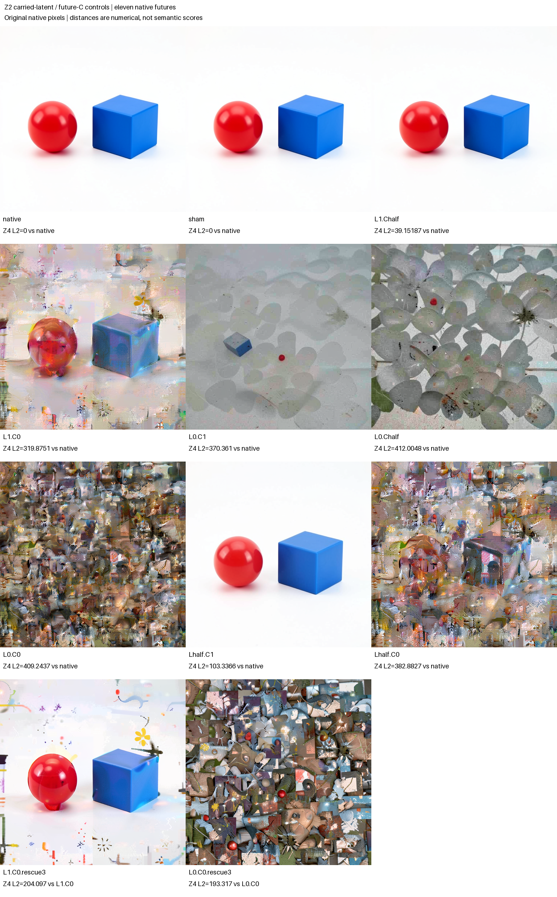
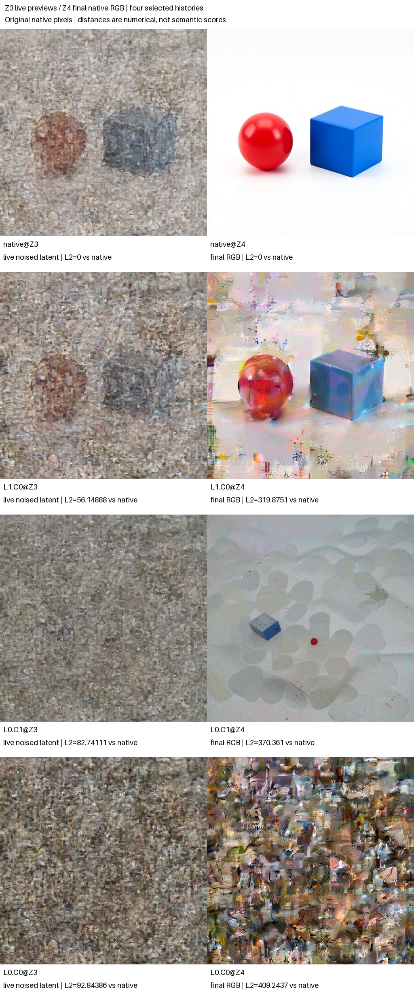

# Carried latent state and future conditioning

This completed assay separates two inputs to later denoising: the image latent left by an observed native history, and the stored prompt conditioning that the model reads again. On the native Z2 latent, half conditioning changed final latent L2 by 39.1519 and zero conditioning by 319.8751. On the derived noise anchor, own conditioning did not reconstruct the original native latent; half conditioning was slightly farther from native than zero conditioning. Late own-C rescue moved the two histories differently: closer to native in latent distance for the carried-state history, farther for the anchor history, while both had lower RGB error from native. These are numerical observations, not shape verdicts.

All eleven futures completed from the valid Z2 project frontier of the [single-prompt joint-self campaign](FLUX-JOINT-SELF.md), with no foreign donor, new encoding or new noise draw. The [independent audit](../../../../artifacts/mdb-flux-context-carriers-20261103/run-01/analysis-v1.json) found valid typed mechanics and qualified the named exact-replay controls. The [immutable publication](../../../../artifacts/mdb-flux-context-carriers-20261103/final-v1/result.json) retains every row and both rescue baselines. Sealed arm-blinded assistant inspection supports retained coarse arrangement under C-zero, with substantial collateral; own C on the anchor produces a small blue block but reverses the requested ordering. Late anchor rescue does not recover a coherent sphere/cube pair.

The question differs from a within-block attention/MLP swap. The native scheduler has already cleared working text, working image, context and noise prediction at this frontier. The next projection rebuilds image features from latent, text features from stored conditioning C, and time/position context from the schedule and IDs. Old working registers therefore do not bypass the declared latent/C contrast. The surviving latent can still contain consequences of earlier prompt reads; weakening C does not independently erase those consequences.

The [shape-timing](FLUX-SHAPE-TIMING.md) and [handoff](FLUX-SHAPE-HANDOFF.md) experiments already tested later opposing-condition switches and complementary working-text/image restores. This panel instead varies the native history's own latent against a derived own-noise anchor and scales that same history's future C. Those contrasts are not interchangeable. One prompt, one seed and dependent branches do not establish a universal carrier lifetime.

## Observed sources and exact recipes

The supplied Z0 and Z2 cuts come from one authenticated native seed-47 prompt history in distilled FLUX.2 Klein 4B, CUDA BF16, batch one, 512 × 512 and four denoising steps. The source-selection record binds their public CAS bytes, prior request/archive/audit, native row, checkpoint and installed pipeline implementation. Z0 is the actual initial unit-normal draw used by that history; it is not newly sampled. Z2 is its observed scheduler latent at logical clock2. Schedule, positions, own C and nuisance state match; step and latent differ as declared.

With `sigma2 = sigmas[2]`, candidate construction uses:

```text
N2 = FP32(sigma2) * FP32(Z0)
R2 = FP32(Z2) - N2
L_alpha = exact native Z2 copy, if alpha=1
          BF16(N2 + FP32(alpha) * R2), otherwise
C_beta = exact own-C copy, if beta=1
         BF16(FP32(beta) * FP32(C_own)), otherwise
```

Each non-copy recipe uses the specified FP32 operation order and one BF16 conversion, then copies into the original tensor strides. Native endpoints bypass reconstructive arithmetic. The independent auditor compares exact expanded bytes and descriptor hashes, including negative versus positive zero; it also verifies the installed typed stride and single-slot Act closure.

N2 is a derived zero-endpoint anchor, not observed noise extracted from Z2. R2 is an anchor-relative residual, not a proven semantic-memory variable. C-zero is an artificial input to a learned projection. This checkpoint's context embedder is biasless, so its observed C-zero working-text output is exactly zero; model weights, time/positions and surviving state still remain. Neither endpoint is a pure semantic erasure or a guaranteed model marginal.

## What the next projection actually reads

The [saved native port observations](../../../../artifacts/mdb-flux-context-carriers-20261103/projection-port-observations.json) bind the actual context embedder: a biasless Linear with weight shape `[3072,7680]`. At both observed clocks, own-C working-text norm is 22,557.11080; half-C is 11,278.55540; C-zero has norm zero and zero fraction one. The direct Z2 half-C check finds text bytes equal to half the expanded native text exactly in this occurrence. Every recorded same-C comparison across latent gains has identical projected-text bytes. These are entry-boundary observations, not semantic linearity of the later nonlinear suffix.

Both late rescues preserve their actual edited Z3 latent and projected image bytes exactly. Restoring C changes working text from zero to the own-C projection, with text-difference L2 22,557.11080. Thus the intervention changes the repeatedly read text source without silently replacing the altered image history. [Homogeneity observations](../../../../artifacts/mdb-flux-context-carriers-20261103/additional-homogeneity-observation.json) retain the additional exact byte checks. Subsequent blocks can respond nonlinearly to these inputs.

## Nine base futures and two matched rescues

| Row | Latent residual gain alpha | Future C gain beta | Role |
|---|---:|---:|---|
| `native` | 1 | 1 | Untouched replay of the known native future |
| `sham` | 1 | 1 | Exact-copy latent/C Acts |
| `L1.Chalf` | 1 | 0.5 | Native latent, half own C |
| `L1.C0` | 1 | 0 | Native latent, artificial zero C |
| `L0.C1` | 0 | 1 | Derived anchor, own C |
| `L0.Chalf` | 0 | 0.5 | Derived anchor, half own C |
| `L0.C0` | 0 | 0 | Derived anchor, artificial zero C |
| `Lhalf.C1` | 0.5 | 1 | Half anchor-relative residual, own C |
| `Lhalf.C0` | 0.5 | 0 | Half anchor-relative residual, artificial zero C |
| `L1.C0.rescue3` | Same actual `L1.C0` Z3 | Restore own C before Z3 projection | One-step suffix sharing its edited prefix |
| `L0.C0.rescue3` | Same actual `L0.C0` Z3 | Restore own C before Z3 projection | One-step suffix sharing its edited prefix |

The eight distinct dose cells and one copy sham are a selected grid, not a complete three-by-three factorial. There is no half-latent/half-C cell. Each rescue starts from its named baseline's actual saved altered Z3 cut. It cannot borrow native Z3 or another alpha's history. Its conditioning-only Act preserves that exact latent, schedule, positions and clock. Parent binding is recorded before rescue execution.

Every row retains Z3 and Z4 observations. The rescue's Z3 is the shared pre-Act source observation; only its Z4 suffix is new work. Comparisons report L2, mean absolute difference, maximum difference and signed mean against native at matching clocks. Rescue rows additionally use their exact C-zero history as a matched reference. No donor p axis or semantic correctness score is defined.

Four histories—`native`, `L1.C0`, `L0.C1`, `L0.C0`—also retain native VAE previews of live noised Z3. Together with eleven final PNGs, these are fifteen original PNG files from eleven logical futures; native and sham have identical bytes. Preview decoding never feeds the continuation. A separate final-native/helper decode check uses a sixteenth VAE call and saves no extra image.

## All eleven numerical outcomes

All columns below use the common native reference at the same clock. RGB MAE uses the original final uint8 pixels. They describe numerical distance and signed change, not semantic scene quality. Full maximum differences, RGB L2/signed means, and both clocks' complete metrics remain in the publication and [portable index](../qualification/flux-context-carriers-20261103.json).

| Row | Z3 latent L2 | Z4 latent L2 | Z4 latent MAE | Z4 signed mean | Final RGB MAE |
|---|---:|---:|---:|---:|---:|
| `native` | 0 | 0 | 0 | 0 | 0 |
| `sham` | 0 | 0 | 0 | 0 | 0 |
| `L1.Chalf` | 6.19668 | 39.15187 | 0.070885 | +0.000168 | 1.06679 |
| `L1.C0` | 56.14888 | 319.87506 | 0.692411 | +0.007165 | 58.67837 |
| `L0.C1` | 82.74111 | 370.36103 | 0.798617 | +0.034772 | 88.97216 |
| `L0.Chalf` | 90.22430 | 412.00478 | 0.900814 | +0.045773 | 107.68081 |
| `L0.C0` | 92.84386 | 409.24369 | 0.894247 | +0.017650 | 134.01146 |
| `Lhalf.C1` | 22.97149 | 103.33661 | 0.196434 | +0.010197 | 3.83024 |
| `Lhalf.C0` | 74.27993 | 382.88271 | 0.837654 | +0.028185 | 105.39642 |
| `L1.C0.rescue3` | 56.14888 | 280.56074 | 0.578742 | +0.011015 | 17.90525 |
| `L0.C0.rescue3` | 92.84386 | 430.17637 | 0.940394 | +0.039803 | 128.09948 |



The native-latent C series shows larger final drift at zero than half C. The anchor C series is not monotonic in latent distance: half C ends at 412.00478, compared with 409.24369 at C-zero and 370.36103 at own C. Its RGB MAE orders those three doses differently: 107.68081, 134.01146 and 88.97216. Neither metric has authority to label a visual outcome. Keeping half the anchor-relative residual reduces native distance substantially at own C (103.33661 versus 370.36103), while under C-zero it remains large (382.88271 versus 409.24369). These selected curves are context-dependent, not a calibrated decomposition into percentages of latent memory and source influence.

## Exact paired late rescues

Both rescues share their baseline's Z3 latent **exactly**, before their conditioning-only Act. The comparison below measures the new suffix against that exact C-zero future, not against a borrowed native prefix.

| Rescue | Exact baseline | Shared Z3 L2 | Z4 L2 from baseline | Z4 latent MAE | Z4 signed mean | RGB MAE from baseline |
|---|---|---:|---:|---:|---:|---:|
| `L1.C0.rescue3` | `L1.C0` | 0 | 204.09703 | 0.441612 | +0.003850 | 42.99855 |
| `L0.C0.rescue3` | `L0.C0` | 0 | 193.31704 | 0.419283 | +0.022153 | 26.11310 |

Restoring own C changes both native suffixes. Relative to common native, the carried-state rescue reduces final latent distance by 39.31432, from 319.87506 to 280.56074; the anchor rescue increases it by 20.93268, from 409.24369 to 430.17637. Both reduce final RGB MAE from native, from 58.67837 to 17.90525 and from 134.01146 to 128.09948. A lower pixel error alongside a larger latent distance is retained as a disagreement between observables, not discarded. No numerical rescue rank was predicted, and neither incomplete recovery nor a visual miss would establish irreversibility with one step remaining.



## Prospective visual questions

The plan sealed three componentwise questions, without an aggregate semantic gate:

- With future C-zero, does native Z2 retain clearer evidence than the derived anchor of two separated objects, red-left/blue-right assignment, red sphere-like form and blue cube-like form? Each component is separate.
- From the anchor, does own C retain clearer red coloration, blue coloration, red sphere-like form and blue cube-like form than C-zero? Ordering is exploratory.
- Does restoring own C before Z3 improve prompt-associated color assignment and object shape identity relative to that exact altered C-zero history? The native-latent and anchor histories are assessed separately.

Half-dose responses and late ordering/full recovery are exploratory. There is no frozen numerical rank prediction. Unknown, mixed, opposing and unchanged component outcomes remain observations. Latent/RGB distances do not decide shape labels. The assay does not isolate an object address, discover a semantic operator, prove memory erasure or forecast RGB independently from the supplied state.

## All visible outcomes and componentwise misses

One assistant inspected the sheet and all fifteen original PNGs before arm identities, current metrics and specific hypotheses were supplied; general project context was known. This is arm-blinded informal inspection, not a calibrated shape classifier or human annotation. The [sealed observations](../../../../artifacts/mdb-flux-context-carriers-20261103/blinded-observations.json), [unblinding](../../../../artifacts/mdb-flux-context-carriers-20261103/unblinded-visual-record.json) and [componentwise interpretation](../../../../artifacts/mdb-flux-context-carriers-20261103/componentwise-hypothesis-outcomes.json) retain captions, uncertainty and all preview observations.

| Final row | Informal visible-pixel observation |
|---|---|
| `native` | Clean red sphere left of blue cube, two separated objects. |
| `sham` | Exact native pixels and the same scene. |
| `L1.Chalf` | Clean red-left sphere/blue cube scene retained. |
| `L1.C0` | Two dominant separated masses: rounded red left with a protruding base, blue block right; substantial pastel/floral clutter. Exactly two total objects and a pure sphere are not established. |
| `L0.C1` | Small tilted blue cube upper left of a small red bead among broad pale floral forms; requested ordering reversed, total count uncertain. |
| `L0.Chalf` | Broad floral forms and red spots, without a secure blue cube. |
| `L0.C0` | Fragmentary collage; no coherent sphere/cube pair. |
| `Lhalf.C1` | Clean red-left sphere/blue cube scene retained. |
| `Lhalf.C0` | Partly discernible left/right masses amid substantial collage. |
| `L1.C0.rescue3` | Clearer glossy red/blue surfaces on existing masses; protrusion and clutter persist. No full native recovery. |
| `L0.C0.rescue3` | Collage persists without a coherent sphere/cube pair. |

For the carried-state hypothesis, red-left/blue-right assignment and blue-block form have support; separated-object count and red-sphere form have only partial support because of extra motifs and distortion. For future C on the anchor, a discrete blue cube improves, but **red presence is inconclusive for improvement**: both controls already have red accents. A stronger red-sphere claim remains partial or unresolved. The reversed ordering and dominant floral forms are countertrends to full scene reconstruction.

Late own-C rescue gives partial color/surface improvement on the native-latent history, without repairing its mixed geometry. **Predicted component improvements on the anchor history were not clearly observed; no coherent pair recovered.** Complete native recovery was exploratory. The component misses remain alongside changed numerical distances; a single late intervention does not prove irreversibility. No aggregate hypothesis pass is assigned. The working inference is that carried latent state and repeatedly read conditioning jointly affect later response, with different conditional recoverability for arrangement, local appearance and clutter in this occurrence.

## Audit and publication workflow

The source tensors, FP32 anchor/residual, exact BF16 recipes and hypotheses are sealed before any new native project, block, scheduler or VAE call. Guards retain attempted pre-release native entry counts. Imported sources and candidate arithmetic are allowed; new prompt encoding and noise draws are absent.

The finite plan accounts for nine two-step continuations at56 adapter transitions each and two one-step rescue suffixes at28 each:560 physical transitions,18 Acts and20 observed projection reads. Native receipt paths and branch-labelled emissions distinguish reused prefixes from newly executed suffixes. Each projection records the actual C/latent inputs and text/image outputs, joining their bytes to pre/post typed cuts. Same-clock time context is checked separately. This is native read provenance, not an independent evaluation of projection weights.

Job `job-a1afc382b4fe` succeeded on Beast. The exact physical census is 560 adapter transitions,18 Acts,578 receipt emissions,20 projection reads,11 final PNGs,4 previews,16 VAE calls and2 reused edited prefixes. One model was loaded; encodings and new noise draws were zero. At the seal, observed35.51182 seconds after worker start, all native-step, project-read, Act, VAE and PNG counters were zero. The sealed digest is `170132d4e222c045553547923f64d6b8913602615e210a4d911d52b4615b23d7`.

Worker time was178.15738 seconds; the scheduler reported219.22 seconds (the recorded start/finish span is219.11534). Poll-sampled peaks were2,670.8 MB RSS and9,342 MB VRAM. The expanded result contains821 files including its manifest,338,225,995 bytes; the retained gzip worker log is194,571,836 bytes. Encoder omission, prefix reuse and gzip1 export were used together, so this is not a matched speedup benchmark. The full raw bundle/log is retained locally; the scheduler reports zero remote artifact-CAS rows/objects.

The audit verified820 manifest entries,30 staged source bindings, exact signed-zero recipe bytes, installed strides, all typed write closures, both actual rescue source cuts and all578 receipt emissions. Native matches the prior native PNG; sham matches native at Z3/Z4 and final pixels; the VAE helper matches native final pixels and PNG bytes. Thus the named replay instrument is `native-replay-qualified`. This qualification is separate from the componentwise visual hypotheses and terminal status remains unassessed. The [independent post-run review](../../../../artifacts/mdb-flux-context-carriers-20261103/postrun-review.json) confirms numerical/custody scope and supplied no image labels.

The generic transaction seal has a retained metadata defect: its default `execution_scope` says CPU FP32 and its generic `work.native_calls` remains zero. Those fields do not describe this external native navigator. The authoritative [source record](../../../../artifacts/mdb-flux-context-carriers-20261103/run-01/extracted/flux-carriers-result/source.json), job execution profile and public receipts establish CUDA BF16 and560 physical transitions. The seal still binds the actual source and precedes release. An additive [metadata-only correction](../../../../artifacts/mdb-flux-context-carriers-20261103/source-freeze-03-metadata/qualification.json), qualified by 28 installed-wheel tests, now lets future callers declare the correct scope. It adds no GPU guard or external-call accounting; the dedicated receipt ledger remains authoritative. The actual scientific job used worker `3f4f8420…`, not corrected future worker `49a0d165…`; its seal, audit and original sources remain unchanged.

The request digest is `dfd968370f1eb0d397b5993e8448e37debedc5219dcc6f539f4671c4305e27e9`; archive digest `dc4eac744092bd10845b2e9242b9b939241eafe82a2f7b6e6d4619715d27922b`; audit digest `56c493fb89a268b4b80d9ca544f69841d2683c1929297e38d82c96a168616efa`; publication digest `846f0aba2fce19b4d3b39fe2442b10f0fe165c7f66b9a38e32202a634b58f8f0`.

The [three curated computation records](../../../../artifacts/mdb-flux-context-carriers-20261103/computation-records.json) describe latent dose, future-C dose and the two actual edited-Z3 rescues using generic addresses. The [Saturn evidence sweep](../../../../artifacts/mdb-flux-context-carriers-20261103/evidence-v1/checksums.json) processed eleven numerical rows and returned four model-and-parent-bound citation query hits. Run, verify, query and stats commands all exited zero; automatic claims were zero. This is numeric-stream integrity and local citation indexing, not semantic certification, automatic computation-family induction or workspace-atlas promotion. The [derivation source](../../../../artifacts/mdb-flux-context-carriers-20261103/derive_records_and_evidence.py) and all command/source hashes are retained. Evidence checksum digest: `5e16e78076abca1b3706d4a77d5273d886a287b5850f57e1619971493fb14e8c`.

Custody, identity, finite-value/shape contracts, exact recipe arithmetic and typed closure are strict mechanics checks. Named replay controls qualify the exact-replay instrument claim: native versus prior PNG, sham versus native PNG and both scheduler arrays, and final VAE-helper parity. A negative replay control yields `replay-unresolved` while retaining structurally valid rows and all metrics. It does not erase a scientific observation or imply an absent effect. Visual component hypotheses have no execution or publication veto.

From the MDB package directory, use the configured installed public environment:

```sh
python qualification/submit_flux_carriers.py /absolute/new-run \
  --predecessor /absolute/audited-joint-self-run
python qualification/submit_flux_carriers.py /absolute/new-run --collect EXACT_JOB_ID
python qualification/analyze_flux_carriers.py /absolute/new-run /absolute/new-run/analysis-v1.json
python qualification/publish_flux_carriers.py /absolute/new-run /absolute/new-run/analysis-v1.json /absolute/new-publication
```

The [auditor](../qualification/analyze_flux_carriers.py) operates only on saved arrays, public cuts/receipts and verified source custody. The [publisher](../qualification/publish_flux_carriers.py) requires that source-bound audit and a fresh output directory. It carries replay qualification honestly and pastes original512px RGB bytes into an eleven-final-image sheet and a four-row Z3/Z4 grid; annotations stay outside image pixels. No image generator or resampling supplies scientific pixels. The [portable index](../qualification/flux-context-carriers-20261103.json) binds every row, both clocks' complete metrics, rescue comparisons, source/audit/cut/receipt hashes and execution ledger. Artifact root: `artifacts/mdb-flux-context-carriers-20261103/`. The immutable original publication and frozen audit/publisher/worker remain unchanged.
