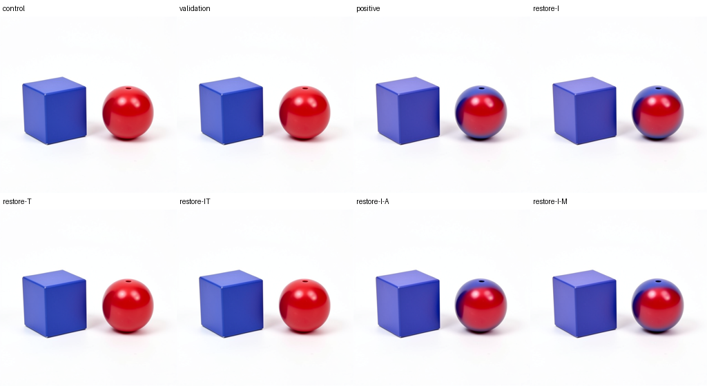

# Predicting and tracing scene changes across contexts

We tested whether a working-text carrier pattern discovered in one FLUX scene
transfers when the objects exchange sides. The carrier asymmetry recurred, and
we traced a local attention-mediated rewrite. The stronger prediction of a
complete color swap failed: the sphere acquired a blue band while remaining
mostly red, and the cube stayed visibly blue. This counterexample separates a
reusable computational pattern from a reusable semantic operation.

The thumbnails are reduced previews of original native 512px PNGs. The cube stays
left and the sphere stays right. `validation` is an independent control replay.

## The plan

The discovery loop has six stages:

1. Select a controlled scene contrast and a consumer measurement.
2. Freeze predictions about the scene, internal carrier and continuation.
3. Execute matched branches from an immutable common state using MDB.
4. Restore individual carriers and writer ports to locate the causal difference.
5. Test the explanation in a changed context, retaining counterexamples.
6. Index the resulting computation records with applicability and unresolved
   alternatives. Expand the family only when new evidence supports expansion.

This run performs the first transfer test and writer localization. Fresh seeds,
paraphrases, different colors/shapes and reciprocal edits remain subsequent cuts.

## What was controlled

The specimen is FLUX.2 Klein4B, four denoising passes, 512px, CUDA BF16, batch 1,
seed 109. The base prompt is:

> A red sphere to the right of a blue cube on a plain white background.

The full prompt adds: “Two separate objects, simple studio product photograph.”

The donor exchanges `red` and `blue`. Its token contrast is exactly rows 4/11;
these addresses are specific to the recorded tokenizer/context. The encoded
conditioning is contextual, so a two-row intervention does not automatically
contain every consequence of changing those words.

Previously observed native parents supply the encoder/noise history. An image
pulse from the donor at step1/joint4 primes a shared receiving state. We advance
that state 23 transitions once to project2, then branch. Edited arms replace only
conditioning rows 4/11 before project2. Every arm restores base conditioning at
project3. This is an intervention transfer in a primed receiver, not a fresh-seed
raw-prompt image forecast.

The earlier left-oriented experiment found that restoring image after joint0
preserved a full color swap, restoring text suppressed it, and restoring both
recovered the exact baseline. We prospectively tested that account in the right
layout; we did not choose the right-layout outcomes after seeing the edits.

## Predictions and observations

At step2/joint0 exit, `I` means working image state and `T` means working text.
Restoration sources come from this run's matched native control. `A` and `M`
replace the next block's image-facing attention return or image MLP return with
the control return. The other native outputs remain in the running branch.

| Branch | Frozen scene prediction | Actual native continuation | RGB direction effect |
|---|---|---|---:|
| control | Red sphere right, blue cube left | Matches |0|
| positive | Complete color swap | Partial recoloring; no complete swap |+0.056065|
| restore-I | Complete color swap | Partial recoloring survives |+0.057082|
| restore-T | Base colors | Visually base; numerical residual remains |−0.000054|
| restore-IT | Exact control future after C reset | Full final payload and PNG exact |0|
| restore-I-A | Tentative complete swap via later reads | Partial recoloring reappears |+0.042640|
| restore-I-M | Tentative complete swap | Partial recoloring survives |+0.053543|

All four prospective signed directional predictions matched. All four complete
swap predictions missed. Of seven categorical arm predictions, three matched;
the additional validation image is an exact replay qualification, not an eighth
independent semantic discovery.

The frozen diagnostic uses original uint8 RGB values:

\[
c(x,y)=\frac{B-R}{R+G+B+1},\quad
s=\operatorname{mean}_{x\ge256}(c)-\operatorname{mean}_{x<256}(c),\quad
\Delta s=s_{arm}-s_{control}.
\]

Every pixel has uniform weight; there is no fitted mask or selected crop. The
control score is−0.165549 and the positive score is−0.109483. A positive delta
means movement toward the desired color arrangement, not successful object
rebinding. Both halves move chromatically; the conspicuous visible change is a
blue band around the red sphere. Original PNG review supplies the object-level
assessment that the scalar cannot provide.

`restore-T` has RGB MAE 0.100858 on the 0..255 scale and maximum difference 8 versus
control. It suppresses the visible band but does not erase every numerical
difference. `restore-IT` has exactly zero final payload and PNG discrepancy.

## Which computation produces the next change

For a joint block, write its image computation as

\[
U=B(I+B(g_A\odot A(I,T))),\qquad
I'=B(U+B(g_M\odot M(N(U)))),
\]

where \(B\) denotes the native BF16 rounding boundary, \(N\) includes the
receiving normalization/modulation, and attention also produces a separate text
update. These equations describe known architectural arithmetic. The experiment
identifies which changed operands carry this particular scene effect.

In `restore-I`, the entire image entering joint1 equals control, while working
text differs. Saved gates and other block context match. Conditioning differs
but is not reread until project3, when it is reset. Joint1 attention writes a
new image difference, and the image MLP receives a changed input.

Replacing that image-facing attention return with the control return produces
three exact outcomes that were predicted before execution:

- The joint1 image exit equals control across all 3,145,728 values.
- The complete image-MLP input equals control.
- Its native return equals control.

The text-facing attention output remains native and edited. At joint2 exit,
2,038,340 image values differ again, RMS 0.063661 versus control. The final band
survives. One restored write delays regeneration; later computation can read the
remaining text-carried difference.

Replacing only the image MLP return leaves a changed attention contribution and
a changed joint1 image exit, as predicted. Relative to `restore-I`, the attention
restoration changes final RGB by MAE 0.957918 and the MLP restoration by 0.391992.
Their diagnostic deltas are−0.014442 and−0.003538 respectively. These are paired
conditional effects, not additive semantic percentages or proof of sustained
necessity.

## What belongs in the symbol table

A useful family candidate is **working text can regenerate image coloration
after image restoration**. Its source, clock, receiver and continuation are part
of its identity. The evidence supports recurrence of the carrier asymmetry across
two layouts at one seed. It does not support calling this a general color-swap
instruction.

MDB now contains eight exact-context equation occurrences covering five unique
joint1 payloads, with native consumers, signed effects, continuation records and
the four categorical counterexamples. Eight exact-context queries resolve; 24
queries with a different seed, relation or receiver abstain. Those abstentions
enforce declared applicability; they do not prove the mechanism is absent there.
The family candidate and its proposed expansion remain separate from these
qualified observations. Automatic family induction is still unfinished.

This also connects to a time-dependent circuit account. A record describes a
transition under a particular state and clock; the continuation describes what
consumes its outputs next. A one-block image reset can leave the continuing text
program intact. Understanding the behavior therefore requires the carrier,
writer and later reads together, rather than assigning a permanent semantic name
to one activation or MLP.

## The next smallest cut

Repeat `restore-I` from the saved common parent, changing one coordinate: keep
the same two edited conditioning rows at project3 instead of resetting them.
Include a source-bound replay of the existing transient-conditioning arm.

If the complete swap appears, duration/refresh becomes a useful applicability
condition for this receiver. If it remains partial, test whether the lexical
slice omits contextual conditioning or whether the receiving state limits the
response. Neither outcome should erase the current partial mechanism.

Only then expand the surviving account across a fresh seed and paraphrase,
resolving new token addresses explicitly. This avoids scaling a semantic claim
that already has a counterexample.

## Execution and evidence

One finite mrun lease, `job-5500509e5fdd`, completed 494 native transitions,
24 MDB state Acts, 518 receipt occurrences, 442 block entries, two explicitly recorded
native return-hook interventions and eight VAE images. One model load;
zero encoder runs or new noise draws. The worker took 246.898 seconds; the full
runner took 344.54 seconds, peaking at 7907.6MB RSS and 9252MB VRAM.

Hypotheses were sealed before any new block. A separate 79-transition control
replay exactly reproduced the shared prefix, final payload and PNG. Because
receipts are content-addressed, 518 physical occurrences have 429 unique receipt
fingerprints. The original worker's wording that replay lineage fingerprints
remain distinct should not be read as a uniqueness claim.

The independent saved-only audit verifies CAS, receipts, declared-only State
Acts, port source/consumption bindings, 16 saved-context gate joins and eight full
BF16 writer equations. Scientific prediction misses remain observations. No model
execution occurs during collection, auditing or atlas publication.

The collected archive is 400,267,259 bytes with 707 files. It retains 46 cuts, 61 slot
pages and 53 tensor blobs, plus original images, full selected module ports,
forecasts and provenance. It includes the inherited 169-tensor checkpoint recipe
and standalone retriever; no new persistent pretrained weight bank was created.

Research artifacts are under
`artifacts/mdb-flux-context-transfer-20261105/`: `PLAN.md`, `run-01/request.json`,
`audit-v2.json`, `image-review-v1.json`, `public-records-v2/` and the original
`collection-01/extracted/binding-minimal-result/`.

The source-bound audit snapshots preserve two pre-collection mechanics fixes:
project only declared clock fields and accept identical repeated receipts while
counting every execution. Five installed-environment reader/BF16 checks passed.
Native return substitutions currently use scoped hooks with a durable ledger;
first-class typed MDB port interventions would make this workflow simpler.
