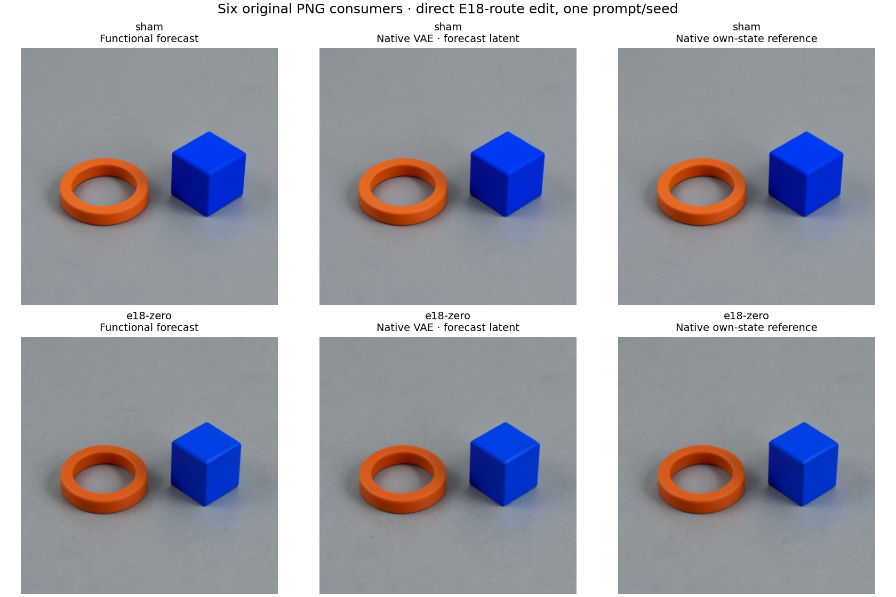

# Direct E18 conditioning intervention

This source-bound maintainer workflow predicts two complete FLUX.2 Klein4B
futures before native learned targets: an own-value sham and positive BF16 zero
only in the direct H18 conditioning slice. It uses real public conditioning
Acts and native Session continuations. It does not remove an upstream Qwen MLP.

## Result and scope

The input is the cobalt-blue-cube/right-of-orange-ring prompt, seed277,
512×512, four distilled steps. Qwen supplies E=`cat(H9,H18,H27)`, shape
`[1,512,7680]`, with39 attended/473 padded query rows. Zeroing columns
`2560:5120` persists through all four projects. H9/H27/noise/IDs/schedule are
fixed within each lane; forecast/native E are separately formed.

All1,989 complete Qwen/denoiser field pairs /1,185,808,384 dependent positions
are bit-exact. The58 regional Qwen diagnostics are counted separately.
All1,548 signed-response fields /1,019,321,337 repeated positions have zero
error. Twelve decoder three-term comparisons agree; current-cohort native
decoder macro-by-macro comparison is not claimed.

The actual signed pixel response has RMS10.3146850121 on0–255 RGB channels,
maximum146, signed mean−2.3916104635,759,372 changed channel values of786,432.
Its predicted complete vector has zero error. Six original PNGs comprise the
functional forecast, native VAE on forecast latent, and native own-state
reference for each branch. Within each branch all three byte hashes agree.



First projected text response RMS is10.0194450762; initial projected image
response is0. Joint block0 then changes image RMS0.1557624336. Latent commit
RMS differences are0.01076027,0.02303400,0.05671488,0.22320589. Context
time/modulation/RoPE fields remain equal at all projects; the same persistent
E produces the same text-projection response each time. Cross-stream RMS
values are not gains or causal shares.

## Mathematical and runtime account

For each branch, project own E and latent, execute the original joint/single
blocks and scheduler, then decode its own final latent. In real arithmetic,
partitioning the context weight gives `Delta T=-H18*W18^T`. The finite
prediction instead preserves source GEMM, casting and addition order; do not
substitute a separately rounded algebraic expression.

One112-transition path is four repetitions of project+5joint+20single+head+
scheduler. Functional StateCuts are component-derived. Native transitions are
actual `NativeCutNavigator.step()` Session advances. The experiment emits
4genuine Act occurrences,224native advances/228receipt occurrences and8actual
context_embedder operand joins. Identical receipts may share hashes.

One27-block functional Qwen prefix and both complete functional image futures,
including signed response hashes, are globally sealed before one native
full36-layer Qwen/LM reference. The native lane then forms and patches its own
E and executes both futures. Two native VAE consumers per branch separate
same-latent decoder parity from whole-program parity.

The encoder forecast covers H0..H27 and E. Unused native reference H28..H36
and LM-logit values are not forecast targets for the image-consumed program.

Original parameters and shared Torch/frontend primitives are explicit. There
is no donor, observed-intermediate forecast refresh, new fitted predictor,
independent parser/RNG/kernel implementation or automatic family induction.
This is one prompt/seed and an imposed interface state. H27 still carries
upstream H18 history, so retained objects do not prove H18 unnecessary.

## Reproduce the finite workflow

Use the qualified installed public wheel cohort and source closure. The
qualification scripts are maintainer tools, not new top-level MDB commands.
Staging only reads metadata/wheels and never runs a local original model.

```sh
python -I -B qualification/stage_flux_e18_conditioning_act.py RUN \
  --parent-run PAIRED_SOURCE_RUN \
  --custody-calibration AUTHENTICATED_CALIBRATION_RECEIPT
python -I -B qualification/stage_flux_e18_conditioning_act.py RUN --inspect
# Review this exact request, source closure, command and resource plan.
python -I -B qualification/stage_flux_e18_conditioning_act.py RUN --submit
# After successful native completion:
python -I -B qualification/stage_flux_e18_saved_audit.py AUDIT --study RUN
python -I -B qualification/stage_flux_e18_saved_audit.py AUDIT --submit
```

The source cohort is the actual paired `run-02`, request783e8dc0…, not a
nonexistent paired `run-01`. The new native E18 run is its own `run-01`.
Submission requires a review bound to the new request. Actual admission is
one strict finite CUDA lease, B1 sequential, CPU4/RAM24GiB/VRAM13GiB/disk12GB,
900s estimate/1200s cooperative/1500s outer, no retry or nested job. The saved
audit is CPU2/RAM3GiB/0VRAM,240s estimate/600s outer, no learned execution.

The qualified synthetic custody calibration only measures public StateCut/
store overhead, not Session guards or neural arithmetic. Its optimized path
saves exact same bytes with9versus17calls over8steps; the measured store time
changes1.1432s→0.7538s, with cache-order confounding. No broad speedup follows.

Collect the compact through the actual-job-bound directory collector and
archived transport encoder. Keep raw arrays and CAS near compute. The compact
contains original PNGs, audit/catalog records, recipes and standalone
retrievers; no persistent pretrained weight bank. Publish with
`publish_flux_e18_conditioning_act.py`, passing exact native job/request,
compact manifest, collection receipt and reader qualification.

Example installed lookup against the delivered record:

```sh
python -I -B -m mdb equations find \
  --catalog docs/assets/flux-e18-conditioning-20261106/evidence/catalog/equations \
  --alias cmp.flux.E18.e18-zero.whole \
  --applicable-to docs/assets/flux-e18-conditioning-20261106/actual-cli-and-jobs/cmp.flux.E18.e18-zero.whole.exact.context.json
```

Root actually executed12 final queries:4exact matches and8changed-clock/seed
abstentions. Exact-context records are not claims of untested applicability.

## Evidence and costs

Native job9339e3ed1472:545.01s/RSS20,462.1MB/VRAM8,374MB.
Saved auditcf83caa6f2cb:245.61s/RSS1,425.2MB/0VRAM. Both succeeded on their
first production attempt. Producer v2 has16installed checks, reader15,
controller7 and publisher6; source/Ruff scopes remain in their receipts.

Raw2,568members/5,057,838,426B plus manifest stay onBeast. Compact48files/
17,651,238B expanded,3,226,706B archived.709original recipe identities and
retrieval scripts cover Qwen398+FLUX169+VAE142 without exporting banks.

- [Publication summary](assets/flux-e18-conditioning-20261106/publication.json)
- [Original saved audit](assets/flux-e18-conditioning-20261106/evidence/audit.json)
- [Actual lease, CLI and result verification](assets/flux-e18-conditioning-20261106/actual-saved-report-verification-v1.json)
- [Whole-field versus regional count clarification](assets/flux-e18-conditioning-20261106/primary-scope-recount-v1.json)
- [Native request](assets/flux-e18-conditioning-20261106/runs/native/request.json)
- [Saved audit request](assets/flux-e18-conditioning-20261106/runs/full-audit/request.json)
- [Forecast error curves](assets/flux-e18-conditioning-20261106/prediction-errors.png)
- [Complete signed effects](assets/flux-e18-conditioning-20261106/signed-responses.png)
- [Target/collateral and endpoint effects](assets/flux-e18-conditioning-20261106/target-and-decoder.png)
- [Seal chronology and genuine occurrence census](assets/flux-e18-conditioning-20261106/chronology-and-counts.png)

The [H18 history experiment](FLUX-H18-STATE-HISTORY.md) now compares direct
negative H18 with the same input followed by regenerated H19..27. Both full
futures and their signed response were predicted exactly. The first edited
block stays numerically odd through attention and gate/up, with SiLU the
first numerical break. The real-arithmetic SwiGLU identity remains separate
from measured BF16 behavior. The native suffix is qualified component
execution; the public full512 Qwen Act boundary remains unqualified. See the
[attention microscope](QWEN-BLOCK0-ATTENTION.md) for the finite-profile issue
and prior precision/counterexample context.
