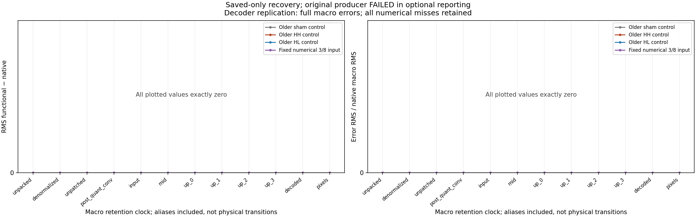
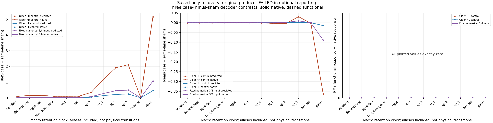
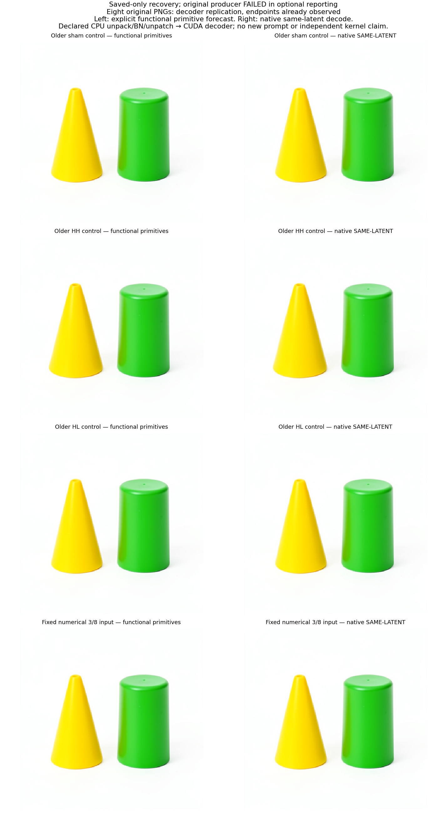

# Predicting the FLUX decoder from latent to pixels

Status: the independent saved-only recovery audit is complete for four decoder replications. All 48 full macro comparisons are numerically bit-exact, including raw RGB and uint8 pixels. Eight upstream stride differences are retained separately. The original GPU job failed during optional catalog reporting; the successful CPU recovery preserves that status and leaves its unexecuted final resident-parameter checks unestablished.

This continues [the remaining denoiser chain](FLUX-FUNCTIONAL-REMAINING.md). Inputs are its four unchanged **predicted** final S4 cuts: sham, HH, HL and the fixed quantized 3/8 state. These image endpoints were already observed. An earlier seed 23 experiment also had exact functional decoder endpoints with weaker internal retention. This panel reuses that arithmetic and upgrades internal evidence; it is not a first decoder discovery or a fresh-prompt test.

## The computed program

The graph scatters packed latents by unique position IDs, applies inverse BN normalization on CPU, unpatches into 32 channels at 64×64, then transfers the argument to CUDA. A post-quant convolution supplies the actual decoder entry. Input convolution, 14 residual blocks, one spatial attention block, four up blocks with three nearest-neighbor expansions, and final GroupNorm/SiLU/convolution produce raw 512×512 RGB. Ordered native-dtype normalization, FP32 NumPy conversion and ties-even rounding produce uint8 pixels.

The argument to `vae.decode` is **before** post-quant convolution. The argument to `vae.decoder` is **after** it. Both actual input joins are retained. The functional path calls no original module forward; it composes original Torch convolution, GroupNorm, SiLU, linear, SDPA and interpolation primitives. This qualifies composition under the declared numerical profile, not an independent CUDA reduction implementation.

Both lanes share the explicit CPU inverse-normalization formula. Native unpack/unpatch and native decoder provide distinct comparisons; the CPU auditor independently reconstructs the small source/statistics joins. Twelve full macro ports are retained per case and lane: unpacked, denormalized and unpatched latent; post-quant output; decoder input; middle block; four up blocks; raw RGB; pixels. Aliased handoffs remain explicit. These are retention clocks, not twelve new denoiser transitions.

## Observed evidence

| Measurement | Result |
|---|---:|
| Functional / native decoder calls |4 /4|
| Full macro comparisons |48, all numerically bit-exact|
| Retained scalar positions compared |587,726,848, including aliases|
| Macro layout matches |40 /48|
| Instrumented operator/container output pairs |508,127 per case|
| Micro input/output field comparisons |1,024:516 inputs +508 outputs|
| Fixed sampled coordinate pairs |16,384|
| Signed case-minus-sham macro accounts |36, all response RMS/max errors 0|
| Signed-response scalar positions |440,795,136, repeated/aliased positions included|
| Forecast module entries |0|
| Conditional diagnostic prefixes |0; none needed|
| Actual installed MDB CLI |4 exact-context matches /4 wrong-clock abstentions|

The micro fields have complete content/layout commitments and fixed witnesses. Complete micro arrays at every port and full micro error norms are not claimed. The 508 outputs include composite/container checkpoints; they are not 508 independent equations or kernel families. All observed micro commitments and witnesses agree.

Each case has two CPU layout differences: unpacked and denormalized arrays have forecast stride `[128,1,4096,128]` versus native `[131072,1024,32,1]`, at shape `[1,128,32,32]`. Values are bit-exact. Unpatched before-postquant arguments and after-postquant decoder inputs agree in hash, shape, dtype and stride. Value parity and layout parity remain separate measurements.

Different macro coordinates have different widths, resolutions and units; the response plot does not establish a cross-stage causal gain. All 36 complete signed response-error vectors are zero. Four dependent paths and repeated tensor coordinates are not independent sample counts.

The left column was computed explicitly before any native decoder comparison. The right column is the original native decoder consuming the same supplied latent. The eight original PNGs are retained under [images](assets/flux-functional-decoder-20261106/images/). Visual appearance does not establish an object concept or a reusable semantic route.

## Failure and saved-only recovery

Original CUDA producer `job-406f417b8512` completed all four forecasts and all four native decodes, then failed at optional catalog reporting. Raw RGB plus pixels contain 1,572,864 positions, exceeding the comparison helper's default 1,000,000-element budget. The closed forecast transaction, full macro stores, micro commitments and signed comparisons had already been written.

The global forecast seal was at 52.847443 s; first native decode entry was 53.200667 s and the final native path completed at 91.731948 s. The process exited with code 1 after 206.66 s, at 3639.4 MB peak RSS and 1676 MB peak VRAM. Its failed status, executed payload custody and log are preserved in [failed-source-authentication](assets/flux-functional-decoder-20261106/failed-source-authentication/).

CPU recovery `job-4bb5ddf2879d` succeeded in 96.25 s, at 2311.3 MB RSS and zero VRAM. It authenticated the actual failed job/request/log and a fresh 555-file inventory, verified the closed transaction and journal health, and audited original tensor stores directly. New derived metadata lives separately; the failed root was not changed, linked, chmodded or copied into another tensor bank.

The original final resident-parameter identity/version checks were after the failing line and did not execute. Their status is **unestablished**. The independent 142-recipe checkpoint restoration authenticates 99,241,030 payload bytes; it does not invent a final resident observation. Derived contract/profile fields are labeled as authenticated source/config declarations, rather than recovered flag probes.

Future workers now save core metadata and perform resident checks before optional catalog publication, and both producer/auditor declare exact endpoint comparison budgets. The corrected future worker has tiny installed qualification; this panel executed the separately archived [8de producer](assets/flux-functional-decoder-20261106/executed-source/flux_functional_decoder_campaign.py). It was not rerun to replace the failure.

Raw evidence is 555 files /2,356,730,218 bytes near compute. The compact collection is 45 files /3,473,298 expanded bytes, transported in a 1,277,820-byte archive. No persistent pretrained bank was added. [retrieve_evidence.py](assets/flux-functional-decoder-20261106/retrieve_evidence.py) retrieves individual raw members with checksums; [retrieve_weights.py](assets/flux-functional-decoder-20261106/retrieve_weights.py) uses the adjacent exact 142-tensor manifest when original weights are needed.

## Use the evidence in MDB

The [machine-readable publication](assets/flux-functional-decoder-20261106/publication.json) separates numeric/layout errors, consumer joins, all micro misses, signed responses, recovery provenance and unestablished checks. Four supplied-context records live in [the catalog](assets/flux-functional-decoder-20261106/catalog/equations/). Save one record's `tested_context` as `context.json`, then use the installed CLI:

~~~bash
/path/to/isolated/bin/python -I -B -m mdb equations find \
  --catalog docs/assets/flux-functional-decoder-20261106/catalog/equations \
  --applicable-to context.json
~~~

Its exact context returns one record; changing `clock` from `step4/project0` to `step3/project0` returns none. These are supplied predicates with tested lookup behavior, not automatic family induction.

Campaign-specific saved-only recovery uses the archived original failed study plus an externally authenticated failed-source packet:

~~~bash
/path/to/isolated/bin/python -I -B qualification/recover_flux_functional_decoder.py \
  /path/to/new-recovery --study /path/to/original-run-02 \
  --failed-auth /path/to/authenticated-failed-source
/path/to/isolated/bin/python -I -B qualification/recover_flux_functional_decoder.py \
  /path/to/new-recovery --submit
mrun why RECOVERY_JOB
~~~

This recovery is intentionally bound to this exact failed producer; it does not accept an arbitrary failed directory. The reviewed execution is one CPU2/RAM3072 MB/VRAM0 lease, 180 s estimate, 360 s outer timeout and no retries. Collection authenticates the successful recovery job, whose compact result still identifies the original failed source. After authenticated collection/extraction, the saved-only publisher takes **original failed producer** request/job pins from outside the pack:

~~~bash
/path/to/isolated/bin/python -I -B qualification/publish_flux_functional_decoder.py \
  --pack /path/to/compact/binding-minimal-result --out /path/to/new-publication \
  --expected-manifest COMPACT_MANIFEST_SHA \
  --expected-request 8740beb5bc338e9ac4fff678a80713f8fb27dd63a336caa52753edb16c671fc8 \
  --expected-job job-406f417b8512 \
  --collection-receipt /path/to/compact/collection-receipt.json
~~~

Source identities: original request `8740beb5…671fc8`; recovery request `2339ecdb…fe1e2e`; audit `0587fb5caadf8c781b97910979e67edc7a97c249e7302c1ab0b6222805bde743`; compact manifest `1d808b1fa1a3113fb994bd67946ec25bc5a7f0366ad7bbd9874125456b11bc4a`. [Recovery review](assets/flux-functional-decoder-20261106/finite-recovery-review.json) binds the concrete source/wheel/request cohort. Full source provenance remains in the publication and recovery metadata.

Source: [graph instrumentation](../qualification/flux_functional_decoder.py), [future worker](../qualification/flux_functional_decoder_campaign.py), [stager](../qualification/stage_flux_functional_decoder.py), [auditor](../qualification/audit_flux_functional_decoder.py), [saved-only recovery](../qualification/recover_flux_functional_decoder.py), [publisher](../qualification/publish_flux_functional_decoder.py).

## Next frontier

The next assay moves back to raw-prompt/template/tokenizer → own-state Qwen embedding and 27 blocks → selected hidden states 9/18/27 → conditioning → its actual first FLUX context projection. The decoder replication has finished; another decoder panel is not needed. Current exact shared-kernel results do not erase earlier independent-arithmetic misses, establish arbitrary raw-prompt-to-image prediction, or supply a universal object dictionary. Dense computation records and generic names remain sufficient for the mechanistic account.
