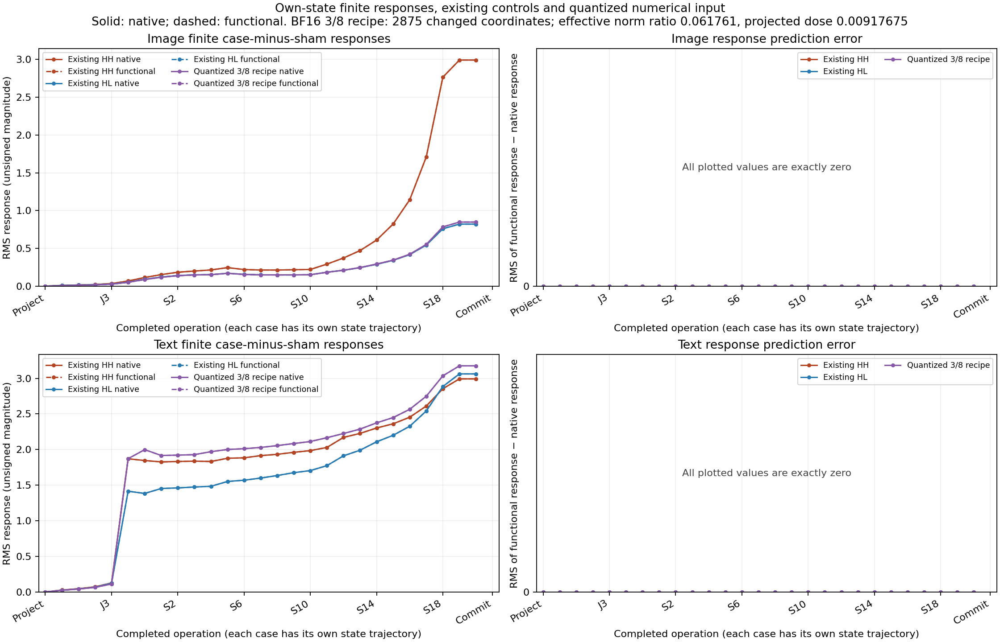

# A complete FLUX pass from its own state

Status: original-checkpoint CUDA experiment and independent saved-only audit complete. Four 28-transition paths agree bitwise at every full-field boundary under the declared shared Torch primitives.

This research instrument moves the forecast boundary to the start of a denoising pass. The supplied cut has latent, conditioning, position IDs, schedule and clock. Image, text, context and noise prediction are absent. The functional graph must form them from its own state and the original checkpoint, then commit the next latent. All four forecasts seal before any native verification pass.

## Computation and state

Write the complete state as `S = (Z, C, IDs, schedule, step, phase, cursor, I, T, E, N)`. Parameters `W` and numerical policy `P` are fixed. Each operation computes `S' = F_phase,cursor(S; W, P)`. The remaining program is the continuation. A computation record binds this function, its input frontier, weights, numerical profile, applicability, observed consumers and counterexamples.

One pass has 28 transitions: project, five joint blocks, twenty single blocks, readout and flow commit. Four cases therefore produce 112 functional transitions, followed by 112 native comparisons. This is 28 successive transitions per case, not a 112-transition single history.

Projection creates the image/text working streams and the time-dependent context. In a single block, with `X = concat(T,I)`, the main structure is:

```text
U = (1 + scale(E)) * LayerNorm(X) + shift(E)
[Q,K,V,A,B] = linear_in(U; W)
H = Attention(RoPE(RMSNorm(Q)), RoPE(RMSNorm(K)), V)
M = SiLU(A) * B
X' = X + gate(E) * linear_out(concat(H,M); W)
```

Each block has its own weights and receives the current stream. Attention and activated MLP features enter a shared output projection in parallel. The next block consumes the resulting residual; its response cannot be inferred from a component's local norm alone. Joint blocks use separate image/text reads and gated feed-forward updates. Readout predicts the flow field. Euler commits `Z' = cast(Z.float() + (sigma_next - sigma) * N)`, with the exact native scalar promotion and final cast retained.

The Python graph independently orchestrates original Torch primitive kernels. It calls no native model, block or module forward during forecasting. It still performs the matrix, normalization, activation, rotary and attention computation. This is neither a separate CUDA implementation nor a demonstrated speedup.

## Measured result

Native job `job-027b22769047` completed in 209.77 s at 2078.7 MB peak RSS and 8320 MB peak VRAM. CPU audit `job-40faf1e39119` completed in 96.25 s at 1227.3 MB RSS and zero VRAM. Seven isolated worker tests and nine isolated auditor tests passed before production. Full raw evidence contains 1,521 files / 2,034,388,203 bytes near compute; the independently collected compact pack contains 31 files / 9,311,967 expanded bytes. Pretrained weights remain external.

| Measurement | Result |
|---|---:|
| Complete predicted/native boundaries |112 /112|
| Full-field comparisons |980, all bitwise exact|
| Scalar positions compared |572,588,032, including repeated carried fields|
| Primitive invocation comparisons |1,272, no descriptor/witness misses|
| Actual next-project consumers |8,120 operand joins /36 output fields exact|
| Original historical committed-latent controls |3, all exact|
| Context-bound catalog records |7; installed CLI7 exact lookups /7 wrong-clock abstentions|

The first native module entered at worker 70.873039 s, after the complete cohort sealed at 70.500928 s. The physical census matches 112 forecast and 112 native transitions, 100 SDPA and 436 linear operations per lane. Forecast native-module entries are zero. Both profiled first attention calls selected `aten::_scaled_dot_product_flash_attention`. Complete boundary arrays are retained; primitive internal arrays have full descriptors/content hashes and fixed witnesses rather than complete saved values at every port.



These plots show image/text working tensors, not RGB pixels. All signed response vectors are compared; RMS in the figure is an unsigned magnitude. The table gives final single-block image/text responses and the subsequent committed-latent response:

| Case minus sham |Image RMS|Text RMS|Committed latent RMS|
|---|---:|---:|---:|
|HH|2.992588|2.992095|0.003572331|
|HL|0.821642|3.061694|0.001691289|
|Quantized3/8 recipe|0.848971|3.175105|0.001433994|

Every corresponding functional response error is zero. The numerical variant has a larger text response than either existing edit and a much smaller image response than HH. These are observed tensor relationships, not object-semantic labels or causal shares.

The nominal 3/8 recipe changes 2,875 of 131,072 coordinates. Rounding leaves displacement norm 0.061761 of the HH displacement, projected dose 0.00917675 and cosine 0.148585 with that direction. It must not be described as an effective 37.5% intervention. The frozen recipe was retained without adaptive retuning.

Portable evidence: [complete measured accounts](assets/flux-functional-pass-accounts-20261106.json), [full-field error figure](assets/flux-functional-pass-errors-20261106.png). Native request`5fbc74012eac18efc2e9a0887e9bea179739c3b7a6b6b841d4d8923344e54806`; native manifest`6441e7ed43835dbe98ad82a1af97ac9c958f2ace05d0a34a5df3d8e84a884bc4`; audit`993e476c3e34b7c7f7d86c3c686520476a1fe7f3b0beaacbce52d372a13f3fec`; compact manifest`11405cc007cd1b4f9ced54f69b6196f5242d718cd4116d8d803ff5dfabb47d32`.

## Frozen experiment

Three complete historical step1/project cuts—sham, HH and HL—are replay controls. A fourth input is fixed before target execution:

```text
Znew = BF16(F32(Zsham) + (3/8) * (F32(ZHH) - F32(Zsham)))
```

The tensor is copied into the declared native latent layout. Actual rounding, changed values, effective dose and equality to existing inputs are measured. A collapsed input remains evidence; the worker does not choose a new dose after observing targets. This is a new numerical input derived from existing own-history states, not a fresh semantic prompt or a new donor run.

The worker retains full boundary states, primitive descriptors and fixed witnesses. A global forecast transaction seals the entire cohort and its external evidence inventory before native target entry. Guards reject native module calls during forecasting and verify the seal at native entries. This is source-bound instrumentation, not an operating-system claim about arbitrary code.

After all four native passes, the worker reads three historical controls. It then executes eight observed next-project consumers: one from each predicted commit and one from each native-reference commit. These are distinct branches. Their outputs are observed; they are not labeled numerical forecasts. The auditor joins the actual projection operands to the committed latent, conditioning, IDs and timestep.

## Run and inspect

Use an isolated installation of the qualified public wheels; do not run this through an editable workspace import. From `packages/mdb`, stage the source-bound experiment:

```bash
/path/to/isolated/bin/python -I -B qualification/stage_flux_functional_pass.py \
  /path/to/new-pass-run \
  --campaign /path/to/mdb-flux-prompt-factorial-20261105 \
  --planning /path/to/pinned-native-configs
```

Review the concrete request, source allowlists, original parameter recipes, numerical policy, finite physical-call census and resource estimate. The qualified run uses one CUDA lease, sequential B1, strict preflight and no retries. A request-bound finite review is saved before submission:

```bash
/path/to/isolated/bin/python -I -B qualification/stage_flux_functional_pass.py \
  /path/to/new-pass-run --submit
```

Check `mrun why JOB_ID` and actual admitted resources. The outer `task_family=analysis` is accompanied by supported `flux_mode=capture`; otherwise the FLUX estimator can return no estimate and unrelated component history can under-size a resident transformer. The first attempt demonstrated this failure and was cancelled before hydration. It remains a separate null attempt.

For a successful producer, run the independent saved-only auditor on the same host:

```bash
/path/to/isolated/bin/python -I -B qualification/audit_flux_functional_pass.py \
  /path/to/new-audit-run --study /path/to/completed-pass-run
/path/to/isolated/bin/python -I -B qualification/audit_flux_functional_pass.py \
  /path/to/new-audit-run --submit
```

Collect only its compact output, without rerunning a model:

```bash
/path/to/isolated/bin/python -I -B qualification/recover_flux_directory.py \
  /path/to/completed-audit-run /path/to/new-compact-collection
```

The compact pack retains complete numerical comparisons, first discrepancies, signed case-minus-sham responses, input geometry, consumer joins, original manifests, seven context-bound equation records and retrievers. Four endpoint records and three response records are dependent occurrences of one cohort. No family induction or universal applicability is inferred from that count. Wrong-clock lookup abstains.

Full states and witnesses remain near compute. `retrieve_evidence.py` fetches individually checksummed members through `external-evidence.json`. `retrieve_weights.py` restores the original169 named tensor artifacts from the pinned checkpoint when needed. Persistent evidence contains recipes rather than another pretrained parameter bank.

## Coverage

The original closure model identity, transformer-only verification adapter identity and numerical source hashes remain separate. These component-derived StateCuts are not fabricated Session/Act receipts. Native validation uses the installed public `Flux2KleinAdapter.advance`.

The starting conditioning is observed. The next-project consumer is observed. This pass alone does not predict the remaining denoising schedule, a VAE image, raw prompt encoding, object semantics or every possible future. Earlier independent-arithmetic response misses remain evidence even if this shared-kernel graph agrees with native execution.

The [remaining-schedule continuation](FLUX-FUNCTIONAL-REMAINING.md) is now complete: archived **predicted** step2/project commits traversed 56 more transitions per case and actual VAE consumption. All 1,960 full-field comparisons and all four image pairs were bitwise exact under the same original kernel profile. The experiment does not substitute equal-valued native commits or observed next-project outputs. The next project was already an observed control; joint0 at step2 was the first later occurrence not observed by this campaign. A real decoder consuming predicted final latents is a conditional image forecast, with decoder reconstruction remaining a separate question. The 28+56 lineage has separate seals.

Related: [paired writer intervention](FLUX-SINGLE-WRITERS.md), [single-stack trace](FLUX-SINGLE-STACK.md), [query/bank computation](FLUX-IMAGE-QUERY-BANK.md). Source: [worker](../qualification/flux_functional_pass.py), [stager](../qualification/stage_flux_functional_pass.py), [auditor](../qualification/audit_flux_functional_pass.py).
