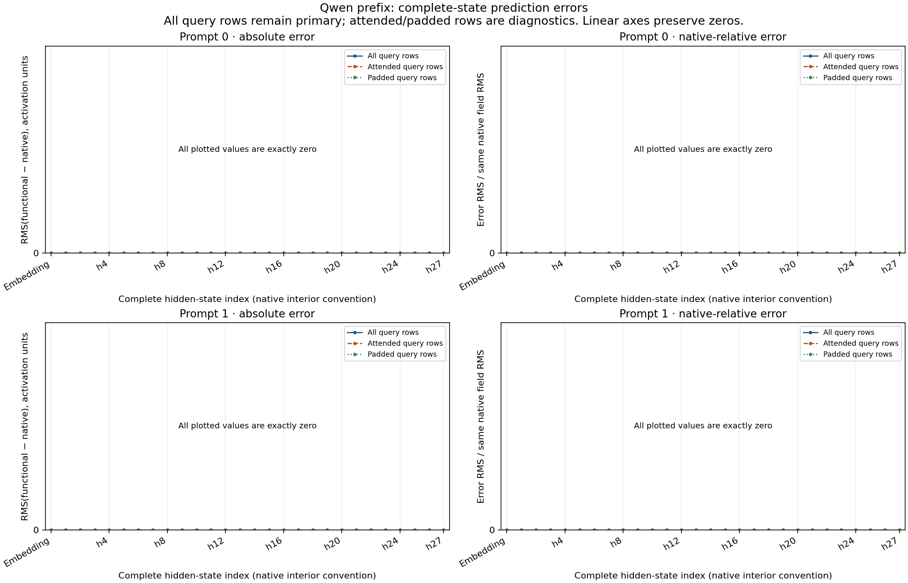
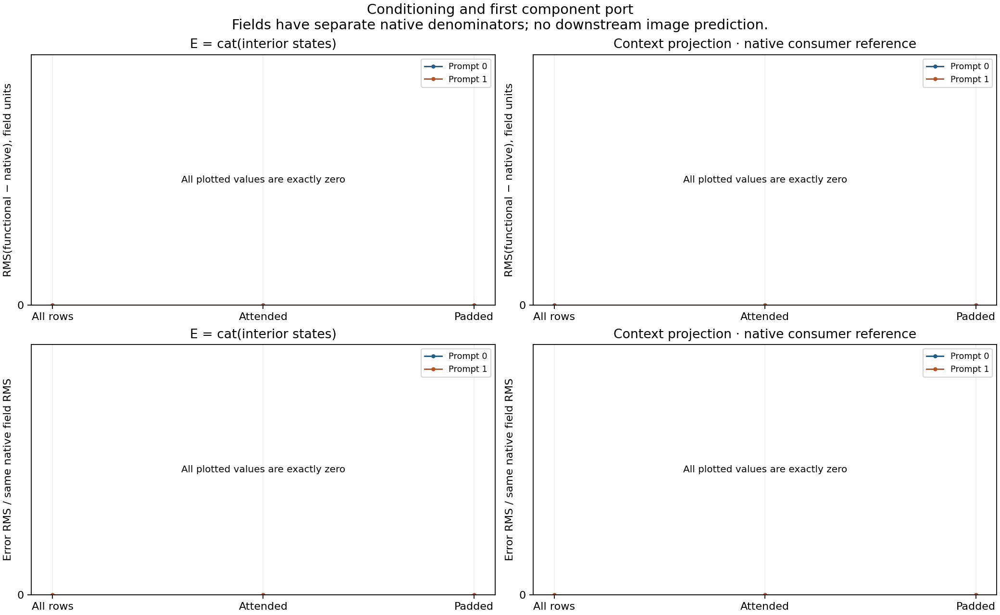
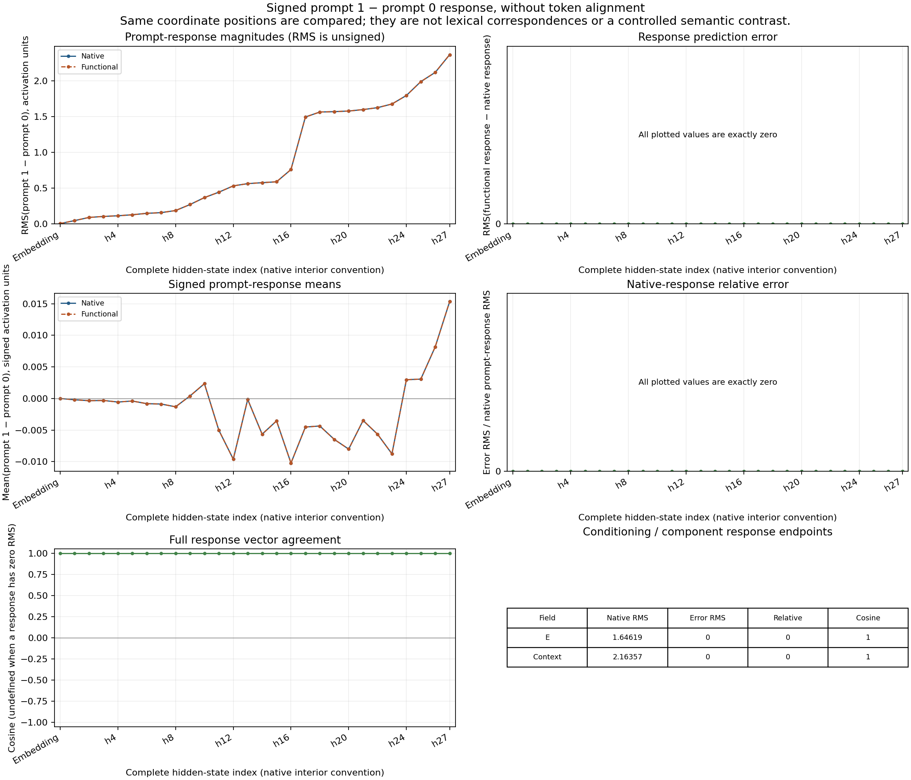

# Predicting FLUX conditioning from the raw prompt

The prospective two-prompt Qwen campaign predicts the embedding, 27 successive
Qwen blocks, their selected conditioning states and the first FLUX context
projection before either native encoder reference runs. All60 complete primary
field comparisons are bit-exact across84,410,368 scalar positions.



This extends the earlier denoiser and [explicit decoder account](FLUX-FUNCTIONAL-DECODER.md)
back to raw prompt formation. The pieces have separate experiments and seals;
this result does not itself forecast a complete prompt-to-image trajectory.
Original Torch primitives implement the finite arithmetic in both lanes.

## Exact inputs and forecast boundary

The two raw UTF8 prompts are:

1. `A yellow cone to the left of a green cylinder on a plain white background. Two separate objects, simple studio product photograph.`
2. `A small violet torus above a large copper pyramid on a plain ivory background. Two separate objects, simple studio product photograph.`

Each is one user message. The pinned original chat template uses
`add_generation_prompt=True` and `enable_thinking=False`. The tokenizer uses
right max-length padding, truncation and length512. Each resulting case has37
attended positions and475 padding positions. All512 output query rows are
retained and passed to the FLUX component. No generated chain of thought,
sampled language continuation, donor or observed activation enters a forecast.

The checkpoint's Qwen3ForCausalLM has36 layers, residual width2560,
32 query heads,8 KV heads, head dimension128 and MLP width9728. Query projection
width4096 differs from residual width2560. The forecast computes embedding
state0 and block outputs1..27, then forms

```python
E = torch.cat([hidden[9], hidden[18], hidden[27]], dim=-1)
# E: [1, 512, 7680], BF16
projected = F.linear(E, context_embedder_weight)
# weight: [3072, 7680], BF16; bias absent
```

The selected states are interior states after blocks8/17/26. Final model
normalization is not applied to them. Native references honestly run all36
blocks, final normalization and the tied LM head; that suffix and its logits
are reference work, outside the prediction target.

## Finite computation and integrity

The own-state graph uses original weights with explicit RMSNorm, Q/K head
normalization, CPU-derived FP32 RoPE frequencies, causal/padding attention,
grouped KV repetition, residuals and SwiGLU. Native module entry is forbidden
during the Qwen forecast. No intermediate is refreshed from a reference.

A synthetic `save_pretrained` / `from_pretrained(dtype=BF16)` check established
that learned weights become BF16 while rotary inverse frequencies remain
FP32. The producer streams original parameter recipes into BF16 meta-created
storage, installs the original rotary constructor's CPU FP32 buffers, and
moves those buffers by device only. Its independent tiny hydration check
verifies every restored tensor and tied LM alias before any forward, then
compares a three-block forecast with a subsequent full four-block reference.

Both original-model forecasts and their context projections are sealed in one
public `ForecastTransaction` before either native Qwen call. The transaction
binds raw inputs, parser dependencies, full array hashes, source identities,
numerical flags and complete conditioning payloads. The global seal is
`bd47e7ea1719d1e3c96eabe34939e1b5d20f7a44a2e04087bc3bc4135e97d980`.

After release, two full native Qwen references supply their own states and E.
Four actual native `context_embedder` calls consume predicted/reference E for
each case. Prehooks retain complete operand hashes; the audit joins those
operands to the sealed forecast or native reference, rather than accepting a
declared source label.

The Linux tokenizer extension is hashed at runtime and sealed before forecasts.
It is runtime-bound, not claimed equal to the Darwin preparation binary. Pure
Python sources are pinned before admission. The audit reapplies the same pinned
parser without executing a neural recurrence.

Configured SDPA, mask and GQA policy are source-bound. This panel does not
independently profile the selected CUDA kernel or retain original native
strides. The helper's legacy `rope_source` prose mentions BF16 placement;
the authoritative, checked `rope_buffer_policy` is CPU FP32 initialization
with FP32 device-only placement. Historical source bytes remain intact.

## Results and their denominators

| Account | Comparisons | Scalar positions | Measured error |
|---|---:|---:|---|
| Complete hidden states0..27 |56|73,400,320|Bit-exact|
| Complete selected conditioning E |2|7,864,320|Bit-exact|
| Forecast context projection versus native reference |2|3,145,728|Bit-exact|
| Signed prompt1-minus-prompt0 responses, all retained fields |30|42,205,184|RMS/max/changed values0|

The primary total is60 comparisons/84,410,368 positions. Conditioning repeats
three retained hidden states; responses and query-row diagnostics reuse those
same dependent coordinates. These are coverage counts, not independent trials.



Both same-predicted-E functional/native projection comparisons are exact.
Both actual native projection differences between predicted and reference E
are zero. Attended and padded query subsets also agree; neither subset is
discarded from the complete comparison.

The prompts produce a nonzero native E difference: RMS1.6461938534 and signed
mean0.0037918879. The projected difference has RMS2.1635689308 and signed
mean0.0084626907. Both finite differences are predicted exactly. They change
many words and attributes at once and are not single-object or single-relation
causal effects. Different spaces have different units; the two RMS values do
not measure causal amplification.



The original model run `job-ebae1e4bd523` succeeded in95.23s, peaking at
4461.6MB RSS/8790MB VRAM. Its raw170-file result is376,796,076 bytes on Beast.
The saved-only CPU audit `job-c9d79d1d8d9e` succeeded in52.68s,
1851.9MB RSS/0VRAM. The local compact pack has31 files/1,853,396 expanded
bytes; its archive is338,127 bytes. Full arrays remain remote and individually
retrievable. Persistent pretrained payload exports are zero.

The audit verifies398 Qwen recipes (298 forecast,100 reference-only), plus the
single original FLUX context weight. Qwen recipe payloads total8,044,936,192
bytes; the context matrix adds47,185,920. They are checked against original
source/header/payload identities without making another persistent weight bank.

The [portable publication](assets/flux-functional-qwen-prefix-20261106/publication.json),
[complete scalar audit](assets/flux-functional-qwen-prefix-20261106/audit-data.json),
[actual installed CLI and scheduler verification](assets/flux-functional-qwen-prefix-20261106/actual-saved-report-verification-v1.json),
[raw-evidence retriever](assets/flux-functional-qwen-prefix-20261106/compact-evidence/retrieve_evidence.py),
[Qwen weight recipes](assets/flux-functional-qwen-prefix-20261106/compact-evidence/qwen-parameter-artifacts.json)
and [weight retriever](assets/flux-functional-qwen-prefix-20261106/compact-evidence/retrieve_qwen_weights.py)
travel with this document. The [executed auditor](assets/flux-functional-qwen-prefix-20261106/source/audit_flux_functional_qwen_prefix.py)
retains its original bytes, including its stale module docstring; it does
reapply the parser, as documented above.

## Generic records and an actual MDB workflow

The audit creates two dependent occurrences of
`law.qwen3.own-state-prefix-and-context-projection.v1`, with aliases
`cmp.qwen-prefix.prompt-00` and `cmp.qwen-prefix.prompt-01`. Conditions include
token/mask/raw-input identities, source manifests, helper, frontier and horizon.
This records a concrete mathematical program without inventing a semantic name
such as “torus detector.” Automatic family induction remains separate.

Given a collected compact result and one record's saved `tested_context`:

```sh
python -I -B -m mdb equations find \
  --catalog COMPACT/catalog/equations \
  --alias cmp.qwen-prefix.prompt-00 \
  --applicable-to prompt-00.exact.context.json
```

The actual installed CLI ran six queries: two exact matches, two changed-input
abstentions and two missing-mask abstentions. A missing applicability condition
does not silently inherit an existing result.

The reusable sequence is:

1. Stage the fixed source-bound cohort with
   `qualification/stage_flux_functional_qwen_prefix.py`; review its exact
   request before one strict-preflight, no-retry mrun admission.
2. Forecast both complete prefixes and projections, seal once, execute native
   references and component consumers, retain all fields and counterexamples.
3. Stage and submit `qualification/audit_flux_functional_qwen_prefix.py`
   against the completed run. This separate CPU lease reads saved arrays and
   original recipes; it performs no neural forward.
4. Collect the compact accounts/catalog/retrievers, inspect complete errors
   and first differences, then query exact applicability through MDB.

Producer/worker mechanics passed11 isolated installed checks. One additional
independent hydration test checks the actual streaming loader and native tiny
reference. The saved-only auditor passed16 checks, including the production
5,505,024-element catalog budget. That reporting budget was corrected before
the one actual audit; no original model result was rerun or changed.

A subsequent [globally sealed raw-prompt-to-image experiment](FLUX-RAW-TO-IMAGE.md)
now joins E, independently formed noise/positions/schedule, all 112 denoiser
transitions and explicit VAE pixels in one fresh specimen. Its 1,011 primary
field comparisons are exact, with a separately labelled recovery of the
original worker's packaging failure. This Qwen panel retains its own prefix
and first-component scope.
