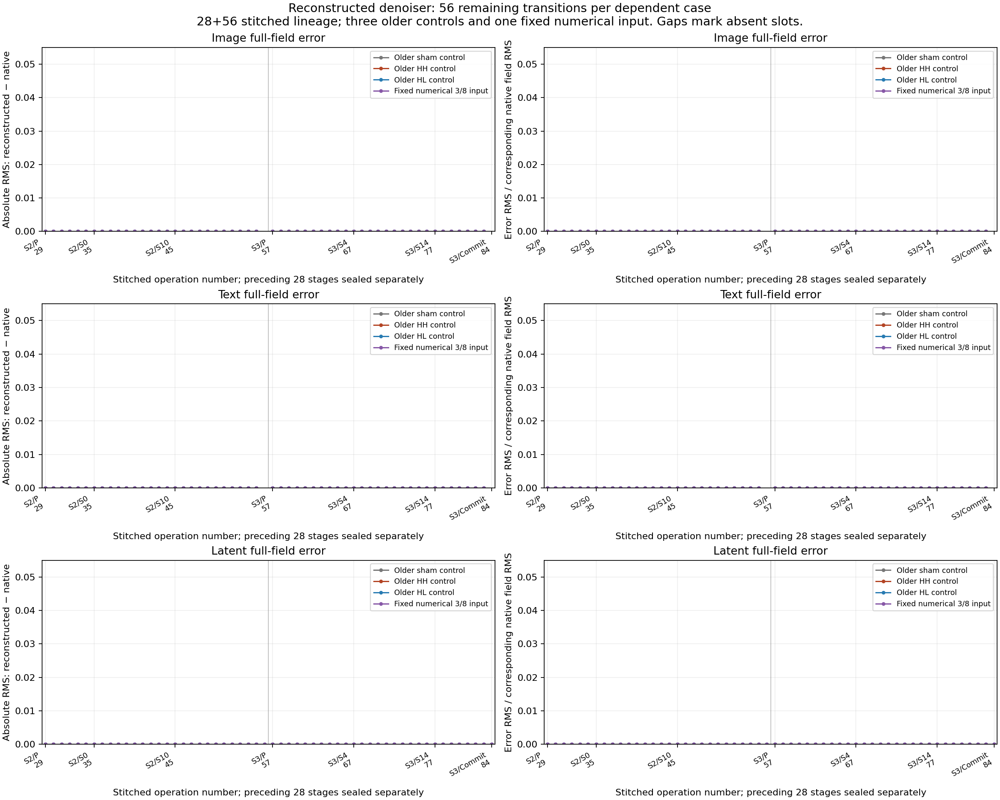
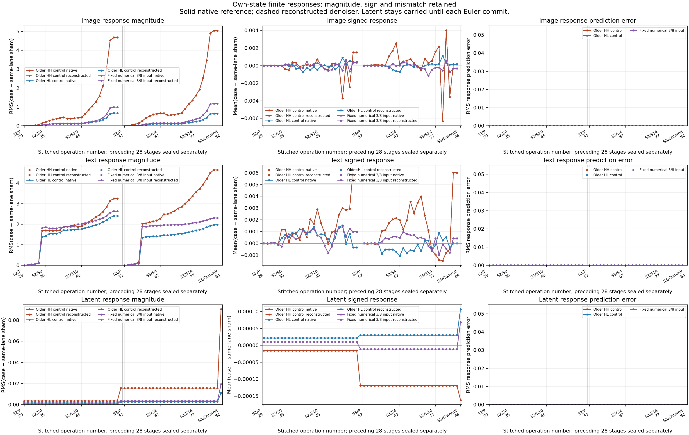
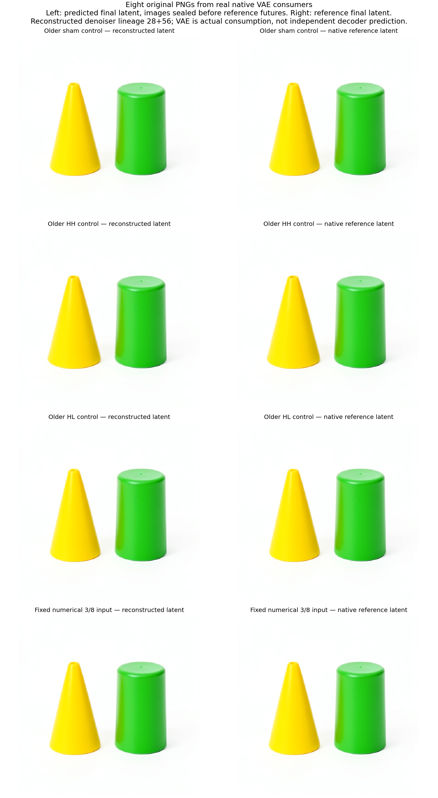

# From predicted FLUX state through the remaining image

Status: original-checkpoint CUDA execution and independent saved-only CPU audit complete. Four own-state continuations each covered 56 transitions. All 1,960 full-field comparisons and all four conditional image comparisons are bitwise exact under the declared original Torch kernel profile.

This continues [the complete functional pass](FLUX-FUNCTIONAL-PASS.md). Its archived **predicted** step2/project commits are the inputs. Equal-valued native commits and the already observed next-project outputs are separate evidence with different lineage. Each continuation forms its own working streams and context, completes steps 2 and 3, and commits a final step4/project state with reset working slots. The real VAE then consumes those predicted final latents.

## What was predicted

For fixed original parameters `W` and numerical profile `P`, each operation is `S[j+1] = F[phase,cursor](S[j]; W,P)`. State includes latent, observed conditioning, image/text IDs, schedule, step, phase, cursor and any live image/text/context/flow fields. The functional graph forms context and working streams from its own current latent at every projection; no native intermediate refresh occurs.

Each pass has project +5 joint +20 single +readout +Euler commit =28 transitions. This experiment predicts two passes per case: 56 successive transitions, 224 across four dependent cases. It composes with four earlier 28-transition paths into **stitched 28+56=84-transition lineages**. These are not single 84-transition forecasts sealed before all earlier targets. Step2/project was already an observed control; step2/joint0 is the first later occurrence not observed by the parent campaign. Three inputs are historical controls; the fourth is the unchanged fixed BF16 numerical 3/8 recipe from the prior experiment. No new prompt or input dose was chosen here.

All 224 functional transitions seal before four real VAE decodes of predicted terminal latents. A second global seal binds the latent predictions, decoder operands/returns, pixel arrays, PNGs and consumer lineage. Only then are the four separate native-reference step2 inputs read and their 224 future transitions executed. Four reference VAE decodes run last. The image/cohort seal is at worker 156.751796 s with zero native future blocks, zero native scheduler calls and zero reference-cut reads.

The reconstructed denoiser calls no model, block or module forward during forecasting. Its matrix, normalization, activation, position and attention operations share the original Torch primitives. The four forecast image renders are **actual native VAE consumers**, counted separately. This experiment does not independently reconstruct VAE arithmetic or CUDA reductions.

## Results

| Measurement | Observed result |
|---|---:|
| Predicted/native transitions |224 /224|
| Full-field comparisons |1,960, all bitwise exact|
| Compared scalar positions |1,145,176,064, including repeated carried/context fields|
| Primitive invocation comparisons |2,544, no descriptor or witness misses|
| Signed response-field comparisons |498, maximum RMS error 0|
| Forecast native-denoiser module entries |0|
| Actual VAE consumers |8; 4 predicted-latent and 4 reference-latent|
| Per-case raw decoded RGB comparisons |786,432 BF16 values, exact in all 4 cases|
| Per-case uint8 comparisons |786,432 channels, exact in all 4 cases|
| Catalog entries |4 dependent terminal-latent equations|
| Actual installed CLI |4 exact-context matches /4 wrong-clock abstentions|

Complete boundary arrays are retained. Internal primitive evidence consists of full descriptors/content commitments plus fixed witness values; these are not independently saved complete arrays at every primitive port. The scalar count includes repeated state and is not an effective independent sample size. The catalog has three additional **observed RGB response accounts**, not three independent decoder equations or automatically induced families.



The predicted changes also agree with native changes. Define `delta[k,case] = Z[k,case] - Z[k,sham]` within the same execution lane. These are finite state differences; RMS is an unsigned magnitude. Full signed vectors, signed means, tails and response errors remain in [the machine-readable publication](assets/flux-functional-remaining-20261106/publication.json).

| Case | Committed S2 latent response RMS, prior experiment | Committed S3 latent response RMS | Final S4 latent response RMS | Observed uint8 response RMS | Observed uint8 signed mean |
|---|---:|---:|---:|---:|---:|
| HH |0.003572331|0.015759381|0.090251197|5.148895|−0.3638916|
| HL |0.001691289|0.002885210|0.011103857|0.452154|−0.0149676|
| Fixed quantized 3/8 input |0.001433994|0.003508478|0.019405684|1.068998|−0.0893122|

All current latent-response and image-response prediction errors are zero. The numerical input starts with a smaller S2 response than HL, then has a larger S3/S4 and pixel response. The ranking changes during continuation. This does not isolate a universal amplification law: the inputs differ in direction, support and quantization as well as their nominal scalar recipe. The earlier 3/8 recipe changed 2,875 coordinates, with effective displacement norm 0.061761 and projected dose 0.00917675 relative to HH. It is not an effective 37.5% dose.





Each left image was produced by a real VAE consuming a predicted final latent, before the native future denoiser ran. Each right image used the separately executed reference final latent. The original eight PNGs and consumer sidecars are retained under [images](assets/flux-functional-remaining-20261106/images/). The contact sheet resizes them for display; numerical comparisons use the original arrays. Visual similarity does not establish an object vocabulary or semantic circuit.

## Actual execution and evidence

Producer `job-f7d249b6d3bb` succeeded in 482.2 s with 2453.5 MB peak RSS and 9222 MB peak VRAM. Its exact request is `00d08d3eb058fa50656b0f3deb23238e9ad38a69a2266751462b80ee2ddce93a`. CPU audit `job-453a53b4ec8c` succeeded in 172.97 s with 1256.7 MB RSS and zero VRAM. Seven isolated worker tests, eight auditor tests and three publisher tests qualified the instrument; the publisher's actual CLI was also exercised. Canonical package-cwd Ruff F/I and diff checks passed before source freeze.

Raw evidence remains on Beast: 2,859 files /3,991,348,958 bytes. The authenticated compact collection has 45 files /18,053,636 expanded bytes, carried in a 2,298,834-byte archive. There is no persistent per-run pretrained weight bank. The audit independently checked original archive-byte retrieval for 169 transformer tensors and 142 VAE dependency tensors. The latter contain 140 decoder/post-quant parameters and two BN buffers; an unused training counter is explicitly runtime bookkeeping rather than a pretrained dependency.

The raw manifest is `c6baff2a5aae8c03651399226f526794e7c9df3535748f365f101586bbfab41d`; the accepted audit is `52bd05dc066f1295db32f9baa36986662417b74f1fdbad487d9d19378512d0a9`. The collected compact manifest is `61e92fc1540bd7ffb2209ed603a786f6513114d70c1eb10261c324f410c7e9b7`.

An initial staging-only attempt mislabeled 456 physical calls as logical work units and encountered the public helper's 256-item cap. It produced no request, payload or job. The corrected contract explicitly declares 232 logical units: 224 matched boundary-comparison sites and eight consumers. All 456 physical calls remain visible. Science bytes and resources are unchanged; no cap or lease limit was bypassed. At actual admission, the supported FLUX capture metadata and reviewed 8192 MB RAM /13000 MB VRAM /CPU4 reservation were verified before forecasts.

## Use the workflow

From `packages/mdb`, use an isolated installation of the bound public wheels and the accepted parent campaign, not editable workspace imports:

```bash
/path/to/isolated/bin/python -I -B qualification/stage_flux_functional_remaining.py \
  /path/to/new-remaining-run --campaign /path/to/accepted-functional-pass \
  --planning /path/to/pinned-vae-planning
```

Inspect source allowlists, the retained predicted-cut provenance, exact checkpoint recipes, numerical policy, physical workload and resource calibration. Save the concrete request-bound finite review as `finite-run-review-v1.json`, then submit once:

```bash
/path/to/isolated/bin/python -I -B qualification/stage_flux_functional_remaining.py \
  /path/to/new-remaining-run --submit
mrun why JOB_ID
```

The qualified execution is one finite CUDA lease, sequential B1, strict preflight and no retries or nested submissions. A successful producer can be audited without rerunning a model:

```bash
/path/to/isolated/bin/python -I -B qualification/audit_flux_functional_remaining.py \
  /path/to/new-audit-run --study /path/to/completed-remaining-run
/path/to/isolated/bin/python -I -B qualification/audit_flux_functional_remaining.py \
  /path/to/new-audit-run --submit
/path/to/isolated/bin/python -I -B qualification/recover_flux_directory.py \
  /path/to/completed-audit-run /path/to/new-compact-collection
```

The saved-only publisher requires the compact manifest pin from the authenticated collection, plus the producer request/job pins from outside the pack:

```bash
/path/to/isolated/bin/python -I -B qualification/publish_flux_functional_remaining.py \
  --pack /path/to/compact/extracted/binding-minimal-result --out /path/to/publication \
  --expected-manifest COMPACT_SHA --expected-request PRODUCER_REQUEST_SHA \
  --expected-job PRODUCER_JOB --collection-receipt /path/to/compact/report.json
```

For an actual catalog query, save an entry's `tested_context` to `context.json`:

```bash
/path/to/isolated/bin/python -I -B -m mdb equations find \
  --catalog /path/to/compact/catalog/equations --applicable-to context.json
```

Changing its clock from step2 to step3 yields no match for these supplied exact predicates. This verifies lookup behavior, not family induction. [retrieve_evidence.py](assets/flux-functional-remaining-20261106/retrieve_evidence.py) retrieves individually checksummed raw members using the adjacent evidence manifest. [retrieve_weights.py](assets/flux-functional-remaining-20261106/retrieve_weights.py) restores the adjacent transformer or VAE recipe manifest into an explicitly chosen temporary directory when required. Neither needs another scientific inference run.

## What remains

This cohort closes its remaining denoiser state chain and validates actual image consumption. Starting conditioning is observed; the current VAE operations are native consumers. Earlier independent-arithmetic response misses remain intact and are not pooled with this exact shared-kernel profile.

An earlier seed23 trajectory already predicted its VAE output with the frozen [functional VAE helper](../qualification/flux_functional_vae.py), with exact raw RGB and pixels and weaker internal retention. Astra's direction is one bounded current-cohort decoder replication with full macro checkpoints, reusing that helper, then raw-prompt Qwen prefix closure. The next genuinely external frontier is prompt/template/tokenizer → own embedding and encoder blocks → selected hidden states 9/18/27 → conditioning. A 298-tensor dependency inventory is a plan, not numerical qualification. A historical missing chat-template binding cannot be repaired retroactively.

The [decoder replication](FLUX-FUNCTIONAL-DECODER.md) is now audited:48 full macro comparisons are numerically exact, with eight upstream layout differences retained. The original producer failed in optional catalog reporting after all forecasts/native paths; a separate successful saved-only recovery preserves that failure and its unexecuted final resident checks. The next frontier remains raw-prompt conditioning.

Source: [worker](../qualification/flux_functional_remaining.py), [stager](../qualification/stage_flux_functional_remaining.py), [auditor](../qualification/audit_flux_functional_remaining.py), [publisher](../qualification/publish_flux_functional_remaining.py). The original closure identity and transformer-only verification adapter identity remain distinct; no Session/Act receipts are fabricated.
