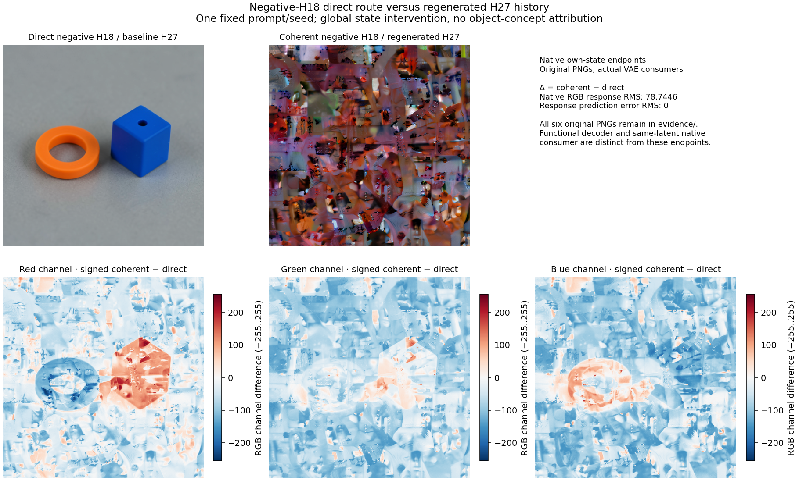
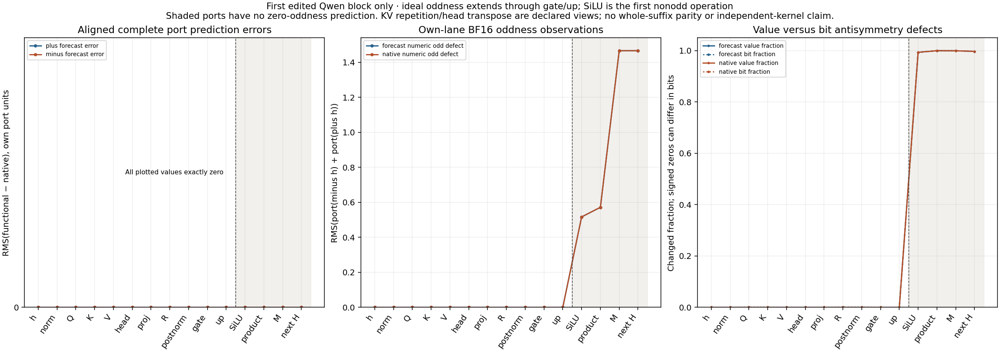

# H18 state history and the first MLP symmetry break

This source-bound maintainer workflow predicts two complete FLUX.2 Klein 4B
futures after negating the text encoder's H18. Both branches have the same
negative direct H18; one retains the original H27 and one regenerates H27
through Qwen blocks18..26. It separates the direct conditioning route from
the inherited history conditional on this large edit.

## Executed result

The prompt describes a cobalt blue cube to the right of an orange ring,
seed 277, 512×512, four distilled steps. Qwen supplies
`E=cat(H9,H18,H27)`, shape `[1,512,7680]`, with 39 attended/473 padded rows.
The branches are `direct=[H9,-H18,H27_base]` and
`coherent=[H9,-H18,H27_minus]`. Each lane forms its own states from the raw
prompt and original weights; H9 and negative H18 are identical across branches.

All 2,001 primary whole Qwen/denoiser fields / 1,206,779,904 dependent positions
are bit-exact. This includes 41 Qwen fields and 1,960 denoiser fields. The 82
overlapping Qwen regional checks and 30 aligned first-block port pairs are
separate coverage. The latter cover 74,973,184 positions and are also exact.
All 1,548 signed response fields / 1,019,321,337 positions have zero error;
twelve decoder endpoint three-term comparisons agree exactly.



The coherent-minus-direct RGB-channel response has RMS 78.7446285293 on the
0–255 scale, maximum 245, signed mean −55.5358301799 and 783,855 changed values
of 786,432. Its complete signed prediction has zero error. Within each branch,
functional decode, original VAE on forecast latent and native own-state decode
have identical PNG bytes. These are endpoint comparisons, not current native
decoder macro-by-macro coverage.

H27-history response RMS is 30.456248712; H9/negative-H18 responses are zero.
Projected text first changes by 20.0770980054, then joint block0 changes the
image stream by 1.3984381358. Latent commit RMS responses are
`0.04952575,0.10627967,0.27505678,1.10175050`. Units differ across fields;
these are not gains or causal shares. The original H27 branch visibly retains
the cube/ring, while regenerated history produces fragmented texture. This
human observation does not assign universal object semantics to H27 or one MLP.

## Local mechanism and finite limits

The edited H18 is the input to zero-indexed block18. Its native trace is
numerically odd through RMS normalization, Q/K/V, attention, output projection,
residual R, postnorm, gate G and up projection U. SiLU is the first numerical
oddness break. For the first edited block only:

| Port pair sum | RMS |
|---|---:|
| R-minus + R-plus | 0 |
| SiLU-minus + SiLU-plus | 0.5168301105 |
| Product-minus + product-plus | 0.5719073681 |
| M-minus + M-plus | 1.4669441815 |
| H19-minus + H19-plus | 1.4669348216 |

R and postnorm each have 477 signed-zero bit differences despite numerical
oddness. Q has 662 and repeated K 608; G/U are bitwise antisymmetric. Keep
these counterexamples rather than requiring blanket bitwise oddness. The
two Torch/NumPy H19 RMS scalar reductions differ by 2.22044604925e−16;
raw BF16 forecast/native equality is separate.

For `M(x)=Wd(SiLU(G)*U)`, real arithmetic gives
`M(-x)+M(x)=Wd(G*U)`. The even part is half this pair sum. No extra Wd(GU)
projection was executed; the equality is an annotated mathematical law, not
a measured BF16 regrouping. Actual addition remainders
`epsilon=Hnext-R-M` have RMS 0.00415047/0.00554376 for plus/minus. Later
blocks consume a generally non-odd state; all-nine-block oddness is not claimed.



## Execution and custody

Both functional histories, both complete 112-transition FLUX futures, decoded
images and full signed-response hashes were globally sealed before any native
learned target. Functional module-forward guards report zero native entries.
Native execution uses one full 36-layer Qwen/LM call and nine unchanged suffix
layers with its own captured positions/mask/RoPE context and no KV cache. That
upstream component wrapper is not a public Qwen Act.

Four downstream public `Act.patch` occurrences are genuine. Both masks cover
columns 2560:7680 with exact shape; all other state slots remain fixed. Native
continuations use actual Session navigator advances. The census is 36
functional Qwen blocks, 45 native Qwen blocks, 224 functional transitions,
224 native advances, 228 receipt occurrences and 8 actual context operands.
Two functional and four native VAE calls separate endpoint consumers. Three
components hydrate once each and make six CUDA placements, at most one GPU
component at a time. No new parameter bank, fitted predictor or donor refresh.

Common H0..H27, edited H18..H27 and the three conditioning values are Qwen
forecast targets. Native H28..H36 and LM-logit values remain reference-only.
The raw history-response descriptors inherit a generic orientation label;
their actual operands are edited-minus-baseline, explicitly identified by
the reader. Conditioning and downstream contrasts are coherent-minus-direct.

Native `job-4420636a123c` took 455.15s / RSS 20,805 MB / VRAM 8,614 MB; CPU saved audit
`job-722d899061e3` took 255.86s / RSS 2,083.6 MB / 0 VRAM. Native request
`a69c20845dba8c20be4b76eff33ddfc89e27d8b016730b19029a2be8e9f55dea`;
compact wrapper `bba4bb1271d24a5d34248d97fae09710dbe2b4b7baa7c72296258af9a3593852`.
Raw custody has 2,712 members / 5,487,696,020 B; the compact has 49 files / 18,801,739 B,
compressed to 3,949,722 B. Raw arrays stay near data, with checksummed retrieval.

## Maintainer reproduction

Use the qualified installed-wheel interpreter from the preceding
[E18 workflow](FLUX-E18-CONDITIONING.md), unchanged original source recipes and
strict mrun preflight. Scripts are source-bound qualification tools, not new
installed public CLI commands. Root's exact metadata parent is the completed
`mdb-flux-e18-conditioning-20261106/run-01`; its actual native source-job JSON
is under `audit-01/source-job.json`.

```sh
python -I -B qualification/stage_flux_h18_state_history.py RUN \
  --parent-run E18_RUN --resource-job E18_AUDIT/source-job.json
python -I -B qualification/stage_flux_h18_state_history.py RUN --inspect
```

After the exact finite request review is recorded in RUN, submit the same
staged request with `--submit`. It declares CUDA, CPU4 / RAM 24 GiB / VRAM 13 GiB,
900 s estimated / 1200 s worker / 1500 s outer, no retries or nested jobs. The prior
E18 actual measurement binds this explicit resource exception. Admission
checks source identity, package cohort, command and actual payload custody.

After native completion, stage and submit the independent saved-only reader:

```sh
python -I -B qualification/stage_flux_h18_saved_audit.py AUDIT --study RUN
python -I -B qualification/stage_flux_h18_saved_audit.py AUDIT --submit
```

That reader uses CPU2 / RAM 3 GiB, 240 s historical estimate / 600 s outer; the measured
255.86 s is retained rather than relabeled to match the estimate. It executes
no learned module, tokenizer, attention recurrence or extra projection.

The portable [evidence directory](assets/flux-h18-history-20261106/evidence/)
contains complete reports, six original PNGs, four conditional equation
records, original 709 weight recipes, retrieval scripts and source sidecars.
The [raw retriever](assets/flux-h18-history-20261106/evidence/retrieve_evidence.py)
checks remote raw membership; three separate scripts under source-metadata
retrieve original Qwen/FLUX/VAE weights when needed. Weight arrays are omitted.

Root additionally ran twelve installed MDB applicability lookups: four exact
matches and eight changed-clock/changed-seed abstentions. For example:

```sh
mdb equations find \
  --catalog docs/assets/flux-h18-history-20261106/evidence/catalog/equations \
  --alias cmp.flux.H18-history.direct.whole \
  --applicable-to docs/assets/flux-h18-history-20261106/actual-cli-and-jobs/cmp.flux.H18-history.direct.whole.exact.context.json
```

The publisher's chronology figure describes its source catalog lookups;
these additional real CLI commands and outputs are retained separately.
Aliases are curated, exact-context computation occurrences. They do not
establish automatically discovered families or generalize to changed seeds.

## Next cut

Test a shared local rule across three fixed fresh contexts. From each own
functional positive R/G/U, compute
`Pminus=SiLU(-G)*(-U); Mminus=linear(Pminus,Wd); Hminus=-R+Mminus`.
Preserve BF16 primitive order and seal all cases before native targets. Report
shortcut-versus-full-functional, full-functional-versus-native, and
shortcut-versus-native errors, plus complete signed edit responses. Keep
premise misses as evidence. This tests local transfer without another complete
image panel or a semantic name.

The mathematical narrative and inspected figures are in the
[blog post](../../../../obsidian/blog/2026-11-06-070800-where-a-sign-flip-becomes-a-different-computation.md).

The proposed follow-up is now [executed on three fresh contexts](QWEN-SIGN-SHORTCUT.md):
all three endpoint channels and signed edit-response channels match exactly.
Residual signed-zero counterexamples remain. The next applicability cut tests
row-wise attention support rather than repeating complete image inference.
