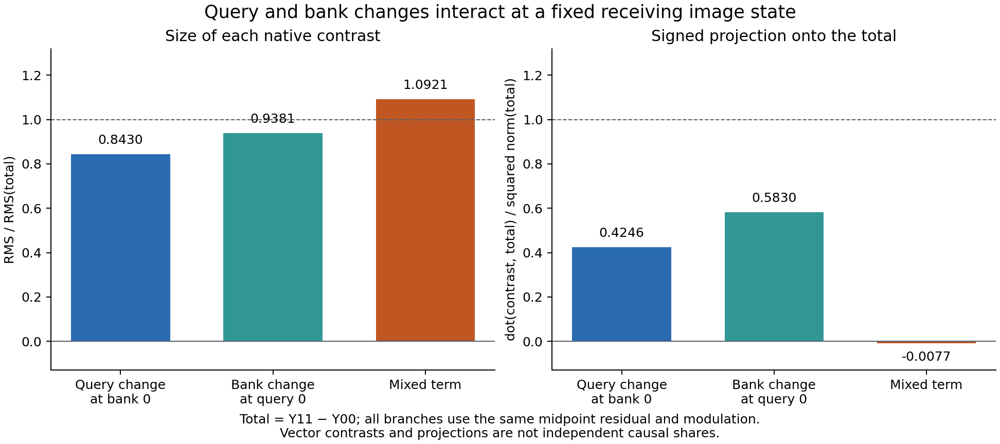

# Image queries and the complete K/V bank at a fixed recipient

The [conditional image-reader assay](FLUX-IMAGE-READER.md) established one
prospective new-register prediction using observed positioned QKV and original
native primitives. This cut asks which part of that attention input causes the
image update: query state, the bank it reads, or their interaction.

## Four sealed forecasts, one receiving state

Source0 supplies the prior sham's actual positioned Q/K/V. Source1 supplies the
prior midpoint's actual positioned Q/K/V. All four targets use the same
midpoint image residual, text, modulation, RoPE and step1/joint0 clock.

The query is the complete original text+image tensor. Text query rows are
unchanged between sources; the changing rows are image queries. Each bank is
the **complete coupled text+image K/V bank**, with K and V moved together.
This experiment does not separate K from V or image-bank from text-bank roles.

Write the image return as

\[
Y_{qb}=T_C\!\left(A_C(Q_q,K_b,V_b),R_{mid},m\right),
\qquad q,b\in\{0,1\}.
\]

Here C binds the original CUDA BF16 numerical policy and native primitive
implementations; T includes image attention projection, residual rounding,
normalization, modulation, SwiGLU and MLP output. It is the image-return tail,
not the text stream. Original model parameters are recipe-backed and unchanged.

One public MDB `ForecastTransaction` uses `files-v1` storage to capture declared
operands, calculate all four complete image forecasts, and seal them together.
Only then may full native targets run. Each target first forms its actual
midpoint QKV, then a dispatch-input substitution supplies the declared Q/K/V
combination to original SDPA. Its real return and the complete downstream block
execute unchanged. Receiving QKV and consumed QKV are separately recorded.
There is no returned-head replacement or fabricated Act receipt.

The two mixed combinations 01 and 10 are new. Corner00 is sham's head with the
**midpoint residual**, not the historical sham block. It reproduces the prior
fixed-head forecast. Corner11 reproduces the prior midpoint native image.
These are four branches at one recipient, not four independent contexts.

## Signed decomposition

At that common recipient, define

\[
\Delta_Q=Y_{10}-Y_{00},\quad \Delta_B=Y_{01}-Y_{00},\quad
I=Y_{11}-Y_{10}-Y_{01}+Y_{00}.
\]

The complete response is J=Y11−Y00=ΔQ+ΔB+I. Its RMS is
0.009754529685. This denominator differs from the previous whole-block
midpoint-minus-sham response, which changed the incoming residual too.

| Contrast | RMS | RMS / J RMS | Signed projection onto J |
|---|---:|---:|---:|
| Query at bank0 | 0.008222886 | 0.842981 | +0.424624 |
| Bank at query0 | 0.009150301 | 0.938057 | +0.583041 |
| Interaction | 0.010652697 | 1.092077 | −0.007665 |
| Query at bank1 | 0.008241674 | 0.844907 | +0.416959 |
| Bank at query1 | 0.009053175 | 0.928100 | +0.575376 |



Projection means <term,J>/<J,J>. Neither it nor the norm ratio is a causal
share. The interaction is large yet almost orthogonal to J, with strong signed
cancellation among the decomposition terms. The full energy identity is

\[
\|J\|^2=\|\Delta_Q\|^2+\|\Delta_B\|^2+\|I\|^2
+2\langle\Delta_Q,\Delta_B\rangle
+2\langle\Delta_Q,I\rangle+2\langle\Delta_B,I\rangle.
\]

The measured terms are 299.318691110 = 212.701083028 + 263.385541900 +
356.977080241 + 184.797813676 − 356.003977946 − 362.538849789.
The saved-array identity has zero residual. All six forecasted contrasts have
zero error at each retained port.

The interaction/total norm ratios are 0.639826 at the attention head,
0.897736 at its projection, 1.009325 after the attention residual,
1.084528 at MLP output, and 1.092077 at image return. Each ratio uses its own
port's response denominator. Differing feature spaces prevent interpreting
absolute RMS across these ports as a measured amplification factor.

## Actual execution and evidence boundary

Native job `job-1a4550b46598` and CPU audit `job-d2211722090c` succeeded.
All four complete image forecasts are exact: 12,582,912 values across branches,
represented as FP32 widenings of BF16. All36 retained primitive-port comparisons
are exact, as are all12 consumed-operand comparisons and all12 receiving-QKV
replay comparisons. Both retrospective corner controls match. Current text
returns are bit-exact under query-only changes at either fixed bank, consistent
with the unchanged text queries and row-wise attention computation.

The cohort seal at worker time22.8609124s records zero target entries. The first
target completes at24.0101921s; the other three complete by25.2905628s.
The target guard and zero-entry seal establish order; completion timestamps
are not entry timestamps.

Forecast work: four SDPA calls, twelve linear calls, four layer norms and four
SwiGLU calls. Full native targets: four blocks, four SDPA, forty-eight linear,
sixteen layer norms, sixteen RMSNorm and eight SwiGLU. No new prefix, full model,
encoder, noise, suffix, scheduler or VAE execution occurs.

Native scheduler elapsed46.7s, peak RSS3468MB, VRAM1576MB; worker28.594s.
Measured-history admission clamps the declared8192MB RAM to6656MB, with
3072MB VRAM reserved. CPU audit elapsed16.61s, RSS2225.8MB, zero VRAM;
saved-array worker11.291s. These are costs, not an end-to-end speedup claim.

Eleven isolated installed-wheel worker checks and six saved-array audit checks
qualify the exact executed sources. The auditor closes observation/sidecar,
seal/order/census and operand-layout joins, verifies complete arrays rather
than samples, and preserves cancellation and undefined-denominator cases.
Earlier fixture failures remain in the research ledger. Astra's post-run
review found no blocking issue and independently checked compact hashes and
scalar energy identities.

This establishes prospective **conditional composition of native primitives**
and a local causal query/bank decomposition. Positioned QKV remains observed.
Independent Flash/GEMM finite arithmetic, earlier state formation, later consumed
continuation and object-level semantic interpretation remain outside this cut.
Previous independent-equation discrepancies are unchanged.

## Installed workflow and custody

Run from the original pinned public wheel cohort, outside a source checkout:

```sh
python -I qualification/stage_flux_image_query_bank.py RUN \
  --source-run COMPLETED_IMAGE_READER_RUN \
  --source-compact COMPLETED_IMAGE_READER_COMPACT
# Bind finite-run review to this exact request and payload before submission.
python -I qualification/stage_flux_image_query_bank.py RUN --submit
python -I qualification/audit_flux_image_query_bank.py AUDIT --study RUN
python -I qualification/audit_flux_image_query_bank.py AUDIT --submit
python -I qualification/recover_flux_directory.py AUDIT COMPACT_COLLECTION
python -I -m mdb equations find \
  --catalog COMPACT_COLLECTION/extracted/binding-minimal-result/catalog/equations \
  --applicable-to COMPACT_COLLECTION/extracted/binding-minimal-result/catalog/context-exact.json
```

Ten curated equation records reuse generic law/route IDs with explicit context
conditions. Installed MDB CLI queries return one match for each exact context
and zero for all ten changed-clock contexts. These are supplied applicability
predicates and retained occurrences, not automatic family induction.

Native request:
`aa8e04ccc1827d13c704d251f0e43f23c5b59adc4a6f850c6a1286a2b0606280`.
Executed worker:
`d29063d9bdc0c8e089d236d186a4333822ce672f73c4a24e195dacaaa68cf122`.
CPU request:
`6df88c2c01379935e311b441d6b7b495d184eb4064547dd22af641a7adff29ed`.
Executed auditor:
`762b164d404adb3f19b2e267b607ca5d5f4c2a4af6e59c2246a68d3aaa5247ca`.

Raw evidence remains near compute:96 inventoried files /693,010,882bytes at
`/mnt/big/mdb/research/job-1a4550b46598/binding-minimal-result`.
Compact collection:33files /828,975bytes, transported in132,645bytes, including
catalogs, source seals, original169 parameter recipes and exact retrieval
scripts. No new persistent parameter bank is added.

[Complete numerical accounts](assets/flux-image-query-bank-accounts-20261106.json)
retain every effect, signed cross term, operand comparison and numerical
limitation. The [completed single-stack trace](FLUX-SINGLE-STACK.md) localizes
native HH versus HL growth through all twenty single blocks. Its next cut tests
attention and MLP features at both recipients. It requires no compression or
semantic-name gate.
