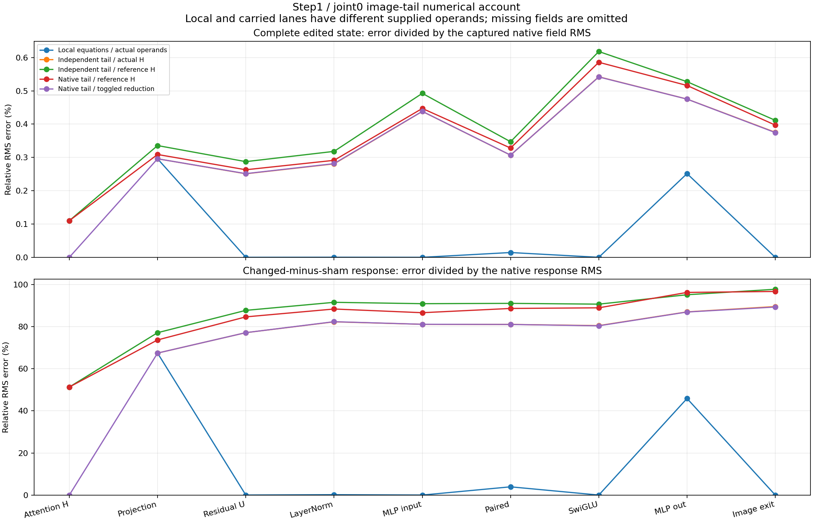

# The first joint block's image arithmetic

The receiver × direction experiment found close complete images alongside
poorly predicted small changes. This microscope asks where that numerical
account loses precision. It reopens two saved MDB states before logical
step1/joint0 and captures the unchanged component's actual operands.

This is a retrospective diagnosis of known states. It uses original checkpoint
parameters, without fitting new coefficients. There is no new prompt, seed,
denoising suffix or VAE in this initial panel. The much later amplification of
the h,h input remains a separate localization question.

## Exact state and component boundary

The selected pair is c1-o0.d-c0-o1 and c1-o0.sham from the
[latent-direction cross](FLUX-LATENT-DIRECTION-CROSS.md). Each source retains
its own image register, working text, modulation and positioned rotary state.
The complete public StateCut store preserves tensor layout and clock. Original
cut, page and blob bytes are authenticated before loading parameters or running
the block.

Only the first `Flux2TransformerBlock` is instantiated, on the meta device,
then populated with all sixteen original named tensors. It executes twice at
the original B1 geometry: 1024 image rows, 512 text rows, width3072,24heads.
Observation-only hooks retain positioned Q/K/V, image attention head H, output
projection, gated residual U, LayerNorm, modulated MLP input, paired MLP values,
SwiGLU output, MLP return and complete image/text exits. Inline gated products
are reconstructed from their operands, rather than claimed as module ports.

Historical image/text hashes are replay observations. A mismatch is preserved
with the new capture; it does not silently discard the numerical panel.
Source identity, clock, dtype, geometry, finite values and immutable inputs
remain mechanics requirements.

## Four continuations of the observed attention boundary

Let H be the captured native image head and H_ref an independent attention
calculation on that same state's captured positioned Q/K/V. Let T be the
extracted native image tail and G its independent FP64/BF16 equations.
Every lane uses its own source state's incoming image and modulation.

| Lane | What is supplied | What it measures |
|---|---|---|
| T(H) | Actual native attention head | Primitive-tail replay against the captured native return |
| T(H_ref) | Independent head from observed Q/K/V | Head disagreement consumed by unchanged native tail arithmetic |
| G(H) | Actual native attention head | Tail equation disagreement with head approximation removed |
| G(H_ref) | Independent observed-QKV head | Combined head and tail numerical account |

H_ref excludes upstream image projection, Q/K/V affine, normalization and RoPE
approximation errors. It is not the earlier full self-fed G program's head.
The native block's profiler records selected ATen attention operators; enabling
a backend is not by itself evidence that it executed.

Two additional probes distinguish local error from propagation: supply each
equation its own exact native input, and start the independent MLP at actual U.
A changed BF16 reduction policy is another named native lane, including
fixed-input local affine calls. It is a numerical counterfactual, without
retroactively correcting the earlier frozen predictions.

## Equations and finite execution

For original image matrices W_o, W_in, W_out and six image modulation vectors
(s_A,c_A,g_A,s_M,c_M,g_M), write B for declared BF16 rounding:

```text
P = linear(H, W_o)
U = B(I + B(g_A * P))
N = layer_norm(U)
X = B(B(N * B(1 + c_M)) + s_M)
[a,b] = linear(X, W_in)
Z = B(SiLU(a) * b)
M = linear(Z, W_out)
I_next = B(U + B(g_M * M))
```

The image graph explicitly binds `attn.to_out.0`, `ff.linear_in` and
`ff.linear_out`. It reuses the qualified [text-tail arithmetic instrument](FLUX-READER-ARITHMETIC.md)
through explicit aliases, rather than assuming the text matrices also serve
image queries. Exact replay on a tiny fixture establishes mechanics; replay
against this original CUDA component is a separate measured observation.

Original weights and nominal equations do not fully specify a finite execution.
Records also retain dtype, geometry, strides, numerical policy, module sources,
runtime versions and the selected attention operators. The peer
[reader-attention closure](FLUX-READER-ATTENTION.md) motivates testing that
instrument here; it does not establish image-query parity in advance.

## Endpoint errors and response errors

For each port Y, the native changed-minus-sham response is
ΔY=Y_edit−Y_sham. A candidate lane has its own ΔY_hat. Preserve

```text
whole-state error = RMS(Y_hat - Y) / RMS(Y)
response error    = RMS(Delta Y_hat - Delta Y) / RMS(Delta Y)
```

The signed error in the saved-only audit is native minus candidate. The native
worker's local comparison sign is candidate minus native; the records label
this difference. Zero denominators remain undefined. Similar response norms
can coexist with opposite vectors and 200% response error.

The boundary substitutions have a useful signed identity. With
A=T(H), B=T(H_ref), C=G(H), D=G(H_ref),

```text
D-A = (B-A) + (C-A) + (D-B-C+A)
```

The final term is the substitution interaction. The audit retains all three
energies and their three signed pairwise cross terms, for each state and for
the edit-minus-sham response. This is fixed-coordinate accounting rather than
additive independent causal responsibility.

## Installed MDB execution and evidence

```sh
python -I qualification/stage_flux_image_tail_microscope.py RUN \
  --campaign PRIOR_CROSS_CAMPAIGN
# Save the independent request-bound review at RUN/long-run-review-final.json.
python -I qualification/stage_flux_image_tail_microscope.py RUN --submit

# After actual native completion, run saved-only reductions near the raw trace.
python -I qualification/audit_flux_image_tail_microscope.py AUDIT --study RUN
python -I qualification/audit_flux_image_tail_microscope.py AUDIT --submit
python -I qualification/recover_flux_directory.py AUDIT COMPACT_COLLECTION
```

There is one finite CUDA lease and one later CPU-only saved-array audit lease,
with no automatic retries or nested submission. Native capture counts and
the independent affine census are recorded. The compact auditor creates fifteen
equation occurrences: ten complete image comparisons and five paired image
effect comparisons. Exact applicability is supplied, not induced; changing the
clock must abstain. Misses remain in the same catalog as exact replay.

Full activation traces remain on Beast. Local artifacts contain source
manifests, reports, equation records and `retrieve_evidence.py` for individual
checksum-verified files. Original checkpoint recipes and `retrieve_weights.py`
provide constants when needed, without a persistent per-run weight bank.

## Qualification and campaign status

The native instrument has twelve isolated installed-wheel tiny CPU checks,
including the actual CLI/bootstrap/export path, complete geometry and operation
counts, strided saved entries, read-only inputs, retained historical misses and
cleanup on exceptions. The saved-only auditor has six tiny checks, including an
actual capture-to-catalog run, corrupt bytes, coherent inventories with wrong
source-role joins, reversed equal-magnitude effects and signed closure.

Native job `job-3fb176d80f27` and saved-array audit `job-ae561763bc7b` both
succeeded. The final installed-wheel auditor source matches the executed
source, with six qualified tiny checks. No numerical quality threshold stops
discovery or certifies a semantic family.

## Measured numerical account

Both complete component calls reproduce their historical image and text hashes
exactly. Native T(H) reproduces all nine retained tail ports in both states
exactly. The selected ATen operation is
`aten::_scaled_dot_product_flash_attention` in both new captures; profiling
identifies the implementation selected here, without exposing its internal
accumulation algorithm.

The actual incoming edit changes only the image register: RMS 0.000979897.
Working text, image/text modulation and positioned text Q/K/V stay exactly
unchanged. Positioned image Q/K/V change, with RMS 0.00279474, 0.00256236 and
0.01844364 respectively. The observed native image-exit effect RMS is
0.010498822.

| Image-exit lane | Sham whole-state error | Edited whole-state error | Response error | Response cosine |
|---|---:|---:|---:|---:|
| Native tail / actual H | 0.0000% | 0.0000% | 0.0000% | 1.000000 |
| Independent tail / actual H | 0.3824% | 0.3754% | 89.5202% | 0.565594 |
| Independent tail / reference H | 0.4145% | 0.4114% | 97.7316% | 0.472205 |
| Native tail / reference H | 0.3987% | 0.3970% | 96.6885% | 0.519060 |
| Native tail / toggled reduction | 0.3827% | 0.3746% | 89.2921% | 0.568458 |

Reference H itself has 51.3040% head-response error, cosine 0.865494.
Supplying the actual after-attention residual to the independent MLP yields
45.1958% image-response error, cosine 0.896019. These conditional replacements
identify numerical dependencies; their errors cannot be added as causal shares.

The local equation panel supplies each operation its own actual native input:

| Local equation | Response error against original policy | Disagreement against toggled native policy |
|---|---:|---:|
| Image output projection | 67.4214% | 3.9149% |
| Paired MLP input affine | 3.9129% | 3.9129% |
| MLP output affine | 45.8637% | 5.2024% |

Local LayerNorm response error is 0.1717%. Local residual additions,
modulation and SwiGLU are exact on supplied actual operands. That does not
make the carried independent tail exact. The policy toggle materially changes
native projection and MLP-output effects, while the local MLP-input affine is
unchanged. Toggling changes the computation; it does not repair the original
forecast or validate it retrospectively.



The response substitution square closes with zero RMS residual. In squared
norm units, head, tail and interaction energies are 324.1543, 277.8718 and
438.1271. Cross terms are +276.9711, -534.0457 and -451.8921, totaling
331.1865. Keep the positive head–tail cross term as well as the two negative
interaction crosses. [All signed accounts and source bindings](assets/flux-image-tail-accounts-20261106.json)
retain both states, every port, actual operand contrasts and profiler counts.

## Reusing the measured records

The compact catalog contains fifteen actual comparisons: ten image endpoints
and five changed-minus-sham effects. They share
`law.flux.image-tail.observed-operands.v1` and
`route.flux.joint0.image-attention-residual-mlp.v1`. Captured native execution
and candidate execution policies are separate conditions. Original source
cuts, weights, clock and actual operand frontier are explicit.

```sh
python -I -m mdb equations find \
  --catalog COMPACT/catalog/equations \
  --applicable-to COMPACT/catalog/context-exact.json
python -I -m mdb equations find \
  --catalog COMPACT/catalog/equations \
  --applicable-to COMPACT/catalog/context-wrong-clock.json
```

The installed CLI was exercised outside the checkout: the exact query returns
one independent-tail edited-image record including its errors; the changed
clock returns `[]`. All fifteen exact-context API queries match and all fifteen
changed-clock queries abstain. These are supplied applicability predicates,
without family induction or new semantic names.

The native lease used two full component calls, two native attention calls,
48 linears, 14 LayerNorms, eight RMSNorms and ten SwiGLUs; independent work
included 22 mathematical affines and two reference heads. It used no full model
load, encoder, new noise or VAE. Scheduler elapsed was 101.87 s, peak RSS
4,148.6 MB and peak VRAM 1,574 MB; scientific worker time was 63.469 s.
The CPU audit used 37.84 s scheduler elapsed, peak RSS 1,109.2 MB and no VRAM;
its worker took 18.659 s. These costs do not establish a speedup.

The 128-file raw trace is 1,312,874,955 bytes and remains near the compute.
The locally collected report/catalog/retrieval bundle is 33 files and
1,205,959 bytes, compressed to a 188,287-byte transport archive. No persistent
per-run pretrained parameter bank was added.

This result diagnoses known inputs at an observed-QKV frontier. It does not
reconstruct upstream approximation errors, explain later h,h amplification,
name object concepts or establish a new-input forecast. The next smallest cut
is a prospective conditional image-reader prediction for one predeclared new
BF16 midpoint register plus sham: bind the input recipe before prefix capture,
stop capture before SDPA, then seal full image predictions before complete
native target calls. Using qualified original-policy primitives would test
composition on a new input; independent Flash/reduction reconstruction remains
a separate objective.
