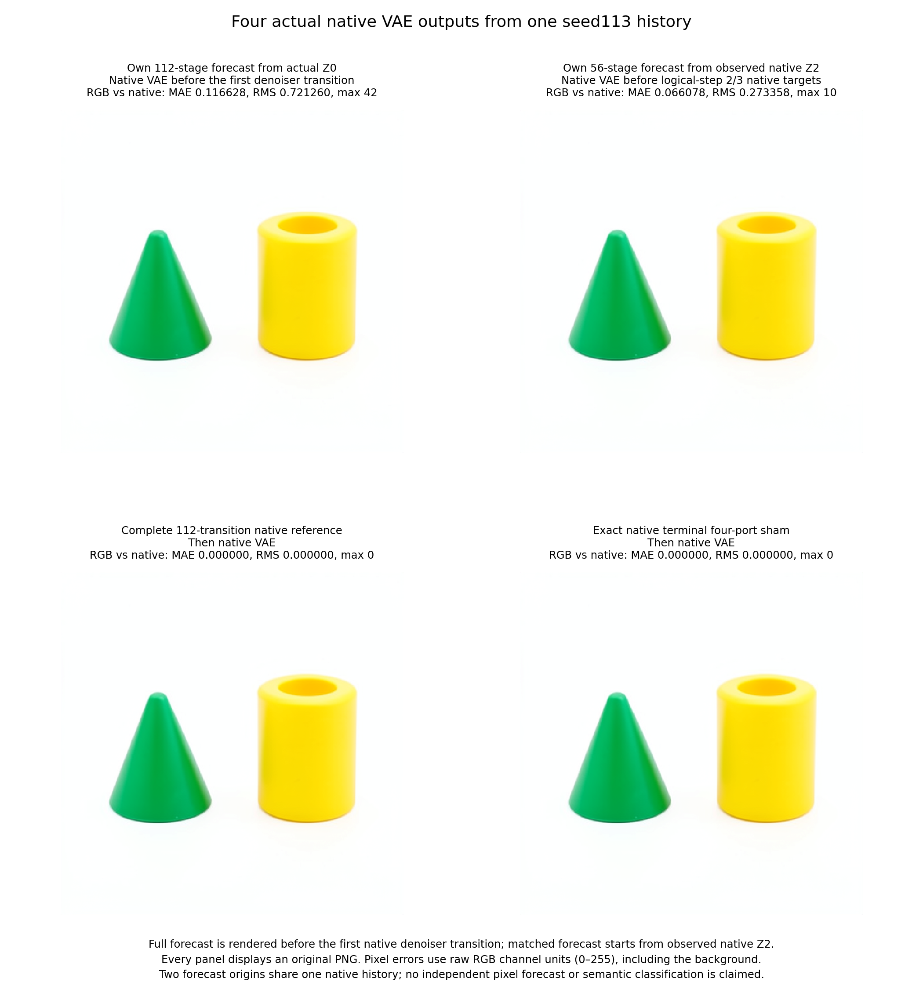
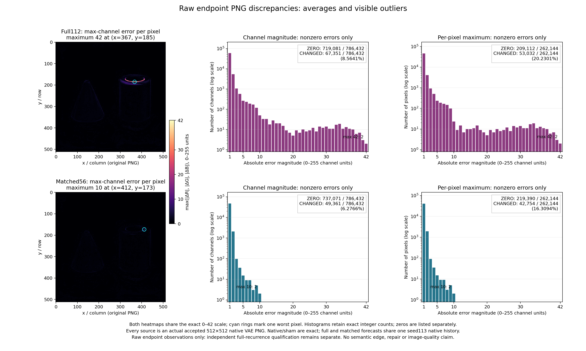

# FLUX from actual initial noise, with a matched observed-state forecast

The full 112-transition forecast has now executed from actual initial noise, and its actual VAE image was rendered before native denoising began. Independent reconstruction reproduced **240 fields / 740,327,424 scalar values exactly** against the sealed mathematics. Against native execution, the full forecast's final latent RMS error is **3.3254%**; its rendered RGB mean absolute error is **0.116628/255**, with maximum channel difference **42**. The matched 56-transition forecast has latent RMS error **1.2509%**, RGB MAE **0.066078/255** and maximum **10**. This is a measured, close numerical forecast for one seed113 history, with visible and hidden-state discrepancies retained.

The campaign starts at the genuine initial step0/project frontier of distilled FLUX.2 Klein: the actual initial latent Z0, native prompt conditioning, IDs, four-step schedule and learned parameters are observed inputs. No native denoiser transition precedes the first mathematical forecast. The specimen is a fresh seed113 history of the green-cone/yellow-cylinder prompt at 512×512, batch1 and CUDA BF16. The retained Z0 bytes and typed cut identify the input; the seed alone does not.

## Two sealed programs in one native history

The full program predicts four complete 28-transition passes, steps0 through3, to terminal Z4. Each pass contains project, five joint blocks, twenty single blocks, readout and Euler commit. The second program starts later from the same native history's observed Z2 at step2/project and predicts the remaining two passes. The two origins give 112 and56 mathematical transitions, respectively: 168 in total.

Each program advances its own computed state. Project builds image/text registers and complete context from its incoming latent plus observed conditioning, IDs and schedule. Joint blocks execute attention followed by the receiving MLP separately for image and text; single blocks use parallel attention/MLP features, output projection, gate and residual addition. Readout consumes the predicted final image register and that pass's predicted time embedding. Euler consumes that pass's incoming latent and predicted noise. The next project consumes the preceding predicted commit, with working fields reset.

The unchanged, source-pinned equations preserve the qualified BF16 boundaries, LayerNorm/RMSNorm details and scalar Euler profile. RoPE constructs frequencies, angles, cosine and sine in FP64, retains cosine and sine in FP32, and applies the qualified rotation arithmetic. Hostile CUDA scalar-promotion cases run before model entry. These are declared equations for a particular source/backend/profile, not a claim about every implementation.

The worker does not refresh future image/text/context/RoPE/noise/latent values from native execution. All complete predicted fields and native comparison boundaries are retained. The independent auditor reconstructs each recurrence using its own preceding output, rather than evaluating each stage on supplied native inputs.

The audit performs another 168 mathematical transitions with checkpoint-derived parameters. Its legacy `models_executed: false` field means no new native framework forward; the NumPy reconstruction does execute learned-weight arithmetic. Auditing is additional computation, separate from the producer's 168 mathematical and 112 native transitions.

For fixed encoded conditioning C, IDs and pretrained parameters θ, write a complete pass as F_s. Its denoiser computes a BF16 noise field V_s. With Q denoting BF16 rounding and δ_s the BF16-rounded FP32 sigma difference, the qualified CUDA Euler profile is:

\[
V_s=D_{\theta,s}(Z_s,C,\mathrm{IDs}),\quad
\delta_s=Q\!\left(\operatorname{FP32}(\sigma_{s+1}-\sigma_s)\right),\quad
D_s=Q\!\left(\operatorname{FP32}(\delta_sV_s)\right),\quad
Z_{s+1}=Q\!\left(\operatorname{FP32}(Z_s+D_s)\right).
\]

The inner rounding matters: an FP32 scalar increment multiplied without this BF16 conversion produces different native results in the retained hostile scalar cases. The retained denoiser program specifies its other intermediate rounding boundaries. The full forecast composes four approximate passes on its own state:

\[
P_{112}=\widehat F_3\circ\widehat F_2\circ\widehat F_1\circ\widehat F_0(Z_0).
\]

The matched forecast instead gives the same approximate late program an observed native Z2. With P56=F̂3∘F̂2(Z2_native) and native endpoint N, the endpoint identity is

\[
P_{112}-N=(P_{56}-N)+(P_{112}-P_{56}).
\]

The first term measures the late approximation on native Z2. The second measures the consequence of replacing that state with predicted Z2 through the approximate late map. It does not isolate early error itself. Squared errors retain the signed cross term 2⟨P56−N,P112−P56⟩; cancellation can reduce the endpoint discrepancy without establishing repair. Native VAE decoding introduces another nonlinear map for the RGB comparison.

## The first actual predicted image precedes the denoiser

The full transaction lives at `transaction/full`. Its frontier contains only the initial observed origin and legitimate parameter/schedule inputs. It excludes the unavailable matched native Z2. All 112 outputs and declared hypotheses seal before the first native target entry.

The public `mdb.flux_derived_terminal.derive_terminal` helper constructs a terminal scaffold from that observed origin. It explicitly records non-native state construction, carries conditioning/IDs/schedule, sets terminal project/cursor0, clears image/text/context/noise, and identifies the observed latent as a placeholder. It performs no native advance or Act application. The returned four-port Act installs sealed predicted Z4 and explicit `None` image/text/context atomically. The inherited final-latent closure adapter binds thirteen source/clock conditions.

The worker applies that Act and renders the actual native VAE before any denoiser transition. Transformer and VAE entries are guarded during prediction; only the VAE is allowed during rendering. Source payload and parameter identity/version checks surround the seal and render. All selected native target counters must still be zero after the first PNG.

Native execution then advances 56 transitions to observed Z2. Only then does `binding.json` add the matched origin, and `transaction/matched` seals the separate 56-transition program. Its actual native VAE image precedes any logical-step2/3 native target. Earlier logical-step0/1 calls remain visible in the monotonic counters; they are never erased to manufacture a second all-zero history.

The derived terminal metadata has its own source-bound record. It is neither a native continuation receipt nor evidence that skipped denoiser transitions ran.

## Four terminal consumers and the physical census

| Execution order | Actual row | State supplied to the native VAE |
|---|---|---|
| 1 | `full.predicted` | Full 112-transition mathematical Z4, admitted from the initial-origin-derived terminal scaffold |
| 2 | `matched.predicted` | Separate 56-transition mathematical Z4 from observed native Z2 |
| 3 | `native` | The same history's complete native Z4 |
| 4 | `sham` | Exact native terminal closure reinstalled atomically |

The native path is split around the matched forecast: first56 transitions, then remaining56. Overall the declared census is 112 native transitions, three Acts, 115 execution receipts, four actual VAE calls and four PNGs, with one load, prompt encoding and initial noise draw. Direct candidate calls are zero. The two non-native scaffold derivations contribute metadata, not extra native or Act receipts.

All native boundaries 0 through 111 retain complete typed cuts and available fields. Every pass's local boundaries are project 0, joints 1–5, singles 6–25, readout 26 and commit 27. Observed Z2 is native boundary 55; terminal Z4 is 111. Image/text working-register errors, readout noise and committed latent have different lifetimes and units.

The full and matched forecasts are dependent comparisons within one native history. They do not provide two independent seeds or isolate a pure horizon effect: the matched program receives an observed later state, while the full program reaches that clock using its own predicted history. Both endpoint images are native VAE responses to admitted terminal latents, not independent pixel predictions.

## Checkpoint-backed parameters and custody

The result includes `parameter-artifacts.json` and a byte-pinned standalone `retrieve_weights.py`. All 169 named checkpoint-backed recipe records bind BF16 shapes, data offsets, raw payload hashes, original NPY framing and complete checkpoint identity. The worker streams each needed bank from the pinned safetensors checkpoint and frees its temporary FP32 representation. It does not persist another per-run pretrained weight bank.

Use an explicit external cache when hydrating parameters. Do not add restored files to the immutable producer result tree:

```bash
rtk proxy python3 /path/to/RUN/retrieve_weights.py --root /path/to/shared-parameter-cache
# With a local pinned checkpoint instead of the default authenticated SSH source:
rtk proxy python3 /path/to/RUN/retrieve_weights.py \
  --checkpoint /path/to/FLUX.2-klein-4B --root /path/to/shared-parameter-cache
```

Exact restoration is a byte-identity operation, not a dtype conversion or a new model run. The independent audit reads the external recipe-qualified cache. See [parameter artifact custody](PARAMETER-ARTIFACTS.md).

Offline transaction verification retains a default 1 GiB geometry limit. These larger forecasts explicitly pass their already declared 3 GiB and 1536 MiB budgets, together with the expected seal hash. The public verifier accepts explicit bounds up to 8 GiB; larger admission does not remove seal, numerical-byte or event-chain checks. The focused [bound regression](../tests/test_forecast_verify_bounds.py) exercises a real sparse >1GiB geometry and rejects altered seals and records.

The authenticated SSH collector compares remote-before, remote-after and local inventories against the final producer manifest. There is no fabricated stdout archive or archive digest. It preserves the request, executed source cohort, both seals, original PNGs, derivations, complete typed native path and parameter recipes.

## Reproduction

Build and install the public MDB wheel with public Saturn-pub and the qualified dependencies in an isolated environment. The launcher stages immutable predecessor equation sources from an accepted two-pass payload. It uses one finite CUDA lease, strict preflight, no automatic retry and a source-bound independent long-run review. The expected duration exceeds fifteen minutes; that review is required before admission.

```bash
MDB_PY=/path/to/qualified/python
MDB_Q=/path/to/saturn-pub/packages/mdb/qualification
MDB_RUN=/path/to/new-run
MDB_CACHE=/path/to/shared-parameter-cache
rtk proxy "$MDB_PY" -I "$MDB_Q/submit_flux_initial_noise.py" "$MDB_RUN" \
  --prior-run /path/to/accepted-two-pass-run
# Complete the source-bound long-run review before this explicit admission:
rtk proxy "$MDB_PY" -I "$MDB_Q/submit_flux_initial_noise.py" "$MDB_RUN" --submit-staged
rtk proxy "$MDB_PY" -I "$MDB_Q/collect_flux_initial_noise.py" "$MDB_RUN" JOB
rtk proxy cp "$MDB_RUN/collection-job.json" "$MDB_RUN/job.json"
rtk proxy python3 "$MDB_RUN/retrieve_weights.py" --root "$MDB_CACHE"
rtk proxy "$MDB_PY" -I "$MDB_RUN/independent-math-freeze/analyze_flux_initial_noise.py" \
  "$MDB_RUN" --parameter-root "$MDB_CACHE" --out /path/to/new-audit.json
```

New campaigns freeze the corrected reader before execution. For this historical run, preserve the original frozen reader and invoke the separately saved corrected cohort with its explicit receipt instead:

```bash
rtk proxy "$MDB_PY" -I /path/to/reader-repair-v1/corrected-cohort/analyze_flux_initial_noise.py \
  "$MDB_RUN" --parameter-root "$MDB_CACHE" \
  --audit-correction /path/to/audit-reader-correction-v1.json \
  --out /path/to/new-audit.json
```

The historical receipt references hash-bound qualification and failure files at their saved absolute paths. Relocation requires resolving those original references, rather than silently rewriting the receipt or relaxing source authority.

The finite production plan declares four CPU threads, worker 1800 seconds, outer timeout 2100 seconds, RAM 14336 MB, VRAM 13000 MB and disk 12 GB. The full/matched transaction caps are 3 GiB / 1536 MiB; the member cap is 3 GiB and complete output cap 10 GiB. Storage profiles are measured before sealing. These are resource contracts and estimates; measured performance is reported below.

The [worker](../qualification/flux_initial_noise_campaign.py), [focused mechanics tests](../tests/test_flux_initial_noise_campaign.py), [launcher](../qualification/submit_flux_initial_noise.py), [collector](../qualification/collect_flux_initial_noise.py) and [independent auditor](../qualification/analyze_flux_initial_noise.py) implement the declared cut. The installed tiny CPU qualification is distinct from real-model numerical evidence.

## Measured endpoint results

The actual prompt was:

> A green cone to the left of a yellow cylinder on a plain white background. Two separate objects, simple studio product photograph.

The accepted job is `job-4350531b1dcd`, request `32696ea315aa3236845417962bef9a990c87a31ef9be83b6c770388090218981`. The model is FLUX.2 Klein 4B distilled, CUDA BF16, four diffusion passes, 512×512, physical batch1. A transition here is a project, joint block, single block, readout or scheduler commit; 112 transitions do not mean 112 sampler steps.

| Terminal row | RGB MAE | RGB RMS | Largest channel difference | Changed channels / 786,432 |
|---|---:|---:|---:|---:|
| Full112 from actual Z0 | 0.116628 | 0.721260 | 42 | 67,351 |
| Matched56 from observed native Z2 | 0.066078 | 0.273358 | 10 | 49,361 |
| Native | 0 | 0 | 0 | 0 |
| Unchanged terminal sham | 0 | 0 | 0 | 0 |

All values use original uint8 RGB channel units, 0–255. Full and matched forecasts changed 53,032 and 42,754 pixels respectively, out of 262,144. A low global mean includes the large white background; it is not a percentage of computations understood or a claim of exact reproduction.



The strongest visible full-forecast discrepancies lie around the yellow cylinder's rim. Two coordinates attain the maximum 42. At `(x=367,y=185)`, predicted RGB is `(249,219,61)` and native RGB is `(253,234,103)`. This locates a numerical discrepancy; it does not identify a semantic “rim” symbol. The matched maximum 10 also occurs at two pixels. The retained histograms include zeros and all outliers, with a shared 0–42 heatmap scale.



## Independent reconstruction and native-state discrepancies

The saved-only audit completed in 588.803 seconds, without a new native model forward. It recomputed the full112 and matched56 programs from their respective origins, each using its own preceding computed state. Full coverage is 160 compared fields / 493,551,616 scalar values; matched coverage is 80 fields / 246,775,808 values. Every compared sealed/independent field is bitwise exact, with zero maximum absolute discrepancy. This agreement is between the producer's mathematics and its independent reconstruction; native execution remains a separate comparison.

| Final latent versus native | RMS error | Error / native RMS | Maximum absolute error | Changed values / 131,072 | Signed mean error |
|---|---:|---:|---:|---:|---:|
| Full112 | 0.0254781 | 3.3254% | 1.34375 | 98,959 | +0.000330204 |
| Matched56 | 0.00958361 | 1.2509% | 0.6875 | 88,420 | +0.000111418 |
| Sham | 0 | 0 | 0 | 0 | 0 |

The denominator in this table is native final-latent RMS 0.766164. Latent units differ from RGB channel units. A small image average does not imply tiny errors at every hidden coordinate, and VAE decoding need not preserve latent distances or individual features. The full and matched latents are neither bitwise identical to native nor uniformly bounded by their RMS errors.

| Forecast | Completed pass | Committed-latent RMS error | Error / same-clock native latent RMS |
|---|---:|---:|---:|
| Full | 0 | 0.00107803 | 0.11187% |
| Full | 1 | 0.00186837 | 0.20764% |
| Full | 2 | 0.00467021 | 0.60534% |
| Full | 3 | 0.0254781 | 3.32541% |
| Matched | 2 | 0.00196379 | 0.25454% |
| Matched | 3 | 0.00958361 | 1.25086% |

Both absolute and relative latent discrepancy grow across the completed passes here. The final sigma interval is also much larger than the earlier intervals. The retained noise, incoming-latent and BF16 Euler records support a more detailed error account; these endpoint trends alone do not identify a repair mechanism or an additive early/late causal share.

The [full depth curves](assets/flux-initial-noise-full-depth-20261105.png) and [matched depth curves](assets/flux-initial-noise-matched-depth-20261105.png) retain all 26 image/text working-register observations per pass, with separate absolute units and same-cursor native denominators. Sparse tick labels improve readability without dropping plotted points.

The measured endpoint decomposition also closes exactly. In latent squared-L2 units, matched error 12.03838194 plus replacement contrast 77.09548542 plus signed cross term −4.05082804 equals full error 85.08303932. In RGB squared-L2 units the same identity is 58,766 + 446,994 − 96,646 = 409,114. Both cross terms are negative, yet full112 remains worse than matched56. Cancellation is not evidence of semantic repair or independent early/late error components.

The audit reports `mechanics_status: valid`, `instrument_status: native-replay-qualified`, signed observed trends, and `terminal_status: unassessed`. Sham latent and PNG exactly match native. There is no numerical accuracy gate, universal-bound certification or semantic promotion. The accepted audit SHA256 is `314fe2d2c63aedf1392b87f0c599a417bfc241e54fac8a9f127d868c834f3115`.

## Chronology, cost and retained data

| Event | Worker elapsed seconds | Native transitions already executed |
|---|---:|---:|
| Full112 transaction sealed | 514.822 | 0 |
| Full112 actual VAE PNG complete | 538.840 | 0 |
| Matched56 transaction sealed | 818.591 | 56 |
| Matched56 actual VAE PNG complete | 826.397 | 56 |
| Native reference complete | 900.007 | 112 |
| Four images and all declared work complete | 901.073 | 112 |

The full seal is `d27bfe505731506417e9fdf1937d79c6e5446eac5bdb90f26cf77149ea7b0014`; matched seal is `8fe70cae45ddce0ce4f106e4056144469902bd82cac2f4f028da31c0e31e0af5`. Full and matched PNG hashes are `7e21ef4f1b79248c86694271947313682c2cc7eccbc86461feb6afece554e539` and `89847915e3462b87c4c661e9b27c617bce4272db981c5766015d04f2de729a63`. Native and sham PNGs share `3e762143c1a9561e91a9a088d43d979a4effaeb00a4733418ba54cc9df831a00`.

Mrun recorded 1,033.69 seconds including finalization, peak reported RSS 8,509.1 MB and VRAM 12,936 MB, within the declared reservations. This run performs the full learned computation twice for comparison, plus the matched forecast and image consumers. It establishes no inference speedup. Collection took another 462.305 seconds for **1,038 files / 5,097,233,859 bytes**. Remote-before, remote-after and local file inventories agree exactly.

The retained result contains approximately 2.073 GB full sealed forecast, 1.041 GB matched forecast, 0.985 GB native arrays, 0.994 GB typed state store, plus source/clock/receipt/parameter-recipe metadata and four original PNGs. It contains no copied parameter archive bank. The audit temporarily reconstructed 169 exact NPY parameter objects, 7,751,110,784 bytes, outside the immutable result tree. All 169 audit-cache paths were removed after success, with per-file hash checks and shared original hardlink anchors preserved. Retrieval scripts and recipes remain available; the checkpoint and scientific evidence were retained.

## Preserved failures and the reader correction

The first GPU attempt, `job-bec0919aa07e`, produced and sealed its full112 forecast before any native denoising, then hit the offline verifier's inherited1GiB ceiling. Its80files/2,090,756,153bytes remain preserved as a failed attempt with no native accuracy reference. The corrected campaign uses explicit declared bounds; it is a corrected assay on the same seed, not an independent replication. Its full predicted PNG is byte-identical to the earlier attempt's PNG.

The accepted job then exposed a second tooling issue during saved-only audit: the old reader required FP32 arrays and rejected genuine lossless int64 position IDs. Audit attempt01 stopped before any recurrence and remains preserved. The corrected reader dispatches modern native archives through the public lossless loader, keeping int64 values intact. It passed 39 focused installed-environment tests, including values beyond 2^53, corruption rejection, typed-slot joins and source-correction rejection cases.

The audit correction is explicit, not a replacement of the original freeze. It binds the immutable request/job, complete original source cohort, failed audit stdout/stderr/receipt, qualification result and original/corrected reader hashes. An AST comparison checks unchanged mathematical and control functions, imports and constants, allowing only native-reader dispatch and exact correction/provenance plumbing. All older equation sources remain byte-identical. No native computation is rerun and no prediction or observation is rewritten. Original auditor hash is `0357770692e6d6dc4f1c52acaa767ad8e39d117421a6b8e5a6efc1200134dc1a`; corrected auditor hash is `93760e398fe844ca0c2000a902891ee8fd98a0ab9a7496a7f5654202ce04cb45`.

## What this cut means

The observation point now precedes the entire denoiser. A source-derived mathematical program consumes actual Z0, encoded conditioning, IDs, schedule and pretrained parameters, then constructs its whole predicted state trajectory without refreshing from future native activations. MDB binds the state, continuation, seal, Act and actual downstream image consumer. This is a larger compositional computation record than a local MLP or late-pass forecast.

This connects the symbol table to the time-circuit view. A computation record identifies an operation, its ports, parameter/source identities and applicability. The live state supplies the values at those ports; the clock and continuation identify what runs next. In this model the live fields include latent, image/text registers and time-derived context, with conditioning, position IDs and the sigma schedule carried explicitly. A record plus a continuation is not a complete state unless these values and immutable parameter bindings are also present.

The block weights are reused across diffusion passes. Different latents and time-derived modulation change attention, MLP inputs and gated residual updates, even at the same static block address. The full forecast demonstrates composition of those state-dependent numerical transitions for this history. It does not yet show which internal pattern should receive an object-level name or which smaller subset of the program is sufficient for a particular concept.

It still executes the learned-weight arithmetic. It does not replace the 4B parameters with a compact discovered program, predict the prompt encoder or VAE mathematically, automatically enumerate futures, or establish a universal semantic dictionary. Native prompt encoding and native VAE decoding remain the two outer learned boundaries. One history does not establish arbitrary-prompt coverage, a universal coordinate bound or reusable semantic families.

The follow-up [four-context campaign](FLUX-PROMPT-FACTORIAL.md) crosses color assignment with left/right placement under one fresh noise state. All four full forecasts and decoded images preceded native denoising. Independent replay matched all 960 field hashes, while native final latent discrepancies ranged from 1.923% to 11.018%. Its completed 56-transition matched-input comparison separates whole-pass discrepancy on native input from inherited state differences transported through the mathematical map. The larger selected case has a much larger transported image difference. Testing the corresponding native finite response remains the next numerical cut, keeping the supplied conditioning boundary and finite coverage explicit.
