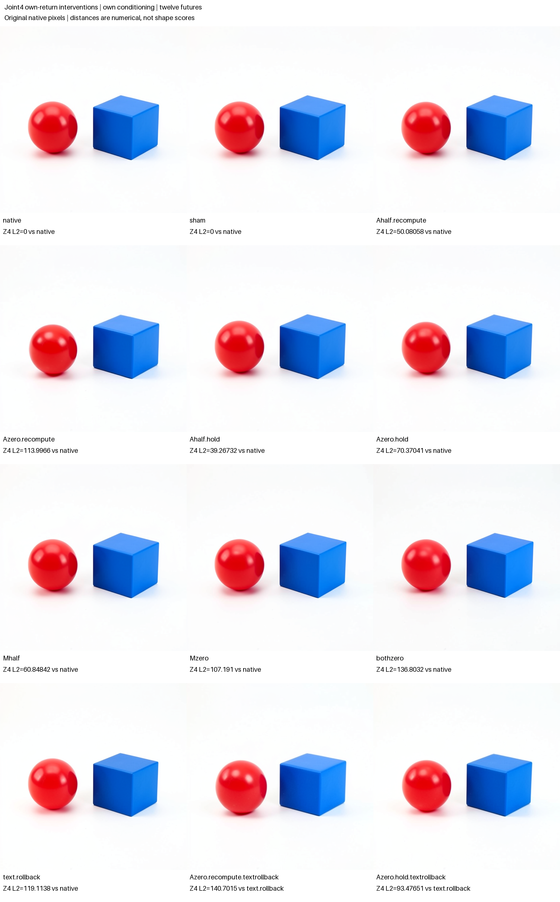
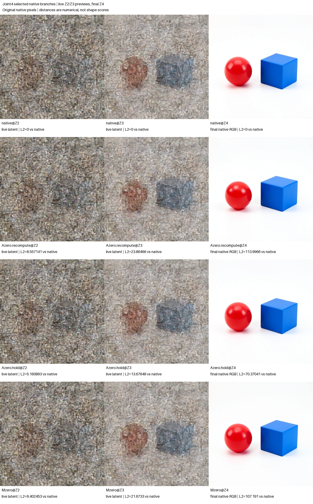

# Joint attention and its receiving MLP under one prompt

Changing joint4's own attention output changed its receiving image MLP and the later native future. Recomputing that MLP moved the final latent farther from native than holding its original same-parent return, at both half and zero attention. The frozen half-attention compensation prediction therefore missed. Zero attention with recomputation caused slightly more final drift than zero MLP, matching the other tentative rank by 6.80555. Arm-blinded assistant inspection described the red sphere, blue cube and their ordering as retained in every final. These are conditional observations from one prompt and seed; cross-context transfer remains unestablished.

The completed assay used one freshly encoded shape prompt with its own stored conditioning throughout. No donor history or changed-conditioning prefix was imported. All twelve futures, eight intermediate previews and exact controls passed the [independent saved-array audit](../../../../artifacts/mdb-flux-joint-self-20261103/run-01/analysis-v1.json). The [immutable publication](../../../../artifacts/mdb-flux-joint-self-20261103/final-v1/result.json) retains every row, matched baseline and prediction miss. Visual descriptions were sealed separately; numerical distance alone supplies no shape label.

The motivation comes from two different observations. The earlier joint-write assay found an influential joint4 attention substitution under a common-text disposal policy, but that substitution also changed the receiving MLP output. The [recipient controls](FLUX-RECIPIENT-CONTROLS.md) showed that local A/M scaling and the final latent can have very different vector geometry. Neither observation separates the joint block's sequential attention-to-MLP dependency from later text/state repair. This new panel makes those distinctions explicit rather than treating the MLP as an independent parallel ingredient.

## Observed parent and native sequential writer

The specimen was distilled FLUX.2 Klein 4B, CUDA BF16, batch one, seed 47, 512 × 512 pixels and four denoising steps. The checkpoint inventory is `dd976d67036c4a0a55642f702dcb3740ba7a4f367557596572baac168330904f`. The exact freshly encoded prompt was:

> A red sphere to the left of a blue cube on a plain white background. Two separate objects, simple studio product photograph.

A fresh native encoding and allowed own-state prefix reached the entry of step1 joint4. A counted native capture from that same parent supplied the block's original attention return, image MLP return, image/text states and modulation gates. These observed values were allowed pre-seal inputs; the edited suffix images were not. Step labels retain the runtime's native logical clock rather than renumbering an imported history.

The image computation is sequential:

```text
U = R + gate_A * A
M = image_MLP(modulated_norm(U))
image_next = U + gate_M * M
```

The actual native BF16 operation order, normalization/modulation and full tensors were retained and audited. The formula is a structural description, not a claim of independent NumPy prediction or exact real-arithmetic interchangeability. Changing A changes U and ordinarily changes the MLP input. A held-output arm instead substitutes the original MLP return captured from this identical native parent; it does not fetch a donor MLP tensor or recompute a different reference suffix.

The candidate scales the native output return first, keeping the original gates unchanged:

```text
U = BF16(R + BF16(gate_A * BF16(a * A_raw)))
image_next = BF16(U + BF16(gate_M * BF16(m * M_selected)))
```

`M_selected` is the receiving MLP's recomputed return or the original same-parent native return. This rounding order is part of the intervention contract; scaling a gate instead need not produce identical BF16 values. The submitted worker and source inventory bind output scaling.

Every branch keeps the same own stored conditioning C throughout all four steps. Most branches retain the block's native post-joint4 working text T. Text-rollback arms separately restore the same parent's pre-joint4 T, after the image candidate is installed. The image-only and text-only Acts must each preserve every undeclared payload field. Stored C and working T are different state fields: rolling back T does not replace C.

## Twelve futures and matched comparisons

| Row | Image attention | Receiving image MLP | Working text after joint4 |
|---|---|---|---|
| `native` | Native | Native | Native post-T |
| `sham` | Native copy control | Native | Native post-T |
| `Ahalf.recompute` | Half own return | Recomputed on changed U | Native post-T |
| `Azero.recompute` | Zero own return | Recomputed on changed U | Native post-T |
| `Ahalf.hold` | Half own return | Held original own return | Native post-T |
| `Azero.hold` | Zero own return | Held original own return | Native post-T |
| `Mhalf` | Native | Half own return | Native post-T |
| `Mzero` | Native | Zero own return | Native post-T |
| `bothzero` | Zero own return | Zero return | Native post-T |
| `text.rollback` | Native | Native | Restored pre-T |
| `Azero.recompute.textrollback` | Zero own return | Recomputed on changed U | Restored pre-T |
| `Azero.hold.textrollback` | Zero own return | Held original own return | Restored pre-T |

All branches continue through the actual remaining denoiser, scheduler and VAE. The headline numerical measurements are L2, mean absolute difference and signed mean relative to the matched native array at each saved scheduler step. There is no donor p axis or shape percentage. The rollback attention arms additionally require comparisons against `text.rollback`, so their attention effect is measured with the same text policy; raw common-native distances remain separately available.

Valid scheduler latent states at saved clocks Z2 and Z3 were also decoded for `native`, `Azero.recompute`, `Azero.hold` and `Mzero`. These labels retain the native cut's logical clock. They are native VAE views of live, still-noised latents, not completed diffusion outputs or independent predictions. Together with their Z4 final images these form a four-row, three-timepoint preview grid. Eight intermediate previews plus twelve final PNGs are twenty images, but only twelve denoising futures. Preview decoding did not feed RGB or reconstructed latent state back into the continuation. Each preview retains its own source scheduler-array and VAE provenance.

## All twelve numerical outcomes

The first distance column always uses own native as its reference. The last column uses the same working-text policy as its edited branch: `text.rollback` for the two attention-plus-rollback rows, and native otherwise. All values are full final-latent L2 distances, not semantic scores.

| Row | L2 from common native | Matched reference | Matched L2 |
|---|---:|---|---:|
| `native` | 0 | Native | 0 |
| `sham` | 0 | Native | 0 |
| `Ahalf.recompute` | 50.080582523 | Native | 50.080582523 |
| `Azero.recompute` | 113.996576508 | Native | 113.996576508 |
| `Ahalf.hold` | 39.267317540 | Native | 39.267317540 |
| `Azero.hold` | 70.370410781 | Native | 70.370410781 |
| `Mhalf` | 60.848424538 | Native | 60.848424538 |
| `Mzero` | 107.191029926 | Native | 107.191029926 |
| `bothzero` | 136.803185225 | Native | 136.803185225 |
| `text.rollback` | 119.113839475 | Native | 119.113839475 |
| `Azero.recompute.textrollback` | 148.983808510 | Text rollback | 140.701486135 |
| `Azero.hold.textrollback` | 128.201412745 | Text rollback | 93.476509222 |



The frozen `H-A-vs-M` rank matched: 113.99658 versus 107.19103, a difference of +6.80555, about 6.35% of M-zero drift. This small one-context separation does not establish general attention dominance. The frozen `H-compensation` rank missed: half-attention recomputation was farther from native than holding, by +10.81326. The broad M-zero visual guess was consistent with the separately blinded inspection.

## Receiving MLP and text-state effects

Half attention changed the native MLP input by L2 278.97395 and raw MLP return by 2,301.99152; zero attention changed them by 622.83131 and 4,423.04269. Held arms still computed those changed raw returns, but installed the original same-parent return: its selected-return and MLP-write differences from native were exactly zero. The auditor verified every candidate's sequential BF16 residual equation. The held/recomputed difference is therefore an observed receiving-state contribution, not a missing-call artifact.

The half-attention recompute-versus-hold final vectors differ by L2 29.37942; the zero-attention pair differs by 88.43368. These pairwise distances are distinct from subtracting their distances to native. The corresponding final RGB mean absolute differences are 0.41534 and 1.94625 on the saved uint8 scale. They report changed native pixels without assigning a shape effect or a mediation percentage.

Rolling back joint4's working-text update alone produced L2 119.11384 from native despite unchanged own C. With the rollback baseline matched, zero-attention recompute and hold ended at distances 140.70149 and 93.47651. Their raw common-native distances, 148.98381 and 128.20141, answer a different question and remain separate. The text-rollback recompute/hold pair differs by L2 108.79621. These measurements show that the working-text policy matters in this context, but do not isolate a unique repair algorithm or semantic operator.



## Prospective guesses and interpretation limits

The numerical guesses were frozen as tentative rank directions without magnitude predictions:

- Zero attention with receiving-MLP recomputation produces greater final drift from own native than zero MLP.
- Under half attention, receiving-MLP recomputation stays closer to own native than holding the original MLP return.

The broad visual guess was that M-zero retains a sphere-like red object and two separated objects. Shape descriptions for other rows were exploratory. Every numerical miss, mixed shape, collateral change and undefined measurement remains visible. Numerical drift does not certify a shape label, and agreement with a broad visual guess does not identify a universal semantic operation.

Holding the original MLP return is a controlled output substitution, not removal of MLP computation. Likewise, scaling a return does not remove its native production, the retained text update, later blocks or future conditioning. The recompute-versus-hold contrast measures the consequence of a receiving-state dependency under this intervention; it is not automatically a semantic mediation fraction. A text rollback changes a complete working text field and is not an object mask. The panel cannot establish a first or minimal shape writer, generalization across seeds, or an independent raw-prompt-to-RGB forecast.

## Separate visual observations

One assistant inspected the blinded grid and all twenty original PNGs without current arm identities, numerical outcomes or specific predictions. General project context and the requested visual categories were known. Its [observations were sealed](../../../../artifacts/mdb-flux-joint-self-20261103/blinded-observations.json) before unblinding through the withheld [arm map](../../../../artifacts/mdb-flux-joint-self-20261103/blind-map.json); the separate [unblinded record](../../../../artifacts/mdb-flux-joint-self-20261103/unblinded-visual-record.json) binds original image hashes. Its digest is `a0fe80d74f9b3aef81617ade2a5b10935c214b40290d18982be401e0cb983bab`.

| Image group | Retained description | Qualification |
|---|---|---|
| All twelve finals | Red sphere, blue cube, two separated objects, red left | One assistant's coarse qualitative reading; appearance details and uncertainty retained per row |
| All four Z2 previews | Shape unknown; reliable object count not established | Dense noise obscures boundaries; not evidence of object absence |
| All four Z3 previews | Provisional red sphere / blue cube / two forms | Moderate confidence through remaining texture; surface details uncertain |

The M-zero prediction is consistent with this broad final-image reading. It does not show that the MLP contribution is unnecessary: original native computation, prior residual/text, own future conditioning and later blocks remain. No edited final lost the coarse scene in this inspection, even though full arrays and pixels changed. This task-aware arm blinding is not a calibrated semantic evaluator or multi-rater certification, and rendered views do not determine exact 3D geometry.

The older hybrid/donor context's cube-restoration contrast is not a controlled history comparison with these fresh-prompt rows. Native history, future conditioning and perturbation type differ. Comparing those outcomes can motivate a matched follow-up but does not establish transfer or its absence.

## Custody and reproduction workflow

The source record, parent identity, native port capture, intervention recipes and hypotheses were sealed before any edited suffix was released. At 66.50672 seconds the seal ledger contained one prompt encoding, 33 prefix transitions plus one adapter block for parity, one direct native candidate capture, zero Acts, zero VAE calls and zero PNGs. The seal digest is `e917f4375c237e71e5c72546df7b21c1d9060c2ce803c1e943616227019bf5d8`.

Job `job-1f1587e6983b` succeeded with one model load, one encoding, twelve direct candidate calls, 981 adapter transitions, fourteen Acts and 995 receipt emissions. Twenty PNGs came from twelve final decodes plus eight previews; the twenty-first VAE call was a final native/helper parity check and saved no extra image. Sham matched every saved native scheduler array and final RGB exactly. Native candidate/adapter ports closed exactly, original own conditioning was retained throughout, and the preview helper matched the final adapter decode in both pixel and PNG bytes.

Native worker work through the result summary took 275.81484 seconds; scheduler elapsed time was 551.36 seconds, peak RSS 16,059 MB and peak VRAM 9,282 MB. The expanded raw artifacts total 494,199,286 bytes; the retained gzip worker log is 220,182,501 bytes. Large inline log transport/publication is an observed bottleneck; the timing difference is not a calibrated attribution of every remaining second. The scheduler reports zero artifact-CAS rows/objects. The full raw bundle and gzip log are retained locally, rather than being automatically retrievable fleet artifact objects.

A separate [CPU-only compression diagnostic](../../../../artifacts/mdb-flux-joint-self-20261103/transport-compression-diagnostic.json), produced by [this saved-array benchmark](../../../../artifacts/mdb-flux-joint-self-20261103/benchmark_transport.py), compressed one retained 12,583,040-byte NPY losslessly. Level1 took 0.16790 seconds and 6,599,400 bytes; level9 took 11.52475 seconds and 5,627,767 bytes. That local one-array example was about 68.6 times faster at a 17.3% size cost. It is not a full-archive benchmark or measured GPU-host speedup.

The follow-up [whole-result repack](../../../../artifacts/mdb-flux-joint-self-20261103/fast-export-v1/benchmark.json), run by [this source-bound script](../../../../artifacts/mdb-flux-joint-self-20261103/benchmark_full_archive.py), packed all 494,199,286 raw bytes at gzip level1 in 6.84990 local CPU seconds, producing 251,285,930 bytes. Verification checked all 1,270 archived file hashes in 1.31119 seconds and found the original file bytes exact. No model or equation ran, and the original source archive remains unchanged. This measures Mac packing/verification, not fleet transfer; dividing the GPU job's 551.36-second total by 6.85 would not be an end-to-end speedup measurement.

An export-only opt-in compression setting was qualified on saved evidence, and the future launcher selects level1. This scientific job used frozen worker `9285d059f75f74e3a678a635c6c4b124c5f4d6b109256e7e3dff3fc9a6c8c08d` and the historical exporter. Later export code changes do not rewrite its payload, numerical outcomes or execution record.

The [export qualification](../../../../artifacts/mdb-flux-joint-self-20261103/source-freeze-02-export/qualification.json) records 27 passing installed-package checks, clean Ruff results, a verified future payload selecting level 1, and the whole-result byte-preserving repack. Its [worker diff](../../../../artifacts/mdb-flux-joint-self-20261103/source-freeze-02-export/worker-export-only.diff) changes compression validation and export arguments only. The original native instrument helper is unchanged.

The independent audit verified source/request/archive/manifest custody, transaction ordering, exact typed closures, same-parent held returns, sequential BF16 equations, own-C continuation, matched text policies and saved-image hashes. Scientific trends did not filter row collection or publication. The request digest is `469e45de79b3b5be1d3da7533bd28547b6ccbbd145d12786ce8d39a90eb82622`; archive digest `db2c1af6a818bcb481eb5abb7b02126af9e0c6f2615061e77267f0c09800637e`; audit digest `c2f901914e4eccaafd6f4389485ba97e51d2dcbc0bae30b132a51431f61fb5f0`; publication digest `6767cb0c16721ee1d7bcdda7cae557843aa30440d23da1e4a2472c4951e2b300`.

The [post-outcome independent review](../../../../artifacts/mdb-flux-joint-self-20261103/postrun-review.json) retained the run as valid exploratory evidence with terminal status unassessed. It verified 1,269 manifest entries plus the manifest itself. Peak RSS was slightly above the nominal 16,000 MB reservation and below its 17,600 MB kill ceiling; the job completed without OOM or retry. This review audited numerical/custody scope and supplied no visual labels.

Two [curated computation records](../../../../artifacts/mdb-flux-joint-self-20261103/computation-records.json) keep the receiving-MLP and working-text-rollback routes separate: `flux.joint4.receiving-mlp.seed47` and `flux.joint4.working-text-rollback.seed47`. Their digest is `313662edee205ada29d64c157183988673d958bdd9dd8f223abd56f93c444feb`. The [saved-evidence generator](../../../../artifacts/mdb-flux-joint-self-20261103/derive_records_and_evidence.py) produced twelve numeric stream rows and source-bound citations. The [evidence bundle](../../../../artifacts/mdb-flux-joint-self-20261103/evidence-v1/checksums.json), digest `c5655204e95fc94f3b0af5bbf00e4caeeba7f20a3e55ae4bb28c3e0096f37256`, records successful run/verification plus an actual [two-hit citation query](../../../../artifacts/mdb-flux-joint-self-20261103/evidence-v1/xref-query.json) at two distinct model-and-parent-bound addresses. Automatic claims are zero. Its scope is numeric-stream mechanics and local occurrence lookup; it does not replace the MDB receipt audit, certify semantic labels, induce a family automatically or ingest a workspace atlas.

The [dedicated submitter](../qualification/submit_flux_joint_self.py), [auditor](../qualification/analyze_flux_joint_self.py) and [publisher](../qualification/publish_flux_joint_self.py) provide this workflow from the MDB package directory, using the configured installed public environment:

```sh
python qualification/submit_flux_joint_self.py /absolute/new-run
python qualification/submit_flux_joint_self.py /absolute/new-run --collect EXACT_JOB_ID
python qualification/analyze_flux_joint_self.py /absolute/new-run /absolute/new-run/analysis-v1.json
python qualification/publish_flux_joint_self.py /absolute/new-run /absolute/new-run/analysis-v1.json /absolute/new-publication
```

The publisher requires a completed source-bound audit and a fresh output directory. Its twelve-final-image sheet and four-by-three time grid paste original 512px RGB pixels without resampling or image synthesis. Labels and numerical annotations occupy separate bands. The [portable index](../qualification/flux-joint-self-20261103.json) binds all rows, source/audit hashes, preview source cuts, public Acts/receipts, final cuts, actual execution ledger and separate arm-blinded visual records. The immutable original publication remains unchanged; visual interpretation and later offline diagnostics are linked separately.
