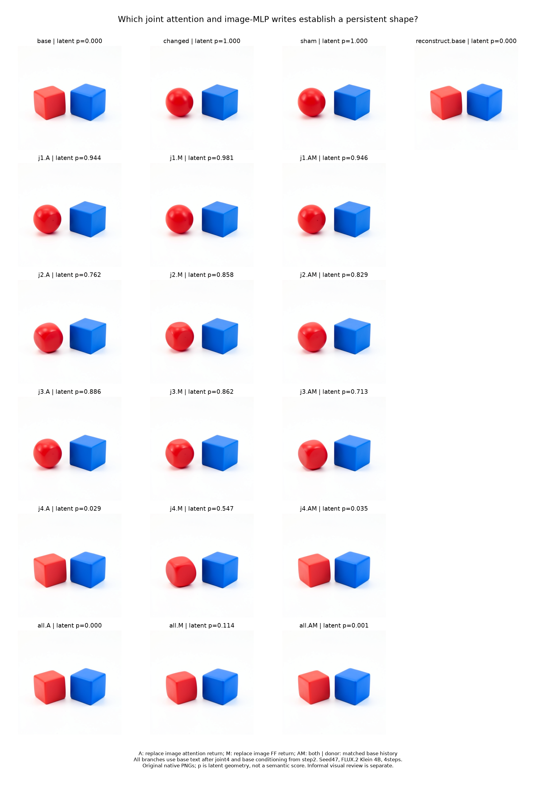
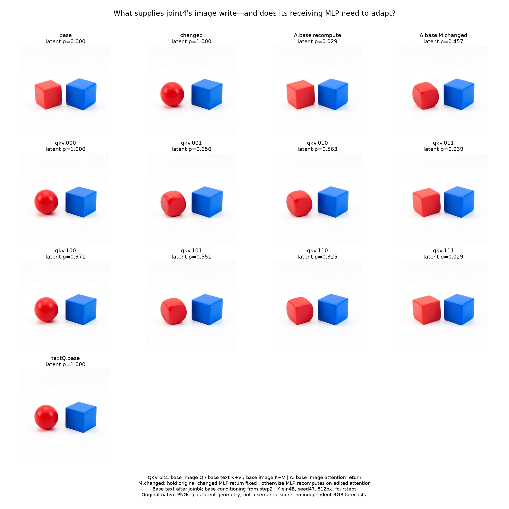

# Attention and MLP writes during the second-step shape handoff

This assay moves inward from the [shape handoff](FLUX-SHAPE-HANDOFF.md): which image attention and image MLP outputs in joint blocks1–4 help establish the state that later renders a sphere? The complementary [single4 operand assay](FLUX-SHAPE-WRITER.md) tests a later receiving-state boundary.

**Observed result:** joint4's image attention return is the strongest individual intervention site in this panel. Restoring it turns the final red sphere into a cube-like object. Restoring joint4's MLP output alone produces mixed rounded/faceted geometry; restoring MLP outputs across all four blocks produces a cube-like object. Thus the evidence supports a strong local attention contribution plus a distributed MLP contribution, under the declared text-disposal condition.



## Completed observations

Job `job-3319beda6ea6` completed nineteen native images,1558 adapter transitions,71 typed Acts and40 direct candidate-block calls, including eight source parity checks. It used one model load and zero prompt encodings. Peak RSS was3208.7MB and VRAM9480MB; native work through the result summary took547.17s.

The table reports final latent p beside a separate informal visual inspection. A means restoring the base image attention return; M restores the base image FF return. The recipient residual and declared state closure remain in place. The receiving MLP recomputes when A changes.

| Edited joint block | A: p / red shape | M: p / red shape | AM: p / red shape |
|---|---|---|---|
| 1 | .943586 / rounded, faceted | .981161 / sphere | .946383 / rounded, faceted |
| 2 | .762268 / rounded, faceted | .858378 / rounded, faceted | .829245 / rounded, faceted |
| 3 | .886187 / rounded, faceted | .861527 / rounded, faceted | .712533 / rounded, faceted |
| 4 | **.029466 / cube-like** | .547278 / mixed rounded, faceted | **.034953 / cube-like** |
| All four | .000266 / cube-like | **.113952 / cube-like** | .000968 / cube-like |

The changed reference is a red sphere at p1; base is cube-like at p0. Every inspected row retains red-left/blue-right ordering and a blue cube. Pose, size, spacing, gloss and curvature change. These labels are unblinded assistant inspection, with mixed shapes retained rather than forced into a binary category.

Three observations matter for the mechanism map:

- **Local attention handle:** the joint4 A restoration removes the clean sphere even though changed text participated throughout joint1–4. Individual A restorations at joint1–3 do not produce the same clear cube-like outcome.
- **MLP contribution across depth:** no individual M restoration produces as clear a cube-like outcome as restoring all four M outputs. This is evidence for a distributed conditional contribution; it is not a proof that every MLP is individually necessary.
- **Interactions are not monotonic:** at joint2, AM ends at p.829 versus A at.762. Adding the base MLP return partially opposes the baseward attention effect in this descriptive coordinate. At joint3 the combined edit moves farther baseward than either individual edit. These are effects of the whole native continuation, not evidence that the local residual additions themselves are nonlinear.

The frozen numerical rank `p(all.A) < p(all.M)` was supported. The tentative prediction that `all.M` would retain a sphere was **wrong**: it rendered a rounded cube-like object. No categorical per-block prediction was frozen. Historical outcomes informed site selection and controls; these nineteen dependent futures are not nineteen independent prediction tests.

All four exact controls were observed: base and changed PNGs match their historical references, the sham matches changed at every retained scheduler state and final pixels, and initial-base-image plus all base A/M returns reconstructs the complete base future exactly. The model-free audit checks all eight source and32 edited local equations, all typed closures, and every complete branch lineage. Canonical evidence run and verify both returned0 over nineteen derived rows; this qualifies custody/tool execution rather than certifying semantic labels.

**The initial panel left attention versus its receiving MLP unresolved.** The j4 A edit also changes the newly computed MLP return: its L2 difference is1358.445, or.198284 relative to the unedited MLP return's norm. This measures local dependence, not a semantic or mediation percentage. It motivated restoring base A while holding the MLP return fixed to the original changed return, followed by query/key/value source decomposition. The completed follow-up below makes those comparisons.

## Publication failure and recovery

The scheduler correctly records this job as **failed**: after all scientific outputs and the closed forecast transaction were written, the final compressed log archive exceeded its512MiB cap. The immutable result directory was recovered over authenticated SSH, without a model call. Its manifest, summary and prediction seal were pinned before copying and checked again afterwards. The audit verifies every recovered file against that manifest, the original request and staged source hashes, closed forecast transaction and original failed-job log. No successful scheduler report or archive marker was manufactured.

The raw result manifest SHA is `e68bbdd6ffa98b99a4e4a309429280d8e9156f44139459eb6b41f3c429caa5f8`; independent audit SHA is `158a1a5e52540f928326c16570f94dfbd86f101637380a26b47c72e139212e7e`. The evidence pack records the separate failed publication and valid recovered mechanics. The existing `mdb-payload-outbox-results` request received this measured failure and an upvote; large port/CAS captures need durable artifact publication beyond a single inline log archive.

Full local evidence is under `artifacts/mdb-flux-joint-writes-20261103/`: raw recovered run, pinned auditor snapshots, visual review, signed summary, curated computation record, original-image figure and canonical evidence sweep. Computation ID `flux.shape.step1.joint1-4.seed47` is a standalone curated record; automatic atlas ingestion remains unfinished.

## Specimen and causal comparison

The specimen is distilled FLUX.2 Klein4B, CUDA BF16, physical batch1, seed47, 512×512, four denoising steps. Checkpoint inventory SHA is `dd976d67036c4a0a55642f702dcb3740ba7a4f367557596572baac168330904f`.

The original prompts are:

```text
A red cube to the left of a blue sphere on a plain white background. Two separate objects, simple studio product photograph.

A red sphere to the left of a blue cube on a plain white background. Two separate objects, simple studio product photograph.
```

The experiment reuses two audited step1 after-joint0 StateCuts from `job-6a6fcb685a20`. Their working image, working text and stored conditioning differ; latent, modulation, positions, schedule and other nuisance state match. They derive from the preceding equal-latent preprojection comparison. The encoder is not run again.

Each branch replaces selected actual image attention returns, image MLP returns, or both with values from the matched base history. The panel includes each joint block1–4 separately, three coalitions spanning all four blocks, two references, a changed-output sham, and an exact reconstruction control: nineteen dependent native futures.

After joint4, every branch receives the same base working text. Before step2 projection, every branch receives the same base stored conditioning. The experiment therefore tests the sufficiency of the edited image state under that common future. Changed text can still participate and receive image feedback between edited joint blocks; this is part of the measured native path.

## The actual sequential computation

For each joint block, the image update is:

```text
A = joint_attention(modulate(norm1(I)), modulate(norm1_text(T))).image_return
U = BF16(I + BF16(gA * A))
M = image_FF(modulate(norm2(U)))
I_next = BF16(U + BF16(gM * M))
```

The attention return includes its native output projection. The two gates come from the shared timestep modulation. `image_FF` is the complete image feed-forward module. The text stream has its own attention return and feed-forward update.

An A substitution changes U and therefore changes the MLP input and its newly computed output. An M substitution leaves the current attention computation intact. AM supplies both observed base returns while retaining the branch's incoming image residual. These are different counterfactual questions; the joint block is sequential, unlike the later single-block parallel merge.

## Truthful execution and custody

The [port helper](../qualification/flux_joint_writes.py) uses scoped hooks for an explicitly counted, direct candidate-block calculation. Hooks are removed before adapter continuation. The worker then executes the original native block and installs the candidate image with a typed image-only Act. Thus an edited calculation is never mislabeled as an unmodified native receipt. Current post-block text must exactly match that native block's text; every nonwritten slot must remain identical.

Eight direct source-block calculations must match the actual adapter results exactly. The independent auditor checks native and edited sequential BF16 equations from saved ports, typed replacement closure, complete receipt paths, the shared text disposal and later conditioning reset, scheduler arrays2–4 and native PNGs. It runs no model, attention kernel, MLP or VAE. The retained native ports remain measured evidence, rather than independently predicted module outputs.

The frozen hypotheses predict an attention-versus-MLP coalition rank and tentative coalition shapes. Per-block outcomes are exploratory. Historical reference and sham joins qualify the instrument. These are causal intervention predictions, not independent numerical RGB forecasts.

## Reproduce the workflow

The [submitter](../qualification/submit_flux_joint_writes.py) verifies source custody, stages installed public packages and submits one finite mrun CUDA lease with strict preflight and no retries. The nineteen futures share one model load. Use the fleet's configured worker cache/model roots, and provide the workspace scheduler URL:

```sh
MRUN_URL=http://192.168.68.68:9025 \
MDB_WORKER_UV_CACHE_DIR=/mnt/hdd8tb/mdb/uv-cache \
MDB_WORKER_TORCH_HOME=/mnt/hdd8tb/mdb/torch \
MDB_WORKER_MODEL_ROOTS=/mnt/big/llm-models \
python qualification/submit_flux_joint_writes.py NEW_RUN \
  --predecessor AUDITED_SHAPE_HANDOFF_RUN

python qualification/submit_flux_joint_writes.py NEW_RUN --collect JOB_ID
python qualification/analyze_flux_joint_writes.py NEW_RUN NEW_RUN/analysis-v1.json
python qualification/publish_flux_joint_writes.py NEW_RUN NEW_FIGURE_DIRECTORY
```

Run these qualification commands in the installed public MDB environment. The native experiment belongs on mrun. The publisher plots only checksum-verified native PNGs; no image generator supplies scientific pixels.

Four installed-package tiny-model tests qualify native parity, self substitution, the attention-to-MLP dependency, scoped hooks, typed image installation and exact future reconstruction. The real specimen and final observations require the completed campaign's separate audit.

## Interpretation boundaries

Final latent p is the signed coordinate along base→changed, with base0 and changed1. It is descriptive geometry, not a percentage of sphere, a calibrated semantic score or a universal route identifier. Informal visual labels must be reported separately and retain mixed shapes and collateral changes.

An effective output substitution identifies a conditional full-field write contribution. It does not alone prove a minimal writer, a concept-selective neuron, an object mask or an operation that generalizes across seeds. No amplitude ranking independently establishes semantic responsibility. The next causal cut should follow the strongest native outcome, including unexpected and opposing effects.

## Hints recovered from earlier image-editing research

A November3 review of the workspace's earlier FLUX image-editing experiments found substantial precedents for this mechanism. They strengthen the experimental design; they do not transfer old head numbers, token rows, checkpoint contracts or semantic labels into this specimen automatically. This review ran no model.

**Attention writes, then the image MLP transforms the receiving state.** The August27 operation-boundary assay (`job-ac54c5774e8b`) isolated the projected image-attention output at joint1 as the first cross-stream writer in its controlled text-only contrast. Reciprocal attention swaps closed the local transition; FF swaps were partial. Later blocks repeatedly repaired or rewrote the result. Findings and worker hooks remain in `saturn/experiments/2026-08-27-flux-rosetta-operation-writer-boundary/`; the machine summary and native proof sheet remain in `obsidian/artifacts/flux-rosetta-operation-writer-boundary-2026-08-27/`.

**The eye-editing series separated contextual binding from the token-local transform.** In `job-be4518fdf2e5`, replacing the face-union image state made the tested eye MLP branch target-like (projection1), while changing the top64 contextual text rows alone left that image MLP branch unchanged (projection0). Attention responded to both. This was a parallel single0 block, whereas our joint4 MLP runs after attention: text can therefore change our MLP indirectly through attention's updated image state. The archived receiver factorial (`job-918c750d16a4`) also found that updates alone did not reproduce the sender future; compatible carried text and image state mattered. The findings are in `saturn/experiments/2026-08-27-flux-rosetta-kv-head-token-coalition/FINDINGS-POPULATION-GEOMETRY-CHART.md`, with retained machine summaries under the corresponding `saturn/results/` job paths.

**Text K/V is an established source hypothesis, not the presumed answer here.** The August27 K/V assay (`job-58c31a4e02db`) exactly reconstructed its local image write with text K+V while image Q/K/V were equal across the compared parents. The retained copied report is `obsidian/artifacts/flux-rosetta-attention-address-payload-2026-08-27/report.json`. September's Puppeteer report (`saturn/results/flux2-puppeteer-attention-source/job-8115cbae11ad/report.json`) independently records exact first-call image-attention and block-image joins from action text K/V, and a same-call text-Q null. Current joint4 parents already differ in image state, so we must separate image Q, text K/V and image K/V rather than assume text-only causation.

**A late influential site need not be the birthplace of the program.** Puppeteer's first correct attention write could be overwritten, and a removed first write could be repaired downstream. Its cumulative writer assay reported an action-enabling joint0–2 coalition rather than one uniquely necessary block (`FINDINGS_WRITERS.md` in `saturn/experiments/2026-09-19-flux2-puppeteer-carrier-origin/`). The earlier eye-depth experiments likewise found increasing carried-register authority across denoising time. Our joint4 result is a strong intervention handle under text disposal immediately after joint4, not proof that joint4 first creates shape information. A matched text-disposal timing control would test whether this protocol makes the final joint writer unusually influential.

**Attribute payload and object assignment require a crossed test.** The recipient-local editing analysis (`saturn/experiments/2026-09-01-flux-apple-edit-dynamic-circuit-lens/FINDINGS.md`) records a green-change payload editing opposite objects when crossed between two independently resolved prompt-local row addresses. The eye color×shape series found shared head populations but different contextual source rows, plus a causally consumed conjunction residual `I = joint - color - shape + base`. These observations motivate separate tests for “which attribute” and “which object,” including a four-parent shape-assignment square and wrong-address controls. Our current whole-field shape swap does not establish such binding.

The review proposed the following panel; items1–3 are now executed in the follow-up below, while object-selective binding remains open:

1. Restore base joint4 attention while holding the image MLP return fixed to its original changed value, versus the already observed recomputed-MLP arm.
2. Split the effective attention source into image Q, text K/V and image K/V at exact native ports; preserve paired K/V and position/clock identity.
3. Include a text-Q-only control. Under this assay's immediate common-text clamp, it should leave the current image and complete later future unchanged. This is a proposed architecture prediction, not an executed result.
4. After source localization, cross object address and shape payload, retain the scheduler-latent parent, and measure any non-additive interaction through the native RGB consumer.

For record naming, the useful object is a conditional contract such as `(source ports, recipient address/state, block, timestep, operator, consumer)`. An address key, its tensor payload, the mathematical operator and the inferred visual function should remain separate fields. The older results supply a reusable experimental vocabulary; the new seed47 joint4 evidence supplies a new state-specific instance.

Historical custody boundary: this review reads retained findings, worker source, machine summaries and the copied K/V report. Several old original result reports and PNG paths are offloaded or absent locally; it does not claim to have freshly requalified every old run. The current nineteen-future assay retains its own complete independent audit and raw result recovery.

## Completed joint4 source and MLP-response follow-up

**The attention edit partly works through the same block's MLP response, and both text and image K/V contribute to the strong source restoration.** A new thirteen-future assay, `job-a48af8c441f0`, completed successfully under the same checkpoint, seed47, CUDA BF16512px four-step profile and common text/conditioning clamps. It reused the two audited joint4-entry cuts; no prompt encoding ran. The new native predictions were sealed before the selected-block observations and new RGB continuations.



### Holding the MLP return fixed changes the result

The original changed incoming image state is I. Its native image attention return is A_C and its native image MLP return is M_C. For the attention replacement A_B, the two compared calculations are:

```text
U = I + gA * A_B
live:   I_next = U + gM * FF(modulate(norm2(U)))
locked: I_next = U + gM * M_C
```

Both use exactly the same incoming residual, attention return, gates and later source resets. Only the installed image MLP return differs. The worker and independent auditor preserve the native BF16 multiplication/addition rounding at each operation.

| Intervention | Final latent p | Informal red-object observation |
|---|---:|---|
| Native changed | 1.000000 | Sphere |
| Base A, MLP recomputes | .029466 | Clear cube-like object |
| Base A, original changed MLP return held fixed | .456599 | Mixed rounded/faceted object |

The frozen prediction that the locked-MLP arm would still give a cube-like object is not supported as a clean categorical flip. Its flat top/front and curved sides remain explicitly mixed. Attention still has a substantial effect with the MLP return locked, so this is not complete mediation. The recomputed MLP return contributes a further baseward shift under this attention intervention; the p difference is not a mediated semantic percentage. Later native MLPs remain live in both branches.

### Separating positioned Q/K/V sources

The native image attention read has the form

```text
A_I = W_out [softmax(Q_I [K_T; K_I]^T / sqrt(head_width)) [V_T; V_I]]
```

Q and K here have already received native normalization and rotary position encoding. T denotes text rows and I denotes image rows. The full eight-way factorial chooses base versus changed sources for image Q, text K+V and image K+V. Each substituted K/V pair retains its row/position correspondence. The same native dispatch, head geometry and output projection run in the direct candidate block. No separately implemented attention approximation is substituted.

| Mask: image Q / text KV / image KV | Final latent p | Informal red-object observation |
|---|---:|---|
| 000 | 1.000000 | Sphere; exact changed future |
| 001 | .649661 | Mixed rounded/faceted |
| 010 | .563382 | Mixed rounded/faceted |
| 011 | **.039345** | **Clear cube-like** |
| 100 | .971240 | Sphere-like |
| 101 | .551098 | Mixed rounded/faceted |
| 110 | .324973 | Rounded cube-like/mixed; uncertainty retained |
| 111 | .029466 | Clear cube-like; exact attention-output replacement future |

Under unchanged recipient image queries, restoring either K/V bank alone gives a mixed object; restoring both gives a clear cube-like object. Image Q alone has little baseward effect, but it strengthens text-KV restoration conditionally: p110=.325 versus p100=.971 and p010=.563. The evidence therefore supports interacting sources rather than an attention result owned exclusively by the current text or a query-only route.

Both frozen numerical rank predictions were supported: text-KV restoration was more baseward than image-KV restoration, and image-Q plus text-KV restoration was more baseward than either alone. The other factorial outcomes were exploratory. All per-row values, including signed inclusion-exclusion coefficients, remain in the audit; they describe nonlinear native-future geometry rather than additive semantic fractions.

This extends the older editing precedent. Its text-only first-write comparisons held image Q/K/V equal; our later joint4 parents already contain different image state. The old text-KV source result therefore supplied a hypothesis and instrument design, while the current assay reveals the additional image-KV contribution in this state.

### Exact controls, custody and cost

All seven named exact observations held:

- Base, changed and the recomputed-MLP attention arm reproduce their three historical PNGs.
- Mask000 reproduces changed scheduler arrays2–4 and final pixels.
- Mask111 reproduces the direct attention-output replacement scheduler arrays and final pixels; its computed image-attention return also equals the base source exactly.
- Text-Q-only replacement leaves the current image and complete common-text-clamped future exact to changed. Candidate text returns are deliberately disposed of at joint4 exit; this is not a claim that text queries are irrelevant to unmodified later text consumers.

The [source helper](../qualification/flux_joint_sources.py) wraps the native dispatcher only inside serialized candidate-block calculations, then restores it before any adapter continuation. The [worker](../qualification/flux_joint_sources_campaign.py) records those calculations separately and installs the image through a typed Act; the common base text clamp immediately follows. The [offline auditor](../qualification/analyze_flux_joint_sources.py) verifies positioned-QKV selection from retained source arrays, native/candidate sequential equations, complete Act closure and native receipt paths, scheduler arrays and PNG custody. It does not recompute attention, FF weights or RGB independently.

The job used one model load,13 candidate-block calls,1027 adapter transitions,37 Acts,1064 receipt emissions and13 native images. Worker time through summary was273.81s; scheduler elapsed323.22s. Peak RSS3227.9MB and VRAM9430MB remained within the calibrated reservation. Seven installed-package tiny-model tests pass. Removing duplicated candidate image arrays reduced the complete raw result to336,478,198 bytes, allowing normal publication and collection without SSH recovery.

Archive SHA: `e5a4af06dfd5d690c2b6ca4ab2619059f2cc241eefe4c2b13b22b5df998c28f9`. Local evidence lives in `artifacts/mdb-flux-joint-sources-20261103/`, including pinned auditor sources, full raw results, informal visual review, signed summaries and the standalone curated record `flux.shape.joint4.source-factorial.seed47`. Automatic atlas ingestion remains unfinished.

### What the next cut should distinguish

The bounded mechanism map is now `live image queries + contextual-text KV + image-state KV → attention image write → receiving-state MLP transform → residual → native future`. It does not identify which K versus V entries, heads, contextual rows or object recipients are minimal. The text-disposal timing is also an applicability condition, not a neutral guarantee that joint4 is naturally dominant.

The next small experiment should split K from V across the two banks, with the image query held live, then test the effective source on a second matched state. Object-specific naming needs a crossed object-address × shape-payload panel with collateral and interaction retained. These experiments can test whether the same source-role contract recurs while the actual addresses move; the current results do not establish a universal sphere/cube opcode.
