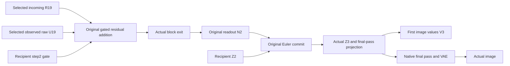

# Following the flow upstream through the final block

The [commit factorial](FLUX-COMMIT-FACTORIAL.md) found that the current flow N2 had a larger signed alignment than the incoming persistent latent Z2 with the tested final-image contrast. This experiment asks where that flow contrast comes from. At the third pass's final single block, does it arrive in the residual, or get produced by that block's new write?

The bounded result: most of this contrast arrives in the incoming residual. All80 sealed local-to-value forecast archives match actual execution byte for byte, and16 native image futures show a much larger residual-only response than write-only response. This does not make the last block irrelevant or identify the earlier writer.

## Specimen and operands

Original FLUX.2 Klein4B distilled, CUDA BF16, batch1,512×512, four passes, seed241. Four recipients cross green/yellow assignment and cone/cylinder order. One prompt is:

> Studio photograph on white: a yellow cylinder stands to the right of a green cone. Show both objects separately.

The source changes green/yellow assignment and preserves layout wording. Each recipient reuses its original initial noise and conditioning. These are four dependent recipients from one seed, not four independent samples.

Let R19 be the combined text/image residual entering step2/single19. Let U19 be the actual raw return of `single_transformer_blocks[19].attn.to_out`, which fuses the attention and activated MLP branches through one output projection. It is not an MLP-only write. The original block computes:

```python
Y19 = R19 + gate2 * U19
N2 = proj_out(norm_out(Y19[:, 512:], temb2))
product = (sigmas[3] - sigmas[2]) * N2
Z3 = (Z2.float() + product).to(N2.dtype)
I3 = x_embedder(Z3)
V3 = to_v((1 + scale3) * norm1(I3) + shift3)
```

This notation stands for the original ordered finite operations. Multiplication and addition round in BF16 at the residual write. The qualified commit rounds the scalar delta and product before FP32 addition and final BF16 cast. Step2's gate, step2's readout conditioning and step3's value modulation are separate known clock inputs. The original checkpoint supplies every learned weight; no response parameters are fitted.

Cross R and U independently between own0 and source1. All four corners retain recipient Z2, gate, readout conditioning, schedule and remaining closure. Both text and image parts of R are replaced. U is clamped independently of that chosen R; this is a factorial intervention, not a claim that every crossed pair is a naturally generated state.



## What MDB executes and seals

One resident model honestly replays four84-operation prefixes. Each source records actual R/U, the final block exit, N2 and Z3. This includes natural endpoint computation; it is not a forecast from an unseen prefix. The two crossed R/U pairs per recipient are new targets.

`ForecastTransaction` freezes the source descriptors, qualitative hypotheses and16 complete Y/N/Z/I/V predictions before any added target. Forecasts use original readout, normalization and projection primitives, with a module guard and explicit call census. No full transformer block or attention dispatcher runs during forecasting. Thus the forecast is conditional on observed R/U and known clocks, and shares learned primitives with the target. Only the addition and commit also receive an independent saved NumPy arithmetic check.

Each target uses `Session.from_cut` and `NativeCutNavigator`, applies two real typed `Act.replace` operations to image/text R, and executes the original block. A campaign-local return hook records the U that this selected R naturally computes, then installs the declared raw U exactly once. The original block applies the gate. The hook activates only at this third-pass target block and leaves the final pass untouched. Actual native returns feed every following operation. Predictions are never installed as their own targets.

Each branch advances31 navigation operations through actual readout, commit and the complete final pass, then uses the original VAE. The runner saves actual readout-entry, scheduler-entry and project-entry StateCuts for every branch:48 checkpoint references. Their fingerprints, clock phases and payload descriptors join to the captured trajectories. These are reusable native cuts near compute; a local metadata retrieval alone does not hydrate their complete tensor closure.

Raw U replacement is still an experiment-local hook, not a new first-class writable MDB U address. The generic evidence sweep recognizes the21 timeline rows but no typed scientific receipts/addresses. The dedicated auditor checks the ports, transaction and numerical evidence.

## Results and signed effects

Native job `job-f8a263248838` and saved-only CPU audit `job-58d12da0fa1d` succeed. All80 primary archives are byte-exact:64 unique archives across180,355,072 repeated scalar positions. Independent NumPy residual additions and commits match raw bits16/16 each under the qualified finite profile; a separate matched-predicted-N2 product check is numerically exact16/16. All16 incoming-R, installed-U, naturally computed-U and clock comparisons hold.

All eight historical controls match Z3, final latent and PNG exactly. Own/own is the previous natural future. Source/source reproduces the previous **flow-only** future, because Z2 remains the recipient's; it is not the prior both-source latent future.

For any consumer X, define R=X10−X00, U=X01−X00, D=X11−X00 and J=D−R−U. Signed projections are `<D,R>/||D||²` and `<D,U>/||D||²`. They can be negative or exceed1 and are not causal percentages. RMS, signed green effects and interaction remain separate observations.

| Consumer | Incoming R projection | New U projection | Interaction RMS / total RMS |
|---|---:|---:|---:|
| Final block Y |0.894–0.949 |0.051–0.106 |0.47–0.69% |
| Readout N2 |0.749–0.767 |0.233–0.251 |3.38–4.02% |
| Commit Z3 |0.749–0.767 |0.233–0.251 |4.41–4.97% |
| Next image values V3 |0.769–0.793 |0.199–0.225 |6.20–6.48% |
| Final latent |0.579–0.777 |0.096–0.122 |35.73–55.80% |
| RGB |0.780–0.880 |0.019–0.041 |22.56–38.25% |

Residual-only RGB change is39.25–45.42 levels RMS; write-only is3.39–4.23. On the baseline green masks, residual change is−0.648 to−0.715 and write change−0.0187 to−0.0274. All four frozen predicates—larger residual RGB alignment, larger absolute residual green effect, negative residual green effect and negative write green effect—hold in each recipient. This is16 predicate observations in four dependent contexts, not a universal rule.

The [actual image grid](../../../../artifacts/mdb-flux-last-writer-20261106/native-grid.png) shows the residual-only and both-source corners producing lime intermediate objects, while write-only remains close in appearance to its original green/yellow scene. Baseline masks are color instruments, not object identity annotations. The write still contributes strongly enough to N2/V3 and downstream interaction to require its own explanation: its RGB alignment rises from0.019–0.041 alone to0.120–0.220 after changing the residual. Large later interaction is a measured result of the complete continuation, not attribution to one particular nonlinear module.

The earlier commit result and this result are compatible. N2 matters at the commit; much of the tested N2 contrast was already present in R19. With U19 clamped, only the image rows of the changed R19 can reach N2: readout drops text rows after the final block. This is a direct residual path under the clamp, not complete mediation through an unconstrained last block.

The next high-value producer is therefore single18, which supplies R19. Proposed policy: cross single18's residual/write and let single19 regenerate its own U normally. That measures the complete native producer effect, including R19→U19; its00/11 controls should match the present r0u0/r1u1. If instead testing isolated direct R19 mediation, clamp U19 to the recipient and match11 to current r1u0. These are different assays. The proposed next run chooses the first policy, not an automatic doubled panel; it has not executed. Splitting final U into attention and MLP remains a later question.

## Reproduce and inspect

Use qualified installed wheels outside the checkout. Maintainer source paths are explicit; runtime imports come from installed public MDB/Saturn packages.

```sh
export MRUN_URL=http://192.168.68.68:9025
MDB_PY=/path/to/qualified/bin/python
MDB_QUALIFICATION=/path/to/saturn-pub/packages/mdb/qualification
"$MDB_PY" -I "$MDB_QUALIFICATION/stage_flux_reader_streams.py" RUN \
  --fresh FRESH_NATIVE_RUN --audit FRESH_AUDIT_STUDY \
  --panel last-writer --control-study COMMIT_FACTORIAL_STUDY
"$MDB_PY" -I "$MDB_QUALIFICATION/stage_flux_reader_streams.py" RUN --submit
"$MDB_PY" -I "$MDB_QUALIFICATION/flux_last_writer_audit.py" AUDIT --study RUN
"$MDB_PY" -I "$MDB_QUALIFICATION/flux_last_writer_audit.py" AUDIT --submit
"$MDB_PY" -I "$MDB_QUALIFICATION/recover_flux_directory.py" AUDIT COMPACT
```

The tested stage used the fresh-generalization `run-03` and prior-writer study under `artifacts/`. Each mrun submission is a finite strict-preflight lease with no automatic retries. CUDA requests10GiB RAM,10GiB VRAM,4CPU threads and a180s estimate; do not reduce RAM based only on one sampled successful peak. The6GiB attempt `job-e8f2d590a1e8` was killed during model setup before scientific execution. It remains an operational failure. The corrected worker and experiment source hashes are unchanged.

The successful native job took129.30s including setup,62.49s measured experiment time, peak RSS8,124.3MB and VRAM9,394MB. It executed832 navigation steps,716 native blocks/attention calls,32 typed R Acts,16 raw U transplants and16 images, with zero encodes/new noise draws. Forecasting used64 linear,32 layernorm and16 SiLU calls, plus16 residual/commit calculations. The CPU audit took12.49s including setup, peak RSS802MB, with zero model/learned calls. No inference speedup is claimed.

After collection, these model-free commands verify the seal and query supplied applicability:

```sh
python -I -m mdb forecast verify COMPACT/extracted/binding-minimal-result/transaction \
  --expected-seal d61f50d621360dfc279ec46dbdb89823e9d785f84a2d32f42a6902a725dbd8f6
python -I -m mdb equations find --catalog STUDY/index-v1/equations \
  --applicable-to STUDY/index-v1/context-order.json
python -I -m mdb equations find --catalog STUDY/index-v1/equations \
  --applicable-to STUDY/index-v1/context-wrong-horizon.json
python -I COMPACT/extracted/binding-minimal-result/retrieve_evidence.py \
  controls source-operands.json RETRIEVED
```

The first context returns one order record; the changed horizon returns none. The252-record index contains232 earlier entries,16 new numerical occurrences and four new frozen-order records, retaining all eight prior carry-order counterexamples. All252 supplied-context lookups and252 changed-context abstentions were checked. Applicability conditions are supplied, not automatically induced families.

Full native evidence is531,690,321 bytes near Beast; compact transport is3,450,408 bytes. Each run retains169 original-parameter retrieval recipes and `retrieve_weights.py` rather than a copied weight bank. The checksum-bound evidence retriever accepts native, reader and historical controls. Actual retrieval of a historical schedule and a new branch's project StateCut metadata is qualified. Full remote arrays/CAS blobs remain required for hydrated replay.

Code: [runner](../qualification/flux_last_writer.py), [auditor](../qualification/flux_last_writer_audit.py), [stager](../qualification/stage_flux_reader_streams.py), [mechanics checks](../tests/test_flux_last_writer.py). Evidence: [audit](../../../../artifacts/mdb-flux-last-writer-20261106/compact-collection-01/extracted/binding-minimal-result/audit.json), [signed summary](../../../../artifacts/mdb-flux-last-writer-20261106/signed-summary.json), [index](../../../../artifacts/mdb-flux-last-writer-20261106/index-v1/provenance.json), [Astra's review](../../../../artifacts/mdb-flux-last-writer-20261106/advice/result-review.md). Four new isolated mechanics tests and23 related focused tests pass. Scientific trends remain distinct from mechanics, supplied lookup and terminal claims.
