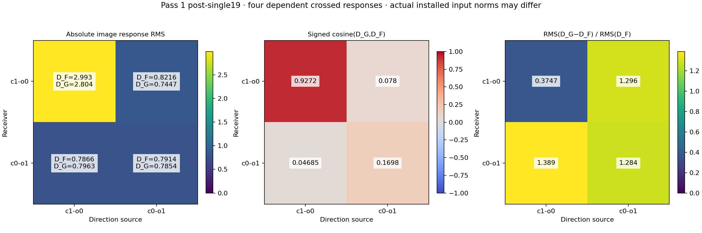
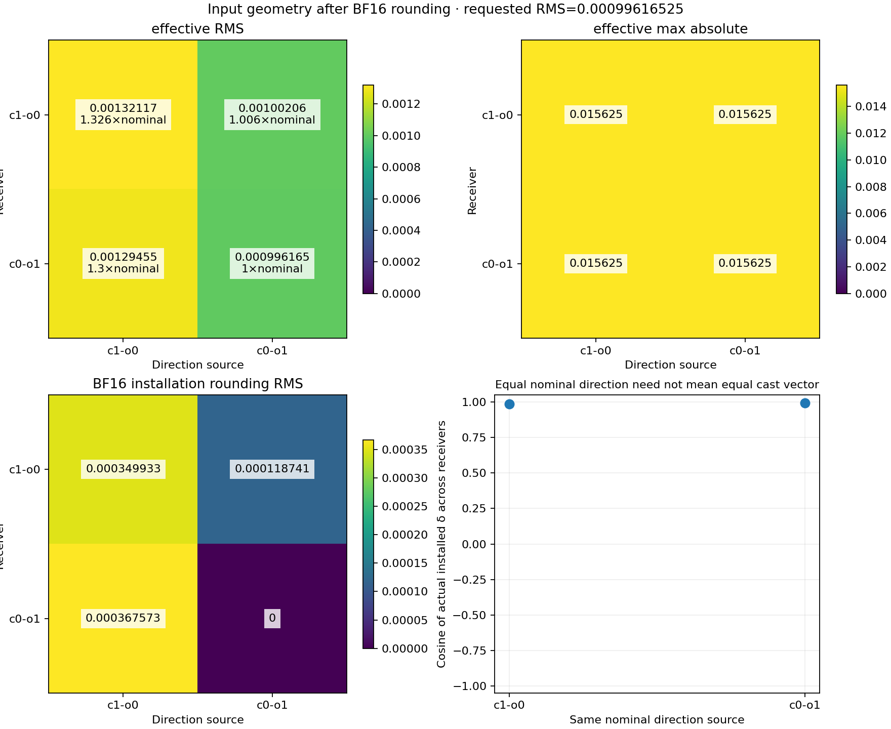
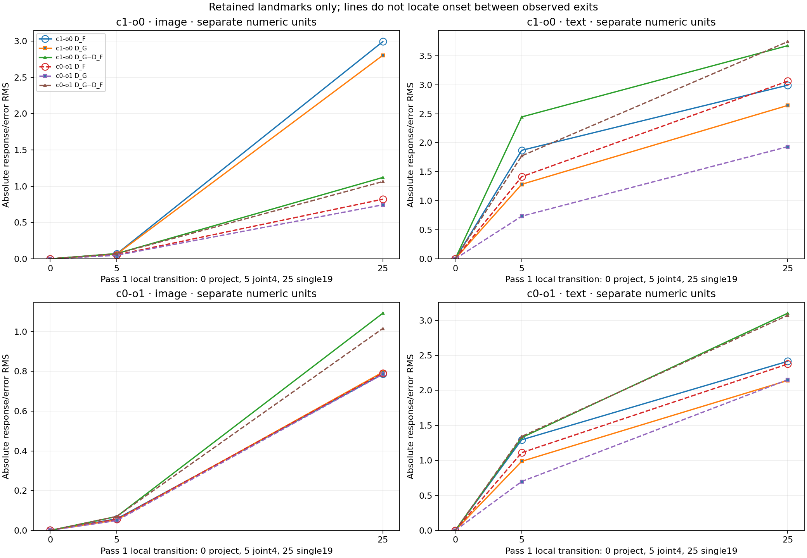
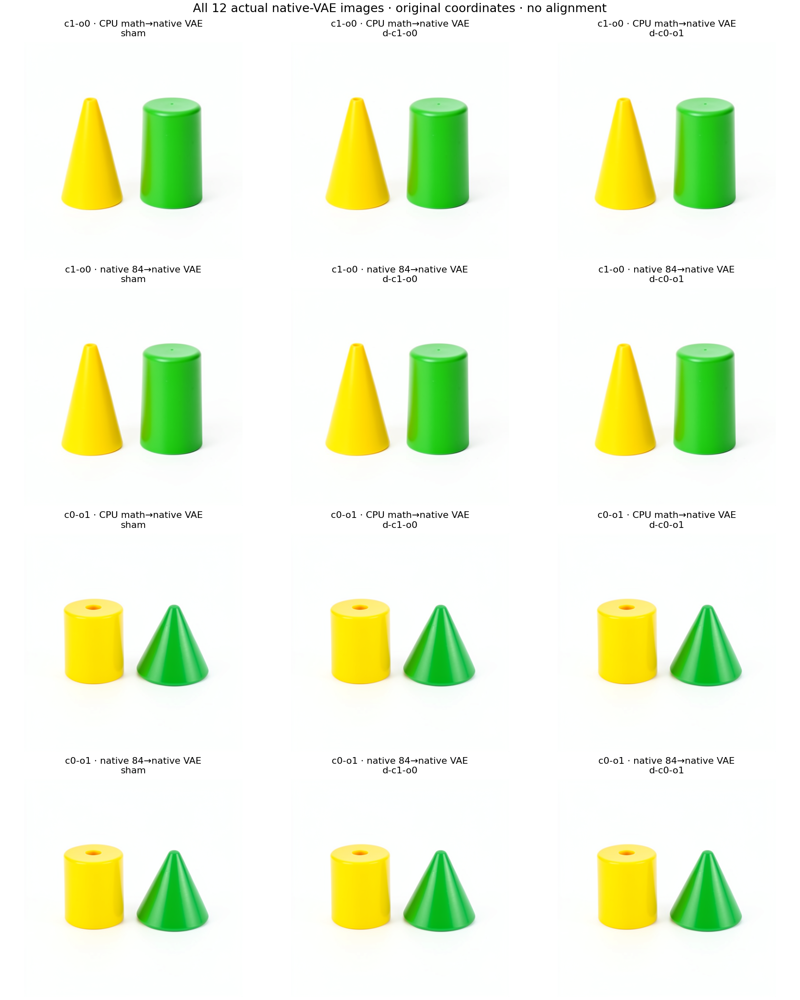
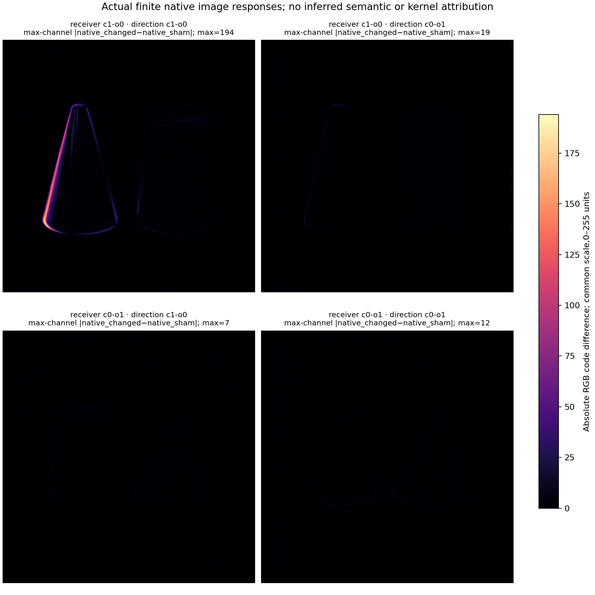

# Crossing receiver states and latent directions

The crossed native experiment finds a large response for one receiver–direction
pairing. Its forecast captures that effect substantially better than the three
smaller effects: post-single19 image response error is 37.47% versus
128–139%. Close final images do not establish accurate small-effect prediction.

This experiment probes dependence on a receiving diffusion state and on an
incoming numerical error direction. It follows the
[native-corner continuation](FLUX-NATIVE-CORNER.md), using the same distilled
FLUX.2 Klein4B checkpoint,512px geometry, four-step schedule and two selected
seed127 contexts. It starts at native N1, before the second diffusion pass,
and predicts all three remaining passes from each constructed input.

## The crossed inputs

Let r choose the receiving context and d choose one of two observed input
discrepancies. Each receiver retains its original conditioning, position IDs,
schedule, execution clock and reset working fields. Only latent changes.

\[
\delta_d=P_{1,d}-N_{1,d},\quad
\rho=\min_d\operatorname{RMS}(\delta_d),\quad
X_{rd}=Q_{\rm BF16}\!\left(\operatorname{FP32}\left[
N_{1,r}+\frac{\rho}{\operatorname{RMS}(\delta_d)}\delta_d\right]\right).
\]

Scaling and addition use FP64 before the one FP32-to-BF16 installation cast.
There is no post-round dose tuning. The common requested RMS is
0.0009961652487912127, derived from source arrays before new outcomes.

| Receiver | Branches |
|---|---|
| c1-o0, yellow cone left | sham, d-c1-o0, d-c0-o1 |
| c0-o1, green cone right | sham, d-c1-o0, d-c0-o1 |

The receiver owns the complete13-slot StateCut: latent, conditioning, img_ids,
txt_ids, timesteps, sigmas, step, phase, cursor, context, image, text and
noise_prediction. Model parameters remain frozen. A direction supplies none
of the other context's conditioning or later working registers.

These are known selected sources, not new seeds. The c0-o1 own-direction
unit-scale input repeats its already observed P1 as a positive control; three
other edited inputs are newly constructed. Each original P1 is independently
recovered by adding its unscaled discrepancy to its own N1.

## BF16 changes the effective dose

The requested input RMS is common, but the installed changes are not equal:

| Receiver | c1-o0 direction RMS | c0-o1 direction RMS |
|---|---:|---:|
| c1-o0 | 0.0013211654 | 0.0010020614 |
| c0-o1 | 0.0012945512 | 0.0009961652 |

These are source-only input observations, independently reproduced with an
installed Torch BF16 cast against the producer's NumPy rounding routine.
All six installed inputs match. The larger-direction change is about30%
above the nominal target because quantization preserves many whole BF16
increments. No native response is used to select or adjust these inputs.

Report the actual RMS, changed support, source-direction cosine and
cross-receiver input cosine. Dividing an output RMS by actual input RMS is
a finite amplitude normalization. It does not remove differences in direction
or support, establish linearity or isolate pure receiver sensitivity.

## Predict and seal before consuming

The CPU campaign uses the original frozen mathematical equations and named
checkpoint parameters. Six independent84-transition programs include two
mathematical shams, which are essential for predicting the responses:

\[
\Delta G_{rd}=G_r(X_{rd})-G_r(N_{1,r}),\qquad
\Delta F_{rd}=F_r(X_{rd})-F_r(N_{1,r}).
\]

Each later mathematical pass consumes its own preceding predicted latent;
native intermediate states do not enter the recurrence. All504 mathematical
transitions, input manifests, retained landmark arrays and final latents seal
before a separate CUDA lease. A qualified FP32 read-only parameter cache keeps
the numerical program unchanged. Its temporary weight files are removed after
verification;169 recipes and a standalone retriever remain.

In CUDA, both receiver ForecastTransactions seal before any consumer. Six
qualified terminal derivations and Acts render the mathematical final latents
through the actual native VAE at zero native denoising steps. Then six exact
input Acts start six native84-transition suffixes and six more VAE decodes.
The physical census is one pipeline load,504 native transitions,12 Acts,
516 receipt occurrences and12 actual PNGs. Rendering scaffolds are metadata,
with zero native steps and zero execution receipts of their own.

Native branches use B1 sequential execution under one lease. There are no new
encodes, noise draws or mathematical recurrences in the CUDA worker. Each
branch retains full cuts at second-pass project, post-joint4, post-single19,
readout and commit, then commits of the final two passes:42 full native
landmarks. Other462 native exits retain manifests, complete field hashes,
receipts, moments and fixed witnesses.

## Read the responses and interactions

For each retained field, preserve signed vectors, absolute RMS, cosine and

\[
e_{rd}=\frac{\operatorname{RMS}(\Delta G_{rd}-\Delta F_{rd})}
{\operatorname{RMS}(\Delta F_{rd})}.
\]

Zero native response makes the relative error undefined. Complete endpoint
forecast errors remain separate: a close final image can coexist with a poor
changed-minus-sham response prediction.

For h=c1-o0 and l=c0-o1, retain the raw-coordinate interaction

\[
I_F=\Delta F_{hh}-\Delta F_{hl}-\Delta F_{lh}+\Delta F_{ll}.
\]

The analyzer also retains conditional receiver contrasts, conditional
direction contrasts, each contrast's prediction error and cosine, and the
corresponding mathematical interaction. These are vector accounts in shared
model coordinates. Text row positions are not asserted lexical alignments;
none of these directions is named as color, object identity or placement.

The frozen qualitative conjectures are zero projection responses in fields
independent of latent, higher normalized final-image-register response in the
previously higher-error receiver under both directions, and positive
mathematical/native response alignment in all four corners. Their misses remain
evidence. No scalar accuracy or cosine threshold stops discovery.

The saved-only analyzer independently reconstructs installed inputs from
authenticated original P1/N1 arrays; joins sealed input tensors to actual
entry Acts and unchanged receiver closure; checks native receipt chains and
all516 occurrences; and joins sealed final latents to actual VAE cuts. These
checks validate the instrument and operands. They do not independently repeat
all504 learned-weight mathematical transitions.

## Reproduce through public installed runtimes

Use installed public runtime wheels for evidence checking. Local saved-only
commands require NumPy, Torch and Matplotlib; the control verifier and indexer
currently load the shared publisher, which imports Matplotlib. Adding plotting
dependencies does not change the separately pinned mrun worker environments.

```sh
python qualification/submit_flux_latent_direction_cross.py MATH \
  --parent ORIGINAL_GPU_RUN --audit ACCEPTED_AUDIT \
  --expectations EXPECTATIONS_JSON
# Save the independent request-bound review at MATH/long-run-review-final.json.
python qualification/submit_flux_latent_direction_cross.py MATH --submit
python qualification/submit_flux_latent_direction_cross.py MATH --collect

python qualification/submit_flux_latent_direction_native.py NATIVE \
  --parent ORIGINAL_GPU_RUN --math-run MATH --audit ACCEPTED_AUDIT
# Save the independent request-bound review at NATIVE/long-run-review-final.json.
python qualification/submit_flux_latent_direction_native.py NATIVE --submit
python qualification/submit_flux_latent_direction_native.py NATIVE --collect

python qualification/verify_flux_latent_direction_controls.py \
  --cpu-run MATH --parent ORIGINAL_GPU_RUN --matched-run MATCHED_Q_RUN \
  --native-run NATIVE --prior-native-run PRIOR_NATIVE_CORNER \
  --out FRESH_CONTROL_REPORT
python qualification/analyze_flux_latent_direction_cross.py \
  --run NATIVE --math-run MATH --parent ORIGINAL_GPU_RUN \
  --audit ACCEPTED_AUDIT --out FRESH_ANALYSIS
python qualification/publish_flux_latent_direction_cross.py \
  --run NATIVE --math-run MATH --analysis FRESH_ANALYSIS \
  --out FRESH_PUBLICATION
python qualification/index_flux_latent_direction_cross.py \
  --run NATIVE --math-run MATH --parent ORIGINAL_GPU_RUN \
  --analysis FRESH_ANALYSIS --out FRESH_INDEX
```

The CPU launcher creates a sibling `.source-stage-v1` directory only to reuse
qualified source acquisition. It is staging metadata, never another model job.
Strict preflight, one finite lease per phase, original checkpoint/runtime
identity, actual scheduler logs and matching before/after/local inventories
protect execution. Source-bound reviews are tool qualification, not user
approval prompts. No automatic retries are used.

The saved-only control verifier checks all 84 transitions of the repeated
c0-o1 own-direction mathematical input against the original sealed continuation.
It can also compare each mathematical sham's first pass against the earlier
matched-input Q run, and the repeated native input against the previous native
corner's complete field hashes and exact PNG bytes. These controls test
repeatability across executions; they do not count as fresh inputs. Descriptor
disagreements remain explicit observations rather than scientific stop gates.
The verifier performs no model forwards or mathematical recurrence.

## Searchable numerical occurrences

The indexer uses the public `EquationCatalog` and `ComputationAtlas` APIs to
store six occurrences of `flux.denoising.own-state-suffix` on route
`flux.three-pass.terminal-latent`. Each equation compares the sealed terminal
latent with the corresponding native terminal. Actual VAE images remain
downstream consumer evidence. No mathematical decoder equation is implied.

Exact applicability retains model and source identity, numerical profiles,
runtime wheels, horizon, installed input, receiving cut, clock, conditioning,
IDs and schedule. The workflow queries every occurrence's exact context, then
changes its input, receiver and clock and removes its input cut to check
abstention. These are supplied predicate checks; matching does not validate a
new input. The records retain signed effects with explicit contrast names,
full numerical accounts, image provenance and counterexamples. Six dependent
occurrences do not establish six computation families or a transferable rule.

## Execution status

CPU job `job-2f177d5a9c04` completed all 504 mathematical transitions with zero
native forwards. It retained 84 files / 334,453,467 bytes and removed its
verified 169-file / 7,751,110,784-byte temporary parameter cache. Scheduler
elapsed time was 3,012.19 seconds, with peak RSS 16,388.6 MB and zero VRAM.
The six-program cohort seal SHA256 is
`1177244cfe810024af72b42821a1ffeacb8346b4e1642e52c4efc6f58b332c30`.

The known-input mathematical control matches all 180 complete field hashes
across 84 transitions. Both mathematical shams' first passes match the earlier
Q histories on all 60 fields each, with zero clock discrepancies. These are
same-input repeatability observations, not new generalization specimens.

Before native submission, a scalar view of the sealed post-single19 image
response gives:

| Receiver | c1-o0 direction, math response RMS | c0-o1 direction, math response RMS |
|---|---:|---:|
| c1-o0 | 2.804192 | 0.744687 |
| c0-o1 | 0.796283 | 0.785421 |

The mathematical account predicts a large response for one pairing. Under
the c0-o1 direction, its actual-input-normalized response is slightly smaller
in c1-o0, contrary to the earlier broad receiver-ranking conjecture. Both that
original conjecture and these quantitative forecasts remained unchanged for
native comparison. The validated native observations follow below.

Native job `job-46a52ffae499` completed its 504 denoiser transitions but exited
with `KeyError: 'finalize_manifest'` during the final metadata export. The
worker's complete source/summary and closed transactions precede that export.
The future worker now invokes the actual pinned finalizer through its correct
helper namespace, qualified on a complete tiny result. The failed scheduler
status and original payload remain unchanged. Recovery collects the original
directory read-only and labels its manifest as collector-derived; it does not
rerun the model or manufacture a producer-issued completion manifest.

Read-only recovery authenticates 887 files / 380,879,036 bytes, with identical
remote-before, remote-after and local inventories. Both transactions are closed;
all six predicted PNGs precede the first native denoiser transition. Native
shams match all 180 historical field hashes per receiver and exact PNGs. The
known low own-direction input also matches its earlier complete native history
and PNG. The failed scheduler status is retained in analysis, publication and
atlas provenance. Six focused worker tests exercise the actual pinned exporter;
35 affected reader/launcher checks pass with the recovery path.

## Measured crossed responses

Let h mean c1-o0 and l mean c0-o1. Rows below name receiver, then direction.
At logical pass1/post-single19, the complete image-register responses are:

| Pair | RMS(ΔG) | RMS(ΔF) | Cosine | Relative response error |
|---|---:|---:|---:|---:|
| h,h | 2.804192 | 2.992588 | 0.92721 | 37.47% |
| h,l | 0.744687 | 0.821642 | 0.07800 | 129.62% |
| l,h | 0.796283 | 0.786650 | 0.04685 | 138.92% |
| l,l | 0.785421 | 0.791397 | 0.16978 | 128.37% |



The high receiver is much more responsive to the high direction than to the
low direction. The high direction does not produce that response in both
receivers. This supports a receiver–direction interaction in these selected
states. Receiver includes both latent and prompt-conditioned closure; the test
does not isolate those ingredients or identify a semantic operation.

Native response/input RMS ratios are 2265.11/819.95 in h and 607.66/794.44 in l.
Both qualitative normalized-rank conjectures hold, but the low-direction margin
is only about 3.2%. The quantitative mathematical forecast reverses that rank:
743.15 in h versus 788.44 in l. All four image cosines are positive; three are
weak and accompany errors greater than the native response itself. These are
prediction limits even though the qualitative sign checks hold.

Same-direction installed-input cosines across receivers are 0.98613 and
0.99296. BF16 changes effective directions and supports as well as scalar dose.
Neither nominal nor actual-RMS normalization removes those confounds.



At projection, image-response errors are 0.67–1.28%, with cosine above 0.9999.
After five joint blocks, image-response errors are already 105–131%, while
native response RMS remains 0.054–0.069. The much larger h,h response develops
across the following twenty single blocks. The retained boundaries therefore
separate an early loss of response agreement from later selective amplification;
they do not locate the first responsible operator. Negative text alignments
and l,h final-latent response cosine −0.05457 remain in the accounts.



## Actual image consumers

All six mathematical and six native final latents pass through the actual VAE.
The complete mathematical/native endpoint RGB MAEs range from 0.11187 to
0.13877 channel units on a 0–255 scale; largest channel differences are 6–22.
Those are endpoint comparisons, separate from changed-minus-sham responses.

| Pair | Native RGB response RMS | RGB response cosine | Relative RGB response error | Largest native response channel |
|---|---:|---:|---:|---:|
| h,h | 5.148895 | 0.99394 | 12.21% | 194 |
| h,l | 0.452154 | 0.32077 | 107.89% | 19 |
| l,h | 0.398892 | 0.15846 | 131.90% | 7 |
| l,l | 0.440821 | 0.36155 | 118.06% | 12 |





The raw-coordinate interaction has native image-register RMS 3.23120, cosine
0.88021 with its mathematical counterpart and 47.62% response error. In RGB,
interaction cosine is 0.98874 and error 16.08%. The large h,h corner dominates
that aggregate; smaller conditional contrasts remain poorly predicted.
Interaction is a signed vector contrast, without independent causal shares or
an object-binding interpretation. The [complete signed accounts](assets/flux-latent-direction-accounts-20261105.json)
retain all four corners, countertrends, endpoint discrepancies and input geometry.

## Searching the actual records

The completed index contains six occurrences, one generic law and one route;
it performs no family discovery or rule induction. Every exact-context query
resolves once. Changed input, receiver or clock queries abstain; a missing
input cut has unknown applicability. The installed command was also exercised
outside the workspace on one actual context and four changed/missing variants:

```sh
python -I -m mdb equations find \
  --catalog CAMPAIGN/latent-direction-index-v1/equations \
  --applicable-to CAMPAIGN/latent-direction-search-v1/context-exact.json
python -I -m mdb equations find \
  --catalog CAMPAIGN/latent-direction-index-v1/equations \
  --applicable-to CAMPAIGN/latent-direction-search-v1/context-changed-clock.json
```

The exact query returns equation
`afd7b446cf382a53fa355bae1f7cf75c78106edb5027ad6e8dbf541c7ddd12ee`
for h,l, including its discrepancies. The changed-clock query returns `[]`.
These are explicit supplied applicability conditions, not learned rules.

CPU and native evidence total 971 original files / 715,332,503 bytes, excluding
small metadata, publication and index additions. No new persistent pretrained
weight bank is included. The artifacts retain 169 recipes and a standalone
`retrieve_weights.py`; only verified temporary parameter copies were removed.

## Next arithmetic cut

The [reader arithmetic microscope](FLUX-READER-ARITHMETIC.md) already shows that
matrix reduction policy can dominate small text effects in a later joint block.
Test that numerical explanation at this experiment's actual step1/joint0 image
tail, using one retrospectively selected weakly predicted off-diagonal input
and its own sham. Capture unchanged native operands, qualify exact native-tail
replay, then compare local and carried mathematical equations on the same
operands. Original and changed reduction policies remain separately named lanes.
The [image-tail microscope](FLUX-IMAGE-TAIL.md) has now executed those two
joint0 calls and a saved-array audit, with no full suffix or VAE. Exact native
tail replay holds on both states. Same-operand independent projection and
MLP-output response errors are 67.42% and 45.86% against the original policy,
versus 3.91% and 5.20% against toggled native reduction. This implicates finite
execution policy without repairing the original forecast. Attention-head
disagreement remains consequential too. The new report retains every error
and signed substitution term. Locating later h,h amplification through the
single stack remains a separate open cut.
