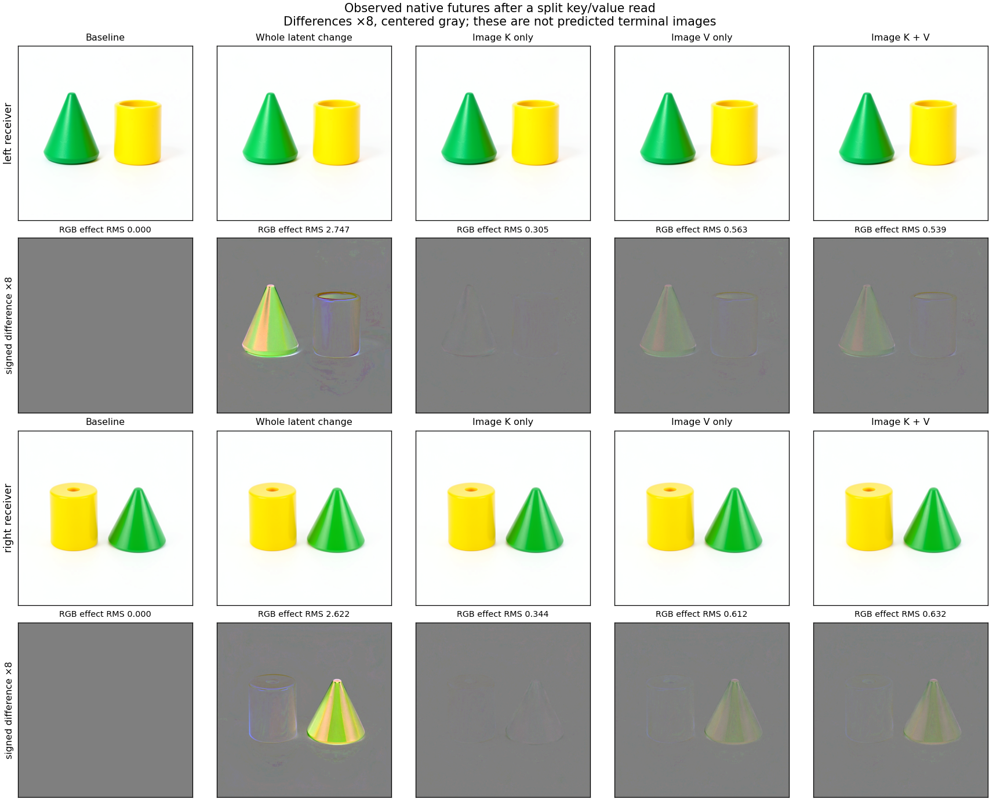

# From persistent latent to the next text write

This experiment follows the source/receiver carrier route one boundary further.
At the next pass, working text is rebuilt from unchanged conditioning, but the
changed image stream can write a difference back into text through attention.
The assay separates the image keys from image values in that read, predicts the
complete receiving text write, and observes native image continuations.

The real run establishes exact carrier/replay and text-read identities in both
contexts. Its mathematical reference tracks full text states within 0.17–0.19%
relative RMS, but misses the small split key/value text effects by 115–128%.
This is stronger causal localization with an unresolved numerical-effect limit.

The specimen is FLUX.2 Klein 4B distilled, CUDA BF16, batch one, seed 127,
512 × 512, four denoising passes. The two receiving contexts and their changes
are saved results from `job-3272cb7fc922`. They are known contexts, not held-out
prompts. See [the source/receiver experiment](FLUX-SOURCE-RECEIVER.md).

## Two frontiers, two different claims

At step 3's project entry, complete live-state comparison shows that each
baseline/changed pair differs only in `latent`. Obsolete image, working text and
context have been cleared. Replacing that latent with the opposite parent's
value therefore recreates that parent's entire live input state. Restoration
and reciprocal transplantation are exact replay controls. They do not discover
a new semantic law or independently predict a numerical future.

At step 3's joint block 0 entry, projected text is identical within each pair,
while image state differs. Four genuine native prefixes run only as far as the
positioned Q/K/V operands. Each stops before original attention executes, and
MDB rolls back to the unchanged source cut. This custom CUDA dispatcher boundary
is not the public CPU-only `record_prefix` API. Refused prefix attempts remain
in the receipt stream.

All eight local mathematical forecasts are sealed with `ForecastTransaction`
before any new native attention returns. Each predicts full text attention head,
after-attention residual, receiving MLP output and final text state. The later
images are observed native continuations; this assay does not numerically
predict those entire image futures.

The baseline and joint-KV text endpoints are already known calibration outcomes
from the source run. The four split-K/V text cases are new hybrid combinations.
Their full image continuations have not been observed before; even joint-KV
retains baseline image queries and residual, so matching the changed text exit
does not imply matching the changed image trajectory. No calibration text target
is a numerical forecast operand.

## The factorial reader

Text queries, text keys/values, text residual and modulation remain baseline.
Image queries and residual also remain baseline in every reader branch.
Only the image portions of positioned keys and values can change:

| Corner | Image keys | Image values |
|---|---|---|
| `k0v0` | baseline | baseline |
| `k1v0` | changed | baseline |
| `k0v1` | baseline | changed |
| `k1v1` | changed | changed |

For text queries `Q`, with concatenated text/image operands, the equations are

```text
A(K,V) = round_BF16(softmax(Q K^T / sqrt(d)) V)
U = round_BF16(T + round_BF16(g_attention * linear_out(A)))
N = modulate(layer_norm(U), shift_mlp, scale_mlp)
[u,w] = linear_in(N)
M = linear_out_mlp(round_BF16(SiLU(u) * w))
T_next = round_BF16(U + round_BF16(g_mlp * M))
```

The independent reference uses NumPy FP64 arithmetic at declared BF16
boundaries and original checkpoint parameter bits. It is not a bit-exact CUDA
GEMM/SDPA emulator. It consumes observed native Q/K/V, so its coverage begins
there. Original weights are retrieved on demand using source-verified recipes;
no response parameters are fitted and no full parameter bank is exported.

For any measured field `F`, retain these finite contrasts:

```text
key effect   = F10 - F00
value effect = F01 - F00
interaction  = F11 - F10 - F01 + F00
total effect = F11 - F00
```

Keys change the attention distribution and values change the weighted content.
Their finite interaction need not vanish. Effects at the head, receiving MLP,
text exit and terminal image are different observables; RMS across those spaces
does not assign causal percentages or object concepts.

## Execution and evidence

One finite resident mrun lease stages four stopped prefixes, eight local
mathematical forecasts, eight latent closure futures and eight reader futures.
The complete planned census is one model load, 440 successful native operation
transitions, 400 completed transformer blocks/attention calls, four stopped
block entries, eight typed latent Acts and sixteen actual VAE images. There are
zero new prompt encodes or noise draws. Port edits inside attention are explicit
instrument overrides, not advertised as typed public Acts.

Every successful exit keeps full tensor descriptors. Complete arrays remain at
project, joint0, joint4 and terminal commit where applicable; full cuts remain
at project, joint0 and terminal commit. All four predicted text fields remain
complete. Source identity, original weight recipes, request, prediction seals,
native operands, intervention hashes and all 452 receipt rows are retained.

The tiny native integration test executes the same complete campaign with a
random small transformer and an explicitly synthetic image consumer. It tests
instrument mechanics; scientific results require the original real model.

## Reproduce

Use the qualified installed public MDB wheel, with the prior authenticated
campaign present. Real-model execution goes through mrun; the final two commands
only read saved data:

```bash
python -I stage_flux_latent_reader.py RUN --prior SOURCE_RECEIVER_CAMPAIGN
python -I stage_flux_latent_reader.py RUN --submit
python -I recover_flux_directory.py RUN COLLECTION
python -I RUN/payload/analyze_flux_latent_reader.py \
  COLLECTION/extracted/binding-minimal-result audit.json
python -I publish_flux_latent_reader.py \
  COLLECTION/extracted/binding-minimal-result audit.json RECORDS
```

The publisher creates fourteen generic computation occurrences: eight local
write predictions and six key/value/interaction contrasts. Applicability names
the exact observed frontier, backend, clock and occurrence. Changed horizons
abstain. Indexing records does not establish cross-context family generality.

## Measured results

Job `job-7afc16a70861` completed all sixteen futures. The frozen auditor verifies
all native intervention hashes, forecast seals and array inventories. A separate
verifier joins all 440 exit clocks to actual MDB transitions and lineage, and
checks 452 unique receipt seals, including four intentional prefix refusals.

All eight closure controls reproduce the expected complete final payload and
PNG, with identical descriptors at every saved native exit. Restoration removes
the prior change; reciprocal transplantation reproduces it. The original known
baseline/changed PNGs also replay exactly.

For both receivers, `k0v0` reproduces the known baseline text exit and `k1v1`
reproduces the known changed text exit **exactly across all 512 text rows**.
The latter retains baseline image queries and residual. Thus the changed image
K/V suffice for this particular text write. They do not recreate the complete
changed image stream or its future.

| Native observable | Left receiver | Right receiver |
|---|---:|---:|
| Text-head key-only effect RMS | 0.001496 | 0.001452 |
| Text-head value-only effect RMS | 0.002972 | 0.002950 |
| Text-head joint K/V effect RMS | 0.003101 | 0.003139 |
| Text-head interaction RMS | 0.001525 | 0.001459 |
| Whole latent-change final RGB effect RMS | 2.747 | 2.622 |
| Key-only final RGB effect RMS | 0.305 | 0.344 |
| Value-only final RGB effect RMS | 0.563 | 0.612 |
| Joint K/V final RGB effect RMS | 0.539 | 0.632 |
| Value-only RGB effect cosine with whole change | 0.819 | 0.797 |
| Key-only RGB effect cosine with whole change | 0.057 | 0.133 |

RGB uses byte units on the 0–255 scale. Within this matched read, value-only
effects are larger than key-only effects at the text head and final pixels,
and point more closely along the original image effect in both contexts.
This is a convergent two-context trend, not a universal value-dominance law.
The finite K/V interaction remains nonzero. Magnitude ratios do not measure
causal percentages, and comparisons between different tensor spaces are not
meaningful attribution scores.

The joint K/V future has only 0.539/0.632 RGB-effect RMS versus the original
whole change's 2.747/2.622. Its effect cosine is 0.807 in both receivers, yet
its complete text exit was identical to the changed source. By joint4, text
has diverged again: its difference from the whole-changed text has relative
effect error 80.96%/93.22%. A local text record alone does not close the future;
the surrounding image state remains part of the continuation's live input.



The upper rows show actual rendered futures. Difference rows are multiplied by
eight and centered on gray. The cone remains green and the cylinder yellow in
the inspected images. These subtle changes do not establish a color-swap
operation, concept dictionary or object-level causal percentage.

## Prediction accuracy and the retained miss

Across eight prospective local reference runs, full-state relative RMS errors
are 0.0947–0.0966% for the attention head, 0.160–0.181% after attention,
0.423–0.504% for the receiving MLP output, and 0.170–0.191% for final text.
Each denominator is the corresponding actual native state RMS.

Those endpoint numbers conceal an important miss:

| Signed effect prediction error, relative to actual effect RMS | Left | Right |
|---|---:|---:|
| Head, key only | 67.22% | 66.35% |
| Head, value only | 35.35% | 35.46% |
| Head, joint K/V | 36.13% | 34.55% |
| Final text, key only | 118.66% | 127.99% |
| Final text, value only | 121.29% | 114.81% |
| Final text, joint K/V | 117.99% | 111.43% |

The predicted joint head-effect cosine is 0.935/0.940, while final text-effect
cosine falls to 0.157/0.203. Some residual differences contain BF16 jumps of
8 or 16 despite small full-field RMS. Numerical discrepancies become material
at the scale of the tested changes. Kernel arithmetic and rounding are plausible
contributors, but this assay does not isolate their individual responsibility.
The reference is not yet a reliable numerical predictor of these small text
effects. Every miss remains in the fourteen published computation records.

## Cost, custody and the next cut

All forecasts were sealed by worker second 109.51 with zero completed native
blocks/attention calls. Final native execution finished at second 439.87;
the summary completed at 440.61. Runner elapsed time was 621.69 seconds,
including imports, startup and cleanup. Peak RSS was 6154.1 MB and peak VRAM
9330 MB. Repeated stack samples show durable-store publication stalls; the
first closure took 118 seconds, with many later branches around 11–24 seconds.
No job was canceled, no forecast changed, and no scientific panel was skipped.

Custody verifies 896 files totaling 638,059,914 expanded bytes. The archive is
508,370,059 bytes; the local campaign retains about 1.6 GiB including compressed
transport and staging. Only three original parameter payloads were read for
the text equations, with a 188,743,680-byte raw cache peak. Original recipes and
the standalone retriever are retained; no full exported parameter bank is added.
Saturn evidence-plane run/verify return zero with `target-streams-only` scope.
This is an exploratory result; terminal status remains unassessed.

Artifacts live in `artifacts/mdb-flux-latent-reader-20261105/`, including
`audit-v1.json`, `clocks-v1.json`, `continuation-effects-v1.json`, the immutable
worker payload, custody records and `public-records-v1/`. Fourteen exact catalog
queries resolve and fourteen changed-horizon queries abstain.

From that campaign directory, the actual searchable example is:

```bash
python -I -m mdb equations find --catalog public-records-v1/equations \
  --applicable-to public-records-v1/context-right-key.json
python -I -m mdb equations find --catalog public-records-v1/equations \
  --applicable-to public-records-v1/context-wrong-horizon.json
```

The first returns `cmp.flux.latent-reader.right.key`, including its numerical
miss. The second returns `[]`. These predicates express supplied scope, not
an inferred applicability rule.

The [operator-level follow-up](FLUX-READER-ARITHMETIC.md) now reproduces all eight
source text tails byte for byte and separates actual-input local equations
from carried approximations. On identical operands, output-projection and MLP
output-matrix arithmetic retain large errors on the small K/V effects; local
residual, modulation and SwiGLU equations match exactly. Changing CUDA
reduction policy moves the two matrix effects closer to the FP64 reference.
Those are known-input diagnostics, not new prospective predictions. The
[attention follow-up](FLUX-READER-ATTENTION.md) now reproduces the calculated
head and complete text tail exactly from fixed Q/K/V in all eight cases.
Head/row-specific value transport and fresh-state reader predictions remain
the next causal and generalization questions.
