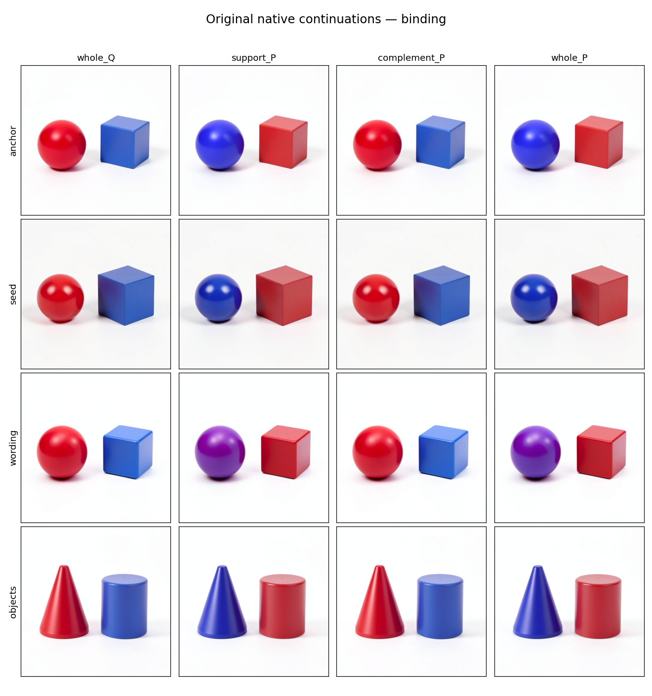
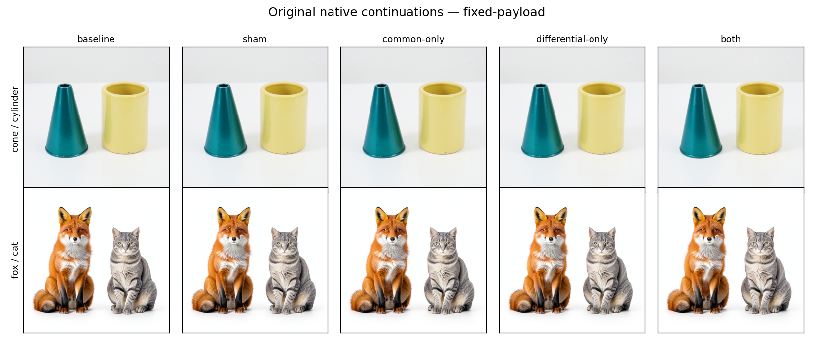

# Four binding rows, receiving-state dependence and exact continuations

The follow-up ran all three proposed cuts in one finite MDB campaign. At the tested binding boundary, the four originally edited text rows reproduce the whole-text assignment in every context; the other 508 rows contain newly produced differences but leave the base assignment intact when transferred alone. Separately, identical C/D payload bytes still reverse their relative image effects between cone and fox receivers. All 26 complete numerical forecasts match native execution exactly, including eleven newly modified futures.

These results connect causal addresses to executable continuations. They narrow the binding carrier and remove the changing-payload explanation for the C/D reversal. They do not yet separate carried input from newly computed writing on the four useful rows.

## Specimen and actual execution

The specimen is the original FLUX.2 Klein4B distilled checkpoint, CUDA BF16, batch 1, 512×512, four denoising steps and guidance 1. The original finite arithmetic and shared Torch primitive kernels are retained. Historical states, original parameters and source observations are declared inputs; this campaign performs no new prompt encoding, noise draw or priming prefix.

Native job `job-b0941d817597` succeeded in 493.43 scheduler seconds, with 11,175 MB peak RSS and 8,274 MB peak VRAM. The worker measured 462.75 seconds. It hydrated the transformer and complete original VAE once, kept at most one component on CUDA, and executed:

| Work | Functional forecast | Native target |
| --- | ---: | ---: |
| State advances | 1,964 | 1,964 |
| Transformer attention calls | 1,774 | 1,774 |
| Linear calls in denoiser | 7,354 | 7,354 |
| Complete VAE decodes | 26 | 26 |
| Typed Acts | 40 | 40 |
| First-consumer port sets | 26 | 26 |

There are 15 known replay conditions and 11 new modified conditions, rather than 26 independent new contexts. The functional lane entered zero original learned modules. Native execution entered 1,774 original transformer blocks. Six complete parent rewinds were verified.

## Binding: where the distinction is carried

The four contexts are the red-sphere/blue-cube anchor at seed 109, the same scene at seed 347, reversed wording at seed 109, and red cone/blue cylinder at seed 109. They inherit the source assistance and image priming of the [previous carrier experiment](FLUX-BINDING-CARRIER-CROSS.md).

P and Q are the historical joint0 exits of two matched delivered-direction placements, A@A and A@B. At joint0 entry their image operands and other declared state agree. Their text differs only on the sealed support S: rows `[4,11,12,13]` for anchor, seed and objects, or `[9,17,18,19]` for wording. The complement C contains 508 rows whose input bytes are identical.

The saved arrays verify that joint0 produces differences on every row in C. Their widened L2 norms are 114.939, 116.961, 126.920 and 114.499 respectively. Because the input on C is equal, the output difference there equals the difference of finite net writes:

```text
(T_P,out - T_Q,out)|C
  = [(T_P,out - T_P,in) - (T_Q,out - T_Q,in)]|C.
```

This identifies newly produced text differences within joint0 as a whole. A net write includes finite residual-add effects; it is not an isolated attention or MLP return.

At step2/joint1 entry, hold I.Q and every nontext slot fixed. Use exact BF16 row SETs to construct:

```text
T_S = P on S, Q on C
T_C = Q on S, P on C
T_P = whole P
T_Q = whole Q

T_P - T_S - T_C + T_Q = 0     (exact in widened arithmetic).
```

Every branch executes its own 54-operation, 49-block suffix and the original scheduler/VAE. Base conditioning is installed before step3 projection in both forecast and native lanes. Whole P is the known I.Q_T.P endpoint, not I.P_T.P.



Support alone follows whole P's visible assignment in all four contexts. Complement alone follows whole Q. Anchor and seed give blue sphere/red cube under support; wording retains the partial purple sphere/red cube; the object context gives a blue/violet truncated cone and red cylinder. Qualitative labels are unblinded observations agreed by root and Astra, not calibrated semantic scores.

| Context | Whole P vs Q RGB RMS | Support vs Q | Complement vs Q | Support vs whole P |
| --- | ---: | ---: | ---: | ---: |
| Anchor | 50.607 | 50.664 | 0.448 | 0.481 |
| Seed 347 | 44.511 | 44.439 | 0.401 | 0.511 |
| Wording | 42.861 | 41.345 | 0.383 | 2.684 |
| Cone/cylinder | 44.913 | 44.950 | 0.440 | 0.429 |

RMS uses complete RGB arrays on the 0–255 scale. Small differences remain, especially in the paraphrase. Complement transfer is not computationally inert: its images and intermediate tensors differ. It does not reproduce the visible assignment by itself under this receiver. The result supports conditional sufficiency of S and weakens the hypothesis that newly spread complement differences independently carry this assignment. It does not show that C has no role in combination, or that four rows are minimal.

The production question is now localized more tightly: useful state remains on S, where the output combines changed input residuals and joint0 writes. This experiment cannot identify which of those contributions supplies the assignment.

## The first consumer and finite interaction

First image normalization is identical across the four binding arms. Rowwise text normalization preserves the row partition. Accordingly, the entry, image-LN, text-LN and MLP-gate factorial tensors are exactly zero in all four contexts.

For a later field F, retain the complete signed interaction:

```text
J_F = F(T_P) - F(T_S) - F(T_C) + F(T_Q).
```

Interaction is already nonzero at the measured attention residual: RMS 0.00641–0.00833, then 0.00587–0.00814 at the MLP return. Final RGB interaction is 0.663, 0.613, 2.648 and 0.590 for anchor, seed, wording and objects. Every interaction tensor is predicted exactly. This localizes the first measured departure from the rowwise partition to the attention/residual interval; it does not split smooth attention nonlinearity from native finite arithmetic. A nonzero interaction is not a semantic cooperation percentage.

The complement is consumed: its isolated transplant changes the immediate attention-residual RMS by 0.0203–0.0275 and the MLP-return RMS by 0.0160–0.0213. Those early effects coexist with a small terminal image effect. The measured MLP law is `u=Linear_in(x); (a,b)=split(u); M=Linear_out(SiLU(a)*b)`, followed by the receiver's gated residual update. Here `x` is the modulated normalization of the attention residual. The predictions preserve each native cast and operation order. The same mathematical law can consume different contextual states and have different later consequences.

## The distinction survives a carrier change

A [saved-metadata check](../../../../artifacts/mdb-lifecycle-20261106/carrier-boundary-metadata-v1.json) compares all thirteen declared slots at three landmarks in every one of the sixteen binding branches. All sixteen row files are hash-checked against the original publication; the independent audit has already checked their forecast/native tensor correspondences.

| Boundary | Slots varying across the four arms | Working text |
| --- | --- | --- |
| Before step3 projection | Latent only | Absent |
| After projection | Image and latent | Exactly identical across arms |
| After step3 joint0 | Image, latent and text | Different again |

All four latent hashes remain distinct within each context, including the complementary branch with a small final consequence. The old text tensor does not survive this boundary. The branch distinction persists through latent, projection rebuilds common text from the fixed conditioning, and joint0 computes text differences again while reading differing image states. [Astra independently checked all 48 metadata states](../../../../artifacts/mdb-lifecycle-20261106/advisor-boundary-addendum-v1.md).

This extends the earlier whole-stream handoff observation to the eight new row hybrids, with their continuations now numerically forecast. It identifies the only varying persistent slot within the declared runtime closure at this boundary. It does not identify a minimal semantic latent code or make every latent difference a binding variable.

## Fixed C/D bytes across cone and fox

The original C, D and once-rounded combined B payloads from seed 613 are supplied unchanged at step0/joint1 entry to both the cone/cylinder613 and fox/cat821 receivers. The experiment does not recompute coefficients, rescale directions, renormalize doses or fit anything on fox. Baseline and own-state SET sham are exact controls. Each branch executes 110 advances and 99 transformer blocks.



| Receiver | Common C RGB RMS | Differential D RGB RMS | Combined B RGB RMS |
| --- | ---: | ---: | ---: |
| Cone/cylinder613 | 4.993 | 2.652 | 7.504 |
| Fox/cat821 | 7.255 | 12.140 | 12.688 |

The C-versus-D ranking reverses with exactly the same supplied payload bytes. Changed source coefficients therefore cannot explain this reversal. Visible objects and left/right arrangement remain recognizable; the RMS effects include appearance, silhouette and small positioning changes rather than an established semantic swap.

The landed L2 sizes are very close but not identical: C is 652.653/652.629, D 280.075/280.056 and B 710.173/710.126 for cone/fox. In finite arithmetic,

```text
delta_r(P) = BF16(H_r + P) - H_r.
```

Receiver-dependent rounding remains part of the contrast. The widened entry remainder `delta_r(B)-delta_r(C)-delta_r(D)` has RMS 0.004972 for cone and 0.005318 for fox. The final RGB interactions are 3.382 and 10.830. These do not isolate smooth receiving-state computation from rounding; both are retained in the full forecast and audit.

One local magnitude cannot predict the final ordering. At the first attention residual, C exceeds D in both contexts (0.2093 vs 0.1616 for cone; 0.2120 vs 0.1643 for fox). At the first MLP return, D exceeds C in both (0.1162 vs 0.1122; 0.1183 vs 0.1154). The later cone/fox ranking still differs. These are response norms, not isolated mediation tests, but they explain why a record needs a continuation as well as a local operation and payload.

## Prospective numerical account

From each observed parent, the functional implementation recursively consumes its own predicted state:

```text
S_hat[k+1] = F_k(S_hat[k]; original_parameters)
Y_hat = original_parameter_decoder(S_hat[final]).
```

It includes the declared entry Act and step3 conditioning Act. It never substitutes an intermediate native target state into that recurrence. All full predicted states, first-consumer ports, decoder results, images and signed accounts are frozen together before the first native target advance.

The global seal is `d6f74e63fab2d266694a079f15c5356f9028ff08e1fa3920fa341472115f5a22`. At seal time, native target advances and native transformer blocks were both zero. The transaction later closed and verifies offline.

Independent saved-only CPU job `job-aca4b5d96885` succeeded in 136.27 seconds with 2,089.9 MB peak RSS, zero model forwards and a zero-VRAM reservation. Its [complete audit](../../../../artifacts/mdb-lifecycle-20261106/audit-01/compact/audit.json) reports:

- All 26 full decoded tensors and RGB images are bit exact, including the eleven new modified futures; maximum absolute error is zero.
- All 156 first-consumer port comparisons have zero maximum absolute error.
- All 27,356 boundary tensor hash comparisons match, with zero layout mismatches.
- All 2,688 complete retained tensor fields match over 1,742,366,724 compared positions.
- All 15 historical replay conditions reproduce complete final payload values and original PNG bytes.
- All 54 signed interaction fields agree between functional and native lanes.
- Source rows, exact SET/ADD consumption, nonedited slots, conditioning splices, parameter identities, six rewinds and forecast-before-release custody are checked separately.

This is an exact original-primitive numerical account from supplied states under the pinned execution profile. Shared kernels and observed source states remain explicit. It is not a learned surrogate, independent numerical-kernel implementation, raw-prompt forecast, universal concept dictionary or proof that the model's semantic computation is fully understood. No compression requirement is imposed.

## MDB mechanics and retained evidence

The first attempt, `job-36f0815baf62`, stopped during strict CPU source identity validation before CUDA, forecasts or targets. Diffusers' historical pipeline loader and the recipe loader recorded different `_name_or_path` fields. The correction reconstructs the exact source-derived loader configuration separately for binding and C/D, creates fresh adapters after each configuration/placement change, and verifies unchanged complete parameter descriptors. It does not override model identities or relax historical source checks. The failed request, log and review remain retained.

Eight installed source-helper tests, two actual installed adapter/profile regressions and fourteen saved-reader tests pass. The producer retains one cosmetic import-order lint diagnostic separately. The numerical claims above come from the original checkpoint run and independent saved audit, not these small tests. [Astra's request-bound readiness review](../../../../artifacts/mdb-lifecycle-20261106/run-02/finite-run-review-v1.json) and [pre-result interpretation notes](../../../../artifacts/mdb-lifecycle-20261106/advisor-method-notes-v1.md) state the scope before target interpretation.

The full native publication contains 2,406 inventoried members and 5,385,515,119 bytes on Beast. The compact audit contains all 52 original forecast/native PNGs plus five reports/retrieval files: 57 members and 13,405,610 bytes. Original parameters are omitted from per-run payload banks; `parameter-artifacts.json` and `retrieve_weights.py` bind 311 exact transformer/decoder/BN recipes. The complete VAE is additionally bound in the adapter identity. Selected local metadata is explicitly a partial collection; raw states stay remote.

## Workflow and next cut

Run from an installed public MDB environment; scheduler placement and strict preflight remain required:

```bash
python -I -B qualification/stage_flux_lifecycle.py RUN \
  --parent-run QUALIFIED_CD_RUN --binding-plan BINDING_PLAN
# Inspect the exact staged request and save its request-bound readiness review.
python -I -B qualification/stage_flux_lifecycle.py RUN --submit
python -I -B qualification/stage_flux_lifecycle_audit.py AUDIT --source RUN
python -I -B qualification/stage_flux_lifecycle_audit.py AUDIT --submit
python -I -B qualification/collect_astra_generalization.py AUDIT
python -I -B qualification/collect_astra_generalization.py AUDIT --retrieve audit.json
python qualification/summarize_flux_lifecycle.py AUDIT/compact observations.json
python qualification/render_flux_lifecycle.py AUDIT/compact FIGURES
```

Before the last two commands, retrieve the original PNG members listed in the compact inventory. The completed run has already retrieved and hash-checked all 57 members, so no model rerun is necessary. A fresh admission is a new request; this workflow has no automatic retry or nested submissions. Use the standalone retriever only when original parameter arrays are needed.

The next binding cut should separate carried input residual from newly computed joint0 writes on the four useful rows. Capturing actual attention and MLP returns, then crossing/restoring them at a fixed receiver and forecasting their full continuations, can decide whether joint0 creates, preserves or reshapes the useful distinction there. For the fixed C/D family, retained trajectories can guide where receiving-state dependence first becomes consequential; equal nominal bytes alone do not remove finite ADD effects.

The symbol-table entry supported now is conditional: original checkpoint and execution profile, a specific clock, four addressed text rows, supplied context, a controlled assignment consequence and an exactly forecastable continuation. The C/D entry likewise needs its receiver. Automatic family induction and generalization beyond these contexts remain future work.

Six generic records, `flux-lifecycle-{anchor,seed,wording,objects,fresh0s613,foxcat0s821}`, are exported in [computation-records-v1.jsonl](../../../../artifacts/mdb-lifecycle-20261106/computation-records-v1.jsonl) and appended to the existing known-computations catalog. The four binding entries refine the existing contextual-object-binding family; the two C/D entries record fixed-payload receiver dependence. All six pass source-hash and schema validation. The full catalog retains eight pre-existing C-runtime source-hash mismatches, unchanged by this append; earlier records and their pinned sources were not rewritten.

## Evidence and source

- [Observation summary](../../../../artifacts/mdb-lifecycle-20261106/observation-summary-v1.json), [original PNGs and independent audit](../../../../artifacts/mdb-lifecycle-20261106/audit-01/compact), [native summary](../../../../artifacts/mdb-lifecycle-20261106/run-02/metadata/summary.json).
- [Producer](../qualification/flux_lifecycle_campaign.py), [stager](../qualification/stage_flux_lifecycle.py), [source qualification](../qualification/flux_binding_support_sources.py), [saved reader](../qualification/audit_flux_lifecycle_campaign.py), [audit stager](../qualification/stage_flux_lifecycle_audit.py).
- [Saved-only summarizer](../qualification/summarize_flux_lifecycle.py), [figure renderer](../qualification/render_flux_lifecycle.py), [all requests, reviews and failed attempt](../../../../artifacts/mdb-lifecycle-20261106).
- [Astra's complete result review](../../../../artifacts/mdb-lifecycle-20261106/advisor-result-review-v1.md), [carrier-boundary addendum](../../../../artifacts/mdb-lifecycle-20261106/advisor-boundary-addendum-v1.md), [six new records' validation](../../../../artifacts/mdb-lifecycle-20261106/new-records-validation-v1.json).
