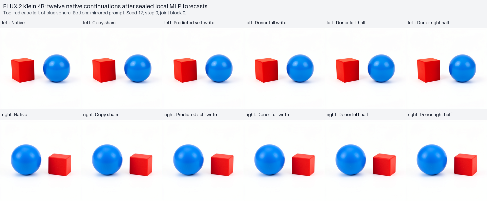

# Forecasting a diffusion model's image MLP write

This finite assay extends MDB's capture → predict → seal → execute workflow to the distilled FLUX.2 Klein 4B diffusion pipeline. An actual CUDA prefix supplies the input to one image feed-forward module. Independent NumPy equations predict its full output, gated write and local residual update before the native module executes. Typed branches then test those writes through the remaining diffusion steps and native VAE.

The completed panel retained all twelve native images with valid saved-array mechanics. Native/sham final latents and PNGs match exactly. The independent FP64 forecast approximates the local BF16 computation with measurable rounding residuals; donor writes change pixels but do not reverse the recipient's object ordering in either scene. These are bounded numerical and native-consumer observations, not an RGB forecast or a discovered object program.

## Specimen and prediction boundary

The specimen is `flux2-klein-4b-distilled`, loaded from the pinned local pipeline inventory with digest `dd976d67036c4a0a55642f702dcb3740ba7a4f367557596572baac168330904f`. The public `saturn_pub` FLUX.2 adapter retains the native transformer, flow scheduler and VAE as the downstream consumer. Execution uses CUDA BF16, batch one, 512 × 512 pixels, four diffusion steps, seed 17 and guidance scale 1. The text encoder prepares both conditions before being parked on CPU; the transformer remains resident for the branch panel.

The selected module is `transformer_blocks.0.ff` at diffusion step zero. A genuine partial GPU prefix stops at its entry before the feed-forward body runs. It retains:

- `r`: the image residual immediately before the feed-forward update;
- `x`: the actual normalized and timestep-modulated feed-forward input;
- `gate`: the actual timestep modulation gate;
- native image position IDs and the typed parent cut.

This is a conditional forecast from an observed prefix. The equations do not predict attention, normalization, modulation or the raw prompt-to-prefix computation. The stored prefix remains unchanged by the aborted partial block. An entry guard counts attempts to run the selected feed-forward module or VAE before release.

## Independent equations and precision

The checkpoint supplies the complete selected feed-forward matrices. Their actual BF16 values are widened without information loss into external read-only FP32 arrays and bound to the checkpoint and native parameter descriptors. The matrices stay outside the transaction archive; their identities and pre-prediction, release and post-execution checks are retained.

For a token's supplied `x`, the independent FP64 equations compute:

```text
[a, b]   = W_in x + bias_in
y        = W_out (SiLU(a) * b) + bias_out
write    = gate * y
residual = r + write
```

The selected native profile has no feed-forward biases. The reusable equation function accepts optional explicit biases and validates their geometry. It processes small token and matrix-row tiles and retains complete `y`, `write` and `residual` arrays without publishing the much wider intermediate activations.

FP64 equations describe the supplied computation; they do not reproduce CUDA BF16 reduction order. Numerical errors against actual BF16 `y`, write and residual are observations. A predicted write becomes an intervention payload through the declared FP64 → FP32 → BF16 round-to-nearest-even conversion, widened back to FP32 for durable storage. A parameterless CPU FP32 writer records `r + payload`; its output is cast to native BF16 before installation. The archive keeps these precision contracts separate.

Both scene forecasts and payloads are globally sealed before any tested native suffix executes. The seal binds arrays, source identities, checkpoint descriptors, cast recipes and prefix identities. Native execution verifies the seal before release. The NumPy callback is trusted Python, not an operating-system sandbox; independent native entry hooks enforce the declared module boundary.

## Two scenes and six branches

The prompts differ only in their requested horizontal relation:

```text
A red cube to the left of a blue sphere on a plain white background. Two separate objects, simple studio product photograph.

A red cube to the right of a blue sphere on a plain white background. Two separate objects, simple studio product photograph.
```

Each recipient has six common-parent branches, for twelve declared native images:

| Arm | First-block image update |
|---|---|
| `native` | Keep the actual native post-block image state. |
| `sham` | Reinstall an exact copy of that native image through a typed Act. |
| `forecastself` | Add the recipient's frozen predicted write to its own residual. |
| `donorfull` | Add the other scene's frozen predicted write to the recipient residual. |
| `donorleft` | Install that donor-write result only in the fixed left coordinate half. |
| `donorright` | Install that donor-write result only in the fixed right coordinate half. |

The spatial masks come from native image position IDs. They are supplied coordinate halves, not learned object masks. All arms preserve recipient text; masked arms preserve native image rows outside the mask at the intervention boundary. Later attention and diffusion can spread changes across the rendered image, so preserved local rows do not guarantee unchanged pixels.

`forecastself` measures the downstream consequence of approximating the local write. It is distinct from the exact sham. Donor transfer tests whether a scene-conditioned write moves the other scene's native image outcome; it does not presume that one feed-forward module or one patch represents one object.

## Saved evidence and interpretation

The worker retains public typed parent and post-block cuts, Acts, continuation receipts, parameterless writer traces, full forecast and native numerical arrays, final latent witnesses, twelve native PNGs, a timeline and an immutable file manifest. The saved-array auditor verifies archive, request, source and transaction custody before reading numerical trees. It runs no model, equation module or native replay.

The audit separates:

- **Mechanics:** source and checkpoint identity, seal ordering, prefix closure, typed Act and receipt joins, BF16 payload bytes, image hashes, recipient-text and local-mask preservation, and native/sham latent and RGB equality.
- **Numerical observations:** full-array differences for `y`, `write` and the residual update, including rounding introduced by the CPU writer and native BF16 cast.
- **Scene observations:** native RGB outcomes, red/blue hue-region components and centroids, their signed horizontal separation, and rendered pixel collateral relative to the recipient's native image.

Hue thresholds and component sizes are uncalibrated descriptive choices. Missing color regions remain unknown. They cannot establish cube or sphere identity, object count or semantic correctness. Separate assistant visual inspection assesses visible shapes and ordering informally; no human annotation or calibrated shape classifier is supplied. No RGB image or semantic outcome is forecast by the numerical equations.

Cross-scene diagnostics also report whether initial latents, image grids and gates are exactly shared, and how `x`, `r` and writes differ. Equality of the timestep gate would be an observation about this fixed-time pair, not an assumed universal rule.

## What the symbol table identifies

The [saved symbol inspection](../../../../artifacts/mdb-flux-mlp-forecast-20261030/writer-symbol-tables-v2.json) uses MDB's `ForwardSymbolTable` and `NativePortCatalog` on all eight recorded CPU residual writers. For `left.donorfull`, the actual trace contains one `aten.add.Tensor` operation:

| Trace-local value | Supplied structural role | Actual port |
|---|---|---|
| `v000000` | Recipient residual | `module:<root>:args`, path `[0]` |
| `v000001` | Sealed donor gated-write payload | `module:<root>:args`, path `[1]` |
| `v000002` | FP32 residual plus write before BF16 installation | `module:<root>:return` |

Each value has shape `[1,1024,3072]`, a content hash, producer/use edges and a trace-qualified identity. The GPU feed-forward boundary, weights and equation arrays are separate evidence; this assay does not record the full GPU feed-forward implementation as an ATen symbol trace.

These records identify a computation and its data flow. They have no established `red cube`, `blue sphere` or `left of` bindings. The object labels come from the supplied prompts and subsequent image inspection. Establishing such a binding requires interventions that predictably move the corresponding object or relationship across contexts, together with collateral and continuation measurements. This first write transfer preserves ordering and leaves that semantic binding open.

## Collect, audit and publish

Use an installed MDB environment with its public dependencies. Real-model submission and collection go through mrun; auditing and publication use saved arrays only. From the package directory, the corrected attempt is collected and inspected with:

```sh
python qualification/submit_flux_mlp_forecast.py /absolute/path/campaign/run-02 --collect job-272e83f859d4
python qualification/analyze_flux_mlp_forecast.py /absolute/path/campaign/run-02 /absolute/path/campaign/run-02/analysis-v1.json
python qualification/publish_flux_mlp_forecast.py /absolute/path/campaign /absolute/path/publication.json --run run-02
```

The audit and publication outputs are exclusive: choose a new output name rather than overwriting existing evidence. The publisher's explicit `--run run-02` selects the corrected attempt. Prior attempts remain in the campaign provenance. The first model attempt failed while serializing a string subclass into the transaction, before forecast release; the corrected runtime preserves that failure and leaves the worker and equations unchanged.

Collection admits at most 512 MiB compressed and 1 GiB expanded for this panel. The audit explicitly admits a 512 MiB archive and 256 MiB individual member. Legacy helper defaults remain unchanged. These are bounded evidence-admission limits, not scientific thresholds.

## Numerical and native image results

The corrected attempt, `run-02` / `job-272e83f859d4`, completed both prefixes before one global seal with zero selected-FF, VAE or denied entries before release. The saved-array audit validates all twelve rows. Each local prediction has shape `[1,1024,3072]`, or 3,145,728 values. Native/sham final latents and PNG bytes match exactly for both scenes; all ten typed Acts preserve recipient text, and all masked branches preserve native rows outside their intervention mask.

| Scene | Max absolute FF output error | Max gated-write error | Max residual error | Write-error L2 / native donor-write contrast L2 |
|---|---:|---:|---:|---:|
| Red cube left | 0.0384196 | 0.331517 | 0.581517 | 10.42% |
| Red cube right | 0.0370609 | 0.253420 | 0.434552 | 10.35% |

These residuals remain observations, not a numerical certification threshold. After payload quantization, self-write error is about 11.67% and 11.69% of the staged donor-minus-recipient write contrast in L2. Native cross-scene write contrast has L2 41.3192; the staged-payload contrast has L2 41.0693. Approximation is therefore material to interpretation, even though the underlying formula is known.

Relative to each full native tensor, the error is smaller: about 0.295% for FF output, 0.322–0.323% for the gated write and 0.233–0.235% for the residual. Write-error RMS is 0.002427 and 0.002412 against native-write RMS 0.753549 and 0.746413. These complementary [native magnitude scales](../../../../artifacts/mdb-flux-mlp-forecast-20261030/native-magnitude-scales.json) were derived from saved arrays after the immutable audit. Small full-tensor error and material error relative to a smaller scene contrast can both hold.

The initial latent, image-ID grid and timestep gate are exactly equal between scenes. Residual and normalized/modulated input differ (L2 44.5303 and 17.9698), as do the writes. This separates the shared gate at the tested timestep from scene-conditioned dynamic values; it does not establish a general time circuit or object address.

The primary donor-content comparison is **`donorfull` versus `forecastself`**: both use the same recipient residual, text and full-grid analytic installation. Comparing only with native would mix donor-content and approximation effects.

| Recipient | Donor-full versus self-forecast RGB MAE on 0–255 channels | Change in normalized red-minus-blue centroid x | Direction relative to donor ordering |
|---|---:|---:|---|
| Red cube left | 0.165309 | +0.00002965 | Toward donor, very small |
| Red cube right | 0.222752 | +0.00019551 | Away from donor, very small |

All twelve color-region ordering signs remain consistent with the recipient prompt. Separate [assistant visual inspection](../../../../artifacts/mdb-flux-mlp-forecast-20261030/visual-review.json) of the twelve-image sheet and two original-resolution images reports one red cube and one blue sphere with recipient ordering in every row; no relation reversal is observed.



The half-grid arms show pixel collateral, including changes outside the corresponding rendered half despite exact local latent preservation. They lack footprint-matched analytic self controls, so their changes cannot isolate donor content as cleanly. The largest native-relative RGB MAE is 0.599552 for the right recipient's left-half donor; its ordering remains unchanged. These controls bound this attempted transfer, without showing that the selected write has no relational contribution.

The worker took 97.51 seconds before archiving and recorded 1,324 native adapter transitions, eight parameterless writer recordings, ten Acts and twelve VAE decodes. The transaction's eight native calls count CPU writer recordings; its zero pre-seal count does not conceal the two explicitly recorded external GPU prefixes. The first attempt's serializer failure and all metadata acquisition attempts remain separate evidence. No trained model was rerun by the auditor, publisher or descriptive image evaluator.

The [portable result](../qualification/flux-mlp-forecast-20261030.json) binds the raw archive, request, source, forecast seal, audit and all numerical/image rows. Terminal status remains unassessed for this exploratory two-prompt, one-seed panel. A next assay could vary time or block, add footprint-matched self controls and measure larger donor-content perturbations while retaining the same native-consumer and precision controls.

The separate [Saturn evidence verification](../../../../artifacts/mdb-flux-mlp-forecast-20261030/evidence/verify.json) checks the derived target stream: twelve image rows reuse two unique numerical forecasts. Its checksum manifest verifies twenty source bindings. This offline stream check adds no model executions, object labels or semantic certification.

## Implementation and related work

- [Finite mrun submission](../qualification/submit_flux_mlp_forecast.py)
- [Native prefix and branch worker](../qualification/flux_mlp_forecast_campaign.py)
- [Independent NumPy equations](../qualification/flux_mlp_equations.py)
- [Saved-array auditor](../qualification/analyze_flux_mlp_forecast.py)
- [Portable publisher](../qualification/publish_flux_mlp_forecast.py)
- [Equation mechanics tests](../tests/test_flux_mlp_equations.py)
- [Saved-array and diagnostic tests](../tests/test_flux_mlp_forecast_audit.py)
- [Language-model computation forecasts](QWEN-COMPUTATION-FORECASTS.md)
- [Fresh-prompt language-model replication](QWEN-PROMPT-GENERALIZATION.md)
