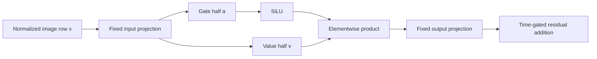

# Understanding one MLP computation and its state update

We followed the internal computation of the image MLP in FLUX.2 Klein4B joint
block 1. We used recorded inputs and the original checkpoint weights to predict
new native module returns, inspect each mathematical stage, and explain an
observed change as gate, value and interaction terms. No images were generated
in this experiment, and no coefficients were fitted.

On 32 selected input rows, the independently calculated outputs differed from
native CPU BF16 by 0.0200–0.0282% relative RMS. Three new input arrangements were
executed after prediction sealing. Row permutation and row-locality predictions
held exactly. The preceding attention/residual/normalization calculation also
reconstructed the recorded MLP inputs exactly on these rows.

## The computation we inspected

The model state supplies the working image residual \(I\), working text \(T\),
position information and time-dependent modulation. In this joint block:

\[
A=\operatorname{Attention}(I,T,\mathrm{position},\mathrm{modulation}),
\]

\[
U=B(I+B(g_A\odot A)),\qquad
x=B(B(\operatorname{LN}(U)\odot B(1+s_M))+b_M),
\]

\[
[a,v]=B(W_{in}x),\quad
s=B(\operatorname{SiLU}(a)),\quad
h=B(s\odot v),\quad
m=B(W_{out}h),\quad
I'=B(U+B(g_M\odot m)).
\]

\(B\) denotes a BF16 rounding boundary. There are two different kinds of gates:
the outer time-modulation gates \(g_A,g_M\), and the internal state-dependent
SiLU values \(s\). The internal gate is recomputed from the current \(x\).

The image MLP expands each 3072-dimensional row into an 18432-dimensional
projection. Its first 9216 values pass through SiLU; those activated values
multiply the other 9216 values. A final projection returns 3072 values. This
specimen has no linear biases. The two matrices contain 84,934,656 fixed
parameters, bound to the original checkpoint by names, shapes and byte hashes.



Ignoring rounding for the algebra, the same expression can be written

\[
m(x)=W_{out}\operatorname{diag}(\operatorname{SiLU}(W_gx))W_vx.
\]

The weights remain fixed. The incoming state determines both the value vector
and the diagonal coefficients. There is no need to learn a second set of
parameters to evaluate this law on another input.

## How the state reached this MLP

The source experiment contains a matched pair at step 2/joint1 entry. Their
entire incoming image states match, while working text differs. The saved
conditioning also differs but is not read again inside this block. The
positional context and time modulation match. Attention is the computation
through which this working-text contrast can change the image-facing write.

Two conditioning rows differ, but numerical differences already span all 512
working-text rows at this boundary. The original lexical addresses and the later
carrier addresses are different parts of the record. This does not establish
that every changed row carries a particular concept or has a causal effect.

Using that **observed attention return**, the saved residual and modulation, an
independent NumPy calculation reconstructed \(x\) exactly across 98,304 values
per source state. Composing the original observed attention/MLP returns also
recovers the corresponding native image exits exactly on these rows.

This closes a conditional part of the transition. The attention return remains
an observed operand. Its derivation from positioned Q/K/V is the next unresolved
part of the computational account.

## Predictions before native execution

We selected 32 of 1024 rows by a fixed seeded random selection. The input is the
actual normalized/modulated MLP input from each source state. These rows and
their order were fixed before new native execution.

| Case | Input | Status |
|---|---|---|
| base | Recorded baseline MLP input rows | Calibration endpoint |
| changed | Recorded changed MLP input rows | Calibration endpoint |
| midpoint | BF16-rounded mean of the two inputs | Newly tested internal input |
| permuted midpoint | Reversed row order of midpoint | Newly tested structural prediction |
| single row | Base with only its first selected row replaced | Newly tested structural prediction |

The source endpoints had previously been executed in the full CUDA model.
The three new arrangements were tested in the isolated original-checkpoint
MLP on CPU BF16. They are local computation tests, not new complete prompt states.

Three NumPy forecasts calculated every selected projection, SiLU activation,
product and output from the supplied inputs and checkpoint matrices. The two
structural forecasts reused those calculated rows. All fields and hypotheses
were sealed before the first native MLP call. No native return or fitted
surrogate supplied a forecast operand.

## What matched and what differed

| Case | Output relative RMS error | Changed output scalars out of 98,304 |
|---|---:|---:|
| base |0.02068%|1039|
| changed |0.02001%|820|
| midpoint |0.02823%|1701|
| permuted midpoint |0.02823%|1701|
| single row |0.02071%|1040|

The largest output discrepancy was 0.0078125. These measured errors are retained;
the independent arithmetic is not bit-identical to the native kernel.

The structural checks were exact: reversing input rows reversed all 98,304 output
values; replacing one row changed no values in the other 31 rows; its 3072 output
values exactly matched the corresponding changed-input row. This directly
qualifies row-local computation at the MLP boundary under this execution profile.
Attention, upstream of this boundary, mixes information across positions.

The native midpoint output differed from the average endpoint output by RMS
0.002714. Its independently predicted counterpart had RMS 0.002714, with a
curvature-vector prediction residual of 0.000165. This full-path measurement
contains nonlinear response and BF16 rounding. A separate smooth SiLU-product
diagnostic at the midpoint of observed projected endpoints also showed nonzero
curvature, RMS 0.000650; that diagnostic removes rounding inside the product core
but does not replace a complete upstream forecast.

CPU and CUDA are separate numerical profiles. The newly measured CPU endpoint
returns differ from the original CUDA endpoint returns by about 0.249–0.251%
relative RMS. Combining the NumPy MLP forecasts with the original observed
attention write gives image-exit errors of 0.123–0.134% relative RMS. Those last
comparisons are retrospective conditional reconstructions, not sealed forecasts
of a new full-block state. The smaller CPU forecast error must not be reported
as CUDA parity.

## Explaining the changed output

For two rounded intermediate states, let \(\Delta s=s_1-s_0\) and
\(\Delta v=v_1-v_0\). Their product difference obeys

\[
\Delta h=s_0\odot\Delta v+\Delta s\odot v_0+
\Delta s\odot\Delta v+(\rho_1-\rho_0),
\]

where \(\rho_i=B(s_i\odot v_i)-s_i\odot v_i\).
The four terms reconstruct the complete observed hidden-product difference
exactly across 294,912 values. There is no residual term hiding missing dynamics.

Projecting these terms through the fixed output matrix gives:

| Contribution | Projected RMS |
|---|---:|
| Value changes under the base gate |0.029516|
| Gate changes applied to the base values |0.030260|
| Gate/value interaction |0.007546|
| Product-rounding difference |0.000781|

The actual output-change RMS is 0.047111. Component norms can cancel and do not
add into percentages. The decomposition is relative to the selected baseline;
it is mathematical accounting, not a unique semantic attribution. The saved-only
audit independently verifies the native product identity and parameter bindings;
the projected component summaries are source-bound producer calculations.

Of 294,912 projected gate scalars, 233,365 changed value, 208,782 activated gate
values changed, and 2844 changed whether they were positive. SiLU also permits
negative values. Most of this response is continuous adjustment within a fixed computational form,
rather than switching a binary instruction flag.

## How this becomes a computation record

The appropriate record describes the operator and its binding:

- Source: normalized image row at step 2/joint1, with explicit state lineage.
- Parameters: the checkpoint-bound `ff.linear_in.weight` and
  `ff.linear_out.weight`.
- Mathematical route: matrix projection → split → SiLU → elementwise product →
  output projection.
- Consumer: time-gated residual addition into the working image stream.
- Applicability: this module, checkpoint, input shape, dtype, backend and state.
- Prediction evidence: sealed own-input stage forecasts, native comparisons,
  locality controls and numerical discrepancies.

MDB captures these operations with anonymous SSA values and genuine named
module/parameter ports. The native trace contains 12 ATen operations per MLP
call, including views, transposes and slices; the mathematical data path has two
matrix multiplications, one SiLU and one elementwise multiplication. Naming the
arithmetic does not yet identify an object-level concept or a reusable semantic
program.

Five measured computation records now live in `public-records-v1/equations/`,
under generic law ID `law.flux.image-swiglu.v1`. Each exact-context query resolves;
each changed-backend query abstains. Native math views and parameter/return
bindings are retained in the same publication.

From the collected result directory, these MDB commands expose the computation:

```bash
python -m mdb.forward_symbols traces/midpoint.json --readable
python -m mdb.forward_symbols traces/midpoint.json --step 7
python -m mdb.forward_symbols traces/midpoint.json --value v000010
```

These views were exercised on the actual trace. In this trace, step 7 reads the
activated gate `v000008` and value half `v000009`, then writes their product
`v000010`. Value IDs belong to this trace, not to a universal symbol dictionary.

The existing `--algebra` instrument emitted zero graph candidates for this
gated-MLP trace. Its three displayed structural identities are built-in
templates, not discoveries from this run. The readable native computation and
manually supplied equation record remain useful; automatic gated-product
recognition is a recorded tool gap.

## Next computation to explain

Move backward from \(x\) to the attention return. Hold the incoming image and
time/position context fixed, derive positioned image queries and text/image keys
and values from the actual states and weights, then forecast an unseen native
attention return. Separate changing key weights/routing from changing the values
being read, and account for their interaction. Keep the receiving normalization,
MLP and residual consumer in the trace.

That is the next mathematical gap. It supersedes the proposed image-edit
duration experiment in the context-transfer report.

## Evidence and execution

Job `job-f0cd6a040823` used one isolated checkpoint MLP, five native calls with
shape `[1,32,3072]`, ten linear calls and five SwiGLU calls. Three independent
NumPy forecasts preceded execution. There were zero full-model forwards,
encoder calls, image decodes or GPU allocations. The worker took 88.534 seconds;
the runner took 207.28 seconds and peaked at 2068.9MB RSS.

The computation is known architecture from the pinned Diffusers source. The new
evidence is its state-specific accounting, its tested new-input predictions,
and the exact native structural checks. It does not establish a new universal
law or a complete attention/semantic account.

Artifacts are under `artifacts/mdb-flux-mlp-state-law-20261105/`:
`audit-v1.json`, `state-chain-v1.json`, `verification-v1.json`,
`public-records-v1/`, `instrument-tests-v1.xml`,
`run-04/request.json`, and the original `collection-01/`.
The authenticated archive is 27,030,864 bytes with 43 files. The two required
parameter recipes and standalone retriever are retained; no new persistent
pretrained weight copies were written. Six focused installed-environment tests
passed.

MDB's graph recorder currently admits dense CPU roots. CUDA module/ATen capture
and checkpoint-component resource planning are recorded as Saturn requests. The
initial launcher stages did not execute a model: one exposed the CPU recorder
constraint, one hit a client argument requirement, and one full-FLUX estimate
was rejected before admission. The executed component workload used mrun's
automatic 4GB CPU probe, with no retries.
