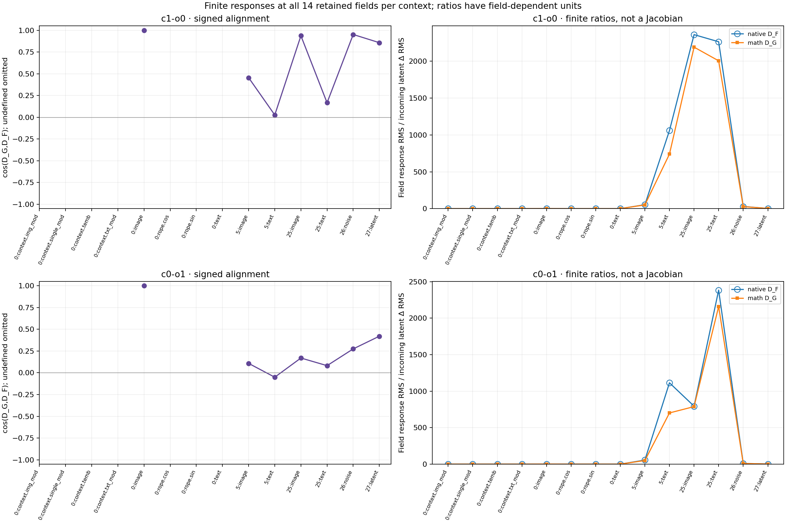
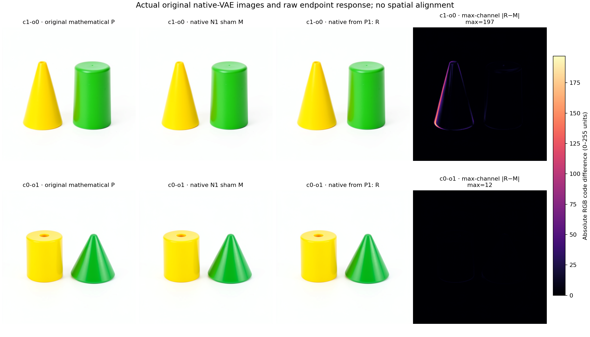
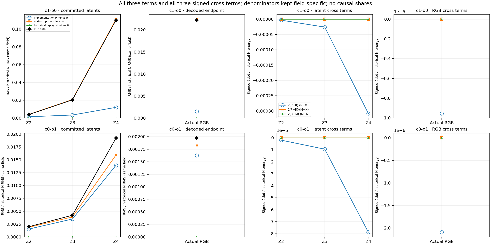

# Native continuations from a sealed predicted state

This experiment tests whether a finite state response measured through the
explicit FLUX mathematical program also occurs in native execution. It then
follows that change through the actual image consumer. The sources are the two
known seed127 contexts selected in [the prompt factorial](FLUX-PROMPT-FACTORIAL.md).
This is a new controlled native branch, not a fresh-seed replication.

## Four futures from two immutable parents

Import the original step1/project StateCut for each context. Replace only its
committed latent, preserving the original tensor layout. Image, text, context
and noise fields are already reset. Conditioning, IDs, schedule and execution
clock remain source-exact.

| Branch | Incoming latent | Continuation |
|---|---|---|
| Native baseline M | Same-value N1 replacement sham | Native passes1–3, then VAE |
| Predicted-input R | Exact previously sealed P1 | Native passes1–3, then VAE |

The physical census is one model load, 336 native adapter transitions, four
Acts, 340 new receipt occurrences, four VAE decodes and four PNGs. It performs
zero new encodes, noise draws or independent mathematical forwards. Imported
historical receipts are separate from this census.

Both new ForecastTransactions seal before any native entry. They bind P1,
the original complete predicted trajectory and terminal image, the historical
native references, exact source parents and frozen expectations. The old
mathematical continuations are reused without fitting or recomputation.

All transitions retain complete manifests, receipts, full field hashes and64
fixed witnesses. Full arrays/cuts survive at project, post-joint4,
post-single19, readout and commit in pass1, plus commits in passes2–3:
28 full transition landmarks. Other308 exits are descriptor-only and cannot
support complete replay or native full-field norms.

## Native response and numerical disagreement

At pass1, the existing mathematical response is D_G=P−Q, where Q=G_1(N1).
The primary native response is D_F=R−M, measured between the two new branches.
Report their signed difference, cosine, absolute norms and

\[
e_{\mathrm{response}}=
\frac{\operatorname{RMS}(D_G-D_F)}{\operatorname{RMS}(D_F)}.
\]

A zero denominator is undefined. The input-normalized finite response ratio
uses the actual RMS(P1−N1); it is not a Jacobian or global stability bound.

Historical replay M−N_old remains a separate instrument diagnostic. A
numerical replay discrepancy does not suppress the changed future. An invalid
checkpoint, source, state closure, clock or implementation remains an integrity
issue. The complete terminal account is

\[
P-N_{\mathrm{old}}=(P-R)+(R-M)+(M-N_{\mathrm{old}}).
\]

Retain all three energies and all three pairwise signed cross terms. Also
report P−M for the current native profile. RGB comparisons use identical raw
coordinates without alignment; these are decoded output contrasts, not
independent latent causes or semantic responsibilities.

Two expectations precede native execution: native post-single19 image response
RMS is larger in c1-o0 than c0-o1, and D_G/D_F have positive alignment in each
case. Their misses remain observations. Final image rankings are exploratory.
The pre-admission correction explicitly replaces the earlier R−N shorthand
with paired R−M, while preserving original expectation bytes and directions.
The incoming native N1 remains the original state used in the denominator.

## Run through installed public packages

```sh
python qualification/submit_flux_native_corner.py NATIVE \
  --parent GPU_RUN --audit ACCEPTED_AUDIT --matched MATCHED_RUN \
  --expectations EXPECTATIONS_JSON --response-contract RESPONSE_JSON \
  --expectation-correction CORRECTION_JSON
# Save a source-bound review at NATIVE/long-run-review-final.json.
python qualification/submit_flux_native_corner.py NATIVE --submit
python qualification/submit_flux_native_corner.py NATIVE --collect
python qualification/analyze_flux_native_corner.py \
  --run NATIVE --parent GPU_RUN --matched MATCHED_RUN --out FRESH_ANALYSIS
python qualification/publish_flux_native_corner.py \
  --run NATIVE --analysis FRESH_ANALYSIS --parent GPU_RUN \
  --matched MATCHED_RUN --out FRESH_PUBLICATION
```

The native worker uses one finite mrun CUDA lease, strict preflight, the original
public runtime wheels and checkpoint profile, and no automatic retries. The
source store is host-local; placement stays on its owner. Current reviewed
resources retain the predecessor's14,336MB RAM/13,600MB VRAM envelope, CPU4,
450-second estimate,900-second worker and1,200-second outer bounds.

The first real attempt stopped before loading the model because a legacy
collector helper was missing from the shipped payload. The failed job and
actual scheduler bytes remain preserved. The corrected launcher includes that
helper and imports the complete pinned helper chain from the staged directory
before admission. A separate earlier staging failure exposed confusion between
physical transitions and the scheduler's finite logical-work cap; the contract
now names four logical futures and336 physical transitions explicitly.

Every new result includes the standalone `retrieve_weights.py` and169 original
parameter recipes. No per-run pretrained weight bank is retained. Collection
authenticates actual scheduler command, request, payload and log, then compares
remote-before, remote-after and local inventories. Analysis performs saved-array
reductions only; its report distinguishes full-array evidence from metadata.

## Completed native result

Job `job-f0c4066835bb` succeeded. Authenticated collection retains595 files /
263,211,678 bytes, with identical remote-before, remote-after and local
inventories. Its actual census matches the plan above. Both same-value
baselines match180 historical field hashes per context and exact terminal
PNGs. Historical replay M−N_old is zero on all checked fields and images.

At logical pass1/post-single19, the image response is:

| Context | RMS(D_G) | RMS(D_F) | Cosine | Relative response error |
|---|---:|---:|---:|---:|
| c1-o0 | 2.96892 | 3.19852 | 0.93711 | 34.92% |
| c0-o1 | 0.78542 | 0.79140 | 0.16978 | 128.37% |

The high-case amplification occurs under native execution. Nearly equal
response norms in the low case conceal poor vector prediction. All three
frozen rank/sign checks hold; they do not certify response accuracy. Image
projection response errors are1.57%/0.67%, but post-joint4 image response
errors exceed100% in both contexts. Post-single19 text response errors are
122.03%/129.31%. Signed countertrends remain in the complete accounts.



The native response continues through the real VAE consumer:

| Final measurement | c1-o0 | c0-o1 |
|---|---:|---:|
| Incoming RMS(P1−N1) | 0.00135495 | 0.00099617 |
| Native response latent RMS(R−M) | 0.09005468 | 0.01261303 |
| Implementation discrepancy latent RMS(P−R) | 0.00987841 | 0.01102434 |
| Native response RGB MAE / maximum channel error | 0.64649 /197 | 0.13770 /12 |
| Implementation discrepancy RGB MAE / maximum | 0.11402 /5 | 0.13649 /7 |

RGB uses raw0–255 channels at identical coordinates. For the high case, a
native suffix supplied with P1 produces the large output tail; continued
approximate mathematical execution is unnecessary for that effect. The low
case has comparable implementation-discrepancy and native-response terms.
Final native latent response/input ratios are66.46 and12.66 along these
specific directions, rather than Jacobians or universal gains.



All three vector terms and all three pairwise cross terms are retained.
For high-case final latent squared L2,12.7904+1062.9737−26.6107=1049.1534;
historical replay terms are zero. Negative implementation/input cross terms
reduce the total. These are signed accounts of the specified branches,
not independent causal percentages.



The [complete published accounts](assets/flux-native-corner-20261105.json)
include all28 response fields and eight continuation accounts. Per-field
plots keep separate numerical scales for
[c1-o0](assets/flux-native-corner-c1-o0-20261105.png) and
[c0-o1](assets/flux-native-corner-c0-o1-20261105.png).
Analysis SHA256:
`91464a61dda97542df34b2aa4fd0678f9e448b9fe857111813d0a15ae1ff11fb`.
Native manifest SHA256:
`7fdbc02a1570d11cf3e88eb3f61cd3cf09fb01825657019318473db92c39fd42`.
The publisher validates authentic job/payload/runtime wheels, source arrays,
existing report operands and baseline diagnostics without model execution.
Its explicit legacy adapter records that the original parent request lacked
individual wheel pins; actual old payload wheel bytes match the new request.
Saved-only publication failures remain preserved separately from the native run.

Scheduler time was735.97s, with peak RSS3,482.1MB and VRAM9,284MB. These are
observed resources, not measured acceleration. Seven worker, ten launcher,
eight analyzer and nine publisher checks qualify the new tools; the real
native campaign supplies separate scientific evidence.

## Next receiving-state test

The [receiver and latent-direction cross](FLUX-LATENT-DIRECTION-CROSS.md)
crossed the two observed error directions with both native receiving states
at a predeclared requested scale. Its six mathematical continuations include
two shams and a known-input repeatability control, and sealed before native
validation. One pairing has native image response RMS2.993 versus0.787–0.822
in the other corners; mathematical response error is37.47% versus128–139%.
Actual BF16-rounded norms and directions qualify the comparison:
receiver-specific installation prevents interpreting normalized responses as
pure receiver sensitivity. An object-level label still requires causal
read/write localization.
