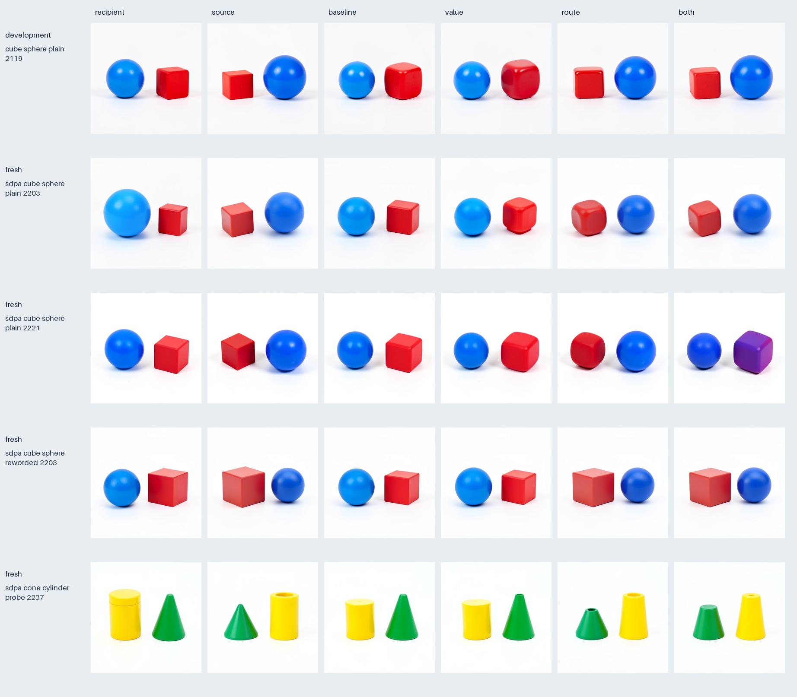
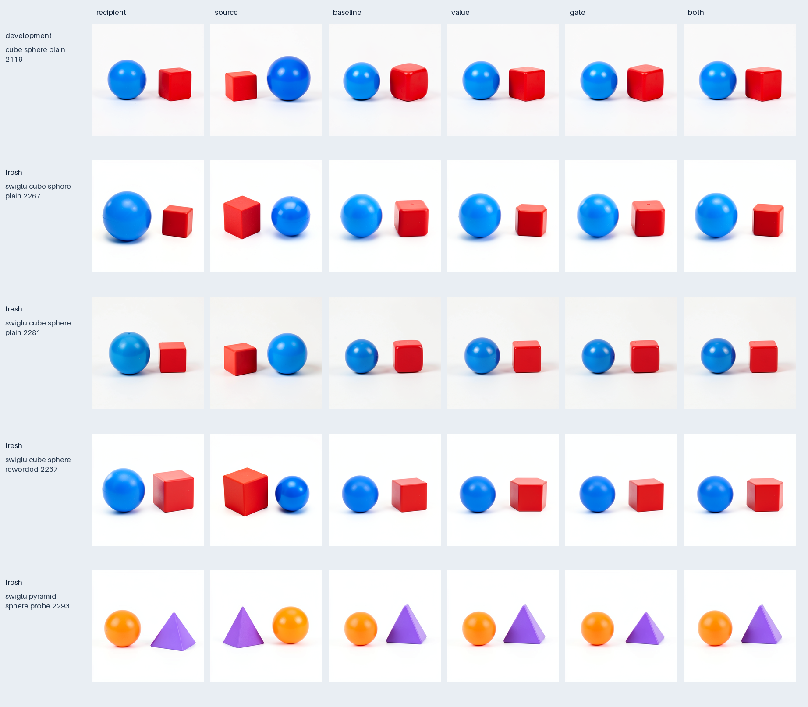

# Attention and SwiGLU computation families

These campaigns move inside the [parallel image writer](FLUX-PARALLEL-RELATION-FAMILY.md), using the [executable family program](COMPUTATION-FAMILY-PROGRAMS.md). They test two nonlinear producers at step 0, single block 4 of FLUX.2 Klein 4B distilled. They are nested computation families within one checkpoint, rather than independent architectures or a universal semantic dictionary.

## What, why and how

| Family | What is varied | Why | How |
| --- | --- | --- | --- |
| Earlier sequential text writer | Already formed residual, attention and MLP returns; separately declared recomputation arms | Test which text update survives to an image consumer | Resolve addressed rows, construct held-return endpoints, predict useful component and route effects |
| Earlier parallel image writer | Image residual and attention return, with fixed Q MLP/gate | Distinguish a useful joint image update from individual returns | Factorial R/A construction, natural P/Q references, frozen future inequalities |
| Third: attention formation | Coherent post-normalization/position Q/K route and V payload | Explain the attention return implicated by the parallel writer | Original SDPA plus full projection, four corners, fixed R_P/Q-other receiver, route-versus-value prediction |
| Fourth: SwiGLU formation | Pre-SiLU G and multiplicative U halves | Test whether the same protocol applies to a different nonlinear producer | Captured shape specialization, generated SiLU/multiply graph, four corners, same original consumer |

All four records need explicit receiving state and continuation. The sequential text family uses an image-assisted source and a later clock; the three image families do not install an image prime. The third and fourth use natural paired captured prompt states. The first two historical campaigns retain their original numerical and selection scopes.

## Fixed receiver and six generated roles

For the two nonlinear families, P supplies the image residual. Q supplies the residual modulation gate, postblock text, conditioning, latent and all other closure. Attention formation holds Q MLP features; SwiGLU formation holds Q attention features. The block modulation gate is distinct from the internal SwiGLU gate half.

Natural P and Q are complete reference histories. Under the fixed mixed receiver, the four corners have generated roles: QQ is the R-only baseline; QP and PQ are the only candidates; PP is the component reference. None of those four mixed constructions is natural P, and the baseline is not natural Q.

The actual primitive runs over every text and image row. Only its image feature rows replace the corresponding Q features at the original full projection input. The native full projection retains its full sequence length and feature width. Only the image endpoint is installed; Q postblock text is preserved. Later computation advances the resulting branch state normally.

## Equations and the reusable structure

Attention's ideal operator is

\[
\Pi_a=\operatorname{softmax}(Q_aK_a^T/\sqrt{128}),\qquad A_{ab}=\Pi_aV_b.
\]

Its consumed Q/K/V shape is `[1,24,1536,128]`; the head-reassembled return is `[1,1536,3072]`. Q and K form one coherent route factor. Native execution uses the original dispatcher, flags, consumed layouts and finite kernels.

SwiGLU's ideal operator is

\[
M_{ab}=\operatorname{SiLU}(G_a)\odot U_b.
\]

The tool derives G and U shape `[1,1536,9216]` from the actual `[1,1536,18432]` fused preactivation, preserving its padded stride and half offsets. Source metadata is authenticated; the view recipe retains the parent hash without inventing hashes for unobserved child bytes. Native execution calls the original complete SwiGLU module, records its SiLU return and verifies its product dependency. The generated graph exposes both nodes; its callbacks are distinct from low-level physical kernel counts.

Both forms are conditionally linear in a payload under a formed operator. Attention mixes token rows through normalized nonnegative weights. SwiGLU gates local channels through signed unnormalized coefficients. This common structure comes from known architectural equations and supplied graphs. The experiments contribute prospective consumer effects, exact finite accounts and reusable execution, rather than discovering a previously unknown attention or SwiGLU identity.

Their ideal mixed terms are

\[
J_A=(\Pi_P-\Pi_Q)(V_P-V_Q),\qquad
J_M=(\operatorname{SiLU}(G_P)-\operatorname{SiLU}(G_Q))\odot(U_P-U_Q).
\]

The native finite primitive, projected endpoint and final-latent mixed terms are measured separately. Bias cancellation and conditional linearity in ideal arithmetic do not license finite BF16 reassociation, split GEMMs or replacement of fused SDPA by explicit softmax.

## Prospective selection and numerical prediction

The primary metric is the signed native final-latent coordinate

\[
p(z)=\langle z-z_P,z_Q-z_P\rangle/\|z_Q-z_P\|^2.
\]

Only two single-factor candidates enter development selection. The selected strict ordering is frozen before fresh prefix submission. Natural references and the component reference are excluded, even if their score is better. Source distance, orthogonal error, decoded distance and unblinded object/shape/color inspection are separate diagnostics.

The ten-stage program computes all source writers, primitive endpoints, 101 own-state suffix transitions and original VAE decodes, then seals globally before any selected native target. The native lane uses its own source operands and states. Module-entry guards and ForecastTransaction records supplement callback ordering. There is no intermediate refresh or later conditioning reset. Exact numerical execution pays the original weights and primitives; it is not a cheaper surrogate.

Each six-action context has two source blocks, four primitive endpoints, 606 suffix transitions, six decodes and five Acts per lane. The native lane has one rewind and 542 transformer blocks including sources. The v3 compiler derives those counts; runtime counters and saved receipts check them. Historical v2 plans remain readable with generated geometry explicitly absent.

## Evidence and current results

The third family selected route over value on development seed 2119: p=0.166440 versus 0.685345. Its frozen ordering held in all four fresh dependent contexts. Their margins were +0.345668, +0.450257, +0.725974 and +0.575183. All 24 fresh complete futures, and six development futures, match native execution through original VAE/PNG. The saved reader accounts for all 560 declared retained tensor-field pairs across development and fresh evidence with zero raw-bit or signed-zero misses, plus 30 byte-identical PNG pairs. Boundary traces add 3,060 paired rows, 42,000 tensor fields and 12,480 scalar fields; they do not contain every complete intermediate activation.

The fresh route-only images reverse the visible object order, with shape collateral. Full route-plus-value transfer is not consistently better: at seed 2221 it produces blue-left/purple-right rather than the source's red-left/blue-right assignment. That broader counterexample remains alongside the successful narrow ranking. Native primitive interaction arrays are nonzero and retained remotely.

The fourth development result selected gate over value: 0.833102 versus 0.869554. Both are worse than the unchanged-feature R-only baseline at 0.778894. Its exact six-future audit accounts for 108 tensor-field pairs, six PNG pairs and 14 generated/actual geometry joins. This is a relative candidate ordering, not evidence that either partial MLP transfer improves the image relation.

The fourth fresh rule, bound to exact prompts and seeds before prefix submission, holds in three of four contexts and reverses on the pyramid/sphere probe:

| Fresh context | Gate p | Value p | Value minus gate | Result |
| --- | ---: | ---: | ---: | --- |
| Cube/sphere 2267 | 0.674935 | 0.758974 | +0.084039 | Held |
| Cube/sphere 2281 | 0.700317 | 0.804840 | +0.104523 | Held |
| Reworded cube/sphere 2267 | 0.744604 | 0.748587 | +0.003984 | Held, small margin |
| Pyramid/sphere 2293 | 0.744198 | 0.710950 | −0.033248 | Counterexample |

All 24 fourth-family fresh numerical futures match exactly: 432 retained tensor-field pairs, 1,780,580,352 compared elements and 24 byte-identical PNG pairs. All fourteen generated/runtime geometry joins agree. The frozen reversal is preserved. On that same probe, gate has slightly lower total source-distance RMS than value (0.676741 versus 0.681147), so that secondary metric disagrees with p; it does not relabel the failure.

The probe changes shapes, colors and seed together. It does not isolate the cause of the reversal or validate a new applicability rule separating cubes from pyramids.

All fresh MLP partial-transfer images retain Q's visible object order. Value/both are less rounded in the two plain cube contexts, but more chamfered or polygonal in the reworded case. The two plain contexts and the probe have worse candidate p than the R-only baseline; the reworded candidates slightly improve it. These unblinded observations support conditional, consumer-specific records rather than a universal useful gate rule.

Across both nonlinear campaigns there are 60 exact complete futures including development, with 48 fresh futures, 1,100 retained tensor-field pairs (4,121,149,440 compared elements), 60 byte-identical PNG pairs, 6,120 paired boundary rows, 84,000 boundary tensor fields and 24,960 scalar fields. The sixty indexed occurrences have sixty exact-query hits and 120 changed-clock/receiver abstentions. These are dependent evidence/indexing counts, not independent scientific samples. Terminal certification remains unassessed.





Each panel includes one development and four fresh contexts. Original images are authenticated native 512² PNGs; only panel thumbnails are resized. All originals have byte-identical sealed forecasts. P/Q/R-only development controls match across the two families. The fresh cohorts use different seeds and do not constitute a matched universal attention-versus-MLP importance test.

The complete workspace evidence lives under `artifacts/mdb-nonlinear-families-20261107`: frozen specifications/designs, before-prefix selection receipts, exact finite requests, immutable runtime wheels, transaction seals, authenticated compact publications, independent audits, generic summaries and exact occurrence atlas indexes. Models run through mrun with CUDA admission; saved-only readers use finite CPU leases and export no parameters.

## Reuse the tool

Use the installed revision containing `mdb.computation_protocol`, not an older common-environment wheel. The public CLI workflow is:

```sh
mdb family specialize specification-template.json source-port-capture.json --out specification.json
mdb family compile specification.json --out program.json
mdb family freeze program.json development-measurements.json --fresh-contexts fresh-contexts.json --out effect-rule.json
mdb family evaluate program.json effect-rule.json fresh-measurements.json --out effects.json
mdb family compare attention-program.json mlp-program.json --out comparison.json
```

`fresh-contexts.json` contains full context objects with IDs, exact P/Q prompts and seeds. Check that the frozen rule says `context_identity_policy: exact-prompt-seed`. Names-only legacy mode has weaker identity scope. The development measurement packet must come from the independent audit and include its exact context metadata.

The actual worker is [flux_primitive_family_campaign.py](../qualification/flux_primitive_family_campaign.py); [the primitive adapter](../qualification/flux_primitive_family_writer.py) executes the generated graph with original kernels. Neither file changes between the third and fourth families. [The independent v2 reader](../qualification/flux_primitive_family_audit_v2.py) compares full retained primitive and projection arrays before endpoint/continuation comparisons, including an error hidden in the projection nullspace. It also emits full native FP64 primitive interaction arrays with source provenance.

[The generic reporter](../qualification/summarize_flux_primitive_families.py) reads only authenticated compact metadata:

```sh
python qualification/summarize_flux_primitive_families.py \
  --native-run /absolute/native-run --audit-run /absolute/audit-run \
  --plan /absolute/program.json --rule /absolute/effect-rule.json \
  --out /absolute/new-summary.json
```

It checks dynamic action/field censuses, preserves incomplete historical coverage, reports raw-bit and signed-zero misses, joins declared geometry, and refuses to count development rows as fresh results. Its four installed fixtures complement the core's 26 checks, 13 writer/campaign checks and seven reader checks; these are mechanics qualifications, separate from model evidence.

The compact collection keeps metadata and PNGs locally. Complete arrays remain on the durable compute volume. Each model publication includes 311 source-bound parameter retrieval recipes and a retrieval script instead of exported weights. The campaign's `retrieve_evidence.py` retrieves one named remote audit member and verifies its size/hash; a 37.75 MB native interaction retrieval was tested and its disposable local copy removed after verification.

## Remaining automation

The compiler currently receives the graph, useful ports, contrast, receiver and native adapter. It generates factorial actions, roles, numerical-program order, a seal barrier, conservative structural properties, work geometry, selection rules and signed evaluation. It does not extract arbitrary model graphs, propose universally useful contrasts, name object concepts, prove wider applicability or enumerate all possible futures.

The next useful primitive is a typed native execution trace tying actual operands and returns to graph nodes and their receiving state. That would let the compiler propose or validate graphs from captured execution instead of relying on manually supplied topology. It is requested in `saturn/request.jsonl` as `typed-primitive-graph-capture-and-execution-census`.
