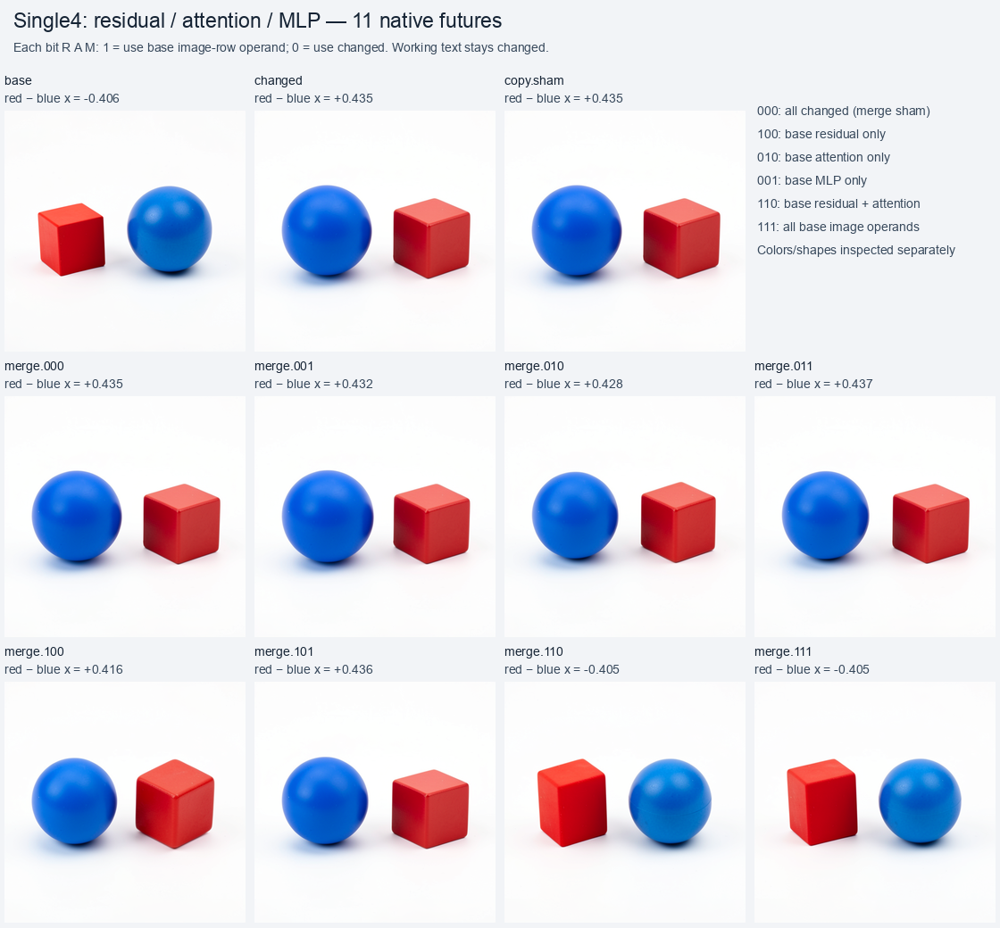
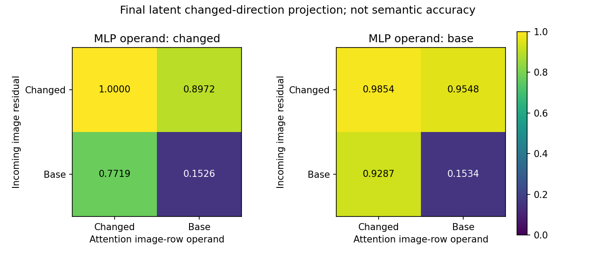

# Residual and attention cooperate at the localized diffusion merge

The single4 factorial finds that replacing the incoming image residual and attention operand together restores the original object ordering. Neither replacement alone does so, and replacing only the MLP operand has a smaller effect. This is a measured coalition in one known scene contrast, rather than a unique MLP with a relation name.

The preceding [dense handoff sweep](FLUX-BLOCK-HANDOFF.md#the-dense-sweep-finds-an-intermediate-compatibility-window) finds that changed text can sustain the flipped scene after single0–1, intermediate single2–3 hybrids lose the clean changed scene, and image state can sustain the flipped ordering after single4–9. We select block 4 because its exit is the first densely tested point supporting the last behavior. The specimen remains FLUX.2 Klein 4B distilled, CUDA BF16, batch one, 512 × 512, four steps, seed31, and the same red-cube/blue-sphere left-versus-right contrast.

## What the mathematical operation actually is

These single-stream blocks use a parallel transformer construction. A shared normalized/modulated input feeds attention and a SwiGLU MLP. Their outputs are concatenated before one learned output projection and one time-gated residual update:

```text
R_next = R + gate * Linear(concat(A, M), W_merge, bias)
```

`R` is the incoming residual, `A` the attention result, and `M` the nonlinear MLP result. The attention result can mix text and image positions; the MLP transforms each position's current features. Earlier attention can already have placed prompt-dependent information in the image residual entering the MLP.

The [merge helper](../qualification/flux_parallel_merge.py) keeps the original full projection shape, frozen weights and BF16 execution. It does not approximate the fused projection by separately projecting and adding two branches. It swaps selected image rows in the actual native operands, recomputes the original merge, and installs only the resulting image field through a public typed Act at the block exit. Working text stays at the changed history's native post-block value. Gates, conditioning, latent, IDs and schedule remain matched.

Two native selected-block executions observe the real projection inputs and returns through read-only hooks. The [worker](../qualification/flux_merge_campaign.py) then seals hypotheses before any RGB outcomes. These observed ports and original projection kernels construct interventions; this is not an independent forecast of the edited images. The unchanged native suffix generates each future.

## Eleven native futures and the retained prediction miss

Each mask has three bits, `R A M`. A one chooses the base history's image-row operand; zero chooses the changed history. Eight combinations plus two native references and a copy sham give eleven images. The six mixed combinations are new causal tests; self/all-base-image cases and references provide controls and joins to known futures.

| Mask | Base operands installed | Final changed-direction latent projection | Inspected ordering |
|---|---|---:|---|
| `000` | None, merge self control | 1.00000 | Changed |
| `001` | MLP | 0.98536 | Changed |
| `010` | Attention | 0.89724 | Changed |
| `011` | Attention and MLP | 0.95483 | Changed |
| `100` | Incoming residual | 0.77187 | Changed |
| `101` | Residual and MLP | 0.92874 | Changed |
| `110` | Residual and attention | 0.15262 | Base |
| `111` | All three image operands | 0.15339 | Base |

Projection is numerical geometry, not semantic accuracy. Assistant inspection of all eleven images sees a blue sphere left and red cube right in changed-order rows, and a red cube left and blue sphere right in base-order rows. Shape, pose and scale vary; the `110` sphere has a visible band or seam. There is no independent human labeling or calibrated semantic classifier.



The sealed directional hypothesis that attention replacement has a larger effect than MLP replacement is supported. The stronger categorical prediction that attention replacement alone restores base ordering is contradicted. The other two categorical predictions, MLP-only preserving changed ordering and residual-plus-attention restoring base ordering, agree with inspection. The [prediction record](../../../../artifacts/mdb-flux-parallel-merge-20261031/prediction-evaluation.json) retains the miss.

MLP substitution is not monotonically helpful toward the base future. Adding the base MLP operand to attention-only replacement moves projection from `0.89724` back to `0.95483`; adding it to residual-only replacement moves `0.77187` to `0.92874`. The MLP participates in state-dependent behavior even though it is a weak standalone control in this occurrence. This does not establish that MLPs generally lack relational roles.

The residual/attention interaction in final-latent projection with changed MLP fixed is `−0.51649`: `p110 − p100 − p010 + p000`. It describes a cooperative effect through the nonlinear downstream consumer. It is not evidence of a Boolean AND gate or a minimal localized semantic program. Whole-field swaps and hybrid compatibility remain part of the interpretation.



## Mechanics and debugging scope

Model job `job-33bac115bde8` completes eleven images, nine image Acts, 1,113 adapter transitions and eight projection evaluations. Actual native merge residual equations close exactly for both source histories. The copy sham and reconstructed `000` future match the changed reference exactly in all retained scheduler arrays and PNGs. Reconstructed `111` joins the dense panel's full base-image restoration exactly in every scheduler file hash and PNG byte. It retains changed text, so matching the untouched base future is not its control contract.

A separate model-free CPU job, `job-ea9956ad5c20`, verifies the complete producer archive, typed CAS, actual port hashes, operand selections, BF16 residual equations and numerical/RGB futures. It performs zero model forwards. The full audit checks 12 cuts, 26 pages, 21 tensor blobs and 1,122 receipt emissions. There are 1,021 distinct receipt contents because equivalent self/copy continuations share content addresses. Emissions are logged separately so deduplication does not undercount executed transitions.

The complete source tree and compressed original log are retained on Beast at `/mnt/hdd8tb/mdb/evidence/flux-merge/job-33bac115bde8`, also bound to the original producer archive SHA `0b4dd1ade5b0df8fbf07c5ee3374d3dc46a848a9b034f134d9e0ed52140ce223`. The [locally verified compact view](../../../../artifacts/mdb-flux-parallel-merge-20261031/offline-audit-04/compact-verification.json) contains the original PNG bytes, rows, source records and returned audit. Full port and latent arrays were verified on the storage host, not re-audited locally from that compact view. Projection outputs are retained actual shared-kernel calculations; the offline auditor does not rerun the external weight matrix.

The [portable result](../qualification/flux-parallel-merge-20261031.json) includes the full audit, predictions, visual observations, repeated-future joins and custody receipt. A separate evidence sweep checks eleven derived numerical rows without model execution. The producer takes 313.34 scheduler seconds, and its model-free audit takes 36.95 seconds. These are execution measurements, without a controlled speedup claim.

Use [NativeCutNavigator](FLUX-BLOCK-HANDOFF.md#scripted-navigation-in-mdb) to reach a selected pre-block cut, capture and fork it, and apply an image-only replacement at the matching block exit. The maintainer campaign records actual native projection ports and their parameter identity; the public adapter's writable state remains the post-block image field. It does not yet expose a general live console breakpoint inside the fused projection.

```sh
python qualification/submit_flux_merge.py /absolute/campaign/run-N --predecessor /absolute/dense/run-01 --selection /absolute/dense/run-01/analysis-v1.json --block 4
python qualification/remote_flux_audit.py /absolute/campaign/audit-N --producer /absolute/campaign/run-N
python qualification/remote_flux_audit.py /absolute/campaign/audit-N --collect AUDIT_JOB_ID
python qualification/remote_flux_audit.py /absolute/campaign/audit-N --verify
```

The remote audit uses one explicit model-free CPU lease with no retries and pins Beast for its host-local evidence store. Host paths and scheduler endpoints in these maintainer scripts describe the recorded fleet. Gzip log custody is lossless and checksummed, with bounded decompression and legacy plain-log support. A local disk-full compaction attempt left original bytes untouched; no historical scientific outcome was rewritten.

## What to name and what to test next

A useful generic candidate is `flux.merge.S04`, **residual and attention coalition**, with applicability restricted to the exact source cuts, image-row factorial, fixed changed text, checkpoint, seed and execution contract above. This names an observed computation/effect relationship. It does not name an object register, a universal `left-of` operation or a complete circuit.

The next decisive test is fresh-seed and paraphrase replication with predictions frozen from this rule. Then factor attention's text versus image keys/values, or narrower spatial supports, where source and carrier explanations disagree. The intermediate mixed-color image also motivates explicit binding measurements. These tests can distinguish a reusable route family from a coalition specific to this pair of states.
