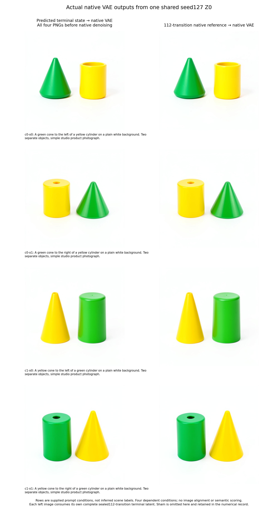
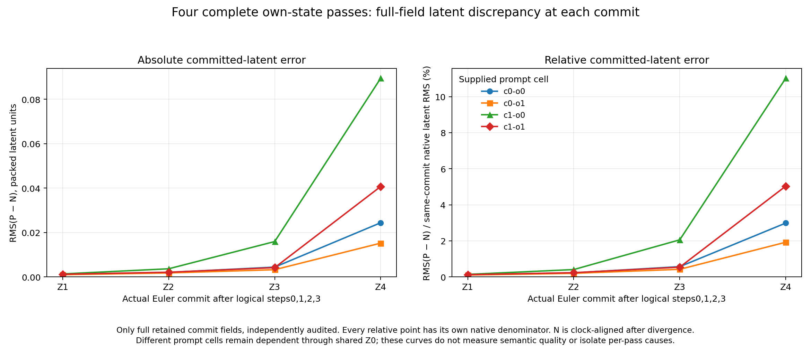
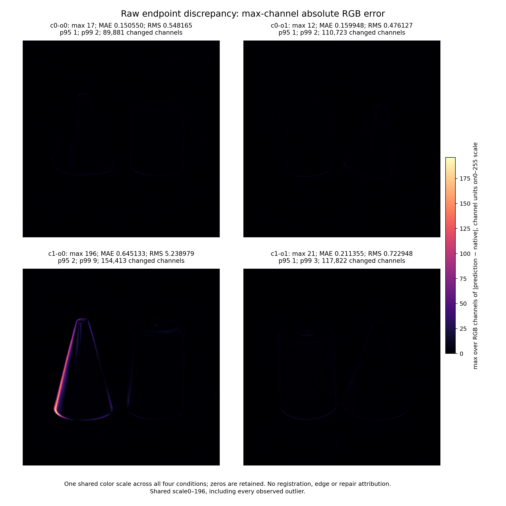
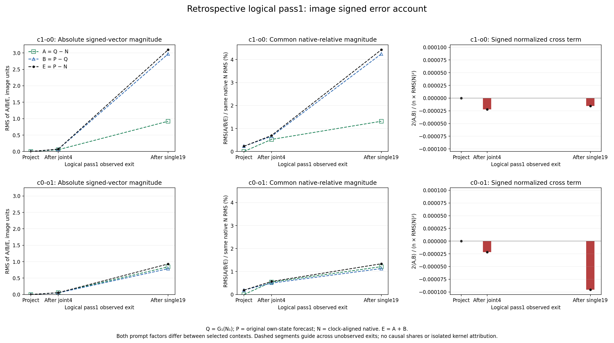

# Four prospective images from one initial-noise state

This workflow tests whether the qualified full112 FLUX.2 Klein4B mathematical
program predicts changes across prompts. It crosses green/yellow assignment
with cone-left/cone-right placement. All four contexts share one newly drawn
seed127 packed latent. Prompt noun order remains cone then cylinder.

The campaign is exploratory. Numerical differences and prompt misrenderings
are retained observations. Four dependent contexts from one noise tensor do
not establish a universal error bound or an object-concept dictionary.

Numerical reconstruction makes the known denoiser equations executable on
their own intermediate state using the original weights. Successful transfer
extends that account's measured coverage. Identifying semantic carriers and
their causal applicability requires additional interventions. The companion
[carrier-transfer experiment](FLUX-CONTEXT-TRANSFER.md) illustrates the
distinction: its signed color-change predictions matched while its predictions
of complete object recoloring missed. A reusable computational pattern can
retain a narrower semantic applicability than first expected.

## Prospective execution

`qualification/flux_prompt_factorial.py` uses one public installed pipeline,
four native prompt encodings and one actual noise draw. Four fresh MDB sessions
carry each prompt's conditioning and exact position IDs, with the same Z0,
schedule and clean execution clock. Original checkpoint parameters are read
on demand. No donor state, future activation refresh or fitted correction is
used.

Each forecast computes its own four passes: project, five joint blocks,
twenty single blocks, readout and Euler commit. The next pass consumes that
forecast's preceding committed latent. All four 112-transition programs seal separately,
then a cohort seal binds them together. Four derived terminal Acts feed the
actual native VAE. Guards prohibit native denoiser targets until all four
prediction PNGs have been saved. Only then do four native 112-transition histories run.
An unchanged terminal sham checks the VAE/Act path.

The physical census is one pipeline load, four encodings, one noise draw,
448 mathematical forecast transitions, 448 native adapter transitions, five
Acts, 453 emitted receipts and nine VAE calls/PNGs. Independent audit adds
448 learned-weight mathematical transitions with zero native framework
forwards. The legacy scheduler `model_free` field for that audit means no
native model object is loaded; it does not mean no learned computation occurs.

## Comparisons and capture coverage

For color assignment c and order o, retain all four P_co forecasts and N_co
native outcomes. Report each endpoint error P_co−N_co, both conditional color
contrasts, both conditional order contrasts and the factorial interaction:

\[
I_Y=Y_{11}-Y_{10}-Y_{01}+Y_{00}.
\]

The key transfer measurements compare predicted versus native changes, such
as (P_10−P_00)−(N_10−N_00) and I_P−I_N. Use fixed raw coordinates without
alignment, and preserve absolute errors, signed means, tails and undefined
relative ratios when the reference contrast is zero. A nonzero pixel
interaction can result from moving recolored objects in a compositional scene;
it does not establish semantic binding.

All predicted fields have complete hashes, moments and 64 shape-fixed witnesses.
Full arrays and hydratable native cuts are retained after project, joint4,
single19, readout and commit in every pass. Other native boundaries retain
complete manifests, receipt bodies, hashes, moments and the same 64 witnesses.
Those boundaries are metadata-only: they do not support complete replay or
full-field native RMS. Text witness positions identify tensor coordinates;
they need not correspond to the same lexical tokens across prompts.

169 parameter recipes and a standalone `retrieve_weights.py` permit exact
rehydration. Persistent per-run copies of pretrained weight banks are omitted.
Unique initial states, landmark activations, predictions, native outcomes,
failures and receipts remain evidence.

## Run using qualified installed packages

Use an isolated installed MDB/Saturn/mrun-pub environment, outside private
workspace imports. The launcher verifies the accepted initial-noise source
cohort and the already qualified lossless integer reader. It freezes the new
worker, independent checker, configuration and source authorities before
execution.

```sh
python qualification/submit_flux_prompt_factorial.py RUN \
  --prior-run ACCEPTED_INITIAL_NOISE_RUN
# Save the source-bound long-run review at RUN/../long-run-review-final.json.
python qualification/submit_flux_prompt_factorial.py RUN --submit-staged
python qualification/collect_flux_prompt_factorial.py RUN JOB_ID
```

Admission uses one finite CUDA lease with strict preflight, measured resource
planning and no automatic retry. Collection authenticates the actual
scheduler job, command, executed payload, logs and remote-before/remote-after/
local inventories. It copies original bytes; it does not manufacture an archive.

`qualification/analyze_flux_prompt_factorial.py` independently reconstructs
all 448 predicted transitions from actual origins and original weights. Its
`analyze_data` core explicitly leaves custody unassessed. The `analyze` wrapper
first verifies authenticated collection and the frozen independent sources.

For a same-host CPU audit after the GPU lease ends:

```sh
python qualification/submit_flux_prompt_factorial_audit.py AUDIT --parent RUN
# Optional lower-memory storage of exactly representable original BF16 bits:
# python qualification/submit_flux_prompt_factorial_audit.py AUDIT \
#   --parent RUN --parameter-codec bf16-bits
# Save its source-bound review at AUDIT/long-run-review-final.json.
python qualification/submit_flux_prompt_factorial_audit.py AUDIT --submit
python qualification/submit_flux_prompt_factorial_audit.py AUDIT --collect
python qualification/publish_flux_prompt_factorial.py \
  --root CAMPAIGN_ROOT --run run-01 --audit-run AUDIT --out publication-v1
```

The CPU worker verifies original producer bytes, creates regular-file hardlinks
preserving contents, mode and mtime, and invokes the unchanged frozen checker.
Hardlinks share the source inode and change its link count and ctime; the
authenticated inventory covers file type, size and content hash.
It verifies the producer inventory again, removes only its temporary
recipe-addressed weight cache, and transports the actual audit report in an
authenticated scheduler log. This avoids reserving the accelerator during
independent mathematical reconstruction.

New CPU audit staging defaults to bounded memoization of decoded original
checkpoint parameters. The first read still runs the frozen recipe validator
and decoder. Subsequent reads use immutable bytes under the complete record
identity and the same Evidence instance's validation domain. Native states,
activations, forecasts and targets always use the original reader. The final
report rechecks every cached value's hash and records actual read counters.
The decoded-byte cap is 18 GiB; decoder and FP64 arithmetic temporaries require
additional RAM. `--no-memoize-parameters` selects the historical uncached profile.

The original I/O adapter passed 18 installed-environment tests. The complete
tiny reconstruction and endpoint trees match the uncached checker: 960 fields,
169 original parameter decodes, 2,535 cache hits, and 1,693 delegated
nonparameter reads. These tiny checks establish the adapter's mechanics; the
actual recovery below provides separate production measurements.

The additional `bf16-bits` storage codec passed 34 installed checks, including
both codecs' complete 960-field and endpoint-tree equality with uncached
reconstruction. It rejects FP32 values whose lower 16 bits are nonzero, stores
immutable U16 bits and reconstructs FP32 using integer shifts and bit views.
There is no rounding or fitted correction. First misses still use the original
validator; final verification hashes both stored bits and reconstructed values.
The optional profile uses an 18 GiB logical decoded bound and an 8 GiB
allocation-inclusive retained charge. Decoder/read/arithmetic temporaries are
additional; the reviewed reservation is 14,336 MB, with the same four threads
and finite time limits. This qualification does not measure production RSS or
speed. The default FP32 positional API and profile remain available.

The first production CPU audit, `job-3e3cefedf464`, was stopped after 2,062.50
seconds and 106 of 448 mathematical transitions. Repeated HDD parameter
reads/hashes made its sealed time budget insufficient. Actual scheduler
job/events/log bytes and the original source freeze remain preserved as an
incomplete instrument attempt. The new finite profile uses four CPU threads,
28 GiB RAM, a fresh temporary parameter cache, and 6,000/6,300-second worker/
outer limits. The numerical analyzer and forecast bytes remain unchanged.
Its cancelled temporary cache was later checked against all 169 recipes and
removed, releasing 7,751,110,784 bytes; the original checkpoint, retrieval
script and scientific evidence remain. Recovery04 started with the qualified
FP32 cache before the optional BF16 profile was admitted. Recovery05 remains
staged and unsubmitted, avoiding duplicate audits.

## Current evidence

CUDA job `job-95453050cf73` completed successfully. All four 112-transition forecasts and
four actual prediction PNGs preceded every native denoiser transition. The
worker completed 448 native transitions, five Acts, 453 receipts and nine VAE
images. Authenticated collection preserved 1,213 files / 1,325,125,620 bytes with
identical remote-before, remote-after and local inventories. The terminal sham
matches the native latent and PNG exactly.



These original-image panels have authenticated GPU-job custody and pre-native
forecast-image sidecars. The later independent CPU audit reconstructed the same
sealed forecast bytes exactly; no endpoint image was replaced.

CPU job `job-cf814192a615` independently reconstructed all448 transitions,
960 complete fields / 1,974,206,464 scalar values, matching every sealed field
hash. Its accepted report SHA256 is
`0d26903d1a34564bf13db9917b6a00e1dac48acfa28131126bc105c8b25c323c`.
The worker took1,801.58seconds; scheduler time was1,810.03seconds. Peak RSS was
16,639.8MB and VRAM0. The actual FP32 cache validated169 original decodes,
served2,535 hits and delegated1,701 nonparameter reads. It verified15,502,178,304
decoded parameter bytes, then removed all169 temporary NPY files totaling
7,751,110,784bytes. Original evidence inventories remained unchanged. These
timings are observations, not a controlled speedup comparison.

Exact independent reconstruction is agreement between mathematical executions.
The nonzero native CUDA discrepancies remain below. [Saved numerical summary](assets/flux-prompt-factorial-20261105.json).

| Prompt condition | Relative latent RMS error | RGB MAE,0–255 | Worst channel error |
|---|---:|---:|---:|
| Green cone left of yellow cylinder |2.987%|0.15055|17|
| Green cone right of yellow cylinder |1.923%|0.15995|12|
| Yellow cone left of green cylinder |11.018%|0.64513|196|
| Yellow cone right of green cylinder |5.035%|0.21135|21|

The larger yellow-cone-left discrepancy is retained. These observations do
not support treating the previous specimen's 3.325% latent error as a universal
bound. Signed RGB contrast relative RMS errors range from 1.183% to 8.087%; the
interaction error is 4.782%, using each native contrast's own RMS denominator.
These are fixed-coordinate numerical comparisons, not semantic classifications.

The larger case's relative committed-latent errors are 0.141%, 0.408%, 2.057%
and 11.018% across the four passes. Its RGB tail includes 768 pixels with a
channel error above 100, with maximum 196 at x=91, y=378: forecast
(253,239,40), native (254,253,236). A background-dominated image mean alone
would obscure that discrepancy. These observations do not isolate new local
arithmetic error from amplification of inherited state error.



The first exported curve plot incorrectly fixed its axes after the first
series, clipping later larger errors. The corrected renderer sets limits after
all four series. The original output remains preserved; numerical summary,
native images, heatmaps and contrast maps are byte-identical across that
visualization correction. A regression check requires every series to remain
within both exported axes.



[Signed color, placement and interaction contrast maps](assets/flux-prompt-factorial-contrasts-20261105.png)
use the original pixel coordinates without alignment or threshold filtering.

An informal arm-blind Astra review paired all four forecasts with their native
references and described the requested coarse colors and placements in both
arms. It also retained blunt cone tips and different cylinder openings across
conditions. This is qualitative evidence, not a calibrated semantic score or
pixel equality claim. One shared seed gives four dependent conditions.

## The next numerical explanation

Let N_(s+1)=F_s(N_s) be the saved native pass and P_(s+1)=G_s(P_s) the sealed
mathematical pass. Evaluate Q_(s+1)=G_s(N_s) on the saved native input. Then

\[
P_{s+1}-N_{s+1}=(Q_{s+1}-N_{s+1})+(P_{s+1}-Q_{s+1}).
\]

The first vector is whole-pass numerical discrepancy on native input, including
propagation of arithmetic differences inside that pass. The second is the
consequence of changing that input through the approximate mathematical map;
it is not native sensitivity. At pass zero, identical input implies Q_1=P_1
and a zero transported-input term.
Retain their signed cross term when comparing squared errors. The existing
native endpoints support this retrospective explanation without another native
image run. It would not constitute a fresh prospective test or identify a
semantic color register. A later new-seed test must freeze its revised numerical
profile and predictions before native execution.

The first focused follow-up recomputes only logical pass1 for c1-o0 and c0-o1:
56 mathematical transitions. The retained post-single19 image errors separate
from 0.811 versus 0.553 in pass0 to 3.096 versus 0.931 in pass1. These cases were
selected retrospectively and differ in both prompt factors. Sawtooth drops
between a pass's last block and the next projection reflect register resets
and changing scale; they are not measurements of repair.

```sh
python qualification/submit_flux_matched_pass.py MATCHED \
  --parent RUN --audit AUDIT
# Save the exact source-bound review at MATCHED/long-run-review-final.json.
python qualification/submit_flux_matched_pass.py MATCHED --submit
python qualification/submit_flux_matched_pass.py MATCHED --collect
python qualification/publish_flux_matched_pass.py \
  --run MATCHED --out FRESH_PUBLICATION
```

The launcher requires the accepted full reconstruction first. Its finite CPU
lease uses the unchanged original pass generator, exact native Z1, original
conditioning, integer IDs and logical-pass1 schedule. A restricted reader
allows source operands and original parameters during Q execution. Both Q
passes seal before P/N target arrays are read. This is a retrospective custody
seal, not new prospective evidence. Full Q arrays survive at five landmarks
per context, with complete output hashes at all 56 transitions. Signed vector
accounts use a common native denominator and retain the cross term. The
original evidence remains immutable; only the owned temporary weight cache
is released after verification.

### Actual matched-input result

CPU job `job-06a7ac52d411` completed the 56 mathematical transitions with zero
native forwards. Collection authenticates 30 original files / 118,102,727
bytes with identical remote-before, remote-after and local inventories. The
worker took 759.40 seconds; scheduler time was 769.25 seconds. Peak RSS was
9,861.8 MB, with no VRAM use, inside its reviewed 14,336 MB reservation. The
lossless BF16-bit cache validated 169 original parameters and served 169 hits;
its 169 temporary NPY files / 7,751,110,784 bytes were removed after verification.
The original producer inventory remained unchanged.

At logical pass1's post-single19 boundary, the signed account is:

| Context / image field | RMS(A=Q−N) | RMS(B=P−Q) | RMS(E=P−N) | A/B cosine |
|---|---:|---:|---:|---:|
| Yellow cone left / c1-o0 |0.92074|2.96892|3.09605|−0.01404|
| Green cone right / c0-o1 |0.84323|0.78542|0.93057|−0.34875|



[Complete signed field accounts](assets/flux-matched-pass-20261105.accounts.json),
[execution and custody summary](assets/flux-matched-pass-20261105.json),
[text countertrends](assets/flux-matched-pass-text-account-20261105.png) and
[readout/commit accounts](assets/flux-matched-pass-readout-commit-account-20261105.png)
are saved-only publications of the authenticated result.

These are absolute RMS values in the same image-register coordinates, not
pixel errors. Within each row the three relative errors use the same native
RMS denominator. The high-case matched-input discrepancy is only modestly
larger, while its transported-input term is much larger. This supports a
state-dependent finite response through G; it does not measure sensitivity
through the native F map. In the lower-error case, opposing directions reduce
the combined error appreciably. Norms cannot be added as independent shares:

\[
\|E\|^2=\|A\|^2+\|B\|^2+2\langle A,B\rangle.
\]

Both pre-execution expectations matched: B exceeds A for the high-case final
image register, and projection B is exactly zero for text, all context fields
and RoPE while remaining nonzero for image. Projected text still has about
0.046 RMS discrepancy against native; B=0 does not imply A=0.

Countertrends remain: high-case text has A larger than B, and high-case noise
has a positive cross term. The committed latent A/B/total RMS values are
0.001458/0.003547/0.003665 for c1-o0 and
0.001399/0.001676/0.001783 for c0-o1. All 28 saved field accounts close their
vector identity exactly; the largest squared-norm floating-point residual is
3.73e−9. Complete Q hashes cover all 56 transitions, while complete native
arrays support only the ten retained landmarks.

The collected report SHA256 is
`31cbd92390b6ea7021aa6bda83c3c99cbadd5618dbf21da846e99cc1be6817da`.
The publisher verifies actual-job custody, original Q arrays and P/N descriptor
references, then plots the authenticated worker accounts without model calls.
Its output explicitly distinguishes that validation from independently
re-reducing P/N arrays. The full forecast reconstruction audit remains separate.

The missing corner subsequently ran as an expanded
[native-continuation experiment](FLUX-NATIVE-CORNER.md): four native futures,
336 transitions and four actual images from the two selected contexts.
Paired shams M exactly match historical N. At post-single19, native image
response R−M has RMS3.19852/0.79140 versus mathematical P−Q2.96892/0.78542;
response errors are34.92%/128.37%. The high-case final native response has a
197/255 channel tail, while P differs from the native P1 continuation by at
most5/255. Complete signed accounts retain the low-case counterexample.

The preceding full112 initial-noise and matched56 findings, including numerical
errors and reader correction history, are in [FLUX-INITIAL-NOISE.md](FLUX-INITIAL-NOISE.md).
