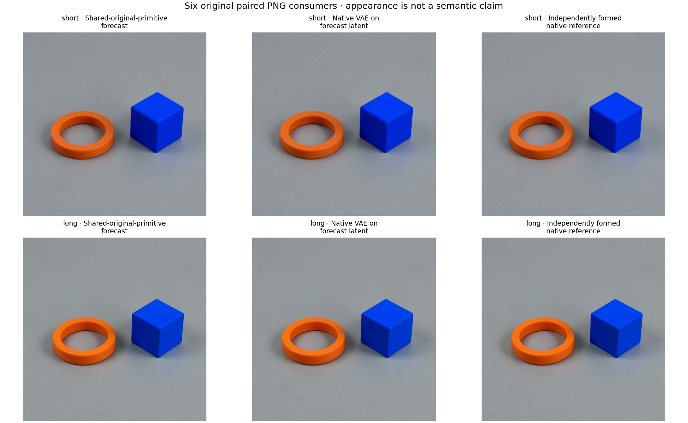
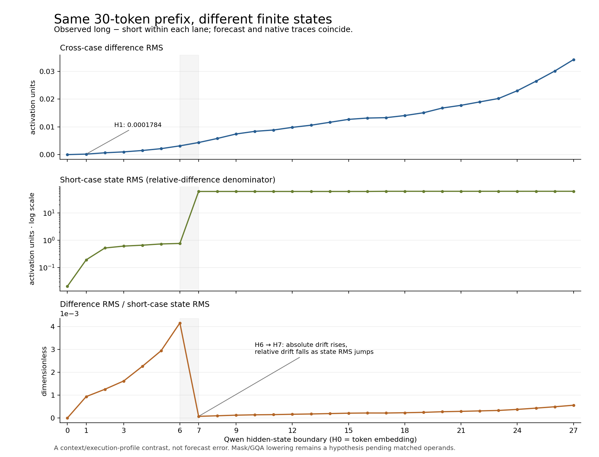

# Raw-context mask/GQA coverage through pixels

The source-bound equation account now predicts two complete FLUX.2 Klein4B
image paths under different Qwen attention argument regimes. All2,022 primary
retained fields /1,229,586,432 scalar comparison positions agree bitwise. All
1,577 pretarget signed-response fields have zero numerical error. These are
dependent repeated coordinates along two paths at one seed, including a known
short-prompt replay and one new long-context case.

This extends [raw prompt to image](FLUX-RAW-TO-IMAGE.md). It uses original
checkpoint parameters and shared Torch numerical primitives, with no donor,
native intermediate refresh, fitted surrogate or per-run pretrained bank.
It is not independent CUDA arithmetic or universal input equivalence.

## Actual inputs and program

Seed277,B1,512×512,four distilled steps,noCFG/no reference image. The short
text is the exact cube/ring prompt in the preceding workflow. The long text
appends128 copies of` The tabletop is gray and the lighting is even.`
Both raw texts were frozen before source tokenization; no text tuning followed.

| Input/argument | Short | Long |
|---|---:|---:|
| Actual uncropped tokens | 39 | 1,319 |
| Retained query rows | 512 | 512 |
| Attended/padded rows | 39/473 | 512/0 |
| Attention-level mask | Explicit bool causal/key-padding | None |
| Causal flag | False | True |
| K/V grouping | repeat_kv | enable_gqa |

The raw-content, truncation, length and dispatch changes are combined. This
is not an isolated padding intervention. Both cases consume all512 query
rows in E, including the short case's padded query outputs.

The forecast forms own Qwen states0..27 and
`E=cat(H9,H18,H27)` with shape`[1,512,7680]`. Native Qwen executes36 blocks
plus tiedLMhead; its unused suffix is counted, not forecast-certified.
Each own-state FLUX path has4×28 transitions: project,5joint,20single,
readout,Euler. Explicit functional VAE produces rawRGB and uint8pixels,
with the qualified CPU unpack/inverse-BN/unpatch frontend.

Both complete forecasts and full FP64 long-minus-short response commitments
precede one global seal. Then native Qwen and denoiser paths independently
form their inputs and successive states. One functional VAE and two native
VAE consumers per case distinguish whole endpoint error from same-latent
decoder error and the native-consumed effect of latent discrepancy.

Actual census:3 CPU-retained component hydrations,6CUDA placements/6offloads,
max1GPU component,2functional/2nativeQwen,224functional/224nativeFLUX,
2functional/4nativeVAE,4separately seeded draws,4,436native descendant module
entries and0guard refusals. The source guard permits no native learned
module entry before the seal. Parser,RNG and parameter-free schedule
primitives are shared declared dependencies.

## Evidence and finite results

| Account | Fields | Comparison positions | Max error |
|---|---:|---:|---:|
| Primary Qwen | 58 | 81,264,640 | 0 |
| Primary denoiser | 1,960 | 1,145,176,064 | 0 |
| Primary RGB/pixels | 4 | 3,145,728 | 0 |
| Recursive signed responses | 1,577 | 1,059,953,657 | 0 |

The signed census includes context/carry tensor leaves beyond the primary
census and overlaps their coordinates; do not add these as independent
trials. All response hashes were pretarget, and all verify. Native pixel
response RMS is10.9757144333 RGB levels, signed mean+2.2758216858, while
its complete prediction error is zero. Conditioning response RMS4.3883649214
has different units and is not a causal gain denominator.

Whole endpoint error is`P−N=(P−C)+(C−N)`, whereC is native VAE consumption
of the forecast latent. Both terms, error energies and cross terms are zero
for both contexts and endpoint representations. Error cosines are undefined.
Three original PNGs are byte-identical within each context; the two contexts
have different PNGs. Native VAE intermediate macros beyond actual captured
postquant operands/returns are not fully retained in this panel.

The shared30token prefix has identical embeddings but different native
hidden states: RMS differenceH1=0.000178376651,H9=0.007434493454,
H18=0.014073519041,H27=0.034241180664. Forecast and native trajectories
of this cross-case difference agree. This is not target prediction error.
Different finite attention lowering is a working explanation, not an isolated
matched-operand result or proof that causal attention reads future words.
Actual54forecast/72nativeSDPA argument receipts match the declared regimes;
selected CUDA kernels and attention-mask-content hashes are unprofiled.

Four explicitly curated generic EquationCatalog occurrences record whole-image
and same-latent-decoder comparisons. Twelve actual installed CLI searches
return4exact matches/8changed-seed or changed-clock abstentions. These do
not perform automatic family induction or extrapolate to arbitrary prompts.

## Reproduce the finite workflow

Use the qualified installed public environment and the exact source/helper
closure. These are maintainer qualification scripts, not a new top-level
`mdb run` command. New model work must go through one mrun lease with CUDA
declared and strict preflight; staging alone makes no model call.

```sh
python -I -B qualification/stage_flux_raw_mask_pair.py NEW_RUN \
  --parent-run WORKSPACE/artifacts/mdb-flux-raw-to-image-20261106/run-01
# Inspect exact source, request, geometry, resources and finite-run review.
python -I -B qualification/stage_flux_raw_mask_pair.py NEW_RUN --submit

# The next two commands read only saved evidence after native success.
# They use the dedicated240s estimate/600s outer CPU audit launcher.
python -I -B qualification/audit_flux_raw_mask_pair.py NEW_AUDIT --study NEW_RUN
python -I -B qualification/audit_flux_raw_mask_pair.py NEW_AUDIT --submit

python -I -B qualification/publish_flux_raw_mask_pair.py \
  --pack AUTHENTICATED_COMPACT --out NEW_PUBLICATION \
  --expected-manifest COMPACT_MANIFEST_SHA \
  --expected-request NATIVE_REQUEST_SHA --expected-job NATIVE_JOB \
  --collection-receipt COLLECTION_RECEIPT \
  --qualification AUDIT_QUALIFICATION_RECEIPT
```

The launcher rejects changed frozen source, changed sealed payload or repeated
submission. The explicit stage0 source request is a metadata/recipe parent,
not a donor state. The source state's parameters remain checkpoint recipes.
Use the included standalone weight-retrieval scripts if exact parameter
arrays are needed. Compact evidence also supplies`retrieve_evidence.py` and
the external manifest so exact raw members can be retrieved by hash.

Actual roots are`artifacts/mdb-flux-raw-mask-pair-20261106/run-02` and
`audit-03`. Native request:
`783e8dc0c0a731c458eed739c5d8b68c932bf622ef5f426d7f484596a8c011dd`.
Global seal:
`836d44bc4dc24b4413473813eb0682efc1ef2c1a143f8b10f98dd6724697c594`.
It precedes native release,255.6706s versus255.7069s. No later native
activation is a forecast input. Pure saved audits and publication cannot
change that sealed prediction.

Native job`job-0b6c4340d5e6`:411.95s,RSS20,718.1MB,VRAM8,374MB.
CPU audit`job-ce54f7b5406a`:208.62s,RSS1,445.9MB,0VRAM. Actual native
reservation was24GiB RAM/13,000MB VRAM/CPU4; the CPU audit used3GiB/CPU2,
no model construction, no learned recurrence and no CUDA.

The producer wrapper covers2,632members/5,208,398,881B; its588,754B manifest
is additional. Raw arrays remain onBeast. The collected compact is65files /
22,422,868B expanded and3,834,243B archived. No full raw or pretrained bank
was collected. The full array audit authenticates709 original recipes once.

## Honest instrument history

`run-01` failed locally before request/job creation because a512work-item
declaration exceeded the supported256cap. The corrected reviewed contract
defines14 component passes and separately retains448 denoiser transitions
and458 combined component/transition calls; this is not14 primitive calls.

Saved-only audit`job-56860c50186f` failed at nested frontend filename
classification;`job-7a55a56683eb` failed when byte generator records lacked
tensor-record stride fields. Their frozen sources, requests, complete logs
and failed states remain preserved. Reader v3 uses actual frozen serializers
in its synthetic fixture, authenticates raw BF16 bits and distinguishes
unrecorded capture stride from serialized NPY stride. It completed without
new neural execution. Publisher key-mapping corrections also leave the
producer, original arrays and forecasts unchanged.

The producer's uncropped-token metadata records2 because it calls
`len(BatchEncoding)`. The saved auditor preserves that field and reports
actual counts39/1,319 from explicit retained-tokenizer IDs. Effective plan
omits`job_id`; wrapper/source/summary carry it and are joined strictly.
These are declared metadata corrections, not numerical misses or rewritten
history. Numerical discrepancies, when present, remain observations.

Current qualifications:12 isolated producer checks;1 bootstrap test covering
both entrypoints and the real finalizer;12 isolated final saved-reader checks.
Earlier failed fixtures and reader versions remain available. Counts above
come from the actual production saved audit, not these synthetic tests.

## Next causal cut

The [seventh Astra review](assets/flux-raw-mask-pair-20261106/advisor/holistic-review-07.json)
and [direction](assets/flux-raw-mask-pair-20261106/advisor/direction-07.md)
select a bounded first-block Qwen attention microscope first. Compare actual
shared-prefix Q/K/V, then hold one complete bank fixed across repeated KV
with explicit full causal mask, repeated KV with causal flag, and unexpanded
KV with causal flag/GQA. These express the same ideal attention. Preserve
their finite signed differences, actual dispatch/profile evidence and
propagation through projection/residual/MLP to H1. Stop at H1. This ordered
triangle is not a full factorial attribution; the original short padding
mask is equivalent to the full causal mask only over its valid prefix.

That [microscope has now completed](QWEN-BLOCK0-ATTENTION.md). Shared-prefix
Q/K/V are exact; the first five differences appear at SDPA. Actual profiling
observes memory-efficient versus Flash Attention. On a fixed full bank,
explicit-mask versus causal-flag execution exactly reproduces the original
prefix difference through H1 at six retained ports. The causal repeated-versus-
grouped contrast is bit-exact zero in this specimen. This localizes the fused
primitive and its consumed tail; it does not isolate arithmetic inside its
CUDA kernels or attribute the full image difference to the numerical route.

Existing public`Act.patch` can replace E18 columns`[2560:5120]` by positive
BF16zero at the genuine step0/project boundary, with same-mask own-value
sham, original E9/E27 and noise fixed. This tests a direct conditioning
constituent through all four projects and image consumption. It does not
ablate Qwen17's upstream MLP: E27 still carries that history. This is the
second planned cut, after localizing prefix drift. Dense states and generic
names remain sufficient; independent arithmetic and universal applicability
remain unestablished.

## Portable evidence

The [publication](assets/flux-raw-mask-pair-20261106/publication.json),
[complete saved audit](assets/flux-raw-mask-pair-20261106/audit-data.json),
[actual installed CLI and job verification](assets/flux-raw-mask-pair-20261106/actual-saved-report-verification-v1.json)
and [compact retrieval script](assets/flux-raw-mask-pair-20261106/compact-evidence/retrieve_evidence.py)
retain source identities, raw-evidence retrieval and the failed reader history.
The original parameter recipes and retrieval scripts are in compact evidence's
source-metadata directory. The portable source directory contains the exact
executed closure and final qualifications; it contains no pretrained arrays.





Full diagnostic figures retain [Qwen errors](assets/flux-raw-mask-pair-20261106/qwen-traces.png),
[denoiser errors](assets/flux-raw-mask-pair-20261106/denoiser-traces.png),
[signed-response prediction errors](assets/flux-raw-mask-pair-20261106/signed-response-trajectories.png),
[decoder decomposition](assets/flux-raw-mask-pair-20261106/endpoint-decomposition.png)
and [actual mask/SDPA arguments](assets/flux-raw-mask-pair-20261106/mask-sdpa-context.png).
