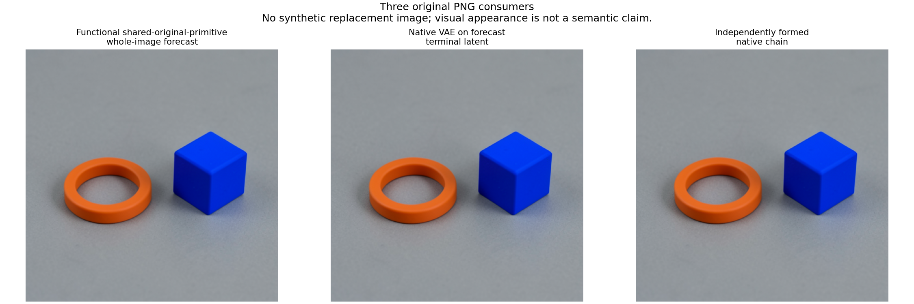
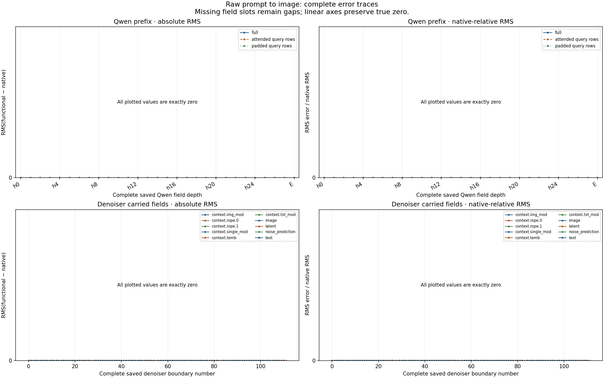
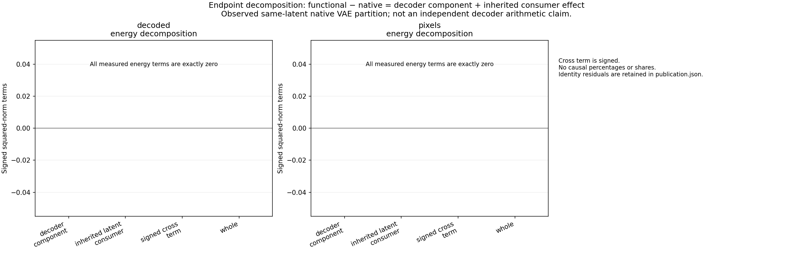

# A globally sealed raw-prompt-to-image computation

One prospective FLUX.2 Klein 4B specimen now joins raw prompt formation,
own-state Qwen conditioning, all 112 denoiser transitions and explicit VAE
pixels before native learned targets execute. All 1,011 primary complete-field
comparisons are bit-exact across 614,793,216 scalar positions.



This composes the earlier [raw-prompt Qwen account](FLUX-FUNCTIONAL-QWEN-PREFIX.md),
[own-state denoiser continuation](FLUX-FUNCTIONAL-REMAINING.md) and
[explicit decoder](FLUX-FUNCTIONAL-DECODER.md). Original Torch primitives are
shared. The original model job failed packaging after completing its scientific
work; a separate, explicitly labelled CPU recovery authenticated and audited
the retained bytes. No neural model was rerun during recovery.

## Exact specimen and finite profile

```text
A cobalt blue cube to the right of a matte orange ring on a gray tabletop. Two separate objects, simple studio product photograph.
```

Seed 277; B1; 512×512; four distilled steps; guidance_scale=1; no reference image
or CFG branch. One user message uses the pinned original template with
add_generation_prompt=True/enable_thinking=False, right max-length padding and
truncation to 512. There are 39 attended/473 padded rows; all 512 query rows enter
FLUX conditioning. No language continuation or CoT is generated.

The pinned parser runs once; native Qwen reuses its IDs and mask. Each lane
creates its own same-seed CUDA generator and forms its noise, packing, IDs and
schedule through declared shared parameter-free primitives. There is no
independent CUDA RNG emulator claim.

Qwen embedding plus 27 blocks produce E=cat(h9,h18,h27), shape [1,512,7680],
without final normalization. Native reference work executes 36 blocks, final
norm and tied LM head; that suffix is not a forecast target. Learned weights
are BF16; Qwen's original inverse-frequency buffers remain FP32 through
device-only placement. The configured SDPA path uses an explicit causal and
padding mask with repeated KV heads. Selected CUDA kernels are not profiled.

Each FLUX pass has project + 5 joint + 20 single + readout + scheduler = 28 typed
transitions. Four passes give 112. The working-state closure retains image,
text, residual latent, context, RoPE, noise prediction and clock where live.
These boundaries contain multiple primitive operations. Every later forecast
consumes earlier predicted state; native continuation consumes its own native
Qwen output and native prior state.

The decoder frontend explicitly uses CPU ID scatter, inverse BN and unpatch;
the decoder itself executes on CUDA. This is the qualified profile, not a
claim about an ordinary all-CUDA pipeline. The source Euler expression keeps
the original BF16 scalar/noise product before FP32 latent addition:

```python
next_latent = (latent.float() + (sigmas[k+1] - sigmas[k]) * noise).to(noise.dtype)
```

## Evidence and ordering

| Primary account | Full fields | Scalar positions | Error |
|---|---:|---:|---|
| Qwen hidden 0..27 and E |29|40,632,320|Bit-exact|
| 112 denoiser transitions, all retained live fields |980|572,588,032|Bit-exact|
| Complete decoded RGB and pixels |2|1,572,864|Bit-exact|
| Total |1,011|614,793,216|Zero|

Counts repeat carried values and selected conditioning coordinates. They
describe one dependent path, not independent statistical trials. Row subsets,
four dependent same-latent/inherited-consumer endpoint comparisons, one
post-quant comparison, input diagnostics and eight Euler equation checks are
additional overlapping accounts, not extra primary histories.



The functional decoder finishes at 199.45s and the global seal at 201.64s.
Native Qwen completion is 215.67s, native denoiser completion 265.57s and both
VAE consumers complete at 283.75s. The actual module-entry guard and execution
inside ForecastTransaction.execute establish pre-target sealing; completion
times are not exact first-entry timestamps. The seal is
`36331a2642324ca69591e1e447ebe2b887d7e2152b0f5d1dbd32e35abb1efa19`.

One functional decoder and two native VAE calls produce P, C and N:
functional pixels, native decoding of predicted Z4, and native decoding of
native Z4. The audit retains P-N=(P-C)+(C-N) and the squared-energy cross term.
Here all differences and the cross term are zero. No causal percentages are
inferred. Actual native before/after-post-quant operands are retained and
joined to their declared inputs. Eleven functional decoder macro outputs are
saved; full native internal decoder macros and all primitive arrays are not
captured in this new specimen.



The original job `job-7efe0a8100bb` remains **failed**: its finalizer rejected
134,217,856-byte `decoder.up_blocks.2.npy`, comprising 128 MiB payload + 128-byte
header, against a 128 MiB member bound. All forecasts, native consumers, closed
transaction and final resident checks had been written before that failure.
There was no original final manifest.

Recovery job `job-0059a663c170` authenticated the failed job/request/payload/log,
complete retained inventory and core closure, then built a separate hardlink
view. The frozen finalizer there used 134,221,824 bytes/member and the unchanged
4 GiB total limit. Original contents/mtimes stayed intact; shared-inode link
counts changed by the expected alias multiplicity. The view's wrapper carries
the original IDs, while the compact recovery capsule carries the new job and
request IDs. The unchanged auditor read the view without new neural calls.

Original runtime 329.23s; peak RSS 20,815.5 MB/VRAM 8,374 MB. Recovery/audit 85.26s;
peak RSS 1,767 MB/VRAM 0. These are scheduler-reported peaks. Three component
hydrations, six CUDA placements and six offloads keep at most one learned
component on GPU. All 709 recipes/15,895,266,374 payload bytes are checked
against original checkpoint files and final resident maps. No persistent
per-run parameter payload bank is exported.

Raw evidence is 1,337 files/2,615,642,740 bytes on Beast. The hardlink view shares
those data blocks. Compact evidence is 50 files/15,297,843 expanded bytes;
archive 2,918,732 bytes. Full arrays stay near compute and remain retrievable.

## Inspect the actual result with MDB

The two records share
`law.flux.raw-prompt-own-state-composition.v1` and
`route.flux.shared-torch-primitives.raw-to-image.v1`. Their aliases are
`cmp.flux.raw-to-image.whole` and
`cmp.flux.raw-to-image.same-latent-decoder`. They are dependent occurrences,
with explicit prompt/mask/noise/source/profile/clock/horizon conditions.

Using the portable assets from this directory:

```sh
python -I -B -m mdb equations find \
  --catalog docs/assets/flux-raw-to-image-20261106/compact-evidence/catalog/equations \
  --alias cmp.flux.raw-to-image.whole \
  --applicable-to docs/assets/flux-raw-to-image-20261106/actual-cli/whole.exact.context.json
```

The installed CLI actually ran eight queries: two exact matches and two each
abstaining on changed seed, changed clock and missing prompt identity. These
are searchable evidence records, not automatic family induction.

The [actual audit](assets/flux-raw-to-image-20261106/audit-data.json),
[publication](assets/flux-raw-to-image-20261106/publication.json),
[independent report/CLI verification](assets/flux-raw-to-image-20261106/actual-saved-report-verification-v1.json),
[recovery receipt](assets/flux-raw-to-image-20261106/compact-evidence/recovery-receipt.json)
and [full-byte retriever](assets/flux-raw-to-image-20261106/compact-evidence/retrieve_evidence.py)
are linked with the compact archive's exact identities. Parameter recipes and
standalone retrieval code are under its source-metadata directory for
[Qwen](assets/flux-raw-to-image-20261106/compact-evidence/source-metadata/qwen_manifest-qwen-parameter-artifacts.json),
[FLUX](assets/flux-raw-to-image-20261106/compact-evidence/source-metadata/flux_manifest-flux-parameter-artifacts.json)
and [VAE](assets/flux-raw-to-image-20261106/compact-evidence/source-metadata/vae_manifest-vae-parameter-artifacts.json).

For another workspace run, `qualification/stage_flux_raw_to_image.py` stages
this fixed specimen against the bound planning metadata and qualified Qwen
run 08. Inspect its exact request before the separate reviewed submit action.
The current launcher derives decoder-member size from geometry and includes
NPY framing; the original executed launcher's bytes remain preserved with the
failed-run provenance. The unchanged forecast worker is
`qualification/flux_raw_to_image.py`. Successful ordinary runs can use
`qualification/audit_flux_raw_to_image.py` through the shared saved-audit
launcher. This failed producer used the distinct, qualified
`qualification/recover_flux_raw_to_image.py`; it must not be sent through a
success-only collection path or relabelled as a successful model job.

Qualification included four producer checks, one independent bootstrap test
with five subprocess cases, 20 saved-audit checks, 11 recovery checks, five
publisher checks and one allocation-free original-geometry NPY-framing regression. None of those tiny
fixtures is presented as real-model scientific evidence; the tables above
come from the actual collected run.

## Next computation coverage

A computation record describes an equation and its ports. The StateCut
supplies live tensors and time/phase/cursor; the continuation selects the next
operation. Together they support typed execution and replay. A record plus
continuation without operands is not a complete current state.

This experiment moves the observation frontier to raw prompt and declared
seed, within the stated shared-primitive numerical profile. It does not prove
universal image prediction, semantic object functions or independent kernel
arithmetic. Earlier independent-arithmetic misses and separate component
coverage limits remain evidence.

The next prepared contrast used two raw prompts under seed 277: a partly
padded 512-row prompt versus a fully attended 512-row prompt. Native SDPA then
changes from an explicit bool mask/is_causal=False/repeated KV to
mask=None/is_causal=True/enable_gqa=True. The existing functional helper
supports both source paths. That contrast has now completed with per-case
dispatch binding and one global seal before either native target. All2,022
primary fields and all1,577 signed-response fields have zero numerical error.
The [paired workflow](FLUX-RAW-MASK-PAIR.md) records the actual run, preserved
reader failures and a new shared-prefix finite-drift observation. The next
experiment localizes that drift at Qwen block0 with matched attention operands.
