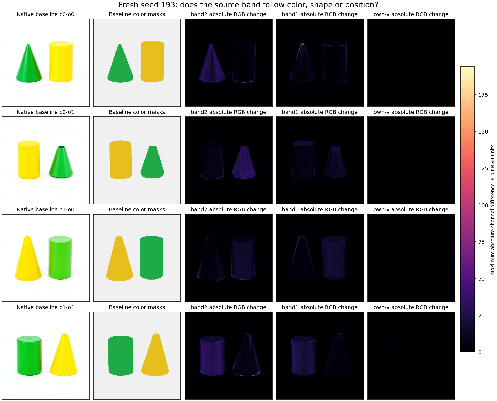

# FLUX reader families across color shape and position

The original-weight reader program predicts new FLUX states exactly under the
qualified CUDA BF16 primitive contract. A fresh seed and crossed color/order
contexts produce 64 byte-exact head, residual, MLP and text predictions. A second
experiment shows that the associated visible color response travels mainly
through the current image attention output; the text output carries a smaller
continuing effect. Reading a change and driving its visible outcome are
different roles in a computation record.

This extends [route discovery](FLUX-READER-ROUTES.md) and
[native reader futures](FLUX-READER-ROUTE-FUTURE.md). The specimen is original
FLUX.2 Klein 4B distilled, CUDA BF16, B1, 512px, four denoising passes,
step3/joint0. Forecasts begin at observed positioned Q/K/V and incoming
text/modulation. They execute native Flash, linear, LayerNorm and SwiGLU
primitives. This tests their decomposition and composition; it is not an
independent Flash implementation or a raw-prompt-to-image forecast.

## Fresh states and competing meanings

Seed 193 replaces the earlier seed 127. One native noise draw is shared by four
cached conditioning inputs:

| Context | Cone | Cylinder | Cone position |
|---|---|---|---|
| c0-o0 | Green | Yellow | Left |
| c0-o1 | Green | Yellow | Right |
| c1-o0 | Yellow | Green | Left |
| c1-o1 | Yellow | Green | Right |

The prompt template is `A {color} cone to the {left/right} of a {color} cylinder
on a plain white background. Two separate objects, simple studio product
photograph.` Conditioning was previously encoded; no encoder executes here.
Native baselines visibly respect these color/order assignments. Several cones
are truncated, and dimensions vary. Swapping prompt colors does not guarantee
an otherwise identical rendered scene.

Each context has baseline, source band2, source band1 and own-V branches. Band2
copies K/V image rows 512–767 from the opposite color assignment at the same
seed/order; band1 copies image rows 256–511. Receiver text K/V and queries stay
fixed. Text rows precede image rows, so these are global K/V rows 1024–1279
and 768–1023 respectively. Own-V multiplies only image V for head7 by 1.0625,
rounded to BF16, with no donor.

Both source bands remain in the evidence. They are address controls without
payload-energy matching. Their sources can differ in geometry as well as color.

## The numerical program

Let B denote declared BF16 rounding and T the incoming text register:

```text
H = FlashAttention(Q_text, K_all, V_all)
A = linear(H, W_attention)
U = B(T + B(g_attention * A))
X = B(B(LayerNorm(U) * B(1 + c_mlp)) + s_mlp)
[a,b] = linear(X, W_in)
Z = B(SiLU(a) * b)
M = linear(Z, W_out)
T_next = B(U + B(g_mlp * M))
```

The three matrices are original text parameters retrieved from the immutable
checkpoint. Modulation comes from the actual parent state. Each branch freezes
H,U,M,T_next before its target full block executes. The original full-query
attention and block then consume the sealed K/V intervention.

All 64 field archives are byte-exact: 100,663,296 BF16 values, including four
baseline, eight band and four donor-free own-V states. Image-divergence timing
matches 16/16 expectations, including four trivial baseline self-comparisons.
Final PNGs are native observations, not numerically forecast images.

Earlier prefixes are counted: four 85-step prefixes execute 300 blocks before
forecasting. Four intentional pre-attention stops capture operands while
preserving parent payloads. The complete campaign executes 772 successful
Navigator steps, 700 native blocks/attention calls and 16 VAE decodes. Forecast
counts are 16 Flash, 48 linear, 16 LayerNorm, 16 SwiGLU. There is one model acquisition,
one noise draw, zero encodes and zero automatic retries.

## The larger effect follows green

Baseline-only color masks and signed color measurements were declared before
target execution. Green score is (G−R)/(G+R+1). Squared RGB change is reported
both in total and per baseline-mask pixel; empty masks abstain. Visual inspection
confirms that these masks cover the intended colored objects.

| Context | Band2 green object RGB RMS | Yellow object RGB RMS | Green score change on green | On yellow |
|---|---:|---:|---:|---:|
| c0-o0 | 17.2065 | 5.3887 | −0.164734 | +0.009438 |
| c0-o1 | 19.3215 | 5.5216 | −0.151282 | +0.019876 |
| c1-o0 | 10.9483 | 5.0162 | −0.053186 | +0.016031 |
| c1-o1 | 17.4702 | 8.2616 | −0.169440 | +0.015867 |

RGB RMS uses 8-bit channel units. Green has the larger per-pixel effect in 4/4
contexts; cone has it in 2/4 and the left half in 2/4. All eight band2 color signs
match the frozen source-direction expectation. Band1 also favors green in 4/4
and matches all eight signs, weakening a unique band2 concept interpretation.
Own-V changes are much smaller: whole-image RGB RMS 0.258–0.293, with no frozen
color-direction prediction.

The larger effect follows green when it moves between shapes and positions.
This supports a color-sensitive response in these contexts. A dedicated green
concept, discrete object slot and unique semantic head remain unestablished;
rendering sensitivity, source payloads and geometry remain live explanations.



## Which stream carries the visible change

K/V affects every query, so a changed text reader alone cannot identify the path
causing the final image. The next panel routes complete attention outputs from
baseline H0 and band2 H1:

```text
base       = [H0_text, H0_image]
full       = [H1_text, H1_image]
text-only  = [H1_text, H0_image]
image-only = [H0_text, H1_image]
```

Both native attention returns use the same actual Q and identical full
geometry/K/V strides. Splits continue through unchanged original projection,
residual, MLP, remaining blocks, flow commit and VAE. All 16 reader predictions
seal before any target block. Eight base/full controls are historical and eight
split futures are new. This lease executes 432 steps, 400 blocks, 408 native attention
calls, 16 VAE decodes and 12 forecast Flash/48 linear/16 LayerNorm/16 SwiGLU calls.
It regenerates no prefixes, encodes or noise.

All 64 reader fields are byte-exact again. All eight controls match prior
text/latent/PNG bytes. All eight splits satisfy both current-exit closures:
text-only T equals full and I equals base; image-only T equals base and I equals
full. Image divergence starts at joint1 for text-only and joint0 for image-only.
Text divergence has reciprocal timing. These are tested architectural
consequences at this boundary.

For final RGB, let ΔF=Y_full−Y_base, ΔT=Y_text−Y_base and
ΔI=Y_image−Y_base. Signed projection p_X=<ΔF,ΔX>/<ΔF,ΔF> measures alignment
with the complete band effect. It is not variance explained or an additive
causal percentage.

| Context | Text-only RGB RMS | Image-only RGB RMS | Text projection | Image projection | Additive response error |
|---|---:|---:|---:|---:|---:|
| c0-o0 | 0.2593 | 5.2509 | +0.005985 | 0.987452 | 7.21% |
| c0-o1 | 0.2918 | 5.5390 | +0.003547 | 0.994497 | 7.31% |
| c1-o0 | 0.2698 | 4.3097 | −0.002233 | 0.991720 | 8.82% |
| c1-o1 | 0.2825 | 6.8032 | +0.002342 | 0.993313 | 5.90% |

Additive response error is RMS(ΔF−ΔT−ΔI)/RMS(ΔF); final-latent error is
13.79–16.28%. Interaction remains, so the paths are not independent additive
explanations. Text-only green-score changes on green are −0.000938,+0.000258,
+0.000687,−0.000655: two oppose the full effect. All signed rows are retained.

The image output is the dominant tested carrier of this late color response.
Continuing text has a real, smaller influence. This revises the tempting causal
interpretation of text-reader activity while retaining its exact computation.

## Keys versus values

A third matched panel holds the receiver queries and text K/V fixed and crosses
baseline/source image keys with baseline/source image values inside band2. The
baseline and joint K/V corners replay eight historical controls; the eight
K-only/V-only futures are new. Sixteen complete reader forecasts seal before
any target block. All 64 field archives are byte-exact again; all eight controls
match text, latent and PNG bytes; all image-divergence expectations match.

The frozen exploratory expectation was that values alone would produce the
larger absolute green-score response on the originally green object and retain
the full intervention's negative sign. Both expectations agree in all four
contexts:

| Context | Keys-only signed green score | Values-only signed green score | Full K/V signed green score |
|---|---:|---:|---:|
| c0-o0 | +0.001578 | −0.165633 | −0.164734 |
| c0-o1 | +0.003097 | −0.156764 | −0.151282 |
| c1-o0 | +0.000764 | −0.053894 | −0.053186 |
| c1-o1 | +0.000326 | −0.169068 | −0.169440 |

Values-only RGB projection onto the full effect is 1.0057–1.0255; keys-only
projection is −0.00814 to −0.00185. The K/V additive response error remains
6.42–9.81% in RGB and 16.48–18.71% in final latent. Payload replacement under
the existing queries/keys produces most of this observed response. This does
not make attention addresses irrelevant: original keys are still required,
and changed keys plus changed values have measured interaction.

The stream and operand experiments are separate factorizations. Joint K/V's
image-output dominance alone does not establish V-only mediation. The following
panel directly tests that conjunction.

## Connecting the value payload to the image output

The fourth panel crosses V-only with complete text/image output routing. It
replays eight baseline/V-only controls from the independently audited operand
panel and tests eight new mixed futures. All 64 reader fields are byte-exact;
all eight controls match text, latent and PNG bytes. All current text/image exit
closures and both reciprocal first-divergence timings match again.

The frozen prediction was that the image-only route would have the larger
absolute signed green-score response and retain the negative full-V sign.
Both agree in all four tested contexts:

| Context | V through text only | V through image only | Full V-only |
|---|---:|---:|---:|
| c0-o0 | −0.001942 | −0.164577 | −0.165633 |
| c0-o1 | −0.000089 | −0.157360 | −0.156764 |
| c1-o0 | +0.001099 | −0.054356 | −0.053894 |
| c1-o1 | −0.000468 | −0.167294 | −0.169068 |

Image-only RGB projection onto the complete V-only effect is 0.9890–0.9971;
text-only is −0.00389 to +0.00709. Additive response error is 5.98–8.45% in RGB
and 13.44–16.03% in final latent. Thus the value-payload to image-output edge
is now tested directly, with interaction and a counter-signed text case retained.

In ideal real arithmetic, holding Q and K fixed holds
P=softmax(QKᵀ/√d) fixed, so ΔH=PΔV. Changing keys instead gives ΔH=ΔPV;
the joint attention interaction is ΔPΔV. This explains the distinction between
changing an address weighting and transporting another value payload under
existing addresses. Native BF16 rounding and downstream nonlinear consumers
remain part of the finite computation. This panel does not independently
reconstruct Flash probabilities or certify the ideal identity bit-for-bit.

The candidate record has an operational name:
`route.flux.image-V.band2.image-output.future-RGB.v1`, paired with
`law.flux.V-band.image-stream-response.v1`. Four qualitative prediction records
bind the frozen sign/dominance expectations to native outcomes. Applicability
is restricted to supplied model, seed, parent, clock, band, consumer and tested
contexts; the record is not a universal green concept. Individual image heads,
upstream value writers and replication on fresh wording/seeds remain open.

## Computation records and the time circuit

A reusable law is a program under an explicit numerical contract. A route names
source rows/heads, stream, consumer and clock. A live occurrence adds actual
operands, residual, modulation, parent identity and continuation. An object-level
name is an interpretation requiring separate cross-context tests.

The time-circuit account includes both state and scheduled consumers: current
text can change while current image stays fixed; the next joint read lets it
influence image. Image-only changes produce the reciprocal delayed text read.
The symbol table should index these lifetimes and roles, including readers that
are not dominant carriers of a selected behavior.

The next causal cut should narrow the image heads and upstream value writers,
using these same parents and native continuations. The peer
[image-tail microscope](FLUX-IMAGE-TAIL.md) already supplies an observed-head
image-tail instrument at another clock. Reuse it while keeping known-input
numerical results separate from fresh-state and semantic claims.

## Workflow custody and limitations

`qualification/flux_reader_fresh.py` stages/submits fresh prefixes and prediction
transactions. `stage_flux_reader_streams.py` reuses durable parents for the
stream cut. `flux_reader_fresh_audit.py` runs saved-only comparisons near the
tensors and publishes 16 supplied-applicability records per panel. Installed CLI
queries return the selected record and abstain at a changed horizon. Family
induction remains manual.

The historical three-panel index remains immutable at `index-v1`. The four-panel
catalog at `artifacts/mdb-flux-reader-fresh-20261105/index-v2/equations` contains
64 numerical occurrences and four causal-response occurrences. All 68
complete-context queries identify one occurrence, and all changed-horizon queries
abstain. This is source-verified consolidation and manually named candidate
family evidence, not automatic family induction. `index-v2/provenance.json`
binds every copied record to its original panel and audit.

```sh
# Fresh-seed acquisition, sealed reader predictions and native continuation.
python -I qualification/flux_reader_fresh.py FRESH_RUN \
  --prior QUALIFIED_READER_FUTURE_RUN --origin-local AUTHENTICATED_ORIGIN_ROOT \
  --factorial AUTHENTICATED_FACTORIAL_ROOT
python -I qualification/flux_reader_fresh.py FRESH_RUN --submit
python -I qualification/flux_reader_fresh_audit.py FRESH_AUDIT --study FRESH_RUN
python -I qualification/flux_reader_fresh_audit.py FRESH_AUDIT --submit
python -I qualification/recover_flux_directory.py FRESH_AUDIT FRESH_COLLECTION

# Reuse the same parents; no prefix, encoder or noise replay.
python -I qualification/stage_flux_reader_streams.py STREAM_RUN \
  --fresh FRESH_RUN --audit FRESH_STUDY
python -I qualification/stage_flux_reader_streams.py STREAM_RUN --submit
# --panel kv selects the matched K-only/V-only factorial instead.
# --panel value-streams --operand-study KV_STUDY tests V-only output mediation.
```

`FRESH_STUDY` contains `compact-collection-01/extracted/binding-minimal-result`
from the audited collection. Set `MRUN_URL` to the configured scheduler before
audit staging. Each submitted request binds its worker sources, model, source
inventory, original parameter recipes, counts and execution environment. Use the
same saved-only audit and collection commands for subsequent panels. Queries
can use the retained catalog context files or a sidecar copied from an occurrence's
`tested_context`, changing only `horizon` for the abstention check.

Fresh native job `job-4663ab0e6fbd` and audit `job-940663c8b340` succeeded.
Stream native job `job-f9d4172f333b` and audit `job-4483b5fc868a` succeeded.
K/V native job `job-22d63312934e` and audit `job-2447d09f120b` succeeded.
V-stream native job `job-8214b5c54472` and audit `job-f9886e5d8a60` succeeded.
Fresh scheduler time 89.18s, peak RSS 2953.5MB/VRAM 9298MB; stream 66.60s,
RSS 2774.1MB/VRAM 9306MB. These are measured costs, not comparative speedups.
The K/V job used 78.84s, RSS 6326MB and VRAM 9306MB.
The V-stream job used 96.21s, RSS 6476.1MB and VRAM 9306MB.

Raw fresh 473,301,141 bytes and stream 160,639,816 bytes remain on Beast. Audited
compact transport archives are 1,844,395 and 1,780,480 bytes, including PNGs,
transactions, reports, catalogs, inventories and checksum-based retrieval.
Both include original-weight recipes and `retrieve_weights.py`, without another
parameter bank.

The K/V panel adds 432 native steps, 400 blocks/attention calls, 16 forecast
Flash calls, 48 linears, 16 LayerNorm/SwiGLU calls and 16 images. Its raw
311,655,233 bytes remain remote; the compact archive is 1,796,952 bytes. It
uses the same original parameters and creates no new encoder input or noise.
The V-stream panel adds 432 steps/400 blocks/408 native attention calls and
16 images, with 12 forecast Flash/48 linear/16 LayerNorm/16 SwiGLU calls.
Its raw 160,650,871 bytes remain remote; the compact archive is 1,797,506 bytes.

The first fresh audit omitted the required execution identity during catalog
publication. Its failed attempt is retained; the corrected CPU audit succeeded
without model replay. A separate stream metadata correction records two legacy
head-edit flags that omitted complete-stream restorations. Original tensors,
explicit stream routes, seals and independently verified exit closures are
unchanged. The current harness emits corrected flags.

The standard Saturn sweep recognizes the retained timeline stream. The dedicated
audit verifies array/transaction/catalog evidence. Timeline coverage does not
replace the numerical audit or certify a semantic family.

Local evidence lives under `artifacts/mdb-flux-reader-fresh-20261105/` and
`artifacts/mdb-flux-reader-streams-20261105/`; the latter includes
`metadata-correction-v1.json`. Historical failures remain immutable and separate
from current interpretations. The operand panel is retained under
`artifacts/mdb-flux-reader-kv-20261105/`.
The direct payload/output mediation is in
`artifacts/mdb-flux-reader-value-streams-20261105/`. Thirteen focused installed
environment tests pass for the current harness.

The [completed head/source/generalization campaign](FLUX-READER-HEADS.md) adds
132 native futures. Coalition18–23 leads the four known contexts; its RGB order
transfers to four new paraphrases at seed241, while its signed-green order only
transfers2/4. Complete image-to-V reconstruction is exact, and typed final-pass
latent swaps establish the persistent source of that image register and V while
retaining recipient text ports. The selected V band's effect has small signed
alignment with the much larger latent-source image change;
these are not causal percentages. Earlier latent writers, a complete individual
head map and independent seed/wording attribution remain open.
