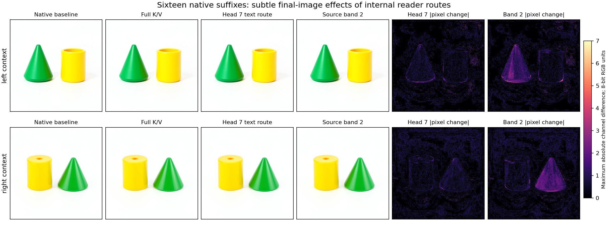

# A computation record earns its continuation

The [route screen](FLUX-READER-ROUTES.md) identified a distributed text reader
and retained counterexamples to a fixed head ranking. This follow-up asks
whether selected components actually reach the image, and whether the extracted
reader predicts states that were not in that screen.

The result is exact local prediction with a verified temporal boundary. All
64 head/residual/MLP/text archive comparisons match byte for byte across sixteen
native cases. Four of those cases use new K/V interpolation states. Text-head
interventions first alter the image in the **next joint block**, while source
K/V interventions affect it in the current block. Both reach the final latent
and PNG. Their visible effects here are small late-denoising changes.

## What was predicted and what was observed

One model acquisition, `job-4c4cf4ac3624`, runs sixteen B1 512px futures from the
two known step3/joint0 parents. Head 7 and source-row band 2 were selected from
the left-context screen, without replacing them with the right context's
observed winners.

Per context, the cases are baseline/full K/V controls, K/V doses 3/8 and 5/8,
head addition/removal and source-band addition/removal. The four controls have
historical endpoints. The eight head/band cases have known local text effects
from the screen but new continuations. The four dose reader states are new in
this campaign.

All sixteen head/residual/MLP/text predictions and image-divergence timing
expectations are sealed before the first full native block. Predictions use
12 FlashAttention calls, 48 original linear calls, 16 LayerNorm and 16 SwiGLU
calls. These are actual native primitive executions, including original model
submodules. This is qualification of a decomposed reader program, not a
zero-computation forecast or an independent FlashAttention implementation.

The unchanged original consumer then executes 432 debugger transitions,
400 transformer blocks, 400 in-block SDPA calls and sixteen VAE decodes.
There is no new prompt encoding or noise draw. The full future image is
observed; its pixels were not numerically forecast.

## A complete local equation, tested on new inputs

For an input dose a, the image rows of both source ports are constructed as:

```text
K_a = B(K_0 + a * (K_1 - K_0))
V_a = B(V_0 + a * (V_1 - V_0))
```

Text rows stay baseline. `B` is BF16 rounding after the declared FP32
construction. The reader computes its own head from captured positioned text
queries and these complete K/V inputs. That head feeds the projection,
gated residual, normalization/modulation, SwiGLU MLP and final residual in
[the reader equations](FLUX-READER-ARITHMETIC.md).

The native full block receives those sealed K/V inputs and independently
executes its original attention and text tail. Every complete field matches
its forecast in all sixteen cases. That is 100,663,296 BF16 values across
64 primary comparisons, including controls and known local interventions.
The four new-dose cases contribute sixteen comparisons over 25,165,824 values.
These element counts are not independent sample counts.

For head interventions, the selected head replacement is the defined Act
payload. Only that text-head slice changes; all other text heads and every
image head are checked unchanged. Exact delivery of an intervention payload
is distinguished from predicting the native operations that consume it.

All four historical controls reproduce their original first text exits,
final latent archives and PNG bytes exactly. No accuracy gate discards a case.

## The clock is part of the computation

```text
image K/V -> joint0 text head -> joint0 text update
                                   |
                                   v
                             joint1 image update
                                   |
                         later blocks and readout
                                   |
                              flow commit
                                   |
                              latent -> VAE
```

| Intervention | First text difference | First image difference | First latent difference |
|---|---|---|---|
| Selected text-head addition/removal | joint0 | joint1 | flow commit |
| Image K/V dose or source-band addition/removal | joint0 | joint0 | flow commit |

All four head cases satisfy the deferred-image prediction. The ten nonbaseline
K/V cases, including two full controls, satisfy the immediate-image prediction.
The two baseline self-comparisons have no divergence. The current joint block's
image output is byte-identical to its appropriate control in the head cases.
The first differing image output is produced by joint1; its stored execution
point names the next operation, so producer and next-clock labels are kept
distinct.

The intermediate images never return to exact control equality before commit.
This establishes persistent numerical difference, not an effect-size curve:
intermediate records retain complete tensor fingerprints rather than complete
intermediate difference arrays. Approximate repair magnitudes remain unmeasured.

At flow commit, working image and text slots are explicitly cleared to typed
`None`. That is disposal after committing the latent, not repair. The next
generation pass would rebuild working state from the persistent latent and
conditioning; this final pass terminates and the VAE consumes the latent.

This is why the time-circuit state is more than a computation ID. The record
describes an operation and its applicability. The live state includes actual
tensor payloads, context and clock; the continuation defines what reads them
next. Weights are the original model memory. No parameters are learned here.

## How much reaches the final image?

For final output Y, use the signed alignment
`dot(Y_case - Y_base, Y_full - Y_base) / ||Y_full - Y_base||^2`.
It is projection onto the complete K/V effect, not a percentage of pixels
explained, semantic success or independent additive attribution.

| Case | Left final-latent alignment | Right final-latent alignment | Left / right RGB alignment |
|---|---:|---:|---:|
| Head 7 addition | 11.47% | 10.33% | 13.78% / 14.91% |
| Head 7 removal: effect remaining | 87.64% | 84.10% | 85.79% / 85.98% |
| Band 2 addition | 40.43% | 44.57% | 53.87% / 55.74% |
| Band 2 removal: effect remaining | 58.56% | 48.77% | 45.98% / 36.91% |
| Dose 3/8 | 37.85% | 36.19% | 41.38% / 35.17% |
| Dose 5/8 | 59.02% | 55.79% | 57.03% / 55.57% |

The dose response is an observation, not a frozen whole-image forecast.
Head 7 has a fairly similar projected RGB effect in both contexts despite
different local text alignments and different local head winners. Local rank
alone therefore does not specify importance at every consumer and horizon.



The first four columns are unmodified native PNGs. The final two show maximum
absolute channel differences from the baseline, on one explicit 0–7 scale in
8-bit RGB units. Head-case RMS differences from their respective controls are
0.30–0.35 RGB units, with maxima 4–6. Band-case RMS differences are 0.42–0.52,
with maxima 4–9. These are subtle updates, not object swaps or object creation.

The band-2 difference maps visibly emphasize the green cone in both spatial
orders. That is a lead, not a concept name: cone shape and green color are
confounded here. Brightness/texture sensitivity and the source contrast can
also explain the localization. A matched color-assignment swap and other source
bands are needed before attributing it to “cone” or “green.”

## Evidence, debugger workflow and an audit repair

Saved-only CPU audit `job-3d641cd605eb` verifies the source/native inventories,
reconstructs the exact intervention inputs, checks the sealed transaction,
compares all fields and controls, and measures native continuation outputs.
Sixteen computation records keep numerical predictions, structural timing and
observed final images distinct. Matching queries resolve; changed-horizon
queries abstain. Applicability is explicitly supplied.

From `artifacts/mdb-flux-reader-route-future-20261105/`:

```bash
ROOT=compact-collection-01/extracted/binding-minimal-result
python -I -m mdb equations find --catalog "$ROOT/catalog/equations" \
  --applicable-to "$ROOT/catalog/context-dose.json"
python -I -m mdb equations find --catalog "$ROOT/catalog/equations" \
  --applicable-to "$ROOT/catalog/context-wrong-horizon.json"
```

These installed-wheel commands were exercised. The first returns
`cmp.flux.reader-future.right.dose375`; the second returns `[]`.

The first saved-data audit, `job-b92cc4259f40`, failed because it assumed every
present working slot was a tensor. The flow commit represents cleared slots
with typed scalar-None descriptors. The corrected auditor recognizes those,
keeps slot clearance separate from exact reunion, and supports the legacy
tensor-hash alias. A regression also separates stride changes from value
changes. The failed audit and its original log remain intact; the successful
audit reuses the same native data with zero model reexecution. Native job
metadata is reused after checking its binding rather than overwritten during
audit restaging. Six focused tests pass.

Native operator/future time was 44.30 seconds and runner time 98.26 seconds,
with peak RSS 8209.8 MB and peak VRAM 9264 MB. This is not a comparative speedup
benchmark. Future launches use that measurement for a 9 GB RAM reservation and
150-second estimate; historical request metadata remains unchanged. The saved
audit used 17.85 runner seconds, 487.8 MB peak RSS and
zero VRAM. The raw native corpus is 247 files totaling 286,835,998 bytes on
Beast; its compact audit is 2,180,254 compressed bytes and 3,564,656 expanded
bytes across 158 files, including all sixteen native PNGs. Tensor archives
remain individually retrievable by SHA; original weight recipes and the
standalone weight retriever remain included. No persistent parameter bank is
added.

The generic Saturn evidence sweep remains separate from this source-bound
MDB audit. Broader prompts/seeds, the source-payload versus receiving-text
factorial, object identity and an independent Flash numerical implementation
remain open. The new material here is the causal route and its verified clock
and continuation, alongside a more broadly tested executable reader.
