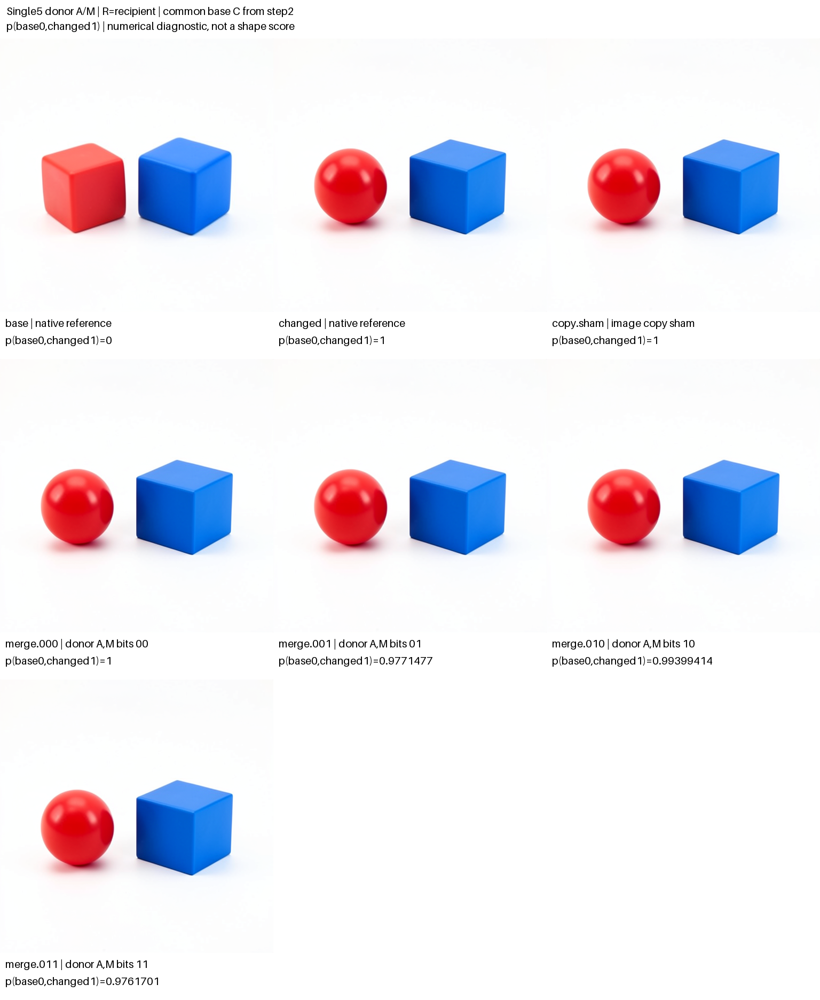
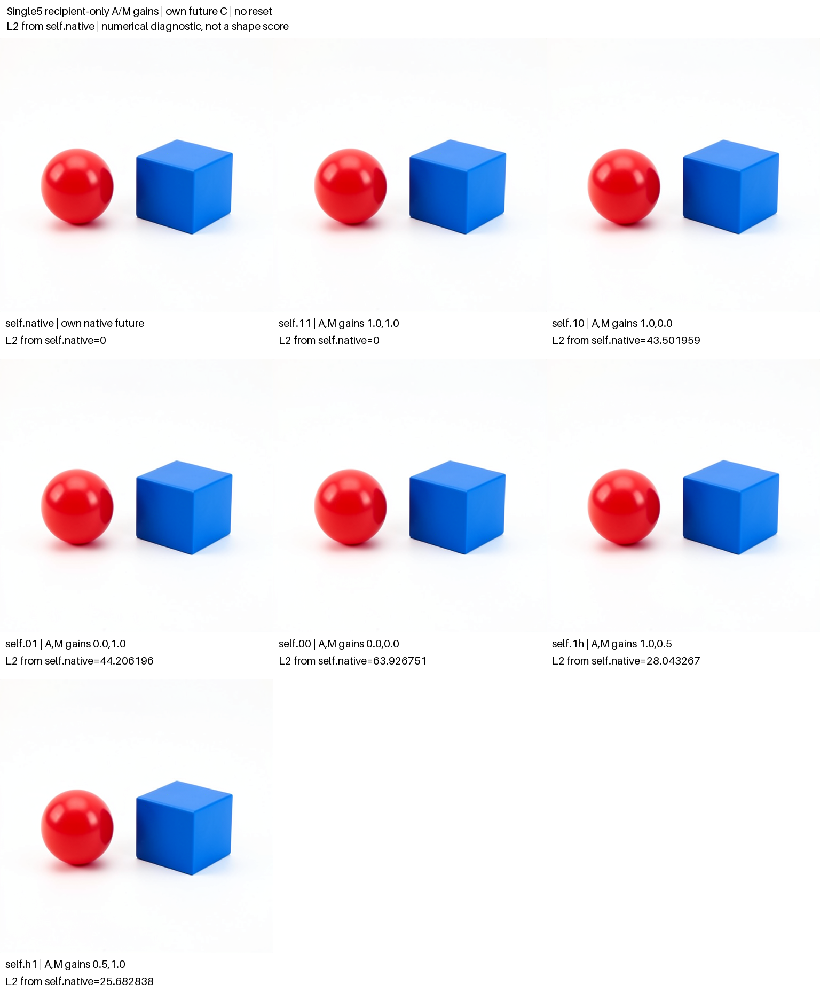

# Adjacent donor edits and recipient operand controls

At adjacent single5, substituting base M moved the final latent farther toward the base reference than substituting base A. This missed the frozen attention-over-MLP rank prediction. With the recipient's own operands and future conditioning, zero A caused slightly more drift than zero M: 44.2062 versus 43.5020, a difference of about 1.6%. These are two conditional numerical comparisons with different reference futures, not evidence for general attention dominance or a semantic operation. Arm-blinded assistant inspection described a sphere-like red object in every non-base image, including both-zero recipient operands; no edited image restored the base red cube.

This follow-up to the [single4 shape-writer experiment](FLUX-SHAPE-WRITER.md) completed all fourteen planned native futures. The [independent audit](../../../../artifacts/mdb-flux-recipient-controls-20261103/run-01/analysis-v1.json) verified custody, typed closures, both native BF16 writer equations, every recipe, conditioning policies and exact controls. The immutable [publication](../../../../artifacts/mdb-flux-recipient-controls-20261103/final-v1/result.json) retains every row and prediction miss.

The earlier experiment used one seed-47 shape-assignment contrast in FLUX.2 Klein 4B. Base M substitution moved the final latent slightly baseward under native recipient residual, but in the opposite direction under copied base residual. Both residual and later native continuation influenced that response. The actual BF16 installed increments were closely aligned but not identical, so their final sign reversal did not isolate rounding from later amplification. This follow-up keeps recipient residual fixed and moves one block later.

## Shared observed state and two continuation policies

The model profile remains distilled FLUX.2 Klein 4B, checkpoint inventory `dd976d67036c4a0a55642f702dcb3740ba7a4f367557596572baac168330904f`, CUDA BF16, batch one, seed 47, 512 × 512 pixels, four denoising steps and guidance 1. Authenticated base and changed cuts after step1 joint4 are supplied observations. Five native single-block advances per history reach single5 entry; native selected-block captures retain actual residual, attention/MLP operands, gate and projection. There is no new prompt encoding.

The source record and hypotheses are sealed after these allowed observations and before the fourteen new RGB suffixes. Every branch continues through the native remaining denoiser, scheduler and VAE. It retains scheduler arrays 2, 3 and 4, a final typed cut and its original PNG.

The continuation policies are deliberately different:

| Panel | Local receiving state | Future stored conditioning C | Headline numerical metric |
|---|---|---|---|
| Donor A/M factorial | Recipient residual; base or recipient A/M | Common base C installed before step2 projection | Final latent p, base=0 and changed=1 |
| Recipient-only gains | Recipient residual, gate and own A/M | Recipient's own C throughout; no reset | Final latent L2 distance from matched `self.native` |

Global base/changed geometry for recipient-only rows is retained as an explicitly unmatched diagnostic. It must not be presented as their headline causal effect: the donor references have a different future-C policy. The recipient-only matched comparison has the same array as both reference endpoints, so its target projection is undefined while its L2, mean absolute difference and signed mean remain useful.

## Seven donor-panel futures

The local writer retains the native full projection and BF16 arithmetic:

```text
image_next = R + gate * Linear(concat(A, M), W_merge, bias).
```

R remains the recipient residual in all four donor masks. A mask bit selects the observed base operand when1 and recipient operand when0. Only image-row operands change; post-block text and all other installed state remain recipient values. An image-only Act installs the resulting image field. The later conditioning-only Act is separate and must preserve every other payload field.

| Row | A source | M source | Future policy |
|---|---|---|---|
| `base` | Native base reference | Native base reference | Common base C from step2 |
| `changed` | Native changed reference | Native changed reference | Common base C from step2 |
| `copy.sham` | Copied changed output | Copied changed output | Common base C from step2 |
| `merge.000` | Recipient | Recipient | Common base C from step2 |
| `merge.001` | Recipient | Base | Common base C from step2 |
| `merge.010` | Base | Recipient | Common base C from step2 |
| `merge.011` | Base | Base | Common base C from step2 |

The primary donor contrasts are `p010−p000`, `p001−p000` and `p011−p010−p001+p000`. Conditional A and M differences at both other-factor settings are retained too. A zero native reference contrast leaves p and affected differences undefined; it does not remove any row.

The frozen extrapolations are that `p010−p001` is negative, and that `p011−min(p010,p001)` is negative. These are rank guesses without numerical magnitude forecasts. Directional misses, interactions, near-zero effects and nonmonotonic outcomes remain observations rather than scientific filters.

## Seven recipient-only futures

These recipes receive no donor tensor. They retain recipient R, gate, post-block text and native projection weights/bias. They scale only the recipient's image-row A and M operands before the full-shaped native projection:

```text
image_next = R_own + gate_own * Linear(concat(a * A_own, m * M_own), W_merge, bias).
```

Text-row operands remain unchanged. Persistent conditioning stays the recipient's own source throughout the continuation, with zero conditioning-reset Acts.

| Row | Attention gain a | MLP gain m | Role |
|---|---:|---:|---|
| `self.native` | Native | Native | Own-C native future reference |
| `self.11` | 1 | 1 | Exact local recipe and future identity control |
| `self.10` | 1 | 0 | Zero M operand |
| `self.01` | 0 | 1 | Zero A operand |
| `self.00` | 0 | 0 | Zero both operands |
| `self.1h` | 1 | 0.5 | Half M operand |
| `self.h1` | 0.5 | 1 | Half A operand |

The numerical self-panel prediction is that zero A causes larger final latent drift from `self.native` than zero M: `L2(self.01)−L2(self.10)>0`. The broad visual guess is that `self.10` retains two separated objects and a sphere-like red object. Shape, ordering, scale, palette and mixed geometry will be assessed separately from numerical drift, with arm identities blinded before visual descriptions are sealed.

Zeroing an operand does not skip its native production or remove projection bias. Later blocks still consume the retained recipient text and state. The experiment tests conditional ingredient changes; a small drift cannot establish that a component is generally unnecessary, and a large drift cannot identify a semantic operation or first/minimal writer. Full, half and zero responses need not be monotonic.

## Controls custody and publication

Copy sham and donor000 should reproduce the changed common-base-C future exactly. `self.11` should reproduce its own-C `self.native` arrays and PNG exactly. Native base and changed PNGs should reproduce the corresponding historical coarse references. There is no111 arm in this panel. Control outcomes are retained individually; they do not filter numerical or visual counterexamples.

The [dedicated submitter](../qualification/submit_flux_recipient_controls.py) delegates to the shared finite launcher. One resident CUDA lease permits fourteen images, at most1,300 adapter transitions and900 seconds of worker time, with no automatic retries or per-row jobs. The [worker](../qualification/flux_merge_campaign.py) records source cuts, operand and projection archives, recipe/continuation policies, public Acts and receipts. The [auditor](../qualification/analyze_flux_merge.py) verifies source custody, five-step prefix lineage, exact typed closures, BF16 residual equations, matched own-C recipes, reset/no-reset native paths, final conditioning and all retained arrays/images. It supplies `recipient_comparisons` against `self.native` separately from legacy global geometry.

From the MDB package directory, using the configured installed public environment:

```sh
python qualification/submit_flux_recipient_controls.py /absolute/new-run \
  --predecessor /absolute/completed-shape-handoff-run

# After that exact job finishes; this does not submit another model run.
python qualification/submit_flux_recipient_controls.py /absolute/new-run \
  --collect EXACT_JOB_ID

python qualification/analyze_flux_merge.py \
  /absolute/new-run /absolute/new-run/analysis-v1.json

python qualification/publish_flux_recipient_controls.py \
  /absolute/new-run /absolute/new-run/analysis-v1.json /absolute/new-publication
```

The [publisher](../qualification/publish_flux_recipient_controls.py) verifies the completed custody/audit binding and every original row/PNG hash before creating a fresh output directory. Two separate seven-image PIL contact sheets preserve original512px RGB pixels, with labels in external bands. The donor sheet labels p; the self sheet labels final latent L2 from own-C native. A full result table retains all fourteen rows, scheduler/file hashes, final cuts, conditioning policy, reset receipts or their declared absence, native paths, source ports, seal, signed donor contrasts and numerical prediction misses. Source snapshots and file manifests accompany the figures.

## Actual numerical results

The donor panel uses final-latent p, with common-base-C reference endpoints base=0 and changed=1. Lower p means a larger displacement along that particular native contrast; it is not a shape score.

| Row | Final latent p |
|---|---:|
| `base` | 0 |
| `changed` | 1 |
| `copy.sham` | 1 |
| `merge.000` | 1 |
| `merge.001` — base M | 0.977147701618 |
| `merge.010` — base A | 0.993994140046 |
| `merge.011` — base A+M | 0.976170096935 |



The A effect at recipient M is −0.006005859954; the M effect at recipient A is −0.022852298382. The A/M interaction is +0.005028255271. The combined substitution is only 0.000977604683 below M alone. The frozen `p010<p001` prediction missed by +0.016846438428; the combined-arm rank prediction matched in direction by that small 0.000977604683 margin. Neither rank forecast specified a magnitude.

The recipient panel instead uses distance from its matched own-C `self.native`. Its p is undefined because both comparison endpoints are that same native state.

| Row | Gains A,M | Final latent L2 from own-C native |
|---|---|---:|
| `self.native` | Native | 0 |
| `self.11` | 1,1 | 0 |
| `self.10` | 1,0 | 43.5019586932 |
| `self.01` | 0,1 | 44.2061964811 |
| `self.00` | 0,0 | 63.9267509945 |
| `self.1h` | 1,0.5 | 28.0432668878 |
| `self.h1` | 0.5,1 | 25.6828375864 |



The frozen zero-A versus zero-M drift direction matched by +0.704237787916, about 1.6% of the zero-M distance. This is modest. At half dose the order reverses: half M has more final drift than half A. Both operand paths show increasing final distance from full through half to zero, while removing both gives the largest measured distance. These numerical dose observations do not calibrate semantic strength or establish necessity. The original single4 sign reversal and this adjacent single5 result should remain separate conditional observations.

A separate [saved-array geometry analysis](../../../../artifacts/mdb-flux-recipient-controls-20261103/saved-geometry.json), produced by [this offline derivation](../../../../artifacts/mdb-flux-recipient-controls-20261103/derive_geometry.py), qualifies the comparison. Donor substitution is not a scaled version of zeroing: the installed donor-versus-zero increment cosines are 0.176739 for A and 0.312784 for M, with norm ratios 0.481016 and 0.438399. Their final panels also use different conditioning policies, so comparing their headline metrics cannot isolate the consequence of perturbation type.

Within the matched own-C panel, half scaling is nearly affine at installation but the final vectors are not scaled copies:

| Operand scaled to half | Local norm / zero-dose norm | Local cosine to zero-dose increment | Final norm / zero-dose norm | Final cosine |
|---|---:|---:|---:|---:|
| A | 0.500358 | 0.999636 | 0.580978 | 0.860653 |
| M | 0.500050 | 0.999928 | 0.644644 | 0.652120 |

The norm of `delta_both_zero−delta_A_zero−delta_M_zero`, divided by the both-zero norm, is 0.007796 at the installed image and 0.706276 at the final latent. These are descriptive vector-geometric quantities, not semantic mediation percentages or repair fractions. They show that nearly affine local BF16 scaling can lead to nonadditive end-to-end responses; they do not isolate rounding, subsequent nonlinearity or repair as the explanation. This post-hoc computation used only audited saved arrays and made no model calls.

All six exact controls were verified: changed-copy future, donor000 future, self11 local image, self11 own-C future, and historical native base and changed PNGs. All saved scheduler arrays at steps 2–4 and original PNGs participate in the relevant future comparisons.

## Separate arm-blinded visual observations

The assistant inspected the grid and all fourteen original images before the [arm map](../../../../artifacts/mdb-flux-recipient-controls-20261103/blind-map.json) was revealed. Specific current hypotheses, arm IDs and numerical outcomes were withheld; general project context and the requested shape/ordering categories were known. The [sealed descriptions](../../../../artifacts/mdb-flux-recipient-controls-20261103/blinded-observations.json) were then joined to original PNG hashes in a separate [unblinded record](../../../../artifacts/mdb-flux-recipient-controls-20261103/unblinded-visual-record.json).

| Rows | Red object | Shared visible observations |
|---|---|---|
| `base` | Cube-like | Two separated, fully framed objects; red left, blue cube-like right |
| `changed`, `copy.sham`, all four `merge` rows | Sphere-like | Same coarse count, ordering and blue cube-like description |
| `self.native`, `self.11`, `self.10`, `self.01`, `self.00`, `self.1h`, `self.h1` | Sphere-like | Same coarse count, ordering and blue cube-like description |

The broad frozen M-zero shape guess was consistent with this inspection. Even the both-zero local operand recipe retained the sphere-like red object. This does not establish that MLPs or attention are unnecessary: their native computation was not skipped, the native text-row update was retained, and own future conditioning and later blocks could repair or maintain the rendered shape. No arm restored the full base cube. Per-image pose, size, palette, lighting and geometric uncertainty remain in the record rather than being collapsed into a semantic pass/fail.

This is one assistant's qualitative, task-aware inspection, not a calibrated classifier, human annotation or multi-rater certification. One rendered view cannot establish exact 3D geometry. Numeric latent p and L2 are not semantic shape measures, and the pictures are observed native continuations rather than predicted RGB arrays.

## Execution and evidence scope

One model job, `job-947ba45b47f9`, succeeded on the first real attempt. It produced 14 images, 1,020 adapter transitions, 18 Acts, 10 direct projection evaluations and 1,038 receipt emissions, with zero prompt encodings. Worker time was 270.8139 seconds; the scheduler reported 331.16 seconds, peak RSS 3,210 MB and peak VRAM 9,390 MB. These timings describe this measured resident execution, not a general throughput claim.

The seal was observed at 64.9301 seconds with zero images, 12 allowed adapter steps and zero Acts: ten prefix advances plus two native port captures. Seal SHA256 is `89e13c9e68b4f67cad88eef33c600ec67cb408017e70a2afc2e8af934306c0b1`. The request digest is `87e0d8bda200bbeefc87648112e251e92bf459a5334b04cf012fcf04a6ff9d91`; the archive digest is `9209fc50369caf60ea02a878d44b6a4238dcf6208e8971bda6e7cf4ab1273c2c`, containing 1,174 files and 341,998,141 expanded bytes. The audit digest is `f2cdc6261a0e82683b775ffd45ee52715ec2f5089769a3b56daf13bf429a786e`; the publication digest is `8a18043e5c8523233501064d4b90e0c96062a9e5780d3e5b3f32d2bae459c0fb`.

The [independent review](../../../../artifacts/mdb-flux-recipient-controls-20261103/independent-review.json) found no fatal blocker, but completed after submission and is retained as a diagnostic review. An initial local collection attempt encountered a pre-existing running `job.json` snapshot. Its [failure receipt](../../../../artifacts/mdb-flux-recipient-controls-20261103/run-01/collector-attempt-01.json), running snapshot and admitted job were preserved; only collection was repeated. No model execution was repeated.

The [two curated computation records](../../../../artifacts/mdb-flux-recipient-controls-20261103/computation-records.json) separate donor A/M substitution from recipient-only gains and preserve their different continuation policies. Their SHA256 is `5569e3ed8d2213a7d2fb1468f2333535424cdea75ec1cc7196d56ff9b3b55296`. The [Saturn evidence sweep](../../../../artifacts/mdb-flux-recipient-controls-20261103/evidence-v1/checksums.json), generated by [this saved-evidence script](../../../../artifacts/mdb-flux-recipient-controls-20261103/derive_records_and_evidence.py), processed fourteen numeric rows; run and verification both exited 0 with no model calls. Its checksum manifest is `3c2dd537ec02e50c03d803a8542e361dd5fbb38517feb36df395d52710853b75`. Its watch covered the numerical stream, but its cross-reference scan found zero references because it scanned only `scope.json`; automatic claims were also zero. That bundle verifies its stated stream mechanics, not actual citation lookup or semantic correctness.

A separate [citation-index-v2 supplement](../../../../artifacts/mdb-flux-recipient-controls-20261103/citation-index-v2/checksums.json), built by [this offline script](../../../../artifacts/mdb-flux-recipient-controls-20261103/index_citations.py), exported the existing two curated records and used the frozen evidence pipeline's canonical sibling loader. The [query](../../../../artifacts/mdb-flux-recipient-controls-20261103/citation-index-v2/query.json) returned two hits at two distinct addresses, each bound to model identity and an observed StateCut input; [statistics](../../../../artifacts/mdb-flux-recipient-controls-20261103/citation-index-v2/stats.json) and [scope](../../../../artifacts/mdb-flux-recipient-controls-20261103/citation-index-v2/scope.json) retain that exact coverage. Its checksum manifest is `c2a72b7e43b9266a64876fc99e525e91cca08caff7b87c19d8c84ac6ede11305`. The earlier [failed direct-CLI import attempt](../../../../artifacts/mdb-flux-recipient-controls-20261103/citation-index-v1/build.json) remains preserved. This is local occurrence lookup over supplied records, with no new model calls, automatic family induction or workspace-atlas ingestion.

The separate [post-outcome results review](../../../../artifacts/mdb-flux-recipient-controls-20261103/independent-results-review.json) retained the run as mechanically valid exploratory evidence with terminal status unassessed. Its digest is `983300e32d7f77d5703a312d62d62b0db331c199d3ab6d668e16dedd6411020b`. The fourteen futures are dependent branches from one seed/context and two observed histories, not fourteen independent trials. The full raw bundle, manifest and gzip worker log are retained locally. The scheduler reports zero remote artifact rows/objects for this direct-job collection; those bytes are not automatically fleet artifact objects. The numeric-stream sweep does not replace the separate MDB typed-receipt audit.

This is an adjacent-boundary check and a recipient-local control panel in one known context and seed. It does not independently forecast the edited RGB images, learn an object mask, certify semantic labels, or automatically induce a reusable computation family. The [portable index](../qualification/flux-recipient-controls-20261103.json) binds the complete row records, source/audit hashes, seal, original PNGs and final typed cuts. Numerical findings, visual observations and terminal claims remain separate.
