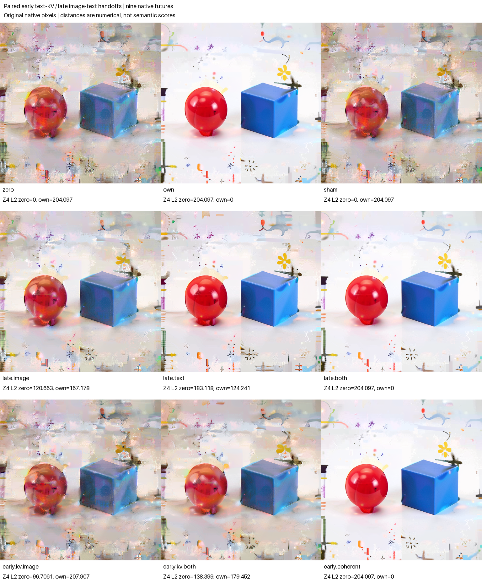

# Where a late conditioning rescue enters the image future

This completed assay separates an early image write from a later image/text handoff in one observed FLUX.2 Klein 4B history. Replacing only the positioned text K/V in the first joint block reproduced the paired own-source image attention return, receiving MLP return and post-block image exactly. That local equality did not make its image-only final future equal the own-source future. At the later single-stack handoff, text-only replacement ended closer to the own reference than image-only replacement in latent and pixel distance; neither alone reproduced it. Installing both working registers reproduced the own reference exactly.

All nine final futures are retained. These numerical ranks were exploratory, not frozen predictions or shape verdicts. The tentative visible-pixel question concerned partial color/surface improvement from the late image carrier; arm-blinded inspection does not establish a clear visible improvement for that arm. Text-only replacement has the clearer-surface trend, an exploratory observation. The preceding [context-carrier panel](FLUX-CONTEXT-CARRIERS.md) found partial surface/color improvement after restoring own conditioning, with mixed geometry and clutter still present; this experiment narrows the routes that can carry that occurrence's response.

## Paired observed parents

The two supplied parents are the prior panel's actual Z3 post-project, pre-joint0 cuts. One has artificial zero stored conditioning and zero projected working text; the other has restored own conditioning and its projected working text. Their image latent, working image, time/position context, schedule and IDs must match exactly. Conditioning and working text are the only permitted differences. These are observed states from the same edited latent history, not two independently sampled scenes.

The worker advanced each parent through the five joint blocks once, retaining post-joint0 and single0 boundaries. Thus later handoff rows share their own exact joint-prefix observation. Native model weights and the full future consumer remained unchanged. No new encoding, new noise draw or foreign prompt was used.

Here source labels `zero` and `own` identify conditioning histories, not generally numerical zero or nonzero arrays. Zero-source working text is exactly zero at the imported post-project joint0 cut. The joint stack can regenerate working text from image and time; zero-history text at single0 must be measured, not called “no text.”

The actual zero-history text norm grows from 5,128.87865 after joint0 to 48,500.22353 at single0. Own-history text norms are 29,917.47763 and 343,815.26206 at those boundaries. These saved-array FP64 reductions differ slightly from the online reduction values, retained separately in the audit. Magnitude is not semantic content or instruction strength.

## Nine futures

| Row | Starting point and intervention |
|---|---|
| `zero` | Continue the zero-C history from its actual single0 cut. |
| `own` | Continue the own-C history from its actual single0 cut. |
| `sham` | Exact-copy image/text Acts on the zero-C single0 cut. |
| `late.image` | At zero-C single0, replace only image with the paired own-C single0 image. |
| `late.text` | At zero-C single0, replace only working text with paired own-C single0 text. |
| `late.both` | Install both paired working registers at zero-C single0. |
| `early.kv.image` | At zero-C post-joint0, install the candidate image produced by replacing only text K/V at the specified native attention port. |
| `early.kv.both` | Install the same candidate image and candidate text at zero-C post-joint0. |
| `early.coherent` | Install the paired own-C native post-joint0 image/text at zero-C post-joint0. |

The early candidate retains zero-parent image Q/K/V and receiving state. Its text K/V comes from the paired own parent at the declared post-normalization/RoPE boundary. Retained Q/K/V arrays and native ports allow an offline closure check. The installed image is the entire joint-block image write, including its sequential MLP response; it is not an isolated attention-output intervention.

The tracked joint helper and a dedicated wrapper provide these candidates. No untracked source-selection module is part of the dependency chain. Three direct block calls are counted separately from public adapter transitions. Stored conditioning follows each declared branch parent; working text/image changes do not silently replace conditioning or time context.

## All nine numerical outcomes

Distances below compare actual saved Z4 latent or final uint8 pixels with each named reference. No donor-direction p axis or semantic score is defined. The [portable index](../qualification/flux-rescue-routes-20261103.json) retains every L2, MAE, signed mean and maximum difference, both reference directions and all source/cut/receipt hashes.

| Row | Z4 L2 from zero | Z4 L2 from own | RGB MAE from zero | RGB MAE from own |
|---|---:|---:|---:|---:|
| `zero` | 0 | 204.09703 | 0 | 42.99855 |
| `own` | 204.09703 | 0 | 42.99855 | 0 |
| `sham` | 0 | 204.09703 | 0 | 42.99855 |
| `late.image` | 120.66285 | 167.17834 | 17.48116 | 27.34992 |
| `late.text` | 183.11798 | 124.24086 | 32.60597 | 13.08459 |
| `late.both` | 204.09703 | 0 | 42.99855 | 0 |
| `early.kv.image` | 96.70614 | 207.90739 | 6.57025 | 43.53772 |
| `early.kv.both` | 138.39891 | 179.45240 | 12.36449 | 34.40696 |
| `early.coherent` | 204.09703 | 0 | 42.99855 | 0 |



The two early KV arms install identical image bytes but different selected text. Their later futures differ. Image-only KV is slightly farther from own than zero is in both final latent distance and RGB MAE; adding candidate text moves the numerical outcome closer to own, without reproducing it. Early coherent own image/text does reproduce own. These observations distinguish local image-write equality from sufficiency of that write for the remaining joint and single stacks. Later repair, overwrite and interaction remain alternatives; a weak final effect is not evidence that the local route is absent.

The late four-cell interaction is computed directly on signed saved vectors:

```text
R = Y_late.both - Y_late.image - Y_late.text + Y_zero
```

For Z4 latent, interaction L2 is 156.86972, RMS 0.43329548, maximum absolute value 3.359375 and signed mean −0.00541916. For RGB, L2 is 16,267.95430, RMS 18.34435, maximum absolute value 296 and signed mean −4.41351. These are FP64 operations on native saved cells, not algebra on distances. The interaction is an end-to-end nonadditivity observation, not a semantic mediation fraction, calibrated effect strength or necessity claim.

## Local KV closure and exploratory attention sample

The pre-sealed structural equality prediction matched: image Q/K/V was identical between the paired native sources; the KV call preserved every recipient Q and image K/V byte and selected only own-source text K/V. Its image attention return, downstream MLP return and whole post-joint0 image were bit-exact to the own-source native candidate and retained native post-block image. Candidate native zero/own image and text also matched their actual prefix captures. Reference numerical arrays were produced after sealing as allowed native operand controls. This was not an independently published numeric port-array or RGB forecast.

A separate [posthoc attention sample](../../../../artifacts/mdb-flux-rescue-routes-20261103/attention-sample-v1/report.json) uses retained normalized/RoPE Q/K/V, eight image queries and all 24 heads. It is outside the sealed hypotheses. Zero-C text V rows are identical but **nonzero**, RMS 0.547969 versus 3.05865 under own C. Mean sampled attention mass to text is 0.1576265 versus 0.1823487, with head/query values ranging from near zero to about 0.91. Offline FP64 sample-output RMS differences from native BF16 are 0.001331 and 0.001552. The full weights/contribution sample is retained as NPZ, not treated as a full numerical forecast or an integrity gate.

The source exposes bias and time-dependent modulation routes that can produce nonzero ports from zero input text. No isolated time or bias intervention was run, so that explanation is not uniquely established. Attention mass and vector contributions do not identify an attention sink, object ownership or semantic assignment.

## Prospective questions and controls

The local prediction asked whether the declared text-K/V replacement reproduces the own-parent image attention, downstream MLP response and joint image output under the otherwise matched image-side state. This is a local native-port closure claim, distinct from an image-semantic prediction.

The tentative visible-pixel question was whether `late.image` produces partial prompt-associated color/surface improvement over `zero`. Text-only ordering, exact final appearance and broader semantic comparisons were exploratory. An image difference is not by itself evidence of a named object address or semantic operator.

Named replay controls compare sham with zero, and `late.both`/`early.coherent` with own; prior zero/own PNGs provide additional observed occurrence controls. These controls qualify the exact-replay instrument claim. A disagreement yields `replay-unresolved` and retains all rows and numerical metrics. Checksum, source identity, finite/shape contracts, typed write closure and receipt lineage remain strict integrity checks.

## Arm-blinded visible outcomes

One task-aware assistant inspected the randomized grid and all nine original PNGs before arm identities, current metrics or the specific hypotheses were supplied; general project context was known. The [sealed observations](../../../../artifacts/mdb-flux-rescue-routes-20261103/blinded-observations.json) and [hash-bound unblinding](../../../../artifacts/mdb-flux-rescue-routes-20261103/unblinded-visual-record.json) preserve each caption, confidence, clipping concern and unknown. This is informal assistant inspection, not human annotation or a calibrated classifier.

| Row | Recorded surface/clutter category |
|---|---|
| `zero` | Substantial pastel smearing, mottled surfaces and fragmentary textures. |
| `own` | Clear silhouettes and glossy highlights; scattered fragments and some irregularities remain. |
| `sham` | Same original pixels as zero; substantial smearing and fragments. |
| `late.image` | Substantial smearing, mottled surfaces and fragments; broad category does not separate it from zero. |
| `late.text` | Clear silhouettes and glossy highlights, with scattered clutter. |
| `late.both` | Exact own pixels; clearer-surface category. |
| `early.kv.image` | Substantial smearing and fragmentary texture. |
| `early.kv.both` | Substantial smearing and fragmentary texture. |
| `early.coherent` | Exact own pixels; clearer-surface category. |

All nine retain a dominant rounded red body left of a blue block, a lower red protrusion and the yellow flower-like motif. The observer did not assign a total-object count of two because the extra motifs/fragments have uncertain identities. The protruding red body is not a pure sphere; no arm restores a clean native scene.

The frozen late-image color/surface prediction receives only weak, partial or inconclusive support: its broad observed categories remain like zero, not a visible prediction win. The clearer late-text trend agrees with its smaller own-reference numerical distances, but that rank and visual contrast were exploratory. The observed local KV equality therefore remains separate from later appearance: even its paired candidate image/text does not reproduce the coherent native own text state or clearer final category. Small appearance differences are not scored or silently promoted into a semantic law.

The [componentwise hypothesis record](../../../../artifacts/mdb-flux-rescue-routes-20261103/componentwise-hypothesis-outcomes.json) separates the matched local equality, exact controls, weak/inconclusive late-image components and exploratory text-only trend. It assigns no aggregate scientific pass.

## Finite execution and offline evidence

The declared census is nine final PNGs and nine VAE calls, three direct joint-block calculations, ten shared-prefix adapter transitions, six late suffixes of 22 transitions and three early suffixes of 26 transitions: 220 adapter transitions total. These comprise 202 native block calls, nine readouts and nine scheduler updates. Selected joint0 executes twice in the paired prefixes plus three direct candidate calculations; these are not five whole-model forwards. Eleven Acts give 231 receipt emissions. Execution uses the qualified CUDA BF16 profile, batch one, one finite mrun lease, no retries, no encoder/noise work and gzip1 transport. All hypotheses and source bindings are sealed before any new native prefix or candidate call.

The [independent audit](../../../../artifacts/mdb-flux-rescue-routes-20261103/run-02/analysis-v1.json) verified 396 manifest entries and 39 staged source bindings, the public typed store, both shared prefixes, all Act/native receipt chains, retained candidate equations, Q/K/V partitions and final latent/RGB arrays. All named source/native/local-KV/replay controls are true; instrument status is `native-replay-qualified`, mechanics valid and terminal status unassessed. The [immutable publication](../../../../artifacts/mdb-flux-rescue-routes-20261103/final-v1/result.json) pastes all nine original 512px RGB tiles unchanged, with external labels. The [independent post-run review](../../../../artifacts/mdb-flux-rescue-routes-20261103/postrun-review.json) checked the actual artifacts and scoped coverage.

Only selected full StateCuts were saved: 23 cuts, 34 pages and 26 tensor blobs. The original auditor incorrectly demanded a full stored state at every receipt-linked intermediate identity and stopped before writing an audit. The [offline repair](../../../../artifacts/mdb-flux-rescue-routes-20261103/source-freeze-04-offline-repair/repair.json) checks conditioning bytes at retained states and separately follows all public before/after points and declared native footprints, joined to the unchanged byte-bound adapter. No further conditioning projection or declared denoiser numerical C read occurs after the supplied project cut; schema and custody code can still inspect C. Missing full states are not reconstructed or independently read-traced. Both old and repaired auditor snapshots are retained; the worker, raw arrays and scientific execution were unchanged. Nine model-free tests cover the repaired partial-retention path and publication mechanics.

At 32.52324 worker seconds, the hypothesis seal bound all source identities with zero new adapter transitions, candidate calls, Acts, VAE calls or PNGs. Actual worker `b1d744d9…` then completed the declared 220 transitions, 11 Acts, 3 candidates and 9 VAE/final images; no encodings or noise draws. Phase census is 22 joint blocks, 180 single blocks, 9 readouts and 9 scheduler commits. Worker time was 100.47434 seconds; scheduler reported 149.26 seconds (timestamp span about 149.035). Poll-sampled peaks were 3,194.3 MB RSS and 9,698 MB VRAM with the restored 16,000 MB RAM/13,000 MB VRAM reservation. The raw manifest inventories 504,757,426 bytes. The full raw bundle and gzip worker log remain locally retained; the scheduler reports zero remote artifact rows/objects.

An earlier manual attempt, `job-cfe22f928044` in run-01, was killed during loading before a seal or scientific outcome: observed tree RSS 7,023.8 MB exceeded its 6,758.4 MB kill ceiling. Its request and gzip log remain intact. The separate run-02 job `job-b0da807f5d60` changed only resource metadata/request digest; all scientific config and 39 payload source hashes match. This was not an automatic retry or another specimen. Resident/poll samples and an automatic 4,608 MB sizing suggestion miss that measured loader transient; retain the 16,000 MB envelope pending targeted loading telemetry. The exact source line causing the transient is not established by the killed-process log.

Resource review: [freeze03](../../../../artifacts/mdb-flux-rescue-routes-20261103/source-freeze-03-resource/review.json). Request digest `58d27543577af53a829259ddd99afb5b4f0a0e08f012ae0f6df644aab254ea64`; archive `fc47bc6de4709de88812d71e301209f5ddaf20ac7af1a174019af7385a265208`; audit `f352f1b0edc8d96c79ca45413be2f709b05afb1aa1419f891e58b402f541e732`; seal `df0b20d0d25b5b72cdce448378f3a43ceeff81cca1cb106ccb653ad71a8720c1`. Raw evidence and both attempt histories remain immutable.

The [three curated computation records](../../../../artifacts/mdb-flux-rescue-routes-20261103/computation-records.json) describe the late image/text factorial, local text-KV equality and early working-text continuation using generic addresses. The [Saturn evidence sweep](../../../../artifacts/mdb-flux-rescue-routes-20261103/evidence-v1/checksums.json) processed nine numerical rows and returned six model-and-exact-frontier-bound query hits. Run, verify, query and stats commands exited zero; new model calls and automatic claims were zero. This is numerical stream integrity and local citation indexing, not semantic certification, automatic computation-family induction or workspace-atlas promotion. The [deriver](../../../../artifacts/mdb-flux-rescue-routes-20261103/derive_records_and_evidence.py), command outputs and source hashes remain available. Evidence checksum digest: `00036c7877ac02e5a5c486b68ee2f2731788c66c199a7c3384df4b2cef88a232`.

To reproduce the offline audit and publication against an explicitly selected completed run:

```sh
python qualification/analyze_flux_rescue_routes.py /absolute/run-02 /absolute/run-02/analysis-new.json
python qualification/publish_flux_rescue_routes.py /absolute/run-02 /absolute/run-02/analysis-new.json /absolute/new-publication
```

Both outputs require fresh paths. These commands execute no model, attention kernel or projection; the separate attention sample is posthoc mathematical analysis of saved operands. The [auditor](../qualification/analyze_flux_rescue_routes.py), [publisher](../qualification/publish_flux_rescue_routes.py) and [portable index](../qualification/flux-rescue-routes-20261103.json) bind the actual source snapshots and explicit reference bases.

Artifact destination: `artifacts/mdb-flux-rescue-routes-20261103/`. The prior carrier results and raw evidence remain immutable. The scope is one observed history and its dependent last-step futures, not an independent raw-prompt-to-RGB prediction or a reusable rescue policy.
