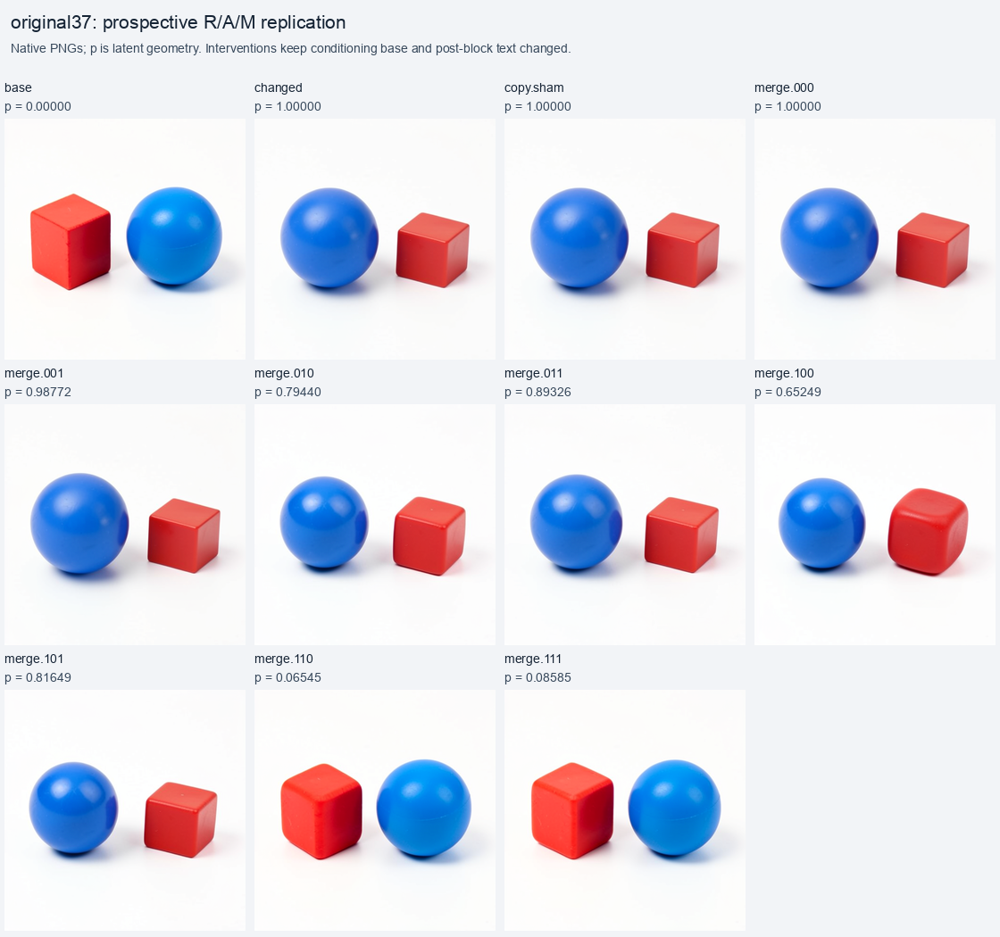
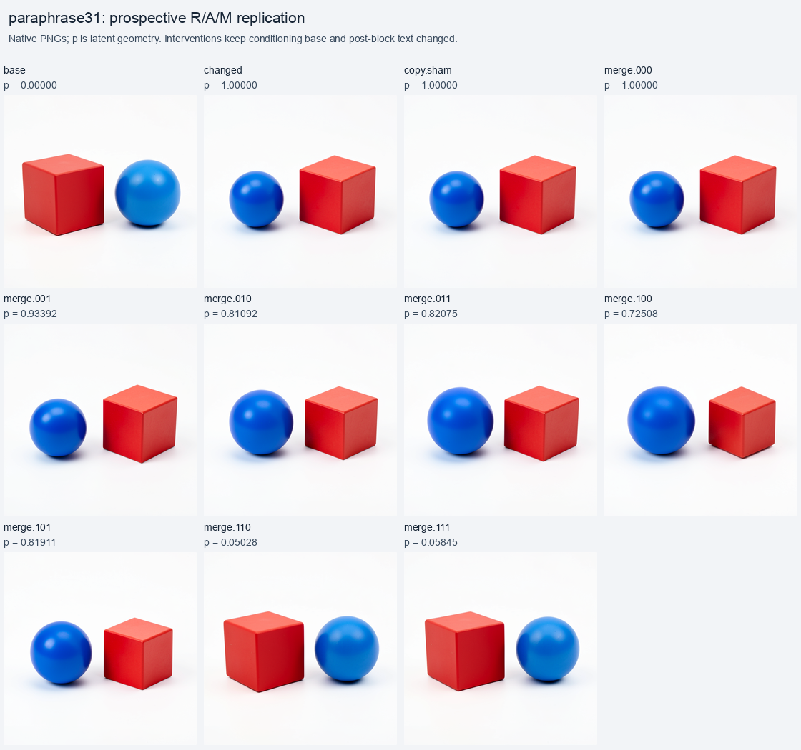
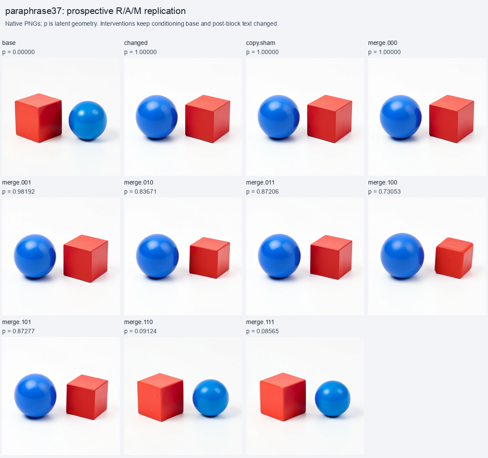
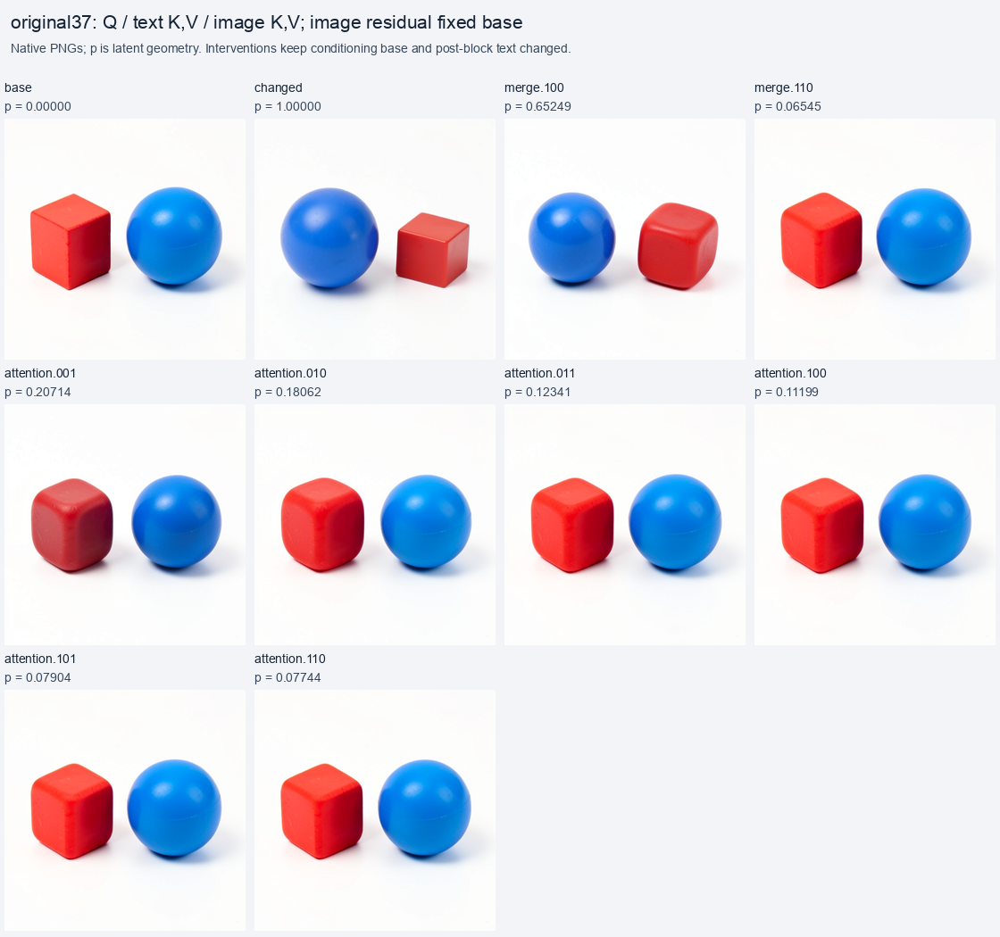

# Replicating a diffusion computation record across seeds and wording

The residual–attention response at first-step single block 4 survived three prospective context tests. Restoring both image residual and attention operands restored the original object ordering; restoring either alone left the changed ordering. All 18 frozen ordering predictions agreed with assistant inspection. The attention-source experiment also produced two counterexamples to a new ranking hypothesis: image keys/values did not move the final latent toward base more than text keys/values.

This extends the [original parallel-merge experiment](FLUX-PARALLEL-MERGE.md) beyond its discovery scene. It supports a reusable, qualified computation record. Its applicability remains limited to the tested checkpoint, occurrence and interventions; new contexts still require prediction and execution.

## Exactly what was tested

The specimen is FLUX.2 Klein 4B distilled, CUDA BF16, batch one, 512 × 512, four denoising steps and guidance 1. There are no reference images, adapters or training updates. Checkpoint inventory SHA is `dd976d67036c4a0a55642f702dcb3740ba7a4f367557596572baac168330904f`.

The historical anchor used seed 31 and these contrasting prefixes:

```text
Base:    A red cube to the left of a blue sphere
Changed: A red cube to the right of a blue sphere
```

The new wording reverses mention order while preserving the intended scene contrast:

```text
Base:    A blue sphere is positioned to the right of a red cube
Changed: A blue sphere is positioned to the left of a red cube
```

Every prefix receives the same literal suffix:

```text
 on a plain white background. Two separate objects, simple studio product photograph.
```

The three preselected contexts are original wording/seed 37, paraphrase/seed 31, and paraphrase/seed 37. Together with the historical anchor they form a small two-seed × two-wording grid. This is one object pair and one relational contrast.

Both literals are encoded once per context. The two histories start from the same base projected parent: the changed history receives only the contrast's initial working text. Persistent conditioning remains base in both histories. Latent, IDs, schedule and time context remain matched. Consequently the changed reference is a native continuation with changed working text and base stored conditioning. It is not an ordinary independent run of the second prompt.

MDB navigates both histories to the input of single block 4 at logical step 0. Read-only module hooks observe the actual native operands and projection returns. Image-row interventions are constructed from these observed ports, then installed as typed image Acts at the matching block exit. Post-block working text remains changed and stored conditioning remains base. The remaining denoiser, scheduler and VAE consume each branch's actual edited state.

## Predictions were frozen before images

The executed campaign plan has SHA `74e79ed6ad77ab357a13d9c80cc91088e87849c62bd893e63b7eb837935a9c36`. Its contexts and expectations were fixed before successful model execution; the worker also seals its prediction transaction before any RGB outcome.

The original seed-31 prediction that attention alone would restore base ordering was wrong. That historical prediction remains unchanged. The replication plan explicitly incorporates its observed counterexample: attention alone should preserve changed ordering. A pre-execution plan amendment separates the historical record from these new expectations; it does not rewrite a failed prediction.

For mask bits `R A M`, a one selects base image-row operands and zero selects changed operands. The six categorical predictions per context were:

| Masks | Frozen ordering expectation |
|---|---|
| `000`, `001`, `010`, `100` | Changed: blue sphere left, red cube right |
| `110`, `111` | Base: red cube left, blue sphere right |

The numerical expectations were attention-only moving toward base more than MLP-only, residual-plus-attention moving farther than either alone, and a negative residual/attention interaction in the final latent. These are signed comparisons, without a scientific pass threshold or a universal claim.

## The merge law and its downstream effect

The selected block uses a parallel attention/MLP construction:

```text
R_next = R + gate * Linear(concat(A, M), W_merge, bias)
```

The full original projection shape and frozen weights are retained. The implementation does not split the fused matrix multiplication into independently rounded branch projections. Actual native BF16 equations close exactly for both histories in all three contexts.

Let `z_B` and `z_D` be the final base and changed latents. For an edited future `z`, the reported projection is

```text
p(z) = dot(z - z_B, z_D - z_B) / dot(z_D - z_B, z_D - z_B)
```

Base has `p=0`; changed has `p=1`. This is a coordinate along their latent difference, not semantic accuracy or a percentage of an image restored. Other directions and visible collateral remain possible.

| New context | MLP `001` | Attention `010` | Residual `100` | Residual + attention `110` | Interaction |
|---|---:|---:|---:|---:|---:|
| Original, seed 37 | 0.98772 | 0.79440 | 0.65249 | 0.06545 | −0.38143 |
| Paraphrase, seed 31 | 0.93392 | 0.81092 | 0.72508 | 0.05028 | −0.48572 |
| Paraphrase, seed 37 | 0.98192 | 0.83671 | 0.73053 | 0.09124 | −0.47601 |

Interaction is `p110 - p100 - p010 + p000`, with changed MLP fixed. All nine predeclared numerical comparisons are supported. All 18 predeclared categorical comparisons agree with inspection, although six are self/all-field controls rather than independent mixed-intervention discoveries. The 39 native image outcomes include references and shams, and are dependent branches from three contexts.







The complete grids also retain unpredicted mixed masks `011` and `101`; both preserve changed ordering in each context. Adding the base MLP operand to attention-only or residual-only replacement moves projection back toward changed in all three contexts. The MLP therefore has a conditional effect even when its standalone replacement moves the reported latent projection relatively little.

The interaction emerges through the downstream native computation. The local merge equation is an affine projection plus a gated residual update; these results do not establish a multiplicative local relation operator. Whole-field compatibility is still an alternative explanation. Object scale, cube pose and shape also change: residual-only replacement visibly rounds the red cube in the seed-37 paraphrase case. Ordering agreement does not imply complete scene restoration.

## Refining attention: receiving queries versus key/value sources

The original-wording/seed-37 context includes a second factorial. Hold image residual at base, MLP at changed, post-block text at changed and persistent conditioning at base. Factor attention's sources into image queries, text keys/values and image keys/values. Bits choose base versus changed for each group.

For positioned, normalized native query/key operands, attention has the form

```text
A_image = softmax(Q_image K_all^T / sqrt(head_dim)) V_all
K_all = concat(K_text, K_image)
V_all = concat(V_text, V_image)
```

The worker uses the same native Diffusers attention dispatcher and checks its processor/backend contract. Native Q/K normalization, rotary positions and token geometry are retained. Text-query outputs are discarded; only resulting image rows reach the merge. K and V are replaced together within each source group in this experiment.

| Q / text K,V / image K,V | Final latent `p` | Inspected ordering |
|---|---:|---|
| `000` | 0.65249 | Changed; joins residual-only merge |
| `001` | 0.20714 | Base; red shape substantially rounded |
| `010` | 0.18062 | Base |
| `011` | 0.12341 | Base |
| `100` | 0.11199 | Base |
| `101` | 0.07904 | Base |
| `110` | 0.07744 | Base |
| `111` | 0.06545 | Base; joins residual-plus-attention merge |

The two native corners reconstruct their observed attention exactly and join existing merge futures exactly. Only six mixed masks need additional image continuations, bringing this context to 17 images.



The frozen hypothesis predicted image K/V would move projection toward base more than text K/V within either fixed query source. Both comparisons contradict it: `0.20714 > 0.18062` and `0.07904 > 0.07744`. The small differences are retained; they do not establish a general opposite ranking.

Changing image queries alone (`100`) is sufficient to restore ordering in this hybrid, even with changed keys/values. Changing text K/V alone or image K/V alone also restores ordering. These are alternative sufficient edits under a fixed base residual, not evidence for three independently sufficient semantic pathways in arbitrary states. In particular, query-only sufficiency has not been tested with the changed residual.

The working inference is that the relation-sensitive route involves both the incoming image state and attention's receiving/source configuration. The result points toward state-dependent addressing and consumption. It does not yet isolate a particular head, prompt token, key coordinate, value payload or minimal `left-of` operator.

## Entries worth keeping in the symbol table

The [portable result](../qualification/flux-route-replication-20261102.json) contains three generic records, each with source-cut identities, weights, execution conditions, signed consumer effects, continuation outcomes and counterexamples:

| ID | Meaning | Evidence scope |
|---|---|---|
| `flux.merge.S04` | Exact structural merge writer | Native equation and reconstruction at the recorded occurrence |
| `flux.route.S04.RA` | Residual-conditioned attention response | Prospectively replicated across the three new contexts |
| `flux.attention.S04.sources` | Conditional image-query / text-KV / image-KV source decomposition | One source-factorial context, including both ranking misses |

The first names a mathematical writer. The second names an empirical response family. The third names a conditional causal experiment. They can share one occurrence while supporting different kinds of claims. Generic IDs let us compare records before assigning semantic names. They are explicitly curated records; this campaign does not implement automatic semantic discovery or automatic equation-atlas ingestion.

The next narrow experiment should separate text K from text V under changed image queries, changed image K/V, base image residual and changed MLP/text. Existing neither/both corners supply controls; K-only and V-only continuations would separate effects through attention weights from effects through value vectors. Only after testing that distinction should we narrow heads, token supports or spatial rows and broaden to unrelated object pairs.

## Execution, audit and reproduction

| Context | Model job | Separate CPU audit | Images | Model job seconds |
|---|---|---|---:|---:|
| Original37 | `job-484564452e38` | `job-f3275aa82fd5` | 17 | 569.3 |
| Paraphrase31 | `job-307a77fab0f4` | `job-b12720c8253b` | 11 | 407.4 |
| Paraphrase37 | `job-230b7bf6de6d` | `job-2168a2d035df` | 11 | 358.8 |

Each model job is one finite mrun lease with one model load, matched prefixes and in-process branching/replay. Across them: 4,002 adapter transitions, 36 image Acts, 32 merge-projection evaluations and six prompt encodings. Peak reported GPU allocation is 9,520 MB. These timings include job work beyond native stepping and are measurements rather than a controlled speedup comparison.

Each separate model-free CPU audit verifies the complete producer archive, typed state, native ports, operand selections, merge equations, latent trajectories, PNG hashes and receipt emission inventory on Beast. It performs zero model forwards. Full arrays and source trees remain at `/mnt/hdd8tb/mdb/evidence/flux-merge/MODEL_JOB_ID`. Locally verified compact views retain original PNG bytes and the returned audits; the full arrays were audited on their storage host. An additional Saturn evidence sweep runs and verifies all 39 derived numerical rows with zero model calls.

Copy shams and reconstructed `000` reproduce changed futures exactly in every saved scheduler array and PNG. Reconstructed `111` equals the base post-block image field exactly while retaining changed working text; equality to the complete untouched base future is not its control contract. Attention-source corners also match native attention and existing merge futures exactly. The offline audit validates retained attention ports and source-selection hashes; it does not rerun SDPA or external-weight projection kernels.

Execution incidents remain in the record. One package-resolution submission failed before model execution; keeping the installed cache offline resolved setup. One CPU audit failed while decoding a typed execution point after collecting its archive; a corrected read-only audit reused those bytes without another model run. No failed scientific outcome was rerun into a pass. Executed source snapshots, package-source parity and the later import-format-only worker change are retained in the portable result.

From the MDB package root, with the public installed qualification environment and fleet settings configured:

```sh
# Freeze inputs and hypotheses from the historical checkpoint plan.
python qualification/submit_flux_route_replication.py /absolute/campaign/plan.json \
  --make-plan /absolute/historical-run/plan.json

# Run one case; collect/audit it before submitting the next CUDA case.
python qualification/submit_flux_route_replication.py /absolute/campaign/original37 \
  --campaign /absolute/campaign/plan.json --case original37
python qualification/remote_flux_audit.py /absolute/campaign/original37-audit \
  --producer /absolute/campaign/original37
python qualification/remote_flux_audit.py /absolute/campaign/original37-audit --collect AUDIT_JOB_ID
python qualification/remote_flux_audit.py /absolute/campaign/original37-audit --verify

# Repeat with --case paraphrase31, then --case paraphrase37 and fresh output paths.
# Summarize verified audits; visual labels are separate inspection records.
python qualification/summarize_flux_route_replication.py /absolute/campaign/plan.json \
  /absolute/campaign/summary \
  --audit original37=/absolute/campaign/original37-audit \
  --audit paraphrase31=/absolute/campaign/paraphrase31-audit \
  --audit paraphrase37=/absolute/campaign/paraphrase37-audit
```

The summarizer emits numerical observations, native-image grids and generic records. Optional `--visual CASE=inspection.json` inputs add separate visual annotations; absent labels remain pending. It does not infer object semantics from latent projection. The current contact-sheet font path is macOS-specific. Fleet paths in the maintainer submitter/auditor describe this recorded setup.

The remaining tooling improvements are first-class typed attention operand cuts and production artifact custody with selected-artifact retrieval. Both requests were upvoted with these jobs as evidence. MDB already supplies the public Session, navigation, capture, typed image Act, branch/replay and sealed transaction machinery used here. The experiment-local hooks and attention reconstruction remain explicit parts of the instrument.

Engineering validation: 21 installed-environment mechanics/regression tests pass, including native tiny-block attention reconstruction, source selection, frozen-plan separation and finite offline CUDA submission. Ruff passes for all seven changed or added Python source/test files. Luna reviewed execution and resource settings before the model campaign; Astra reviewed the final scientific claims and counts.
