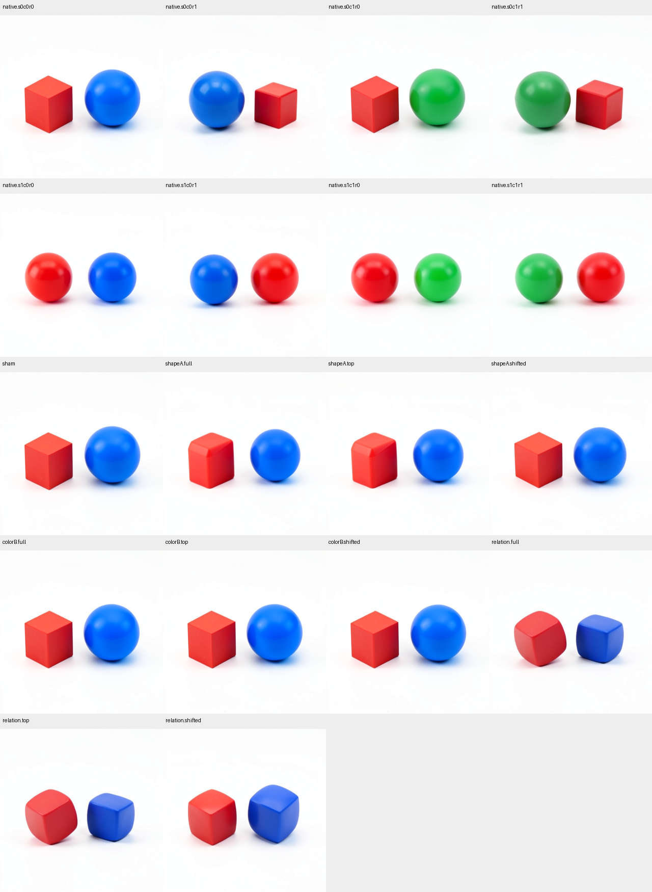
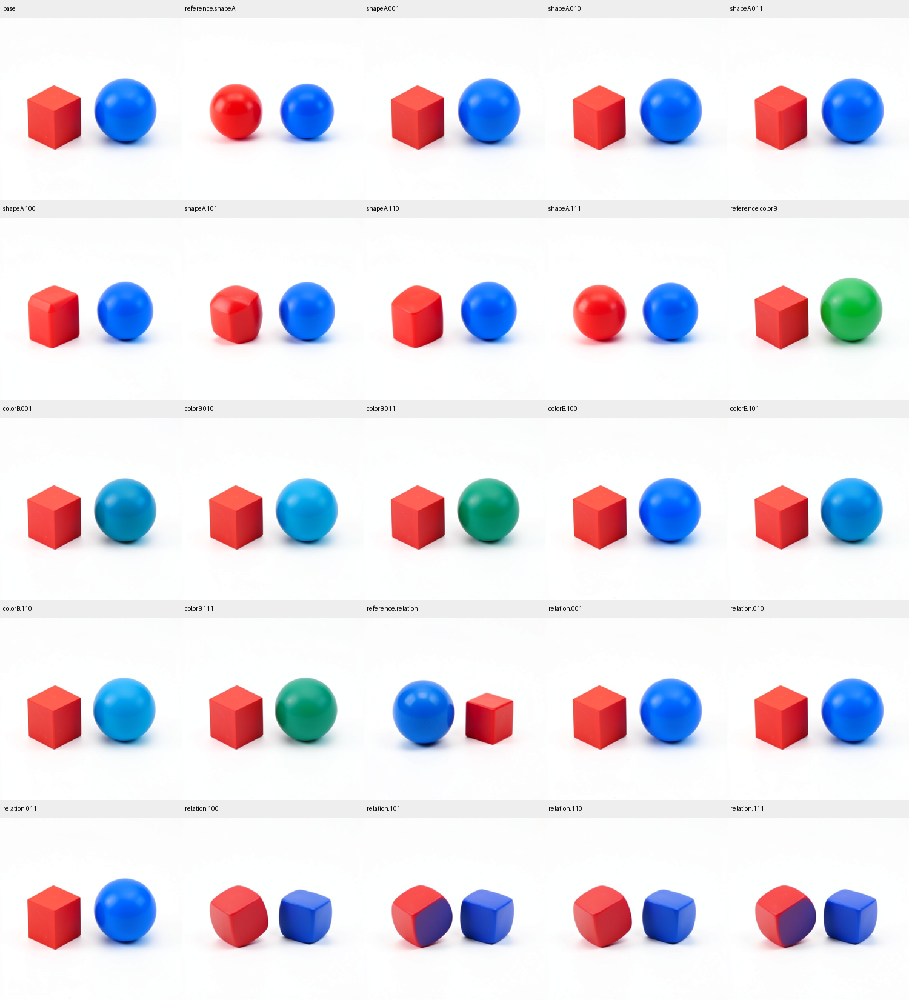
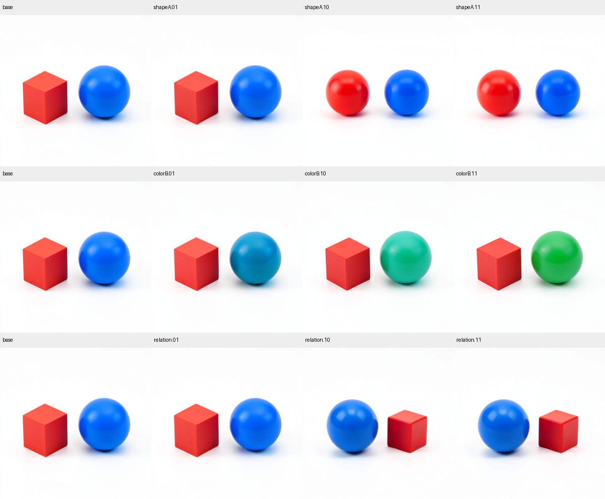

# A causal inventory of a generated scene

This exploratory workflow distinguishes pixel-level scene components, observed internal state relationships, and causal responses through the native image consumer. It does not derive semantic objects from prompts or equate a high-energy tensor region with a causal object.

The finite campaign runs eight natural histories crossing A's shape, B's color and A's left/right ordering under one seed. It retains early single4, later joint4-entry and joint4-exit cuts, actual native attention and MLP returns, and computes descriptive three-factor interactions. Prefix contrast selects top-quarter image-row supports and equally sized half-grid-shifted controls using native H/W IDs. A global forecast seal precedes all eighteen final-image futures. Nine interventions replace full or selected image state; a sham checks exact replay. Recipient text and persistent conditioning remain native throughout continuation.

The separate pixel instrument extracts generic colored connected components, RGB statistics, bounds and centroid relationships without a prompt. Shape semantics remain unknown. The instrument is for isolated colored primitives on white and must report fragmentation, missing components and threshold sensitivity. Pixel segmentation, prompt compliance, state localization and causal attribution remain separate evidence layers.

```sh
export MDB_WORKER_UV_CACHE_DIR=/mnt/hdd8tb/mdb/uv-cache
export MDB_WORKER_TORCH_HOME=/mnt/hdd8tb/mdb/torch
export MDB_WORKER_MODEL_ROOTS=/mnt/big/llm-models
python qualification/submit_flux_scene_inventory.py /absolute/path/run-01 --stage-only
python qualification/submit_flux_scene_inventory.py /absolute/path/run-02
python qualification/submit_flux_scene_inventory.py /absolute/path/run-02 --collect JOB_ID
```

Use the installed MDB environment and configured mrun credentials. The real-model worker runs only inside one admitted CUDA lease with strict preflight and no retries. The calibrated resident numerical profile is FLUX.2 Klein4B distilled, BF16, B1, 512 pixels, four denoising steps. The checkpoint inventory is pinned in the plan. Full scene decomposition and transfer to new seeds remain unestablished until measured; even a successful controlled inventory would not explain arbitrary materials, lighting, shadows or occluded geometry.

Sources: [campaign](../qualification/flux_scene_inventory_campaign.py), [analysis instrument](../qualification/flux_scene_inventory.py), [submitter](../qualification/submit_flux_scene_inventory.py), [capability write-up](../../../../obsidian/blog/2026-11-03-181057-toward-a-causal-inventory-of-a-generated-scene.md), [local evidence](../../../../artifacts/mdb-flux-scene-inventory-20261103/).

## Executed factorial and native image results

Job `job-1424b0346278` succeeded with eighteen final images, one model load, eight encodes, 1,676 adapter transitions and ten typed image-only Acts. The independent audit verifies 2,088 files, 1,686 receipts, all typed closures and eight native sequential joint equations. Native/sham scheduler states and final pixels match exactly. Worker time was394.997s, scheduler453.6s, peak RSS16,323MB and VRAM9,632MB. Six outside-workspace instrument checks passed; a seventh check now covers the follow-up coalition plan.

The prompt-independent chromatic instrument returned two components in all eighteen images, unchanged across three additional chroma thresholds. All eight natural references have the requested color assignments and centroid ordering. Arm-blinded assistant inspection records coarse cube/sphere observations separately. These are36 pixel-component observations and18 centroid relations, not automatically recovered internal semantic symbols.



Color B's top-quarter internal contrast support covers100% of the blue component and29.0% of the red component. The typed patch changes the blue region more than the shifted support (RGB MAE.02649 versus.00538) and more than its red-region collateral(.00536), yet B remains blue. Shape A's top support covers99.97% of red and64.1% of blue; it changes both, with larger per-pixel blue collateral. Shape patches round the red cube without a clean sphere transfer. Ordering patches retain the original ordering and produce rounded-cube collateral on both objects. All five frozen numerical rankings held; none of those rankings certifies semantic transfer.

At joint4 exit, shape main/shape×ordering coefficient RMS is.764/.626; color main/color×ordering is.260/.251. Attention and MLP returns also have substantial interactions. These are descriptive factorial relationships across the eight actual prefixes. They motivate binding- and receiving-state-qualified records, rather than independent attribute-vector commands.

The [audited result](../../../../artifacts/mdb-flux-scene-inventory-20261103/run-03/analysis-v1.json), [arm-blinded observations](../../../../artifacts/mdb-flux-scene-inventory-20261103/blind-visual-labels.json), [unblinded review](../../../../artifacts/mdb-flux-scene-inventory-20261103/visual-review.json), [generic records](../../../../artifacts/mdb-flux-scene-inventory-20261103/scene-records.json) and [canonical evidence checksums](../../../../artifacts/mdb-flux-scene-inventory-20261103/evidence/checksums.json) retain the outcomes and limitations. The records comprise pixel observations, centroid relationships and nine causal intervention records. They are not automatically ingested into the equation atlas.

## State-source coalition follow-up

The follow-up [worker](../qualification/flux_scene_state_closure_campaign.py) crosses source/recipient image I, working text T and future conditioning C. I/T Acts occur at step1 joint4 exit. C Acts occur only at step2 preprojection. Recipient scheduler latent/history remains unchanged by the Acts. Each factor uses all seven nonempty coalitions plus the common base;25 futures contain18 new coalition outcomes and7 known replay controls.

```sh
python qualification/submit_flux_scene_state_closure.py /absolute/path/closure-run --predecessor /absolute/path/audited-inventory-run
python qualification/submit_flux_scene_state_closure.py /absolute/path/closure-run --collect JOB_ID
python qualification/analyze_flux_scene_state_closure.py /absolute/path/closure-run /absolute/path/closure-run/analysis-v1.json
```

Keep the same measured worker environment exports. Four cuts exceed the shipped-payload byte bound, so this finite follow-up hard-pins the actual source host and reads selected prior-job CAS files by an explicit locator. Every byte/size is pinned from the independently audited archive and checked before model loading. This is host-local historical artifact transport, not a fleet durable artifact mount. The client-only oversize rejection is retained, with no scheduler job or inference. The native public adapters, StateCuts, Acts and consumer remain unchanged.

## Completed I/T/future-C response family

Job `job-2bde111d1343` succeeded with25 final images,1,950 adapter transitions,36 Acts and1,986 receipt emissions. The audit verifies1,722 unique receipts,2,059 result files and twelve exact pre-C state matches. All seven known native/image-only PNG controls reproduce exactly. Worker377.56s, scheduler396.68s, peak RSS2,369.9MB, VRAM9,250MB; one load and zero encodes. Seven small mechanics checks pass outside the workspace. The second evidence sweep run/verify returns0/0 over25 derived rows.



Working text T plus later conditioning C changes B to dark green/teal, while either alone produces partial cyan. The B-region median green-minus-blue readout is−.2431 for T,−.2078 for futureC and+.1216 for T+C. This is a continuous conditional response; no Boolean neuron-level AND or minimal circuit is claimed. I alone leaves B blue. The shape I/T/C coalition gives a near-sphere with remaining facets; individual T/C or their pair retain a cube. All seven ordering coalitions keep recipient ordering, with substantial shape/color collateral in some I-containing arms.

All three frozen RGB ranks `111 > 100` hold (shape.80364>.50015; color.74149>.01311; relation.34983>.26071). The three future-C-only semantic transfer guesses miss: the shape stays cube-like, color shifts partially toward cyan, and ordering remains unchanged. Those misses are preserved as counterexamples, not hidden by the favorable numerical ranks. Informal visual observations remain separate from the pixel instrument.

The [full audit](../../../../artifacts/mdb-flux-scene-inventory-20261103/closure-run-02/analysis-v1.json), [blinded labels](../../../../artifacts/mdb-flux-scene-inventory-20261103/closure-review/blind-labels.json), [unblinding](../../../../artifacts/mdb-flux-scene-inventory-20261103/closure-review/visual-review.json), [21 generic state-response records](../../../../artifacts/mdb-flux-scene-inventory-20261103/state-response-records.json) and [evidence checksums](../../../../artifacts/mdb-flux-scene-inventory-20261103/closure-evidence/checksums.json) retain the sources, clocks, source selection, typed closures, effects and counterexamples. They are standalone causal records, with no automatic equation-atlas import or expanded applicability.

The first and second campaigns together execute43 dependent native futures. Every final output has two major colored components under the fixed instrument. Object-local causal addressing is partial; semantic shape extraction and a complete internal scene inventory remain open. The next informative cut crosses carried latent L and persistent C at an actual post-scheduler project frontier, keeping historical replay distinct from prospective held-out semantic prediction.

## Carried latent versus persistent conditioning

The next panel uses the four natural histories' saved **step2 project** cuts. The independent source check finds that only `latent` and `conditioning` differ: image, text, context and noise prediction are all cleared, and IDs, schedule and cursor agree exactly. The legal interventions therefore form a closed two-source comparison at one clock.

Let `G₂(L,C)` denote the unchanged native suffix from that frontier through the last scheduler update and VAE. Each factor has corners `G₂(L₀,C₀)`, `G₂(L₀,C₁)`, `G₂(L₁,C₀)` and `G₂(L₁,C₁)`. The base corner is shared. The three `10` corners are new; the base, three `01` corners and three coherent `11` corners replay seven known outcomes. Coherent source reconstruction and exact replay are mechanics checks. They do not count as successful semantic predictions.

Before executing these new futures, the plan predicts that source latent with base conditioning preserves reversed ordering, looks sphere-like for the shape contrast, and gives a greener B than conditioning alone for the color contrast. Shape is inspected separately under anonymous arm labels. The pixel instrument measures component count, median channels and centroid ordering without reading prompts. A whole-latent intervention tests carried scene history; it does not isolate an object or relation register.

```sh
python qualification/submit_flux_scene_persistent.py /absolute/path/persistent-run --predecessor /absolute/path/audited-closure-run
python qualification/submit_flux_scene_persistent.py /absolute/path/persistent-run --collect JOB_ID
python qualification/analyze_flux_scene_persistent.py /absolute/path/persistent-run /absolute/path/persistent-run/analysis-v1.json
```

Use the same installed environment and Linux worker exports as above. The [worker](../qualification/flux_scene_persistent_campaign.py), [submitter](../qualification/submit_flux_scene_persistent.py) and [independent auditor](../qualification/analyze_flux_scene_persistent.py) retain source custody, whole-payload closures, typed receipts and native continuations. The byte-bound host-local input transport is explicit. Ten outputs run sequentially under one finite CUDA lease, with one model load, zero encodes, a700-transition ceiling and no retries.

## Completed L/C cross: carried scene history survives opposing C

Job `job-2b05cfb69822` succeeded. All three prospective `10` predictions held under their declared instruments. Source latent preserved red-right/blue-left ordering with base left-of conditioning. Source shape latent rendered a sphere-like red A with base cube conditioning, under informal arm-blinded inspection. Color B's median green-minus-blue was+.13333 with source L/base C, compared with−.20784 with base L/source C; the coherent natural source was+.35294. Future C therefore still changes appearance conditional on carried history.

| Property | Base L / source C (`01`) | Source L / base C (`10`, new) | Source L / source C (`11`, replay) |
|---|---|---|---|
| A shape | Cube | Sphere-like | Sphere |
| B color | Cyan/teal-blue | Green/teal | Green |
| Ordering | Red left, blue right | Red right, blue left | Red right, blue left |



All ten outputs have two major chromatic components. All seven historical PNG controls reproduce exactly. The audit independently checks nuisance-slot equality, the three coherent source-state reconstructions, twelve typed Acts and572 receipts. Counts are560 native adapter transitions, one model load, zero encodes and ten final decodes. Worker148.74s, scheduler175.92s, peak RSS6,448MB and VRAM9,260MB. This adds three new dependent crossed futures, not ten independent discoveries. Across the three campaigns there are53 executed final-image futures, with repeated controls explicitly retained.

This isolates a whole carried-state dependency behind the earlier failed late ordering edits. It does not prove that a particular latent coordinate is a left-of operator, or that whole-latent transfer is necessary or minimal. The previous image/text interventions changed the transformer's working state while retaining the original scheduler latent. For this deterministic Euler lane, the scheduler update has the form `L_next = Q(L + delta_sigma * velocity)`, with the native intermediate casts retained. Replacing velocity-producing working features leaves the old L term live. Replacing L at the next project boundary is a different causal operation. The native suffix also rereads C and can respond differently to the same C in different carried states.

The [audit](../../../../artifacts/mdb-flux-scene-inventory-20261103/persistent-run-01/analysis-v1.json), [anonymous observations](../../../../artifacts/mdb-flux-scene-inventory-20261103/persistent-review/blind-labels.json), [unblinding](../../../../artifacts/mdb-flux-scene-inventory-20261103/persistent-review/visual-review.json), [nine occurrence records](../../../../artifacts/mdb-flux-scene-inventory-20261103/carried-response-records.json) and [external seal pin](../../../../artifacts/mdb-flux-scene-inventory-20261103/persistent-external-seal.json) are retained. Canonical evidence run, verify, citation query and stats all return zero; the local query returns nine model/checkpoint/parent-bound occurrences. This is working local lookup, with automatic family discovery, rule induction and equation-atlas integration still open.

The pinned installed transaction wheel has a legacy CPU-FP32 metadata label and a bound-model counter that omits external navigator calls. The [additive annotation](../../../../artifacts/mdb-flux-scene-inventory-20261103/persistent-run-01/metadata-annotation-v1.json) preserves that defect and identifies CUDA-BF16 source profiles, public receipts and the dedicated ledger as the numerical-lane/work-count authority. The original seal and raw outputs are unchanged. The first offline indexing attempt also remains retained: commands succeeded, but provenance writing tried to hash a Python cache directory; the corrected packaging pass makes no model calls.

The [spatial follow-up](FLUX-SCENE-SPATIAL.md) has now completed20 additional futures,15 new and5 historical controls. Separate left/right latent windows produce two blue spheres or two red cubes; stacking them produces blue-left/red-right. Smaller shape and color windows preferentially affect their targets with measurable collateral. Its supports are geometric windows from historical reference images, so automatic latent object identity and fresh-scene applicability remain open. Across all four campaigns there are73 executed final-image futures including repeated controls.
