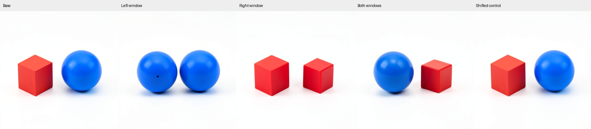
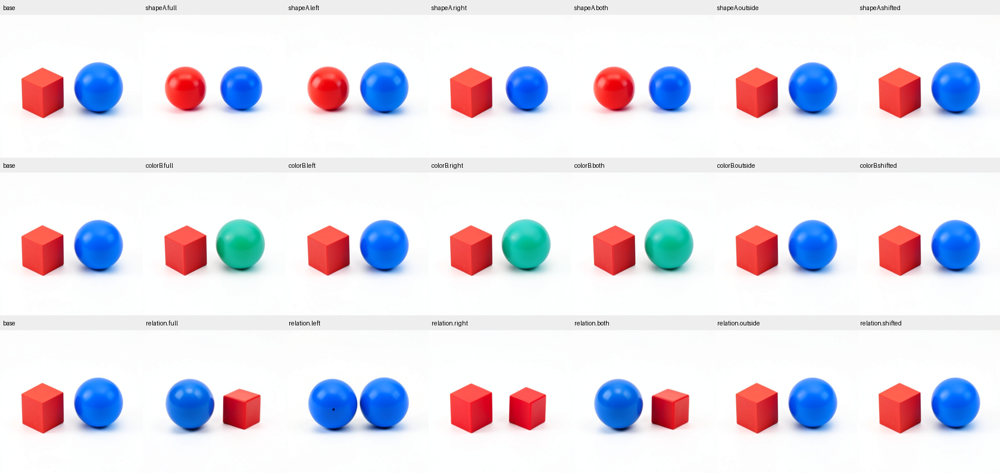

# Spatial parts of carried scene state

This exploratory assay subdivides the carried latent that preserved shape, color and ordering in the [whole-state L/C cross](FLUX-SCENE-INVENTORY.md). It asks whether separate spatial edits can change one object or compose a different scene under unchanged recipient conditioning.

Four audited natural step2 project cuts supply the base and three contrasts: red cube versus sphere, blue versus green second object, and red-left versus red-right ordering. Working image, text, context and velocity prediction are cleared. All source nuisance slots agree; only latent and conditioning differ. Every edited branch retains base conditioning.

## Windows and information boundary

The known base and coherent source RGB references supply two chromatic component bounds, sorted by left/right site. For each site, their bounding-box union receives a16-pixel halo, clipped at the image midline. Native `(T,H,W,L)` IDs locate latent cell centers in those windows. The windows are output-assisted geometric hypotheses; they are not automatically inferred latent object identities. Their pixel footprints do not define the model's full receptive fields.

Shape uses143 left and182 right rows; color143/195; ordering168/182. Their disjoint unions contain325/338/350 of1,024 rows. Each matched control shifts that union cyclically by half the native grid height and has zero overlap with the unshifted union. The outside arm patches the union's complement.

Each contrast runs full latent, left-only, right-only, both, outside and shifted policies. A shared base and exact-copy sham give20 outputs. Full-latent arms and base/sham replay five known PNGs; fifteen spatial outcomes are new. The both arm stacks separate left and right Acts from the actual left-edited state. Every unchanged row and all nonlatent slots must remain exact.

## Frozen questions

The shape prediction expects left/both to produce sphere-like A and right-only to retain cube-like A. The color prediction expects right-only B to be greener than left-only B. The ordering prediction expects left-only to yield two blue objects, right-only two red objects, and both blue-left/red-right with the corresponding sphere/cube binding. Outside and shifted ordering arms are predicted to retain recipient ordering. These are tentative, componentwise forecasts; misses, partial repair, fragmentation and collateral remain results.

The pixel instrument measures chromatic components, ordered coarse hue labels, median channels, centroids and fixed-base-region RGB changes. Anonymous visual observations assess shapes separately. The offline auditor also retains the RGB mixed response `Y_both - Y_left - Y_right + Y_base`; a nonzero mixed response is descriptive evidence of coupling through the nonlinear suffix, not a failed execution gate.

## Run and audit

Use the qualified installed public MDB environment with mrun credentials and the Linux worker profile:

```sh
export MDB_WORKER_UV_CACHE_DIR=/mnt/hdd8tb/mdb/uv-cache
export MDB_WORKER_TORCH_HOME=/mnt/hdd8tb/mdb/torch
export MDB_WORKER_MODEL_ROOTS=/mnt/big/llm-models
python qualification/submit_flux_scene_spatial.py /absolute/path/spatial-run --predecessor /absolute/path/audited-persistent-run
python qualification/submit_flux_scene_spatial.py /absolute/path/spatial-run --collect JOB_ID
python qualification/analyze_flux_scene_spatial.py /absolute/path/spatial-run /absolute/path/spatial-run/analysis-v1.json
```

This source-bound assay selects the qualified predecessor job explicitly. Preserve the retained pre-run auditor snapshot if helper code changes later. Input cuts travel through the declared host-local, size/hash-pinned historical CAS path, checked before model loading. The finite sequential CUDA lease admits one BF16/B1 model, zero encodes,1,120 transitions,22 Acts and20 final decodes, with a1,300-transition/600-second ceiling, strict preflight and no retries. A10GB RAM/13GB VRAM exception is calibrated to the preceding job's6,448MB RSS/9,260MB VRAM, with serialization margin.

Sources: [geometry and patch mechanics](../qualification/flux_scene_spatial.py), [worker](../qualification/flux_scene_spatial_campaign.py), [submitter](../qualification/submit_flux_scene_spatial.py), [independent auditor](../qualification/analyze_flux_scene_spatial.py), [mechanics checks](../tests/test_flux_scene_spatial.py), [focused blog](../../../../obsidian/blog/2026-11-03-205446-how-carried-scene-state-survives-a-conflicting-prompt.md), [retained experiment evidence](../../../../artifacts/mdb-flux-scene-inventory-20261103/).

## Completed native results

Job `job-79259af4ad40` succeeded. All20 outputs have two major chromatic components at the fixed instrument settings. Five historical PNG controls match exactly; the audit verifies22 Acts,1,142 receipts and all three exact left-edited parent matches for stacked interventions. Worker261.43s, scheduler291.57s, peak RSS7,520MB, VRAM9,262MB. Four outside-workspace mechanics tests pass; Ruff is clean. There are15 new dependent spatial futures, not20 independent replications.



For ordering, left-only produces two blue spheres and right-only two red cubes. Both windows produce blue sphere left/red cube right, while outside and shifted windows retain the original coarse scene. The visible ordering/color predictions hold under the pixel instrument; shape binding agrees with the separately saved informal anonymous observations. The350/1,024-row union is sufficient for this outcome. This establishes a bounded spatial scene-content response, not a minimal relational predicate, object permanence proof or automatic latent object table. Single-window outputs retain size/highlight collateral and a small dark spot on the left blue sphere.

For shape, left-only143rows changes red A to sphere-like; right-only keeps A cube-like. Its target/companion fixed-base-region RGB MAE is.1620/.0275. For color, right-only195rows gives median G−B+.07843 versus−.51765 with left-only, as prospectively ranked. Informal inspection calls it green/teal, while the coarse hue instrument abstains because its.08 channel-separation threshold is unmet. Preserve this disagreement. Color target/red collateral MAE is.20390/.00936; the shifted control's target MAE is.00187.

The shape right-only arm has source-directed RGB projection.48781 while the red object remains a cube. The left-only arm scores.50459 and makes it sphere-like. These are different object-level effects despite similar global projections. Output mixed-response RMS is.04610 for ordering,.01845 for shape and.00438 for color: exact disjoint state-write composition does not imply additive native RGB effects.



The [audit](../../../../artifacts/mdb-flux-scene-inventory-20261103/spatial-run-01/analysis-v1.json), [pre-outcome external seal](../../../../artifacts/mdb-flux-scene-inventory-20261103/spatial-external-seal.json), [anonymous labels](../../../../artifacts/mdb-flux-scene-inventory-20261103/spatial-review/blind-labels.json), [unblinding](../../../../artifacts/mdb-flux-scene-inventory-20261103/spatial-review/visual-review.json), [eighteen generic occurrence records](../../../../artifacts/mdb-flux-scene-inventory-20261103/spatial-response-records.json) and [evidence checksums](../../../../artifacts/mdb-flux-scene-inventory-20261103/spatial-evidence/checksums.json) retain every arm. Canonical run, verify, citation query and stats return0/0/0/0; all18 occurrences are locally indexed with model/checkpoint/parent bindings. No automatic family induction or equation-atlas import is claimed.

The pinned installed transaction's legacy CPU-FP32 scope label and external-call counter limitation are preserved in an [additive annotation](../../../../artifacts/mdb-flux-scene-inventory-20261103/spatial-run-01/metadata-annotation-v1.json). Source profiles, public receipts and the dedicated ledger establish CUDA BF16 and physical work; raw seal/result bytes are unchanged. The next applicability test should cross object bindings in a fresh context, then trace a successful carried support backward to its attention/MLP writers.
