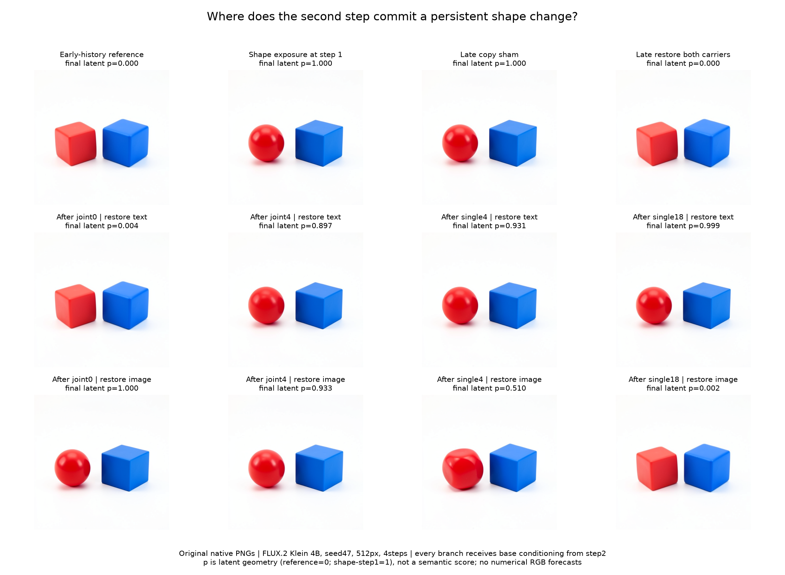

# Locating a second-step shape handoff

This follows the [shape-timing experiment](FLUX-SHAPE-TIMING.md). That experiment found a seed-47 case in which shape information at steps 0 and 1 together renders a red sphere and blue cube, and the result survives returning to base conditioning for steps 2 and 3. Initial shape text alone leaves two cube-like objects. The next question is where, within step 1, text-conditioned computation writes the persistent shape difference into image state.

## Controlled parents and futures

The specimen remains FLUX.2 Klein 4B distilled, checkpoint inventory `dd976d67036c4a0a55642f702dcb3740ba7a4f367557596572baac168330904f`, CUDA BF16, batch one, seed 47, 512 × 512, four steps, guidance 1. Previously authenticated encoder carriers and native first-step states are observed inputs. There is no new prompt encoding or training.

The two parents have identical image latent `Z1`, positions, schedule and execution point. Only persistent conditioning differs. Native projection at step 1 produces identical image features and time context but different working text. Call these the early-history reference `B` and shape-at-step1 reference `D`.

At exits from joint blocks 0 and 4 and single blocks 4 and 18, the instrument creates complementary hybrids:

```text
restore_text:  (T_B, I_D)
restore_image: (T_D, I_B)
```

Every branch resets stored conditioning to the same base value before the projection at step 2. This matters: continued shape-source reads at later steps cannot rescue a disrupted carrier or explain the difference between final images. Working text and image state are the declared intervention fields; all other state remains matched to the recipient at that cut.

Two references, eight single-field restorations, a late copy sham and a late both-carrier restoration produce twelve native images. The sham should reproduce `D` exactly. Restoring both carriers should reproduce `B` exactly under the common future source. Reference PNGs should exactly match the preceding experiment's `early` and `coherent.switch2` outcomes.

## Predictions and interpretation

The frozen early guess is that after joint0, text remains the influential carrier: base-text restoration should remove the sphere outcome while base-image restoration should retain it. The late guess reverses that pattern after single18. The two intermediate sites are exploratory localization points. Mixed shapes and categorical misses remain observations rather than being discarded.

Native images are the semantic consumer. Final latent projection along the `B` to `D` difference and full carrier differences are numerical diagnostics, not calibrated shape scores. Post-hoc assistant inspection supplies separate shape labels. This assay does not discover an object mask or isolate an MLP writer.

## Instrument and evidence

The [handoff worker](../qualification/flux_handoff_campaign.py) now accepts a step1 shape panel while retaining the earlier relation panel as its default. Public MDB navigation and Saturn Session, Act and LocalStore contracts provide projections, exact cuts, restoration and the future-source reset. A [dedicated submitter](../qualification/submit_flux_shape_handoff.py) authenticates the two scheduler-result parents from the preceding archive.

Nine installed-package tests outside the checkout pass: real tiny native projected-pair matching, common-source reset and exact sham/both-carrier closure, wrong-clock and changed-latent refusal, legacy dense-plan checks, and transaction/publisher regressions. The [offline auditor](../qualification/analyze_flux_handoff.py) checks typed closures, reset authority, source projection lineage, complete native receipt paths and arrays, image bytes and exact controls. The [publisher](../qualification/publish_flux_shape_handoff.py) uses original native PNGs and verified carrier arrays.

One finite CUDA lease loads the model once, shares captured prefixes in process, permits at most 1,100 transitions and twelve images, has an 840-second timeout and disables retries. Source and hypotheses are frozen before new transformer-block continuations or RGB outcomes. These are causal native futures with prospective hypotheses, not numerical forecasts of the twelve RGB images.

Producer job: `job-6a6fcb685a20`. [Raw run](../../../../artifacts/mdb-flux-shape-handoff-20261103/run-01). All twelve images completed, with 870 native transitions and 24 Acts. The job took `263.56` seconds; worker time through output preparation was `206.67` seconds. Reported peak RSS was `2,651.2` MB and peak VRAM `9,284` MB. These are telemetry observations, not a controlled speed or memory benchmark.

## Result: the two carriers overlap



All four exact control observations passed: the two references reproduce their historical PNGs, the copy sham reproduces the changed future in arrays and pixels, and restoring both carriers reproduces the base future in arrays and pixels. Independent custody/closure/path checks passed. Every branch's receipt path crosses the common conditioning reset exactly once. No model was run during audit or figure generation.

The table reports assistant inspection of the final red object. Blue remains cube-like and red stays left of blue in these images, with changes in pose, scale, curvature and lighting. Projection `p` uses the final latent difference between the two references; it is not a shape score.

| Last completed block | Restore base text; retain changed image | Final `p` | Restore base image; retain changed text | Final `p` |
|---|---|---:|---|---:|
| Joint0 | Cube-like | 0.003568 | Sphere | 0.999713 |
| Joint4 | Sphere | 0.896814 | Sphere | 0.933384 |
| Single4 | Sphere | 0.930794 | Mixed rounded/faceted cube-like shape | 0.510332 |
| Single18 | Sphere | 0.999055 | Cube-like | 0.002141 |

The four predeclared early/late categorical intervention expectations agree with this informal inspection. The four middle intervention outcomes were exploratory, and the other four images are references and exact controls. These are dependent branches from one context, not twelve independent prediction trials.

After joint0, restoring base text removes the sphere while restoring base image does not. By joint4, both complementary hybrids render spheres. Changed image state can sustain the sphere under base text; changed text can still recreate it from base image state. At single4 the latter hybrid is mixed, and by single18 it becomes cube-like. This is an interval of overlapping influence, followed by an image-dominated continuation, rather than one atomic exchange of ownership.

The overlap does not prove two independent copies of a semantic program. The remaining model can reconstruct state from a surviving carrier, and the compatibility of the hybrid matters. The observations establish sufficient whole-field combinations at declared cuts under a common later source. They do not establish minimality, independent redundancy, a universal clock, or a unique object address.

The single4 image-restoration row is a useful counterexample to a geometric classifier: its `p` exceeds one half, but its object is visibly faceted and mixed. We preserve that label instead of calling it a successful sphere merely from projection. The [visual review](../../../../artifacts/mdb-flux-shape-handoff-20261103/visual-review.json) explicitly records the uncalibrated, unblinded inspection instrument.

## What this says about the computation

The source projection, input image, latent, position and time context are matched at entry to step1. At all four captured boundaries the paired histories still have exactly equal context tensors, including their time modulation. Their working text and image values differ. The image-field L2 contrast relative to its base value rises from `3.83%` after joint0 to `14.33%` after joint4, `26.15%` after single4 and `43.95%` after single18. Text contrast also grows, from `12.31%` to `27.46%`, even though its ability to recover a clean sphere under image restoration eventually disappears.

Larger differences therefore do not by themselves identify greater causal authority. The causal test is what the native suffix can still do with each surviving state under the declared conditions. The same fixed mathematical writers act on different inputs and leave consequences whose carriers and recoverability change with depth. The recurrent source/read/write/consumer skeleton gives us a useful dynamic-circuit grammar; this experiment maps a bounded execution through it.

The first tested image-sufficient cut is joint4 here, compared with single4 in the earlier first-step relation panel. Seed, contrast and timestep all differ between those panels, so the comparison does not isolate which axis moved the boundary. It does show why a symbol-table entry needs its occurrence and receiving state alongside a physical module address.

The generic record [`flux.handoff.shape.step1.seed47`](../../../../artifacts/mdb-flux-shape-handoff-20261103/computation-record.json) stores the source-qualified carrier trajectory, signed numerical effects, controls, continuation and counterexamples. It is a curated standalone empirical record, not automatic atlas ingestion or a discovered neuron named “sphere.” Full [audited summary](../../../../artifacts/mdb-flux-shape-handoff-20261103/summary-v1.json) and [audit](../../../../artifacts/mdb-flux-shape-handoff-20261103/run-01/analysis-v1.json) remain available.

## The next causal cut

Image state becomes sufficient under base-text restoration somewhere between the exits of joint0 and joint4. Clean sphere recovery from changed text survives at joint4, becomes mixed by single4, and is absent by single18. Those are functional brackets, not isolated writer identities.

The next useful experiment moves inside joint1–4: observe their actual attention and image-MLP inputs/returns, intervene on candidate writes, and continue under the same future-source reset. This can distinguish first creation, accumulation, reader eligibility and downstream reconstruction. The mixed single4 row is a second useful target for testing how incompatible text/image histories combine, rather than forcing it into a binary handoff story.

The [completed single4 writer follow-up](FLUX-SHAPE-WRITER.md) takes that second target: eleven native futures factor residual, attention and MLP operands while retaining recipient text and the same later source reset. It finds a strong dependence on receiving state and an MLP-operand effect whose final sign reverses between receiving conditions. Both strong interventions remain visually mixed. That response refines this overlap map without identifying its first or minimal writer; the joint1–4 localization remains a separate next experiment.
