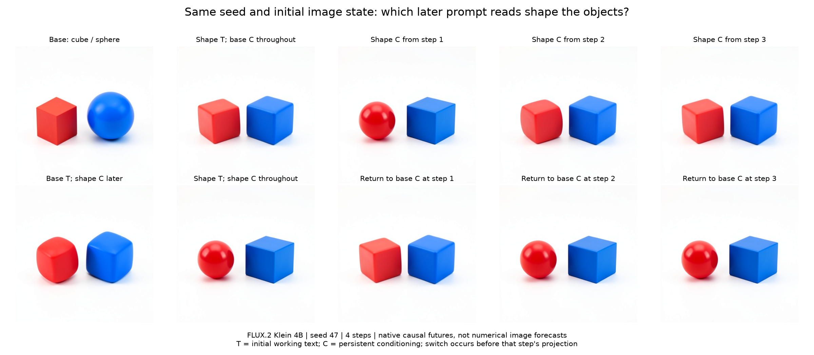

# Following object shape through repeated prompt reads

Completed: `job-61e7213615c9` produced all ten native images, with 784 transitions, 12 typed Acts, one model load and zero prompt encodings. The independent model-free audit passed. In seed 47, shape information during steps 0 and 1 together produces a red sphere that survives base conditioning at steps 2 and 3. Either early text alone or later conditioning alone leaves the red object cube-like, although the blue object becomes cube-like in both cases. This is a bounded temporal interaction, with a different historical seed-31 outcome retained below.

The first attempt, `job-52e1ac69f07e`, stopped before transformer-block continuations and images because its prediction callback returned the wrong envelope. Its raw job, logs and failure record remain preserved. Two intervening queued submissions were cancelled before model execution: one to remove an unnecessary forecast-cache RAM reservation, one to bind the result summary to its request identifier. The successful attempt retains identical scientific inputs and hypotheses.

## Why this cut

The [four numerical forecasts](FLUX-BRANCH-FORECASTS.md) exactly predicted a mixed semantic outcome at seed 47: replacing initial working text with the shape contrast changed the blue sphere into a cube, but left a rounded red cube-like object instead of the requested red sphere. Persistent conditioning stayed base. Numerical prediction reproduced the mixed result; it did not explain which writes created it.

Reviewing recent posts and their earlier foundations suggested four useful distinctions:

| Source | Hint for this experiment |
|---|---|
| [Mapping diffusion computations](../../../../obsidian/blog/2026-11-02-120355-mapping-diffusion-computations-with-a-dynamic-symbol-table.md) and [concept routes](FLUX-CONCEPT-ROUTES.md) | Working text and persistent conditioning have different consumption times. A carrier can disappear while its effect persists. |
| [Route replication](FLUX-ROUTE-REPLICATION.md) | Both receiving state and attention sources can control ordering under a fixed residual. Their roles require separate experiments. |
| [Symbol lifetimes](../../../../obsidian/blog/2026-10-28-004715-symbol-lifetimes-time-scaffolds-dynamic-circuits.md) | Record the source, writer, receiving state, timestep and consumer together; a physical address alone does not name an operation. |
| [The scene is a symbol table](../../../../obsidian/blog/2026-08-18-020404-the-scene-is-a-symbol-table-object-registry-and-edit-battery.md) and [the binding audit](../../../../obsidian/blog/2026-09-18-151427-the-relationship-survived-the-binding-has-not-been-tested.md) | Historical attribute and relationship interventions had different supports. Wrong addresses could edit the wrong object. Relation transfer did not establish correct instance binding. These historical claims are leads, not newly replicated results. |

Reinspection of the retained seed-31 concept panel gives a particularly direct clue. Its native shape reference shows a red sphere and blue cube. Initial shape working text with later base conditioning shows rounded cube-like objects. Introducing coherent shape conditioning at step 1 produces the red sphere and blue cube. This is informal inspection of existing images, preceding the new assay; it is not a new prospective prediction.

An additional model-free reanalysis verifies twelve saved scheduler arrays against their original manifest and recomputes their contrasts. Conditioning-only at step 0 and both-carrier replacement at step 1 remain exactly equal at all three shared scheduler endpoints. The final conditioning-only image has the requested sphere/cube shapes under inspection, while its projection from the early text-only endpoint toward the coherent endpoint is only `0.390753`. A threshold at one half would incorrectly turn that geometry into a semantic verdict. The [retrospective measurements](../../../../artifacts/mdb-flux-shape-timing-20261102/historical-reanalysis.json) retain the raw array hashes; no new model calls were made.

## The computation being separated

Write persistent conditioning as `C`, current working text as `T`, persistent image latent as `Z`, and timestep context as `τ`. Each projection forms:

```text
T_k = context_embedder(C_k)
I_k = x_embedder(Z_k)
τ_k = time-conditioned modulation and positions
Z_(k+1) = scheduler(Z_k, readout(blocks(T_k, I_k, τ_k)))
```

The implemented text projection itself does not read the image latent or timestep. The same conditioning enters a different receiving image state and time modulation on successive steps. That makes timing a concrete computational variable rather than a name attached to one fixed weight matrix.

In the initial text-only intervention, the first step consumes shape text but later projections consume base conditioning. In the coherent reference, every projection consumes shape conditioning. The first scheduler latent should be identical because both initial working texts and image states are identical and stored conditioning has not yet been reread. Subsequent divergence can then be attributed to the different source reads under that common first-step state.

MDB's installed adapter permits conditioning Acts at `project` boundaries and text/image Acts during transformer blocks. The assay follows that contract: initial source changes occur before projection, and the helper restores the declared working text afterward. Later source switches occur before the selected timestep's projection. It does not bypass the adapter's write checks.

## Frozen experiment

Specimen: FLUX.2 Klein 4B distilled, checkpoint inventory `dd976d67036c4a0a55642f702dcb3740ba7a4f367557596572baac168330904f`, CUDA BF16, batch one, 512 × 512, four steps, guidance 1, seed 47.

The base text asks for a red cube left of a blue sphere. Shape text asks for a red sphere left of a blue cube. Both retain the studio-photograph suffix. Previously authenticated encoder carriers supply these two conditions; there is no new prompt encoding or training.

Ten native futures:

- Base reference.
- Initial shape text with base conditioning throughout (`early`).
- Initial shape text with shape conditioning throughout (`coherent`).
- Initial base text with shape conditioning consumed on later steps (`source_only`).
- `early` histories switching to shape conditioning before step 1, 2 or 3.
- `coherent` histories switching back to base conditioning before step 1, 2 or 3.

Each switch forks a retained native parent from its own history. The pre-switch history is reused exactly. The consumer is the unchanged native denoiser, scheduler and VAE. Hypotheses are sealed before any transformer-block continuation or RGB outcome. These are prospective causal hypotheses followed by native futures, **not numerical forecasts of the ten images**.

The frozen hypotheses include exact first-step/replay controls, a clean coherent-shape reference, and two directional timing comparisons: switching earlier should move the final latent closer to the opposite conditioning endpoint than switching later. These comparisons can be wrong; their signed geometry and counterexamples will be retained. Latent distance is not a shape classifier.

## Observed results



The initial text-only (`early`) and coherent histories have exactly equal first scheduler latents. Their later source reads then separate their futures. Changing the source before step 1 exactly reconstructs the opposite complete future: all four scheduler arrays and PNG bytes match in both directions. The base and early PNGs also exactly reproduce the preceding seed-47 experiment.

Let `p` project the final latent along the difference from `early` (`p=0`) to `coherent` (`p=1`). This is numerical geometry, not a percentage of semantic success.

| Conditioning switch | Final `p` | Inspected red shape | Inspected blue shape |
|---|---:|---|---|
| Early → shape before step 1 | 1.000000 | Sphere | Cube |
| Early → shape before step 2 | 0.108295 | Rounded cube-like | Cube |
| Early → shape before step 3 | 0.005289 | Rounded cube-like | Cube |
| Coherent → base before step 1 | 0.000000 | Rounded cube-like | Cube |
| Coherent → base before step 2 | 0.972863 | Sphere | Cube |
| Coherent → base before step 3 | 0.996861 | Sphere | Cube |

Both frozen directional geometry comparisons are supported. Earlier introduction of shape conditioning at step 2 is closer to the coherent endpoint than introduction at step 3: L2 distances `151.901` versus `160.081`. Earlier return to base at step 2 is closer to the early endpoint than return at step 3: `158.971` versus `160.707`. The latter numerical difference does not correspond to a visible sphere-to-cube change; both red objects remain spherical under inspection.

The four exposure combinations reveal a useful asymmetry. The base renders a red cube and blue sphere. Shape working text only at step 0 renders two cube-like objects. Base working text at step 0 followed by shape conditioning renders rounded cube-like objects. Shape exposure during both early steps renders the red sphere and blue cube. Returning to base conditioning after those first two steps preserves that result. Object size, spacing, curvature, pose and illumination also vary; this is not selective editing at a discovered object address.

The working inference is that the first step prepares a receiving state on which the second step's text-conditioned computation can form the red sphere. The source-only branch starts step 1 from the base first-step state and does not produce that sphere. This supports a state-dependent temporal coalition in this seed. It does not establish a local Boolean AND operator or a universal two-read requirement: the historical seed-31 source-only branch does produce a red sphere. Initial state and history belong in the computation's applicability conditions.

These ten outcomes are dependent branches from one specimen, with two exact duplicate endpoint controls. Shape descriptions are post-hoc assistant inspection, not calibrated classifications or independent human labels. The [visual record](../../../../artifacts/mdb-flux-shape-timing-20261102/visual-review.json), [audited summary](../../../../artifacts/mdb-flux-shape-timing-20261102/summary-v1.json) and [curated computation record](../../../../artifacts/mdb-flux-shape-timing-20261102/computation-record.json) preserve those distinctions. The record `flux.shape.temporal-coalition.seed47` is standalone; automatic atlas ingestion and semantic naming remain open.

## Execution and evidence

The [worker](../qualification/flux_shape_timing.py) uses public Saturn Session, Act and LocalStore APIs plus MDB navigation and sealed transactions. The [submitter](../qualification/submit_flux_shape_timing.py) stages two complete authenticated source cuts and installed public runtime packages. One finite mrun CUDA lease loads the model once, shares prefixes in process, permits at most 800 transitions and ten PNGs, has an 840-second timeout and disables retries. Resource calibration comes from the preceding same-profile job.

Four installed-package tests verify unread-source timing and exact coherent reconstruction through a real tiny FLUX consumer, typed closure preservation and invalid-shape refusal, the production hypothesis helper's predict → seal → execute transaction, and a production-summary publish/collect round trip with request binding. They run outside the checkout. The last two were added after checking the first failure and publication interfaces. These are instrument checks rather than semantic evidence.

The [model-free auditor](../qualification/analyze_flux_shape_timing.py) passed archive, source identity, sealed hypothesis, typed-cut/Act, native receipt-path, scheduler-array and PNG checks. It recomputed the geometry with zero model calls. Complete arrays at retained project cuts additionally join their typed-state descriptors; final arrays and PNGs remain archive/source-bound native observations without VAE recomputation. The [publisher](../qualification/publish_flux_shape_timing.py) uses original native PNGs and audited geometry. Visual object descriptions remain separate informal inspection; no calibrated shape classifier is supplied. Exact sources and the [audit](../../../../artifacts/mdb-flux-shape-timing-20261102/run-04/analysis-v1.json) are retained beside the producer archive.

The successful scheduler job took `211.56` seconds, with `169.13` worker seconds through comparison/output preparation, and reported peaks of `2,201.5` MB RSS and `9,316` MB VRAM. These are telemetry observations under the recorded host conditions, not a controlled performance or memory benchmark.

Raw campaign: [failed attempt](../../../../artifacts/mdb-flux-shape-timing-20261102/run-01), [corrected attempt](../../../../artifacts/mdb-flux-shape-timing-20261102/run-04). Each immutable request binds its exact worker source. The initial failure took 61.58 seconds, peaked at 7,705 MB RSS and 8,084 MB VRAM, and produced no images. It is an instrument error, not a negative scientific observation. The active request reserves 16 GB RAM, calibrated against the earlier full native panel's 10.70 GB peak; it does not allocate the numerical forecaster's 7.81 GB trajectory cache.

A finite [collector](../../../../artifacts/mdb-flux-shape-timing-20261102/await_result.py) was intended to collect this one job and run pinned audit sources. Its progress stopped updating while queued, without an error file. After scheduler completion, collection and audit were recovered directly from the same job with no model rerun. The [incident record](../../../../artifacts/mdb-flux-shape-timing-20261102/collector-incident.json) preserves the stale progress snapshot. The cause of the background client's cessation is unestablished; a stale progress file did not establish that it remained active. Durable collection and explicit freshness checks remain a tooling improvement.

## An additional carrier-level clue

While the fresh assay waited, a [selected-port reanalysis](../../../../artifacts/mdb-flux-shape-timing-20261102/carrier-row-geometry.json) authenticated the original source manifests, slot pages, safetensors blobs and tensor descriptors for conditioning and projected text. It ran no models. Changing the relation, color assignment and shape assignment affected 504, 508 and 507 of 512 rows respectively in both carriers. Each changed support is a contiguous suffix, starting at row 8, 4 or 5. The largest 64 projected-text rows contain only 57.1%, 43.3% and 43.2% of their corresponding contrast energy.

These measurements favor treating the prompt-derived state as distributed contextual features when choosing candidates. They do not identify causal support or prove that all changed rows matter. Token labels and the padding boundary were not supplied to this analysis; late-row energy must not be renamed an object address without consumer tests. The next row-level experiment should compare selected supports with complementary and matched controls through native image outcomes.

## What remains unresolved

This cut localizes the source-sensitive red-shape change to the early two-step history in this specimen. It does not identify an object neuron, discover an instance address automatically, or isolate the responsible attention/MLP writer.

The smallest next causal cut compares the equal-latent histories at the start of step 1, then follows the text/image handoff within that step. Restore base conditioning in both histories before step 2, so the later suffix receives identical source inputs. Complementary text/image restores and selected attention/MLP port interventions can then identify which second-step writes create the persistent shape difference. The receiving latent at step 1 is matched; the native consumer, remaining schedule and later conditioning are controlled. This can distinguish a local writer from a carrier handoff without prematurely naming an MLP “red sphere.”

The [within-step follow-up](FLUX-SHAPE-HANDOFF.md) has now completed twelve native futures under that common later source. It finds overlapping text/image influence at joint4, an intermediate mixed shape at single4, and image-dominated continuation by single18. All four exact controls pass. Image sufficiency is bracketed between joint0 and joint4; individual attention/MLP writers remain unresolved.
